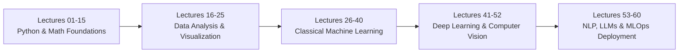

# 🧠 AI & Machine Learning Masterclass

[](https://www.python.org/)
[](https://jupyter.org/)
[](https://matplotlib.org/)
[](https://seaborn.pydata.org/)
[](#)
[](#)

🌐 **Language:** **English** | [हिंदी / Hinglish](README_HINGLISH.md)

A comprehensive, organized, and production-grade knowledge repository covering the complete **Artificial Intelligence & Machine Learning Journey (Lectures 00 to 60)**.

Each lecture module contains:
- 📝 **Structured Markdown Notes (`notes.md`)**: In-depth theoretical concepts, mathematical formulas, syntax breakdowns, and best practices.
- 📕 **High-Definition PDFs (`notes.pdf`)**: Formatted documents with rendered KaTeX formulas, tables, and Mermaid architecture diagrams for offline study.
- 💻 **Hands-On Jupyter Notebooks (`.ipynb`)**: Clean, reproducible, self-contained Python implementations with production-ready code examples.
- 📊 **Original Visuals & Diagrams**: High-clarity, code-generated diagrams and visual reference sheets.

---

## 📂 Repository Architecture

```plaintext
AI-ML/
├── .gitignore
├── README.md
├── lecture_00/                   # Course Orientation & Environment Setup
├── lecture_01/                   # Orientation, Python Foundations, VS Code & Setup
│   ├── Notes_01.01/ to 01.07/    # Sub-topics with README.md, README_HINGLISH.md, notes.pdf, .ipynb
│   └── Practice_Problems/        # Systems Engineering Case Studies (Questions & Solutions)
│       ├── Questions/            # README.md, questions.pdf, questions.ipynb
│       └── Solutions/            # README.md, solutions.pdf, solutions.ipynb, 300DPI plots
├── lecture_02/                   # Python Fundamentals (Part 1 - Syntax, Operators, Types & Input)
│   ├── Notes_02.01/ to 02.13/    # Sub-topics with README.md, README_HINGLISH.md, notes.pdf, .ipynb
│   └── Practice_Problems/        # 10 Assignment Problems + 3 Systems Case Studies
│       ├── Questions/            # README.md, questions.pdf, questions.ipynb
│       └── Solutions/            # README.md, solutions.pdf, solutions.ipynb, 300DPI plots
├── lecture_03/                   # Python Fundamentals (Part 2 - Conditionals, Loops & Functions)
│   ├── Notes_03.01/ to 03.18/    # Sub-topics with README.md, README_HINGLISH.md, notes.pdf, .ipynb
│   ├── Practice_Problems/        # 10 Assignment Problems + 3 Systems Case Studies
│   │   ├── Questions/            # README.md, questions.pdf, questions.ipynb
│   │   └── Solutions/            # README.md, solutions.pdf, solutions.ipynb, 300DPI plots
│   ├── Python_Fundamentals_Assignment2.pdf # Official Assignment Sheet
│   ├── Python_Fundamentals_Part2.pdf       # Official Slide Deck
│   └── Topic_List.jpg                     # Official Lecture Visual Index
├── lecture_04/                   # Python Fundamentals (Part 3 - Strings, Lists, Tuples, Dicts, Sets)
│   ├── Notes_04.01/ to 04.14/    # Sub-topics with README.md, README_HINGLISH.md, notes.pdf, .ipynb
│   ├── Practice_Problems/        # 10 Assignment Problems + 3 Systems Case Studies
│   │   ├── Questions/            # README.md, questions.pdf, questions.ipynb
│   │   └── Solutions/            # README.md, solutions.pdf, solutions.ipynb, 300DPI plots
│   └── Python_Fundamentals_Assignment3.pdf # Official Assignment Sheet
├── lecture_05/                   # Python Fundamentals (Part 4 - Object-Oriented Programming (OOP))
│   ├── Notes_05.01/ to 05.16/    # Sub-topics with README.md, README_HINGLISH.md, notes.pdf, .ipynb
│   ├── Practice_Problems/        # 10 Assignment Problems + 3 Systems Case Studies
│   │   ├── Questions/            # README.md, questions.pdf, questions.ipynb
│   │   └── Solutions/            # README.md, solutions.pdf, solutions.ipynb, 300DPI plots
│   ├── Python_Fundamentals_Assignment4.pdf # Official Assignment Sheet
│   ├── Python_Fundamentals_Part4.pdf       # Official Slide Deck
│   └── Chat_System_Code.pdf               # Official Chat System Reference
├── lecture_06/ ... lecture_17/   # (NumPy, Scientific Computing, Linear Algebra & Pandas)
├── lecture_18/                   # Data Visualization (Part 1 - Matplotlib Fundamentals)
│   ├── Notes_18.01/ to 18.18/    # Sub-topics with notes.md, notes.pdf, .ipynb
│   ├── Practice_Problems/        # Case Studies & Challenges (Questions & Solutions)
│   │   ├── Questions/            # questions.md, questions.pdf, questions.ipynb
│   │   └── Solutions/            # solutions.md, solutions.pdf, solutions.ipynb
├── lecture_19/                   # Data Visualization (Part 2 - Advanced Matplotlib & Seaborn)
│   ├── Notes_19.01/ to 19.16/    # Sub-topics with notes.md, notes.pdf, .ipynb, diagrams
│   └── reference_materials/      # Cheatsheets, slide notes & sample notebooks
├── lecture_20/                   # Mathematics for AI (Part 1 - Probability Theory)
│   ├── Notes_20.01/ to 20.20/    # Sub-topics with README.md, notes.pdf, .ipynb
│   └── Practice_Problems/        # Industry Case Studies (Questions & Solutions)
├── lecture_21/                   # Mathematics for AI (Part 2 - Linear Algebra Mastery)
│   ├── Notes_21.01/ to 21.15/    # Sub-topics with README.md, notes.pdf, .ipynb
│   └── Practice_Problems/        # Industry Case Studies (Questions & Solutions)
├── lecture_22/                   # Mathematics for AI (Part 3 - Calculus Mastery)
│   ├── Notes_22.01/ to 22.09/    # Sub-topics with README.md, notes.pdf, .ipynb
│   └── Practice_Problems/        # Industry Case Studies (Questions & Solutions)
├── lecture_23/                   # Machine Learning Foundations (Part 1 - Linear Regression)
│   ├── Notes_23.01/ to 23.14/    # Sub-topics with README.md, notes.pdf, .ipynb
│   └── Practice_Problems/        # Industry Case Studies (Questions & Solutions)
├── lecture_24/                   # Advanced Regression, Regularization & Logistic Regression
│   ├── Notes_24.01/ to 24.15/    # Sub-topics with README.md, notes.pdf, .ipynb
│   └── Practice_Problems/        # Industry Case Studies (Questions & Solutions)
├── lecture_25/                   # Classification Fundamentals, Naive Bayes, kNN & Pipelines
│   ├── Notes_25.01/ to 25.15/    # Sub-topics with README.md, notes.pdf, .ipynb
│   └── Practice_Problems/        # Industry Case Studies (Questions & Solutions)
├── lecture_26/                   # Scratch Implementations of ML Algorithms [ADD-ON]
│   ├── Notes_26.01/ to 26.12/    # Sub-topics with README.md, README_HINGLISH.md, notes.pdf, .ipynb
│   ├── Practice_Problems/        # 8 Core Implementations + 3 Systems Case Studies
│   │   ├── Questions/            # README.md, README_HINGLISH.md, questions.pdf, questions.ipynb
│   │   └── Solutions/            # README.md, README_HINGLISH.md, solutions.pdf, solutions.ipynb, 300DPI plots
│   ├── Section_Introduction.pdf  # Official Slide Deck
│   ├── 00_Day_29_Contents.jpg    # Verified Curriculum Syllabus
│   └── knn_scratch_original.ipynb # Original Reference Implementation
└── lecture_27/ ... lecture_60/   # (Tree Ensembles, Clustering, Deep Learning & LLMs)
```

---

## 📊 Detailed Module Breakdown

### 🚀 Day 01: Course Orientation, Python for AI/ML & VS Code Mastery
*Module Guides:* [📖 English Guide](lecture_01/README.md) \| [हिंदी / Hinglish Guide](lecture_01/README_HINGLISH.md)

Foundational orientation module introducing the Apna College AI/ML curriculum, the 5 core pillars of artificial intelligence, deep architectural rationale for choosing Python over C++/Java, local hardware and development tooling setup, official installation guides, and complete mastery of Visual Studio Code.

| Lecture | Topic Title | Core Concepts | Quick Links |
| :--- | :--- | :--- | :--- |
| **01.01** | Course Objective & AI/ML Revolution | Vision, deterministic vs probabilistic paradigm shift, industry benchmarks | [Notes](lecture_01/Notes_01.01/README.md) \| [PDF](lecture_01/Notes_01.01/notes.pdf) \| [Notebook](lecture_01/Notes_01.01/lecture_01_01.ipynb) |
| **01.02** | Curriculum Architecture: 5 Pillars of AI/ML | Foundations, Data Analysis, Classical ML, Deep Learning, Generative AI & MLOps | [Notes](lecture_01/Notes_01.02/README.md) \| [PDF](lecture_01/Notes_01.02/notes.pdf) \| [Notebook](lecture_01/Notes_01.02/lecture_01_02.ipynb) |
| **01.03** | Course Schedule, Pedagogy & Roadmap | First-principles engineering pedagogy, project-driven learning, milestones | [Notes](lecture_01/Notes_01.03/README.md) \| [PDF](lecture_01/Notes_01.03/notes.pdf) \| [Notebook](lecture_01/Notes_01.03/lecture_01_03.ipynb) |
| **01.04** | Why Choose Python for AI & Machine Learning? | Two-Language Problem, CPython C-extensions, SIMD vectorization, developer velocity | [Notes](lecture_01/Notes_01.04/README.md) \| [PDF](lecture_01/Notes_01.04/notes.pdf) \| [Notebook](lecture_01/Notes_01.04/lecture_01_04.ipynb) |
| **01.05** | Core Development Tools & Ecosystem Setup | Python interpreter, PATH mechanics, package managers, virtual environments | [Notes](lecture_01/Notes_01.05/README.md) \| [PDF](lecture_01/Notes_01.05/notes.pdf) \| [Notebook](lecture_01/Notes_01.05/lecture_01_05.ipynb) |
| **01.06** | Official Installation & Configuration Guide | Step-by-step walkthrough, verification commands, shell configuration | [Notes](lecture_01/Notes_01.06/README.md) \| [PDF](lecture_01/Notes_01.06/notes.pdf) \| [Notebook](lecture_01/Notes_01.06/lecture_01_06.ipynb) |
| **01.07** | Mastering VS Code for AI/ML Engineering | Keybindings, multi-cursor editing, Jupyter integration, kernel management | [Notes](lecture_01/Notes_01.07/README.md) \| [PDF](lecture_01/Notes_01.07/notes.pdf) \| [Notebook](lecture_01/Notes_01.07/lecture_01_07.ipynb) |

> [!TIP]
> **💡 Day 01 Comprehensive Systems & Performance Case Studies:**  
> *Module Guides:* [📖 English Guide](lecture_01/Practice_Problems/README.md) \| [हिंदी / Hinglish Guide](lecture_01/Practice_Problems/README_HINGLISH.md)  
> - 📋 **Problem Statements:** [Questions](lecture_01/Practice_Problems/Questions/README.md) \| [questions.pdf](lecture_01/Practice_Problems/Questions/questions.pdf) \| [Starter Notebook](lecture_01/Practice_Problems/Questions/questions.ipynb)
> - 💡 **Complete Solutions:** [Solutions](lecture_01/Practice_Problems/Solutions/README.md) \| [solutions.pdf](lecture_01/Practice_Problems/Solutions/solutions.pdf) \| [Executed Notebook](lecture_01/Practice_Problems/Solutions/solutions.ipynb)

---

### 🐍 Day 02: Python Fundamentals (Part 1 — Operators, Data Types & Input Pipeline)
*Module Guides:* [📖 English Guide](lecture_02/README.md) \| [हिंदी / Hinglish Guide](lecture_02/README_HINGLISH.md)

Comprehensive foundational guide covering Python syntax, dynamic pointer memory semantics, primitive and container data types, PEP 8 standards, binary and unary arithmetic operators, relational and assignment operators, Boolean logic, operator precedence, type casting invariants, user input parsing, and 10 official assignment problems.

| Lecture | Topic Title | Core Concepts | Quick Links |
| :--- | :--- | :--- | :--- |
| **02.01** | Our First Program | Standard output stream, `print()` signature (`sep`, `end`, `flush`), Unicode UTF-8 character set | [Notes](lecture_02/Notes_02.01/README.md) \| [PDF](lecture_02/Notes_02.01/notes.pdf) \| [Notebook](lecture_02/Notes_02.01/lecture_02_01.ipynb) |
| **02.02** | Variables in Python | Dynamic pointer references, namespace bindings, identifier rules, case-sensitivity | [Notes](lecture_02/Notes_02.02/README.md) \| [PDF](lecture_02/Notes_02.02/notes.pdf) \| [Notebook](lecture_02/Notes_02.02/lecture_02_02.ipynb) |
| **02.03** | Data Types in Python | `int`, `float`, `str`, `bool`, `NoneType`, `complex`, runtime type introspection with `type()` | [Notes](lecture_02/Notes_02.03/README.md) \| [PDF](lecture_02/Notes_02.03/notes.pdf) \| [Notebook](lecture_02/Notes_02.03/lecture_02_03.ipynb) |
| **02.04** | Keywords & Comments | CPython 35 reserved keywords, AST tokenizer rules, single-line `#`, docstrings (`__doc__`) | [Notes](lecture_02/Notes_02.04/README.md) \| [PDF](lecture_02/Notes_02.04/notes.pdf) \| [Notebook](lecture_02/Notes_02.04/lecture_02_04.ipynb) |
| **02.05** | Style Guide & Best Practices | PEP 8 architectural standards, 4-space indentation, `snake_case` naming conventions | [Notes](lecture_02/Notes_02.05/README.md) \| [PDF](lecture_02/Notes_02.05/notes.pdf) \| [Notebook](lecture_02/Notes_02.05/lecture_02_05.ipynb) |
| **02.06** | Arithmetic Operators | Binary/unary operators, true division (`/`), floor division (`//`), negative modulo invariants | [Notes](lecture_02/Notes_02.06/README.md) \| [PDF](lecture_02/Notes_02.06/notes.pdf) \| [Notebook](lecture_02/Notes_02.06/lecture_02_06.ipynb) |
| **02.07** | Relational Operators | Boolean order evaluations (`==`, `!=`, `<`, `>`, `<=`, `>=`), chained comparisons | [Notes](lecture_02/Notes_02.07/README.md) \| [PDF](lecture_02/Notes_02.07/notes.pdf) \| [Notebook](lecture_02/Notes_02.07/lecture_02_07.ipynb) |
| **02.08** | Assignment Operators | Simple vs compound assignment (`+=`, `-=`, etc.), in-place mutation, immutable rebinding | [Notes](lecture_02/Notes_02.08/README.md) \| [PDF](lecture_02/Notes_02.08/notes.pdf) \| [Notebook](lecture_02/Notes_02.08/lecture_02_08.ipynb) |
| **02.09** | Logical Operators | Boolean lattice algebra (`and`, `or`, `not`), truth tables, short-circuit execution guarantees | [Notes](lecture_02/Notes_02.09/README.md) \| [PDF](lecture_02/Notes_02.09/notes.pdf) \| [Notebook](lecture_02/Notes_02.09/lecture_02_09.ipynb) |
| **02.10** | Operator Precedence | Syntactic binding hierarchy, right-associativity of `**`, AST expression tree evaluation | [Notes](lecture_02/Notes_02.10/README.md) \| [PDF](lecture_02/Notes_02.10/notes.pdf) \| [Notebook](lecture_02/Notes_02.10/lecture_02_10.ipynb) |
| **02.11** | Type Conversion & Casting | Implicit type widening/promotion vs explicit type constructors (`int()`, `float()`, `str()`) | [Notes](lecture_02/Notes_02.11/README.md) \| [PDF](lecture_02/Notes_02.11/notes.pdf) \| [Notebook](lecture_02/Notes_02.11/lecture_02_11.ipynb) |
| **02.12** | Taking User Input | Standard input stream (`stdin`), `input()` contract, string return invariant, type parsing | [Notes](lecture_02/Notes_02.12/README.md) \| [PDF](lecture_02/Notes_02.12/notes.pdf) \| [Notebook](lecture_02/Notes_02.12/lecture_02_12.ipynb) |
| **02.13** | Average of 2 Numbers & Synthesis | End-to-end algorithmic synthesis, numerical formula implementation, edge-case mitigation | [Notes](lecture_02/Notes_02.13/README.md) \| [PDF](lecture_02/Notes_02.13/notes.pdf) \| [Notebook](lecture_02/Notes_02.13/lecture_02_13.ipynb) |

> [!TIP]
> **💡 Day 02 Comprehensive Practice & Case Studies Suite:**  
> *Module Guides:* [📖 English Guide](lecture_02/Practice_Problems/README.md) \| [हिंदी / Hinglish Guide](lecture_02/Practice_Problems/README_HINGLISH.md)  
> - 📋 **Problem Statements (10 Assignment Problems + 3 Case Studies):** [Questions](lecture_02/Practice_Problems/Questions/README.md) \| [questions.pdf](lecture_02/Practice_Problems/Questions/questions.pdf) \| [Starter Notebook](lecture_02/Practice_Problems/Questions/questions.ipynb)
> - 💡 **Complete Solutions & Proofs:** [Solutions](lecture_02/Practice_Problems/Solutions/README.md) \| [solutions.pdf](lecture_02/Practice_Problems/Solutions/solutions.pdf) \| [Executed Notebook](lecture_02/Practice_Problems/Solutions/solutions.ipynb)

---

---

---

### 🔀 Day 03: Python Fundamentals (Part 2 — Conditional Statements, Loops & Functions)
*Module Guides:* [📖 English Guide](lecture_03/README.md) \| [हिंदी / Hinglish Guide](lecture_03/README_HINGLISH.md)

Comprehensive foundational module covering control flow branching (`if`, `elif`, `else`), decision trees, Python 3.10+ Structural Pattern Matching (`match ... case`), indefinite iteration (`while`), definite sequence traversal (`for`), iterator protocols, `range()` sequence types, modular function architecture (`def`, scope, `PyFrameObject`), lambda closures, recursion mechanics, and complete solutions to the 10 official Assignment 2 problems with 3 systems engineering case studies.

| Lecture | Topic Title | Core Concepts | Quick Links |
| :--- | :--- | :--- | :--- |
| **03.01** | Conditional Statements in Python | Control flow branching, if/elif/else syntax, truth value testing, Boolean lattices | [Notes](lecture_03/Notes_03.01/README.md) \| [PDF](lecture_03/Notes_03.01/notes.pdf) \| [Notebook](lecture_03/Notes_03.01/lecture_03_01.ipynb) |
| **03.02** | Practice Examples (Conditionals) | Driving license eligibility, academic grading brackets, tax threshold boundaries | [Notes](lecture_03/Notes_03.02/README.md) \| [PDF](lecture_03/Notes_03.02/notes.pdf) \| [Notebook](lecture_03/Notes_03.02/lecture_03_02.ipynb) |
| **03.03** | Odd or Even (Parity Checking) | Parity invariants, modulo arithmetic ($x \pmod 2$), low-level bitwise masking ($x \mathbin{\&} 1$) | [Notes](lecture_03/Notes_03.03/README.md) \| [PDF](lecture_03/Notes_03.03/notes.pdf) \| [Notebook](lecture_03/Notes_03.03/lecture_03_03.ipynb) |
| **03.04** | Nesting (Decision Trees) | Hierarchical branching, cyclomatic complexity $M = E - N + 2P$, guard clause refactoring | [Notes](lecture_03/Notes_03.04/README.md) \| [PDF](lecture_03/Notes_03.04/notes.pdf) \| [Notebook](lecture_03/Notes_03.04/lecture_03_04.ipynb) |
| **03.05** | Match Case in Python | PEP 634 Structural Pattern Matching, literal/capture/wildcard patterns, pattern guards | [Notes](lecture_03/Notes_03.05/README.md) \| [PDF](lecture_03/Notes_03.05/notes.pdf) \| [Notebook](lecture_03/Notes_03.05/lecture_03_05.ipynb) |
| **03.06** | Loops Using While | Indefinite iteration, loop invariants, state mutations, monotonic termination proofs | [Notes](lecture_03/Notes_03.06/README.md) \| [PDF](lecture_03/Notes_03.06/notes.pdf) \| [Notebook](lecture_03/Notes_03.06/lecture_03_06.ipynb) |
| **03.07** | Practice Examples (Loops) | Counter-controlled loops, accumulators, sentinel loops, successive division digit extraction | [Notes](lecture_03/Notes_03.07/README.md) \| [PDF](lecture_03/Notes_03.07/notes.pdf) \| [Notebook](lecture_03/Notes_03.07/lecture_03_07.ipynb) |
| **03.08** | Multiplication Table of N | Arithmetic progressions $a_i = N \cdot i$, columnar formatting, range iteration | [Notes](lecture_03/Notes_03.08/README.md) \| [PDF](lecture_03/Notes_03.08/notes.pdf) \| [Notebook](lecture_03/Notes_03.08/lecture_03_08.ipynb) |
| **03.09** | Break & Continue Control Flow | Early loop exit (`break`), iteration skip (`continue`), syntactic placeholder (`pass`), loop `else` | [Notes](lecture_03/Notes_03.09/README.md) \| [PDF](lecture_03/Notes_03.09/notes.pdf) \| [Notebook](lecture_03/Notes_03.09/lecture_03_09.ipynb) |
| **03.10** | Loops Using For (Iterator Protocol) | Definite iteration, iterable vs iterator distinction, `iter()`, `next()`, `StopIteration` | [Notes](lecture_03/Notes_03.10/README.md) \| [PDF](lecture_03/Notes_03.10/notes.pdf) \| [Notebook](lecture_03/Notes_03.10/lecture_03_10.ipynb) |
| **03.11** | Vowel Count (Stream Filtering) | Character stream traversal, vowel set membership testing, case normalization | [Notes](lecture_03/Notes_03.11/README.md) \| [PDF](lecture_03/Notes_03.11/notes.pdf) \| [Notebook](lecture_03/Notes_03.11/lecture_03_11.ipynb) |
| **03.12** | The range() Function | Immutable sequence arithmetic progression, lazy generation, constant $\mathcal{O}(1)$ space | [Notes](lecture_03/Notes_03.12/README.md) \| [PDF](lecture_03/Notes_03.12/notes.pdf) \| [Notebook](lecture_03/Notes_03.12/lecture_03_12.ipynb) |
| **03.13** | Sum of N Numbers | Loop accumulation $\mathcal{O}(N)$ vs Gauss closed-form formula $\frac{N(N+1)}{2}$ in $\mathcal{O}(1)$ | [Notes](lecture_03/Notes_03.13/README.md) \| [PDF](lecture_03/Notes_03.13/notes.pdf) \| [Notebook](lecture_03/Notes_03.13/lecture_03_13.ipynb) |
| **03.14** | Functions in Python | Function definition, parameters vs arguments, return values, call stack `PyFrameObject` | [Notes](lecture_03/Notes_03.14/README.md) \| [PDF](lecture_03/Notes_03.14/notes.pdf) \| [Notebook](lecture_03/Notes_03.14/lecture_03_014.ipynb) |
| **03.15** | Practice Examples (Functions) | Modular decomposition, pure deterministic functions, side-effect elimination | [Notes](lecture_03/Notes_03.15/README.md) \| [PDF](lecture_03/Notes_03.15/notes.pdf) \| [Notebook](lecture_03/Notes_03.15/lecture_03_15.ipynb) |
| **03.16** | Types of Functions & Arguments | Built-in vs user-defined, positional/keyword arguments, default values, `*args`, `**kwargs` | [Notes](lecture_03/Notes_03.16/README.md) \| [PDF](lecture_03/Notes_03.16/notes.pdf) \| [Notebook](lecture_03/Notes_03.16/lecture_03_16.ipynb) |
| **03.17** | Lambda Functions (Anonymous) | Alonzo Church $\lambda$-calculus, single-expression syntax, inline callbacks (`map`, `filter`) | [Notes](lecture_03/Notes_03.17/README.md) \| [PDF](lecture_03/Notes_03.17/notes.pdf) \| [Notebook](lecture_03/Notes_03.17/lecture_03_17.ipynb) |
| **03.18** | Factorial of N (Iterative vs Recursive) | Factorial definition $N!$, iterative product $\mathcal{O}(1)$ vs recursive call stack $\mathcal{O}(N)$ | [Notes](lecture_03/Notes_03.18/README.md) \| [PDF](lecture_03/Notes_03.18/notes.pdf) \| [Notebook](lecture_03/Notes_03.18/lecture_03_18.ipynb) |

> [!TIP]
> **💡 Day 03 Comprehensive Practice & Case Studies Suite:**  
> *Module Guides:* [📖 English Guide](lecture_03/Practice_Problems/README.md) \| [हिंदी / Hinglish Guide](lecture_03/Practice_Problems/README_HINGLISH.md)  
> - 📋 **Problem Statements (10 Assignment Problems + 3 Case Studies):** [Questions](lecture_03/Practice_Problems/Questions/README.md) \| [questions.pdf](lecture_03/Practice_Problems/Questions/questions.pdf) \| [Starter Notebook](lecture_03/Practice_Problems/Questions/questions.ipynb)
> - 💡 **Complete Solutions & Proofs:** [Solutions](lecture_03/Practice_Problems/Solutions/README.md) \| [solutions.pdf](lecture_03/Practice_Problems/Solutions/solutions.pdf) \| [Executed Notebook](lecture_03/Practice_Problems/Solutions/solutions.ipynb)

### 📦 Day 04: Python Data Structures (Strings, Lists, Tuples, Dictionaries, Sets & Assignment 3)
*Module Guides:* [📖 English Guide](lecture_04/README.md) \| [हिंदी / Hinglish Guide](lecture_04/README_HINGLISH.md)

Comprehensive deep-dive into Python's primary sequence, mapping, and set data structures: Unicode string immutability, slicing mechanics, dynamic array over-allocation in CPython lists, immutable structural packing of tuples, compact hash table architecture in dictionaries, set algebraic theory, and complete solutions to the 10 official Assignment 3 problems alongside 3 systems engineering case studies.

| Lecture | Topic Title | Core Concepts | Quick Links |
| :--- | :--- | :--- | :--- |
| **04.01** | Strings in Python | Creation, Unicode UTF-8 representation, string immutability, zero-based indexing, `len()` invariant | [Notes](lecture_04/Notes_04.01/README.md) \| [PDF](lecture_04/Notes_04.01/notes.pdf) \| [Notebook](lecture_04/Notes_04.01/lecture_04_01.ipynb) |
| **04.02** | Slicing in Strings | Step slicing (`[start:stop:step]`), negative indexing, step reversals (`[::-1]`), boundary defaults | [Notes](lecture_04/Notes_04.02/README.md) \| [PDF](lecture_04/Notes_04.02/notes.pdf) \| [Notebook](lecture_04/Notes_04.02/lecture_04_02.ipynb) |
| **04.03** | String Formatting | Formatted string literals (f-strings), `str.format()`, `%` formatting, floating-point alignment & precision | [Notes](lecture_04/Notes_04.03/README.md) \| [PDF](lecture_04/Notes_04.03/notes.pdf) \| [Notebook](lecture_04/Notes_04.03/lecture_04_03.ipynb) |
| **04.04** | Lists in Python | Dynamic arrays, array of pointer references, over-allocation growth geometry, mutability semantics | [Notes](lecture_04/Notes_04.04/README.md) \| [PDF](lecture_04/Notes_04.04/notes.pdf) \| [Notebook](lecture_04/Notes_04.04/lecture_04_04.ipynb) |
| **04.05** | List Methods | Sequence mutation (`append`, `extend`, `insert`, `remove`, `pop`, `clear`), in-place Timsort (`sort`) | [Notes](lecture_04/Notes_04.05/README.md) \| [PDF](lecture_04/Notes_04.05/notes.pdf) \| [Notebook](lecture_04/Notes_04.05/lecture_04_05.ipynb) |
| **04.06** | Loops with Lists | Iteration patterns (`for`, `while`), index tracking with `enumerate()`, parallel iteration (`zip()`), list comprehensions | [Notes](lecture_04/Notes_04.06/README.md) \| [PDF](lecture_04/Notes_04.06/notes.pdf) \| [Notebook](lecture_04/Notes_04.06/lecture_04_06.ipynb) |
| **04.07** | Tuples in Python | Structural immutability, pointer safety, hashability, memory compaction over dynamic lists | [Notes](lecture_04/Notes_04.07/README.md) \| [PDF](lecture_04/Notes_04.07/notes.pdf) \| [Notebook](lecture_04/Notes_04.07/lecture_04_07.ipynb) |
| **04.08** | Tuple Methods & Unpacking | `count()`, `index()`, sequence destructuring, extended starred unpacking (`*rest`), swap idiom | [Notes](lecture_04/Notes_04.08/README.md) \| [PDF](lecture_04/Notes_04.08/notes.pdf) \| [Notebook](lecture_04/Notes_04.08/lecture_04_08.ipynb) |
| **04.09** | Dictionaries in Python | Hash table mappings, key uniqueness, hashability invariant, amortized $\mathcal{O}(1)$ CRUD operations | [Notes](lecture_04/Notes_04.09/README.md) \| [PDF](lecture_04/Notes_04.09/notes.pdf) \| [Notebook](lecture_04/Notes_04.09/lecture_04_09.ipynb) |
| **04.10** | Dictionary Methods | View objects (`keys()`, `values()`, `items()`), defensive lookups (`get()`, `setdefault()`), bulk update (`update()`) | [Notes](lecture_04/Notes_04.10/README.md) \| [PDF](lecture_04/Notes_04.10/notes.pdf) \| [Notebook](lecture_04/Notes_04.10/lecture_04_10.ipynb) |
| **04.11** | Sets in Python | Unordered unique collections, hash table lookup, membership testing ($x \in S$), mathematical set axioms | [Notes](lecture_04/Notes_04.11/README.md) \| [PDF](lecture_04/Notes_04.11/notes.pdf) \| [Notebook](lecture_04/Notes_04.11/lecture_04_11.ipynb) |
| **04.12** | Set Methods & Operations | Set algebra (Union `|`, Intersection `&`, Difference `-`, Symmetric Difference `^`), disjoint testing | [Notes](lecture_04/Notes_04.12/README.md) \| [PDF](lecture_04/Notes_04.12/notes.pdf) \| [Notebook](lecture_04/Notes_04.12/lecture_04_12.ipynb) |
| **04.13** | In-Class Practice (Part 1) | Common elements detection across sequences, tokenized word frequency counters | [Notes](lecture_04/Notes_04.13/README.md) \| [PDF](lecture_04/Notes_04.13/notes.pdf) \| [Notebook](lecture_04/Notes_04.13/lecture_04_013.ipynb) |
| **04.14** | In-Class Practice (Part 2) | Dictionary inversion, multi-value collision grouping, bipartite relation mappings | [Notes](lecture_04/Notes_04.14/README.md) \| [PDF](lecture_04/Notes_04.14/notes.pdf) \| [Notebook](lecture_04/Notes_04.14/lecture_04_014.ipynb) |

> [!TIP]
> **💡 Day 04 Comprehensive Practice & Case Studies Suite:**  
> *Module Guides:* [📖 English Guide](lecture_04/Practice_Problems/README.md) \| [हिंदी / Hinglish Guide](lecture_04/Practice_Problems/README_HINGLISH.md)  
> - 📋 **Problem Statements (10 Assignment Problems + 3 Case Studies):** [Questions](lecture_04/Practice_Problems/Questions/README.md) \| [questions.pdf](lecture_04/Practice_Problems/Questions/questions.pdf) \| [Starter Notebook](lecture_04/Practice_Problems/Questions/questions.ipynb)
> - 💡 **Complete Solutions & Proofs:** [Solutions](lecture_04/Practice_Problems/Solutions/README.md) \| [solutions.pdf](lecture_04/Practice_Problems/Solutions/solutions.pdf) \| [Executed Notebook](lecture_04/Practice_Problems/Solutions/solutions.ipynb)

### 🏛️ Day 05: Python Fundamentals (Part 4 — Object-Oriented Programming (OOP))
*Module Guides:* [📖 English Guide](lecture_05/README.md) | [हिंदी / Hinglish Guide](lecture_05/README_HINGLISH.md)

Comprehensive production-grade guide to Object-Oriented Programming in Python: Class & instance namespaces, `__init__()` constructor mechanics, classmethods & staticmethods, information hiding & encapsulation via `@property` and name mangling, single/multiple/hierarchical inheritance with cooperative `super()`, diamond inheritance and C3 Linearization (MRO), Abstract Base Classes (`abc`), polymorphism, method overriding, duck typing, special dunder protocols, and full solutions to the 10 official Assignment 4 problems alongside 3 systems engineering case studies and the production Chat System project.

| Lecture | Topic Title | Core Concepts | Quick Links |
| :--- | :--- | :--- | :--- |
| **05.01** | What is Object-Oriented Programming (OOP)? | Procedural vs OOP paradigms, state & behavior bundling, clean architecture | [Notes](lecture_05/Notes_05.01/README.md) \| [PDF](lecture_05/Notes_05.01/notes.pdf) \| [Notebook](lecture_05/Notes_05.01/lecture_05_01.ipynb) |
| **05.02** | Classes & Objects in Python | `class` blueprint syntax, instance instantiation, object identities (`id()`), heap memory allocation | [Notes](lecture_05/Notes_05.02/README.md) \| [PDF](lecture_05/Notes_05.02/notes.pdf) \| [Notebook](lecture_05/Notes_05.02/lecture_05_02.ipynb) |
| **05.03** | Attributes & Methods in Python | Instance namespace (`__dict__`), class namespace mapping, method dispatch | [Notes](lecture_05/Notes_05.03/README.md) \| [PDF](lecture_05/Notes_05.03/notes.pdf) \| [Notebook](lecture_05/Notes_05.03/lecture_05_03.ipynb) |
| **05.04** | Constructor — The `__init__()` Method | Dual-phase creation protocol (`__new__` allocator vs `__init__` initializer), instance state binding | [Notes](lecture_05/Notes_05.04/README.md) \| [PDF](lecture_05/Notes_05.04/notes.pdf) \| [Notebook](lecture_05/Notes_05.04/lecture_05_04.ipynb) |
| **05.05** | Types of Constructors & Overloading | Default vs parameterized constructors, method overloading emulation via defaults and `@classmethod` | [Notes](lecture_05/Notes_05.05/README.md) \| [PDF](lecture_05/Notes_05.05/notes.pdf) \| [Notebook](lecture_05/Notes_05.05/lecture_05_05.ipynb) |
| **05.06** | Attributes — Class vs Instance Scope | Class variable shared memory, instance variable shadowing, mutable class attribute mutation traps | [Notes](lecture_05/Notes_05.06/README.md) \| [PDF](lecture_05/Notes_05.06/notes.pdf) \| [Notebook](lecture_05/Notes_05.06/lecture_05_06.ipynb) |
| **05.07** | Instance Methods | Explicit `self` parameter binding, bound method objects, descriptor invocation protocol | [Notes](lecture_05/Notes_05.07/README.md) \| [PDF](lecture_05/Notes_05.07/notes.pdf) \| [Notebook](lecture_05/Notes_05.07/lecture_05_07.ipynb) |
| **05.08** | Class Methods (`@classmethod`) | Class-level binding via `cls`, alternate constructors/factories, polymorphic instantiation | [Notes](lecture_05/Notes_05.08/README.md) \| [PDF](lecture_05/Notes_05.08/notes.pdf) \| [Notebook](lecture_05/Notes_05.08/lecture_05_08.ipynb) |
| **05.09** | Static Methods (`@staticmethod`) | Isolated utility functions, decoupled namespaces, static helpers without `self` or `cls` | [Notes](lecture_05/Notes_05.09/README.md) \| [PDF](lecture_05/Notes_05.09/notes.pdf) \| [Notebook](lecture_05/Notes_05.09/lecture_05_09.ipynb) |
| **05.10** | Practice Problem: In-Class Banking System | Transaction validation invariants, atomic state transitions, boundary condition safeguards | [Notes](lecture_05/Notes_05.10/README.md) \| [PDF](lecture_05/Notes_05.10/notes.pdf) \| [Notebook](lecture_05/Notes_05.10/lecture_05_10.ipynb) |
| **05.11** | Encapsulation & Access Control | Public, protected (`_attr`), private (`__attr`), name mangling (`_Class__attr`), `@property` descriptors | [Notes](lecture_05/Notes_05.11/README.md) \| [PDF](lecture_05/Notes_05.11/notes.pdf) \| [Notebook](lecture_05/Notes_05.11/lecture_05_11.ipynb) |
| **05.12** | Inheritance Mechanics & Super Proxy | Base and derived classes, code reuse, cooperative multiple inheritance with `super()` proxy | [Notes](lecture_05/Notes_05.12/README.md) \| [PDF](lecture_05/Notes_05.12/notes.pdf) \| [Notebook](lecture_05/Notes_05.12/lecture_05_12.ipynb) |
| **05.13** | Taxonomy of Inheritance & C3 Linearization | Single, Multilevel, Multiple, Hierarchical & Hybrid inheritance, C3 MRO monotonic resolution | [Notes](lecture_05/Notes_05.13/README.md) \| [PDF](lecture_05/Notes_05.13/notes.pdf) \| [Notebook](lecture_05/Notes_05.13/lecture_05_13.ipynb) |
| **05.14** | Abstraction & Abstract Base Classes (ABCs) | Formal interface contracts, `abc.ABC`, `@abstractmethod`, preventing partial class instantiations | [Notes](lecture_05/Notes_05.14/README.md) \| [PDF](lecture_05/Notes_05.14/notes.pdf) \| [Notebook](lecture_05/Notes_05.14/lecture_05_14.ipynb) |
| **05.15** | Polymorphism — Method Overriding | Runtime dynamic method dispatch, polymorphic substitution, specialized subclass behavior | [Notes](lecture_05/Notes_05.15/README.md) \| [PDF](lecture_05/Notes_05.15/notes.pdf) \| [Notebook](lecture_05/Notes_05.15/lecture_05_15.ipynb) |
| **05.16** | Polymorphism — Duck Typing & Dunder Protocols | Structural typing ("quacks like a duck"), Python protocols (`__len__`, `__getitem__`, `__str__`, `__repr__`) | [Notes](lecture_05/Notes_05.16/README.md) \| [PDF](lecture_05/Notes_05.16/notes.pdf) \| [Notebook](lecture_05/Notes_05.16/lecture_05_16.ipynb) |

> [!TIP]
> **💡 Day 05 Comprehensive Practice & Case Studies Suite:**  
> *Module Guides:* [📖 English Guide](lecture_05/Practice_Problems/README.md) \| [हिंदी / Hinglish Guide](lecture_05/Practice_Problems/README_HINGLISH.md)  
> - 📋 **Problem Statements (10 Assignment Problems + 3 Case Studies):** [Questions](lecture_05/Practice_Problems/Questions/README.md) \| [questions.pdf](lecture_05/Practice_Problems/Questions/questions.pdf) \| [Starter Notebook](lecture_05/Practice_Problems/Questions/questions.ipynb)
> - 💡 **Complete Solutions & Proofs:** [Solutions](lecture_05/Practice_Problems/Solutions/README.md) \| [solutions.pdf](lecture_05/Practice_Problems/Solutions/solutions.pdf) \| [Executed Notebook](lecture_05/Practice_Problems/Solutions/solutions.ipynb)


### 🎨 Day 18: Data Visualization (Part 1 — Matplotlib Mastery)
*Module Guides:* [📖 English Guide](lecture_18/README.md) \| [हिंदी / Hinglish Guide](lecture_18/README_HINGLISH.md)

Focuses on data visualization theory, the anatomy of plots, and core 2D plotting with **Matplotlib**.

| Lecture | Topic Title | Core Concepts | Quick Links |
| :--- | :--- | :--- | :--- |
| **18.01** | What is Data Visualization? | Visual perception, exploratory vs explanatory, Anscombe's Quartet | [Notes](lecture_18/Notes_18.01/README.md) \| [PDF](lecture_18/Notes_18.01/notes.pdf) \| [Notebook](lecture_18/Notes_18.01/lecture_18_01.ipynb) |
| **18.02** | How to Plot Data - Basic Structure | Coordinate systems, Data Prep $\to$ Canvas $\to$ Plot $\to$ Decoration $\to$ Render | [Notes](lecture_18/Notes_18.02/README.md) \| [PDF](lecture_18/Notes_18.02/notes.pdf) \| [Notebook](lecture_18/Notes_18.02/lecture_18_02.ipynb) |
| **18.03** | Introduction to Matplotlib | Matplotlib history, architecture (`backend`, `artist`, `scripting`), Pyplot interface | [Notes](lecture_18/Notes_18.03/README.md) \| [PDF](lecture_18/Notes_18.03/notes.pdf) \| [Notebook](lecture_18/Notes_18.03/lecture_18_03.ipynb) |
| **18.04** | Important Plot Methods | `plt.plot()`, `plt.title()`, `plt.xlabel()`, `plt.ylabel()`, `plt.grid()`, `plt.show()` | [Notes](lecture_18/Notes_18.04/README.md) \| [PDF](lecture_18/Notes_18.04/notes.pdf) \| [Notebook](lecture_18/Notes_18.04/lecture_18_04.ipynb) |
| **18.05** | Multiple Datasets on Line Plot | Multi-series plotting, legends (`plt.legend`), color differentiation, z-order | [Notes](lecture_18/Notes_18.05/README.md) \| [PDF](lecture_18/Notes_18.05/notes.pdf) \| [Notebook](lecture_18/Notes_18.05/lecture_18_05.ipynb) |
| **18.06** | Format Strings (`fmt`) | Fast syntax `[marker][line][color]`, e.g., `'ro--'`, `'b^:'`, hex colors | [Notes](lecture_18/Notes_18.06/README.md) \| [PDF](lecture_18/Notes_18.06/notes.pdf) \| [Notebook](lecture_18/Notes_18.06/lecture_18_06.ipynb) |
| **18.07** | Styling & Saving Plots | Figure sizing (`figsize`), DPI scaling, `plt.savefig()` (PNG, SVG, PDF), styling themes | [Notes](lecture_18/Notes_18.07/README.md) \| [PDF](lecture_18/Notes_18.07/notes.pdf) \| [Notebook](lecture_18/Notes_18.07/lecture_18_07.ipynb) |
| **18.08** | Chart Selection Taxonomy | Choosing the right chart: Comparison, Distribution, Composition, Relationship | [Notes](lecture_18/Notes_18.08/README.md) \| [PDF](lecture_18/Notes_18.08/notes.pdf) \| [Notebook](lecture_18/Notes_18.08/lecture_18_08.ipynb) |
| **18.09** | Vertical Bar Charts (`plt.bar`) | Categorical discrete comparison, bar width, alignment, edge styling | [Notes](lecture_18/Notes_18.09/README.md) \| [PDF](lecture_18/Notes_18.09/notes.pdf) \| [Notebook](lecture_18/Notes_18.09/lecture_18_09.ipynb) |
| **18.10** | Adding Labels to Bars | Direct data labels via `plt.text()` & `ax.bar_label()` container iteration | [Notes](lecture_18/Notes_18.10/README.md) \| [PDF](lecture_18/Notes_18.10/notes.pdf) \| [Notebook](lecture_18/Notes_18.10/lecture_18_10.ipynb) |
| **18.11** | Grouped Bar Charts | Offset indexing with NumPy `np.arange()`, width offset calculations | [Notes](lecture_18/Notes_18.11/README.md) \| [PDF](lecture_18/Notes_18.11/notes.pdf) \| [Notebook](lecture_18/Notes_18.11/lecture_18_11.ipynb) |
| **18.12** | Horizontal Bar Charts (`plt.barh`) | Long categorical labels, ranking, inverted axis sorting | [Notes](lecture_18/Notes_18.12/README.md) \| [PDF](lecture_18/Notes_18.12/notes.pdf) \| [Notebook](lecture_18/Notes_18.12/lecture_18_12.ipynb) |
| **18.13** | Scatter Plots (`plt.scatter`) | Bivariate relationships, correlation, scatter vs line performance | [Notes](lecture_18/Notes_18.13/README.md) \| [PDF](lecture_18/Notes_18.13/notes.pdf) \| [Notebook](lecture_18/Notes_18.13/lecture_18_13.ipynb) |
| **18.14** | Advanced Scatter Customizations | 4D visual encoding: Marker size (`s`), color mapping (`c`, `cmap`), alpha transparency | [Notes](lecture_18/Notes_18.14/README.md) \| [PDF](lecture_18/Notes_18.14/notes.pdf) \| [Notebook](lecture_18/Notes_18.14/lecture_18_14.ipynb) |
| **18.15** | Annotations on Scatter Plots | Point labeling via `plt.annotate()`, bounding boxes, arrows (`arrowprops`) | [Notes](lecture_18/Notes_18.15/README.md) \| [PDF](lecture_18/Notes_18.15/notes.pdf) \| [Notebook](lecture_18/Notes_18.15/lecture_18_15.ipynb) |
| **18.16** | Multiple Datasets on Scatter Plots | Multi-class scatter plots, category-wise legend separation | [Notes](lecture_18/Notes_18.16/README.md) \| [PDF](lecture_18/Notes_18.16/notes.pdf) \| [Notebook](lecture_18/Notes_18.16/lecture_18_16.ipynb) |
| **18.17** | Pie Charts (`plt.pie`) | Composition plotting, `autopct`, `startangle`, shadow, limitations | [Notes](lecture_18/Notes_18.17/README.md) \| [PDF](lecture_18/Notes_18.17/notes.pdf) \| [Notebook](lecture_18/Notes_18.17/lecture_18_17.ipynb) |
| **18.18** | Advanced Pie Charts | Donut charts (center circle wedge), `explode` slices, custom palettes | [Notes](lecture_18/Notes_18.18/README.md) \| [PDF](lecture_18/Notes_18.18/notes.pdf) \| [Notebook](lecture_18/Notes_18.18/lecture_18_18.ipynb) |


> [!TIP]
> **🧪 Day 18 Comprehensive Case Studies & Practice Problem Set:**  
> *Module Guides:* [📖 English Guide](lecture_18/Practice_Problems/README.md) \| [हिंदी / Hinglish Guide](lecture_18/Practice_Problems/README_HINGLISH.md)  
> - 📝 **Problem Statements:** [Questions](lecture_18/Practice_Problems/Questions/README.md) \| [questions.pdf](lecture_18/Practice_Problems/Questions/questions.pdf) \| [Starter Notebook](lecture_18/Practice_Problems/Questions/questions.ipynb)
> - 💡 **Complete Solutions:** [Solutions](lecture_18/Practice_Problems/Solutions/README.md) \| [solutions.pdf](lecture_18/Practice_Problems/Solutions/solutions.pdf) \| [Executed Notebook](lecture_18/Practice_Problems/Solutions/solutions.ipynb)

---

### 📈 Day 19: Data Visualization (Part 2 — Advanced Matplotlib & Seaborn)
*Module Guides:* [📖 English Guide](lecture_19/README.md) \| [हिंदी / Hinglish Guide](lecture_19/README_HINGLISH.md)

Advanced statistical visualizations, distributions, five-number summary, object-oriented Matplotlib API, and high-level **Seaborn** statistical graphics.

| Lecture | Topic Title | Core Concepts | Quick Links |
| :--- | :--- | :--- | :--- |
| **19.01** | Histograms (`plt.hist`) | Continuous distribution, bin count & width, density normalization, skewness | [Notes](lecture_19/Notes_19.01/README.md) \| [PDF](lecture_19/Notes_19.01/notes.pdf) \| [Notebook](lecture_19/Notes_19.01/lecture_19_01.ipynb) |
| **19.02** | Multiple Datasets on Histogram | Side-by-side vs stacked histograms, overlapping distributions with alpha | [Notes](lecture_19/Notes_19.02/README.md) \| [PDF](lecture_19/Notes_19.02/notes.pdf) \| [Notebook](lecture_19/Notes_19.02/lecture_19_02.ipynb) |
| **19.03** | Vertical Reference Lines (`plt.axvline`) | Statistical threshold benchmarks: Mean, Median, Mode lines & annotations | [Notes](lecture_19/Notes_19.03/README.md) \| [PDF](lecture_19/Notes_19.03/notes.pdf) \| [Notebook](lecture_19/Notes_19.03/lecture_19_03.ipynb) |
| **19.04** | Box Plots (Five-Number Summary) | Tukey's 5-number summary ($Q_1, Q_2, Q_3, \text{IQR}$), $1.5 \times \text{IQR}$ outlier detection | [Notes](lecture_19/Notes_19.04/README.md) \| [PDF](lecture_19/Notes_19.04/notes.pdf) \| [Notebook](lecture_19/Notes_19.04/lecture_19_04.ipynb) |
| **19.05** | Advanced Box Plot Operations | Notched box plots (median confidence), horizontal orientation, custom flier props | [Notes](lecture_19/Notes_19.05/README.md) \| [PDF](lecture_19/Notes_19.05/notes.pdf) \| [Notebook](lecture_19/Notes_19.05/lecture_19_05.ipynb) |
| **19.06** | Stack Plots (Area Charts) | Cumulative part-to-whole trends over time via `plt.stackplot()` | [Notes](lecture_19/Notes_19.06/README.md) \| [PDF](lecture_19/Notes_19.06/notes.pdf) \| [Notebook](lecture_19/Notes_19.06/lecture_19_06.ipynb) |
| **19.07** | Subplots in Matplotlib | Multi-panel figures via `plt.subplot()` and `plt.subplots()`, `tight_layout()` | [Notes](lecture_19/Notes_19.07/README.md) \| [PDF](lecture_19/Notes_19.07/notes.pdf) \| [Notebook](lecture_19/Notes_19.07/lecture_19_07.ipynb) |
| **19.08** | Modern Matplotlib (Object-Oriented API) | Explicit `fig, ax = plt.subplots()`, axis methods (`ax.set_*()`), cleaner engineering | [Notes](lecture_19/Notes_19.08/README.md) \| [PDF](lecture_19/Notes_19.08/notes.pdf) \| [Notebook](lecture_19/Notes_19.08/lecture_19_08.ipynb) |
| **19.09** | Practice Task: Weekly Weather Analysis | Multi-axis dual plotting ($Y_1$ temperature line, $Y_2$ precipitation bars) | [Notes](lecture_19/Notes_19.09/README.md) \| [PDF](lecture_19/Notes_19.09/notes.pdf) \| [Notebook](lecture_19/Notes_19.09/lecture_19_09.ipynb) |
| **19.10** | Introduction to Seaborn | High-level statistical visualization library, themes (`darkgrid`, `whitegrid`), Pandas integration | [Notes](lecture_19/Notes_19.10/README.md) \| [PDF](lecture_19/Notes_19.10/notes.pdf) \| [Notebook](lecture_19/Notes_19.10/lecture_19_10.ipynb) |
| **19.11** | Creating Plots with Seaborn | Semantic mapping attributes: `x`, `y`, `hue`, `style`, `size`, `palette` | [Notes](lecture_19/Notes_19.11/README.md) \| [PDF](lecture_19/Notes_19.11/notes.pdf) \| [Notebook](lecture_19/Notes_19.11/lecture_19_11.ipynb) |
| **19.12** | Relational Plots in Seaborn | Figure-level `sns.relplot()`, `sns.scatterplot()`, `sns.lineplot()`, faceting (`col`, `row`) | [Notes](lecture_19/Notes_19.12/README.md) \| [PDF](lecture_19/Notes_19.12/notes.pdf) \| [Notebook](lecture_19/Notes_19.12/lecture_19_12.ipynb) |
| **19.13** | Categorical Plots in Seaborn | Figure-level `sns.catplot()`, `sns.barplot()` (with CI error bars), `sns.boxplot()`, `violinplot` | [Notes](lecture_19/Notes_19.13/README.md) \| [PDF](lecture_19/Notes_19.13/notes.pdf) \| [Notebook](lecture_19/Notes_19.13/lecture_19_13.ipynb) |
| **19.14** | Distribution Plots in Seaborn | Figure-level `sns.displot()`, Kernel Density Estimation (`kdeplot`), `histplot`, `rugplot` | [Notes](lecture_19/Notes_19.14/README.md) \| [PDF](lecture_19/Notes_19.14/notes.pdf) \| [Notebook](lecture_19/Notes_19.14/lecture_19_14.ipynb) |
| **19.15** | Relational & Matrix Plots: Heatmaps | `sns.heatmap()`, correlation matrix (`df.corr()`), `annot=True`, diverging colormaps | [Notes](lecture_19/Notes_19.15/README.md) \| [PDF](lecture_19/Notes_19.15/notes.pdf) \| [Notebook](lecture_19/Notes_19.15/lecture_19_15.ipynb) |
| **19.16** | Best Practices for Data Visualization | Edward Tufte principles (Data-Ink ratio, chartjunk), color accessibility, chart ethics | [Notes](lecture_19/Notes_19.16/README.md) \| [PDF](lecture_19/Notes_19.16/notes.pdf) \| [Notebook](lecture_19/Notes_19.16/lecture_19_16.ipynb) |


> [!TIP]
> **🧪 Day 19 Comprehensive Case Studies & Practice Problem Set:**  
> *Module Guides:* [📖 English Guide](lecture_19/Practice_Problems/README.md) \| [हिंदी / Hinglish Guide](lecture_19/Practice_Problems/README_HINGLISH.md)  
> - 📝 **Problem Statements:** [Questions](lecture_19/Practice_Problems/Questions/README.md) \| [questions.pdf](lecture_19/Practice_Problems/Questions/questions.pdf) \| [Starter Notebook](lecture_19/Practice_Problems/Questions/questions.ipynb)
> - 💡 **Complete Solutions:** [Solutions](lecture_19/Practice_Problems/Solutions/README.md) \| [solutions.pdf](lecture_19/Practice_Problems/Solutions/solutions.pdf) \| [Executed Notebook](lecture_19/Practice_Problems/Solutions/solutions.ipynb)

### 🎲 Day 20: Mathematics for AI (Part 1 — Probability Theory)
*Module Guides:* [📖 English Guide](lecture_20/README.md) | [हिंदी / Hinglish Guide](lecture_20/README_HINGLISH.md)

Rigorous mathematical foundations of probability for AI & Machine Learning: Kolmogorov axioms, conditional probability, Bayes' Theorem, random variables, expectation, variance, and parametric distributions (Binomial, Uniform, Gaussian).

| Lecture | Topic Title | Core Concepts | Quick Links |
| :--- | :--- | :--- | :--- |
| **20.01** | Math for AI & Why Probability Matters | Uncertainty quantification, MLE, cross-entropy, generative modeling | [Notes](lecture_20/Notes_20.01/README.md) \| [PDF](lecture_20/Notes_20.01/notes.pdf) \| [Notebook](lecture_20/Notes_20.01/lecture_20_01.ipynb) |
| **20.02** | Core Foundations of Probability | Random experiments, sample space, events, Kolmogorov's 3 axioms | [Notes](lecture_20/Notes_20.02/README.md) \| [PDF](lecture_20/Notes_20.02/notes.pdf) \| [Notebook](lecture_20/Notes_20.02/lecture_20_02.ipynb) |
| **20.03** | Classical vs. Empirical Probability | Theoretical symmetry, frequentist relative frequency, Law of Large Numbers | [Notes](lecture_20/Notes_20.03/README.md) \| [PDF](lecture_20/Notes_20.03/notes.pdf) \| [Notebook](lecture_20/Notes_20.03/lecture_20_03.ipynb) |
| **20.04** | Foundation Probability Practice Problems | Combinatorics, permutations $P(n,k)$, combinations $C(n,k)$, counting rules | [Notes](lecture_20/Notes_20.04/README.md) \| [PDF](lecture_20/Notes_20.04/notes.pdf) \| [Notebook](lecture_20/Notes_20.04/lecture_20_04.ipynb) |
| **20.05** | Types of Events | Mutually exclusive vs independent events, exhaustive events, partitions | [Notes](lecture_20/Notes_20.05/README.md) \| [PDF](lecture_20/Notes_20.05/notes.pdf) \| [Notebook](lecture_20/Notes_20.05/lecture_20_05.ipynb) |
| **20.06** | The Complementary Rule | Complement $P(A') = 1 - P(A)$, De Morgan's laws, at-least-one calculations | [Notes](lecture_20/Notes_20.06/README.md) \| [PDF](lecture_20/Notes_20.06/notes.pdf) \| [Notebook](lecture_20/Notes_20.06/lecture_20_06.ipynb) |
| **20.07** | The Addition Rule of Probability | General addition rule, double-counting correction, inclusion-exclusion | [Notes](lecture_20/Notes_20.07/README.md) \| [PDF](lecture_20/Notes_20.07/notes.pdf) \| [Notebook](lecture_20/Notes_20.07/lecture_20_07.ipynb) |
| **20.08** | The Multiplication Rule of Probability | Joint intersection, dependent vs independent, probability chain rule | [Notes](lecture_20/Notes_20.08/README.md) \| [PDF](lecture_20/Notes_20.08/notes.pdf) \| [Notebook](lecture_20/Notes_20.08/lecture_20_08.ipynb) |
| **20.09** | Probability Rules Practice Problems | Series vs parallel system reliability, fault tolerance, urn problems | [Notes](lecture_20/Notes_20.09/README.md) \| [PDF](lecture_20/Notes_20.09/notes.pdf) \| [Notebook](lecture_20/Notes_20.09/lecture_20_09.ipynb) |
| **20.10** | Conditional Probability | Reduced sample space, $P(A \mid B) = \frac{P(A \cap B)}{P(B)}$, contingency tables | [Notes](lecture_20/Notes_20.10/README.md) \| [PDF](lecture_20/Notes_20.10/notes.pdf) \| [Notebook](lecture_20/Notes_20.10/lecture_20_10.ipynb) |
| **20.11** | The Law of Total Probability | Sample space partition, marginalization, total defect calculations | [Notes](lecture_20/Notes_20.11/README.md) \| [PDF](lecture_20/Notes_20.11/notes.pdf) \| [Notebook](lecture_20/Notes_20.11/lecture_20_11.ipynb) |
| **20.12** | Bayes' Theorem | Prior, likelihood, marginal evidence, posterior belief updating | [Notes](lecture_20/Notes_20.12/README.md) \| [PDF](lecture_20/Notes_20.12/notes.pdf) \| [Notebook](lecture_20/Notes_20.12/lecture_20_12.ipynb) |
| **20.13** | Bayes' Theorem Practice Problems | Medical diagnosis paradox, base rate fallacy, false positives in AI | [Notes](lecture_20/Notes_20.13/README.md) \| [PDF](lecture_20/Notes_20.13/notes.pdf) \| [Notebook](lecture_20/Notes_20.13/lecture_20_13.ipynb) |
| **20.14** | Random Variables | Mapping $X: \mathcal{S} \to \mathbb{R}$, discrete vs continuous, PMF, PDF, CDF | [Notes](lecture_20/Notes_20.14/README.md) \| [PDF](lecture_20/Notes_20.14/notes.pdf) \| [Notebook](lecture_20/Notes_20.14/lecture_20_14.ipynb) |
| **20.15** | Mean, Median & Mode | Expected value $\mathbb{E}[X]$, linearity of expectation, skewness impact | [Notes](lecture_20/Notes_20.15/README.md) \| [PDF](lecture_20/Notes_20.15/notes.pdf) \| [Notebook](lecture_20/Notes_20.15/lecture_20_15.ipynb) |
| **20.16** | Variance & Standard Deviation | Dispersion $\text{Var}(X) = \mathbb{E}[(X-\mu)^2]$, shortcut $\mathbb{E}[X^2] - (\mathbb{E}[X])^2$ | [Notes](lecture_20/Notes_20.16/README.md) \| [PDF](lecture_20/Notes_20.16/notes.pdf) \| [Notebook](lecture_20/Notes_20.16/lecture_20_16.ipynb) |
| **20.17** | Probability Distributions & its Types | Discrete vs continuous families, PMF/PDF properties, AI loss mapping | [Notes](lecture_20/Notes_20.17/README.md) \| [PDF](lecture_20/Notes_20.17/notes.pdf) \| [Notebook](lecture_20/Notes_20.17/lecture_20_17.ipynb) |
| **20.18** | Binomial Distribution | Bernoulli trials, PMF $\binom{n}{k} p^k (1-p)^{n-k}$, mean $np$, variance $np(1-p)$ | [Notes](lecture_20/Notes_20.18/README.md) \| [PDF](lecture_20/Notes_20.18/notes.pdf) \| [Notebook](lecture_20/Notes_20.18/lecture_20_18.ipynb) |
| **20.19** | Uniform Distribution | Constant density $\mathcal{U}(a, b)$, PDF $\frac{1}{b-a}$, mean $\frac{a+b}{2}$, variance $\frac{(b-a)^2}{12}$ | [Notes](lecture_20/Notes_20.19/README.md) \| [PDF](lecture_20/Notes_20.19/notes.pdf) \| [Notebook](lecture_20/Notes_20.19/lecture_20_19.ipynb) |
| **20.20** | Normal Distribution | Bell curve PDF, 68-95-99.7 rule, Z-score standardization, CLT connection | [Notes](lecture_20/Notes_20.20/README.md) \| [PDF](lecture_20/Notes_20.20/notes.pdf) \| [Notebook](lecture_20/Notes_20.20/lecture_20_20.ipynb) |


> [!TIP]
> **🧪 Day 20 Comprehensive Case Studies & Practice Problem Set:**  
> *Module Guides:* [📖 English Guide](lecture_20/Practice_Problems/README.md) | [हिंदी / Hinglish Guide](lecture_20/Practice_Problems/README_HINGLISH.md)  
> - 📝 **Problem Statements:** [Questions](lecture_20/Practice_Problems/Questions/README.md) | [questions.pdf](lecture_20/Practice_Problems/Questions/questions.pdf) | [Starter Notebook](lecture_20/Practice_Problems/Questions/questions.ipynb)
> - 💡 **Complete Solutions:** [Solutions](lecture_20/Practice_Problems/Solutions/README.md) | [solutions.pdf](lecture_20/Practice_Problems/Solutions/solutions.pdf) | [Executed Notebook](lecture_20/Practice_Problems/Solutions/solutions.ipynb)

### 📐 Day 21: Mathematics for AI (Part 2 — Linear Algebra Mastery)
*Module Guides:* [📖 English Guide](lecture_21/README.md) | [हिंदी / Hinglish Guide](lecture_21/README_HINGLISH.md)

Rigorous mathematical foundations of Linear Algebra for AI, Machine Learning & Deep Learning: Vectors, matrices, tensors, inner products, norms, span, basis, rank, determinants, Gaussian elimination, Moore-Penrose pseudo-inverses, Gram-Schmidt orthogonalization, QR decomposition, eigenvalues, eigenvectors, symmetric spectral theorem, Singular Value Decomposition (SVD), PCA, and Deep Learning attention mechanisms (LoRA).

| Lecture | Topic Title | Core Concepts | Quick Links |
| :--- | :--- | :--- | :--- |
| **21.01** | Vectors, Scalars, Matrices & Tensors | Tensor rank hierarchy (0D to 4D), row/column vectors, batch tensors | [Notes](lecture_21/Notes_21.01/README.md) \| [PDF](lecture_21/Notes_21.01/notes.pdf) \| [Notebook](lecture_21/Notes_21.01/lecture_21_01.ipynb) |
| **21.02** | Vector Operations & Geometric Intuition | Vector addition, scalar multiplication, $\ell_1$ & $\ell_2$ norms, cosine similarity | [Notes](lecture_21/Notes_21.02/README.md) \| [PDF](lecture_21/Notes_21.02/notes.pdf) \| [Notebook](lecture_21/Notes_21.02/lecture_21_02.ipynb) |
| **21.03** | Matrix Operations & Special Matrices | Addition, scaling, transposes, symmetric, diagonal, identity, orthogonal matrices | [Notes](lecture_21/Notes_21.03/README.md) \| [PDF](lecture_21/Notes_21.03/notes.pdf) \| [Notebook](lecture_21/Notes_21.03/lecture_21_03.ipynb) |
| **21.04** | Matrix Multiplication & AI Forward Passes | Dot products vs outer products, linear composition, batch gemm $\mathcal{O}(mnp)$ | [Notes](lecture_21/Notes_21.04/README.md) \| [PDF](lecture_21/Notes_21.04/notes.pdf) \| [Notebook](lecture_21/Notes_21.04/lecture_21_04.ipynb) |
| **21.05** | Linear Combinations, Span & Basis | Linear combinations, span subspaces, linear independence, canonical basis | [Notes](lecture_21/Notes_21.05/README.md) \| [PDF](lecture_21/Notes_21.05/notes.pdf) \| [Notebook](lecture_21/Notes_21.05/lecture_21_05.ipynb) |
| **21.06** | Linear Independence & Matrix Rank | Row/column rank, rank-nullity theorem, full rank vs rank deficiency | [Notes](lecture_21/Notes_21.06/README.md) \| [PDF](lecture_21/Notes_21.06/notes.pdf) \| [Notebook](lecture_21/Notes_21.06/lecture_21_06.ipynb) |
| **21.07** | Determinants & Geometric Singularity | Oriented volume scaling, Laplace expansion, invertibility criterion $\det(A) \ne 0$ | [Notes](lecture_21/Notes_21.07/README.md) \| [PDF](lecture_21/Notes_21.07/notes.pdf) \| [Notebook](lecture_21/Notes_21.07/lecture_21_07.ipynb) |
| **21.08** | Systems of Linear Equations & Gaussian Elimination | Augmented matrix, forward elimination, back-substitution, REF & RREF | [Notes](lecture_21/Notes_21.08/README.md) \| [PDF](lecture_21/Notes_21.08/notes.pdf) \| [Notebook](lecture_21/Notes_21.08/lecture_21_08.ipynb) |
| **21.09** | Matrix Inverses & Moore-Penrose Pseudo-Inverse | Gauss-Jordan inversion, overdetermined systems, pseudo-inverse $A^+$, Least Squares | [Notes](lecture_21/Notes_21.09/README.md) \| [PDF](lecture_21/Notes_21.09/notes.pdf) \| [Notebook](lecture_21/Notes_21.09/lecture_21_09.ipynb) |
| **21.10** | Orthogonality, Orthonormality & Projections | Orthogonal projections, Gram-Schmidt orthogonalization, QR decomposition | [Notes](lecture_21/Notes_21.10/README.md) \| [PDF](lecture_21/Notes_21.10/notes.pdf) \| [Notebook](lecture_21/Notes_21.10/lecture_21_10.ipynb) |
| **21.11** | Eigenvalues & Eigenvectors | Invariant directions, characteristic equation $\det(A - \lambda I) = 0$, eigenspaces | [Notes](lecture_21/Notes_21.11/README.md) \| [PDF](lecture_21/Notes_21.11/notes.pdf) \| [Notebook](lecture_21/Notes_21.11/lecture_21_11.ipynb) |
| **21.12** | Diagonalization & Spectral Theorem | Modal matrix $P$, similarity transformation $A = P \Lambda P^{-1}$, symmetric spectral theorem | [Notes](lecture_21/Notes_21.12/README.md) \| [PDF](lecture_21/Notes_21.12/notes.pdf) \| [Notebook](lecture_21/Notes_21.12/lecture_21_12.ipynb) |
| **21.13** | Singular Value Decomposition (SVD) | Rectangular factorization $A = U \Sigma V^T$, Eckart-Young low-rank theorem | [Notes](lecture_21/Notes_21.13/README.md) \| [PDF](lecture_21/Notes_21.13/notes.pdf) \| [Notebook](lecture_21/Notes_21.13/lecture_21_13.ipynb) |
| **21.14** | Principal Component Analysis (PCA) via Linear Algebra | Covariance matrix $\mathbf{\Sigma}$, spectral projection, scree plot, dimensionality reduction | [Notes](lecture_21/Notes_21.14/README.md) \| [PDF](lecture_21/Notes_21.14/notes.pdf) \| [Notebook](lecture_21/Notes_21.14/lecture_21_14.ipynb) |
| **21.15** | Linear Algebra in Deep Learning & Attention | Dense layers, im2col gemm convolution, Transformer Scaled Dot-Product Attention, LoRA | [Notes](lecture_21/Notes_21.15/README.md) \| [PDF](lecture_21/Notes_21.15/notes.pdf) \| [Notebook](lecture_21/Notes_21.15/lecture_21_15.ipynb) |

> [!TIP]
> **🧪 Day 21 Comprehensive Case Studies & Practice Problem Set:**  
> *Module Guides:* [📖 English Guide](lecture_21/Practice_Problems/README.md) | [हिंदी / Hinglish Guide](lecture_21/Practice_Problems/README_HINGLISH.md)  
> - 📝 **Problem Statements:** [Questions](lecture_21/Practice_Problems/Questions/README.md) | [questions.pdf](lecture_21/Practice_Problems/Questions/questions.pdf) | [Starter Notebook](lecture_21/Practice_Problems/Questions/questions.ipynb)
> - 💡 **Complete Solutions:** [Solutions](lecture_21/Practice_Problems/Solutions/README.md) | [solutions.pdf](lecture_21/Practice_Problems/Solutions/solutions.pdf) | [Executed Notebook](lecture_21/Practice_Problems/Solutions/solutions.ipynb)

### 📉 Day 22: Mathematics for AI (Part 3 — Calculus Mastery)
*Module Guides:* [📖 English Guide](lecture_22/README.md) | [हिंदी / Hinglish Guide](lecture_22/README_HINGLISH.md)

Rigorous mathematical foundations of Calculus for AI, Machine Learning & Deep Learning: Functions, composite functions, function arithmetic, vertical/horizontal transformations, limit definition of derivative, differentiation rules, activation derivatives (Sigmoid, Tanh, ReLU), critical points, concavity tests, and Gradient Descent optimization.

| Lecture | Topic Title | Core Concepts | Quick Links |
| :--- | :--- | :--- | :--- |
| **22.01** | Introduction to Calculus for AI & Continuous Change | Continuous change, differential vs integral, parameter sensitivity, loss minimization | [Notes](lecture_22/Notes_22.01/README.md) \| [PDF](lecture_22/Notes_22.01/notes.pdf) \| [Notebook](lecture_22/Notes_22.01/lecture_22_01.ipynb) |
| **22.02** | Mathematical Functions & Real-World Transformations | Domain, codomain, range, root functions, sinusoids, exponentials, logs in AI | [Notes](lecture_22/Notes_22.02/README.md) \| [PDF](lecture_22/Notes_22.02/notes.pdf) \| [Notebook](lecture_22/Notes_22.02/lecture_22_02.ipynb) |
| **22.03** | Composite Functions & Deep Neural Architectures | Function composition $(f \circ g)(x)$, nested deep neural network forward pass, non-commutativity | [Notes](lecture_22/Notes_22.03/README.md) \| [PDF](lecture_22/Notes_22.03/notes.pdf) \| [Notebook](lecture_22/Notes_22.03/lecture_22_03.ipynb) |
| **22.04** | Operations on Functions: Scalar Multiplication & Addition | Vertical stretch, compression, shift, reflection, linear combinations, residual connections | [Notes](lecture_22/Notes_22.04/README.md) \| [PDF](lecture_22/Notes_22.04/notes.pdf) \| [Notebook](lecture_22/Notes_22.04/lecture_22_04.ipynb) |
| **22.05** | Input Transformations: Scaling & Shifts | Horizontal shifts, horizontal scaling, affine input maps ($z = w x + b$), standardization | [Notes](lecture_22/Notes_22.05/README.md) \| [PDF](lecture_22/Notes_22.05/notes.pdf) \| [Notebook](lecture_22/Notes_22.05/lecture_22_05.ipynb) |
| **22.06** | Differentiation & Instantaneous Rate of Change | Secant to tangent limit, derivative definition, first-principles proofs, Taylor linear approximation | [Notes](lecture_22/Notes_22.06/README.md) \| [PDF](lecture_22/Notes_22.06/notes.pdf) \| [Notebook](lecture_22/Notes_22.06/lecture_22_06.ipynb) |
| **22.07** | Differentiation Rules & Activation Derivatives | Power, product, quotient, chain rule. Derivations of Sigmoid, Tanh, ReLU derivatives | [Notes](lecture_22/Notes_22.07/README.md) \| [PDF](lecture_22/Notes_22.07/notes.pdf) \| [Notebook](lecture_22/Notes_22.07/lecture_22_07.ipynb) |
| **22.08** | Finding Minima & Maxima | Critical points, First & Second Derivative Tests, concavity, Gradient Descent algorithm | [Notes](lecture_22/Notes_22.08/README.md) \| [PDF](lecture_22/Notes_22.08/notes.pdf) \| [Notebook](lecture_22/Notes_22.08/lecture_22_08.ipynb) |
| **22.09** | Calculus Optimization Practice Problem | Analytical derivation of $f(x) = x^3 - 6x^2 + 9x$, critical points, double derivative test, extrema | [Notes](lecture_22/Notes_22.09/README.md) \| [PDF](lecture_22/Notes_22.09/notes.pdf) \| [Notebook](lecture_22/Notes_22.09/lecture_22_09.ipynb) |

> [!TIP]
> **🧪 Day 22 Comprehensive Case Studies & Practice Problem Set:**  
> *Module Guides:* [📖 English Guide](lecture_22/Practice_Problems/README.md) | [हिंदी / Hinglish Guide](lecture_22/Practice_Problems/README_HINGLISH.md)  
> - 📝 **Problem Statements:** [Questions](lecture_22/Practice_Problems/Questions/README.md) | [questions.pdf](lecture_22/Practice_Problems/Questions/questions.pdf) | [Starter Notebook](lecture_22/Practice_Problems/Questions/questions.ipynb)
> - 💡 **Complete Solutions:** [Solutions](lecture_22/Practice_Problems/Solutions/README.md) | [solutions.pdf](lecture_22/Practice_Problems/Solutions/solutions.pdf) | [Executed Notebook](lecture_22/Practice_Problems/Solutions/solutions.ipynb)

---

### 🤖 Day 23: Machine Learning & Linear Regression Foundations
*Module Guides:* [📖 English Guide](lecture_23/README.md) | [हिंदी / Hinglish Guide](lecture_23/README_HINGLISH.md)

Rigorous theoretical foundations of Supervised Machine Learning and **Linear Regression**: Arthur Samuel & Tom Mitchell definitions, ML paradigms, Supervised ML workflow, Generalization error & Bias-Variance tradeoff, Regression vs Classification, Scikit-Learn API architecture (Estimators, Transformers, Predictors), Linear Hypothesis line & hyperplane geometry, Ordinary Least Squares (OLS) residual derivation, Mean Squared Error (MSE) cost function, strict convexity & contour geometry, Vectorized Gradient Descent optimization, learning rate dynamics, analytical Normal Equation vs numerical solvers, end-to-end `insurance.csv` implementation, and comprehensive evaluation metrics (MAE, MSE, RMSE, $R^2$, and degrees-of-freedom Adjusted $R^2$).

| Lecture | Topic Title | Core Concepts | Quick Links |
| :--- | :--- | :--- | :--- |
| **23.01** | Introduction to Machine Learning | Arthur Samuel & Tom Mitchell definitions $E, T, P$; ML paradigms taxonomy | [Notes](lecture_23/Notes_23.01/README.md) \| [PDF](lecture_23/Notes_23.01/notes.pdf) \| [Notebook](lecture_23/Notes_23.01/lecture_23_01.ipynb) |
| **23.02** | Types of ML: Supervised Learning | Labeled datasets $\mathcal{D} = \{(\mathbf{x}^{(i)}, y^{(i)})\}$, target mapping $f: \mathcal{X} \to \mathcal{Y}$ | [Notes](lecture_23/Notes_23.02/README.md) \| [PDF](lecture_23/Notes_23.02/notes.pdf) \| [Notebook](lecture_23/Notes_23.02/lecture_23_02.ipynb) |
| **23.03** | Types of ML: Unsupervised & Reinforcement Learning | Latent structure discovery, PCA, K-Means clustering, MDP $(S, A, P, R, \gamma)$ | [Notes](lecture_23/Notes_23.03/README.md) \| [PDF](lecture_23/Notes_23.03/notes.pdf) \| [Notebook](lecture_23/Notes_23.03/lecture_23_03.ipynb) |
| **23.04** | Supervised ML Workflow & Components | Data splits, generalization error, Bias-Variance tradeoff, Overfitting vs Underfitting | [Notes](lecture_23/Notes_23.04/README.md) \| [PDF](lecture_23/Notes_23.04/notes.pdf) \| [Notebook](lecture_23/Notes_23.04/lecture_23_04.ipynb) |
| **23.05** | Regression vs. Classification Tasks | Continuous targets vs discrete labels, MSE vs Cross-Entropy loss | [Notes](lecture_23/Notes_23.05/README.md) \| [PDF](lecture_23/Notes_23.05/notes.pdf) \| [Notebook](lecture_23/Notes_23.05/lecture_23_05.ipynb) |
| **23.06** | Introduction to Scikit-Learn | API design principles: Estimators, Transformers, Predictors, Uniform interface | [Notes](lecture_23/Notes_23.06/README.md) \| [PDF](lecture_23/Notes_23.06/notes.pdf) \| [Notebook](lecture_23/Notes_23.06/lecture_23_06.ipynb) |
| **23.07** | Starting with Linear Regression | Linear hypothesis $\hat{y} = \mathbf{w}^T \mathbf{x} + b$, geometric hyperplane intuition | [Notes](lecture_23/Notes_23.07/README.md) \| [PDF](lecture_23/Notes_23.07/notes.pdf) \| [Notebook](lecture_23/Notes_23.07/lecture_23_07.ipynb) |
| **23.08** | What is the Best Fit Line? | Residuals $e_i = y_i - \hat{y}_i$, Ordinary Least Squares (OLS), covariance/variance formula | [Notes](lecture_23/Notes_23.08/README.md) \| [PDF](lecture_23/Notes_23.08/notes.pdf) \| [Notebook](lecture_23/Notes_23.08/lecture_23_08.ipynb) |
| **23.09** | What is the Cost Function? | Mean Squared Error (MSE), mathematical justification for the $\frac{1}{2m}$ factor | [Notes](lecture_23/Notes_23.09/README.md) \| [PDF](lecture_23/Notes_23.09/notes.pdf) \| [Notebook](lecture_23/Notes_23.09/lecture_23_09.ipynb) |
| **23.10** | Understanding the Cost Function Curve | Convexity, positive definite Hessian $\mathbf{H}$, 1D parabola vs 3D paraboloid contours | [Notes](lecture_23/Notes_23.10/README.md) \| [PDF](lecture_23/Notes_23.10/notes.pdf) \| [Notebook](lecture_23/Notes_23.10/lecture_23_10.ipynb) |
| **23.11** | Gradient Descent in Linear Regression | Partial derivatives $\nabla J$, simultaneous update rule, learning rate $\alpha$ dynamics | [Notes](lecture_23/Notes_23.11/README.md) \| [PDF](lecture_23/Notes_23.11/notes.pdf) \| [Notebook](lecture_23/Notes_23.11/lecture_23_11.ipynb) |
| **23.12** | Summary of Linear Regression Foundations | Normal Equation $\mathbf{w}^* = (\mathbf{X}^T \mathbf{X})^{-1} \mathbf{X}^T \mathbf{y}$ vs Gradient Descent comparison | [Notes](lecture_23/Notes_23.12/README.md) \| [PDF](lecture_23/Notes_23.12/notes.pdf) \| [Notebook](lecture_23/Notes_23.12/lecture_23_12.ipynb) |
| **23.13** | Linear Regression Hands-On Pipeline | End-to-end `insurance.csv` implementation, categorical encoding, scikit-learn training | [Notes](lecture_23/Notes_23.13/README.md) \| [PDF](lecture_23/Notes_23.13/notes.pdf) \| [Notebook](lecture_23/Notes_23.13/lecture_23_13.ipynb) |
| **23.14** | Evaluation Metrics for Regression | MAE, MSE, RMSE, $R^2$, and degrees-of-freedom Adjusted $R^2$ penalty | [Notes](lecture_23/Notes_23.14/README.md) \| [PDF](lecture_23/Notes_23.14/notes.pdf) \| [Notebook](lecture_23/Notes_23.14/lecture_23_14.ipynb) |

> [!TIP]
> **🧪 Day 23 Comprehensive Case Studies & Practice Problem Set:**  
> *Module Guides:* [📖 English Guide](lecture_23/Practice_Problems/README.md) | [हिंदी / Hinglish Guide](lecture_23/Practice_Problems/README_HINGLISH.md)  
> - 📝 **Problem Statements:** [Questions](lecture_23/Practice_Problems/Questions/README.md) | [questions.pdf](lecture_23/Practice_Problems/Questions/questions.pdf) | [Starter Notebook](lecture_23/Practice_Problems/Questions/lecture_23_questions.ipynb)
> - 💡 **Complete Solutions:** [Solutions](lecture_23/Practice_Problems/Solutions/README.md) | [solutions.pdf](lecture_23/Practice_Problems/Solutions/solutions.pdf) | [Executed Notebook](lecture_23/Practice_Problems/Solutions/lecture_23_solutions.ipynb)

---

### 🧠 Day 24: Advanced Regression, Regularization & Logistic Regression
*Module Guides:* [📖 English Guide](lecture_24/README.md) | [हिंदी / Hinglish Guide](lecture_24/README_HINGLISH.md)

Bridging classical regression to high-performance regularized models and probabilistic classification: Categorical feature encoding (Nominal vs Ordinal, One-Hot orthogonal basis), the Dummy Variable Trap & perfect multicollinearity, Feature scaling (StandardScaler, MinMaxScaler, RobustScaler), Discretization & Interaction polynomials, the Bias-Variance tradeoff decomposition ($\text{Bias}^2 + \text{Var} + \sigma^2$), Overfitting vs Underfitting mathematical anatomy, systematic mitigation playbook, diagnostic Learning Curves ($m$ vs loss), L1 Regularization (Lasso) diamond geometry & automatic feature selection, L2 Regularization (Ridge / Tikhonov) circular geometry & analytical Normal Equation, Lasso Regularization paths & LassoCV hyperparameter search, ElasticNet hybrid grouping effect, Logistic Regression Odds & Log-odds Logit, Sigmoid activation $\sigma(z) = \frac{1}{1 + e^{-z}}$, linear decision boundary hyperplane, Maximum Likelihood Estimation (MLE) derivation of Binary Cross-Entropy (Log Loss), gradient updates, clinical `heart.csv` pipeline, Confusion Matrix, and comprehensive classification metrics (Accuracy, Precision, Recall, F1-Score, ROC-AUC).

| Lecture | Topic Title | Core Concepts | Quick Links |
| :--- | :--- | :--- | :--- |
| **24.01** | Feature Engineering: Encoding | Nominal vs Ordinal, Label Encoding, One-Hot Encoding orthogonal basis | [Notes](lecture_24/Notes_24.01/README.md) \| [PDF](lecture_24/Notes_24.01/notes.pdf) \| [Notebook](lecture_24/Notes_24.01/lecture_24_01.ipynb) |
| **24.02** | The Dummy Variable Trap | Perfect multicollinearity, singular matrix $\det(\mathbf{X}^T \mathbf{X}) = 0$, $K-1$ rule | [Notes](lecture_24/Notes_24.02/README.md) \| [PDF](lecture_24/Notes_24.02/notes.pdf) \| [Notebook](lecture_24/Notes_24.02/lecture_24_02.ipynb) |
| **24.03** | Other Feature Engineering Techniques | Z-score standardization vs MinMax normalization, Binning, Polynomial interactions | [Notes](lecture_24/Notes_24.03/README.md) \| [PDF](lecture_24/Notes_24.03/notes.pdf) \| [Notebook](lecture_24/Notes_24.03/lecture_24_03.ipynb) |
| **24.04** | Overfitting (High Variance) | Memorizing noise, Bias-Variance decomposition $\text{Bias}^2 + \text{Var} + \sigma^2$, generalization gap | [Notes](lecture_24/Notes_24.04/README.md) \| [PDF](lecture_24/Notes_24.04/notes.pdf) \| [Notebook](lecture_24/Notes_24.04/lecture_24_04.ipynb) |
| **24.05** | Underfitting (High Bias) | Oversimplified hypothesis space, inability to capture non-linear structure | [Notes](lecture_24/Notes_24.05/README.md) \| [PDF](lecture_24/Notes_24.05/notes.pdf) \| [Notebook](lecture_24/Notes_24.05/lecture_24_05.ipynb) |
| **24.06** | Fixing Underfit & Overfit | Engineering playbook: Regularization, feature pruning, polynomial expansion | [Notes](lecture_24/Notes_24.06/README.md) \| [PDF](lecture_24/Notes_24.06/notes.pdf) \| [Notebook](lecture_24/Notes_24.06/lecture_24_06.ipynb) |
| **24.07** | Diagnostic Learning Curves | Training size $m$ vs loss curves, plateau analysis, cross-validation diagnostics | [Notes](lecture_24/Notes_24.07/README.md) \| [PDF](lecture_24/Notes_24.07/notes.pdf) \| [Notebook](lecture_24/Notes_24.07/lecture_24_07.ipynb) |
| **24.08** | Regularization: Lasso (L1) | $J = MSE + \lambda \|\mathbf{w}\|_1$, geometric diamond constraint, automatic sparsity | [Notes](lecture_24/Notes_24.08/README.md) \| [PDF](lecture_24/Notes_24.08/notes.pdf) \| [Notebook](lecture_24/Notes_24.08/lecture_24_08.ipynb) |
| **24.09** | Regularization: Ridge (L2) | $J = MSE + \frac{\lambda}{2} \|\mathbf{w}\|_2^2$, Normal Equation $(\mathbf{X}^T \mathbf{X} + \lambda \mathbf{I})^{-1} \mathbf{X}^T \mathbf{y}$ | [Notes](lecture_24/Notes_24.09/README.md) \| [PDF](lecture_24/Notes_24.09/notes.pdf) \| [Notebook](lecture_24/Notes_24.09/lecture_24_09.ipynb) |
| **24.10** | Lasso Implementation & Paths | Hands-on `insurance.csv`, tracing coefficient shrinkage paths across $\alpha$ | [Notes](lecture_24/Notes_24.10/README.md) \| [PDF](lecture_24/Notes_24.10/notes.pdf) \| [Notebook](lecture_24/Notes_24.10/lecture_24_10.ipynb) |
| **24.11** | Using LassoCV | K-Fold cross-validated hyperparameter search for optimal regularizer $\alpha^*$ | [Notes](lecture_24/Notes_24.11/README.md) \| [PDF](lecture_24/Notes_24.11/notes.pdf) \| [Notebook](lecture_24/Notes_24.11/lecture_24_11.ipynb) |
| **24.12** | ElasticNet Overview | Hybrid convex combination $MSE + \alpha [\rho \|\mathbf{w}\|_1 + \frac{1-\rho}{2} \|\mathbf{w}\|_2^2]$, grouping effect | [Notes](lecture_24/Notes_24.12/README.md) \| [PDF](lecture_24/Notes_24.12/notes.pdf) \| [Notebook](lecture_24/Notes_24.12/lecture_24_12.ipynb) |
| **24.13** | Logistic Regression Intuition | Odds $\frac{p}{1-p}$, Logit $\ln(\text{Odds})$, Sigmoid function $\sigma(z) = \frac{1}{1 + e^{-z}}$ | [Notes](lecture_24/Notes_24.13/README.md) \| [PDF](lecture_24/Notes_24.13/notes.pdf) \| [Notebook](lecture_24/Notes_24.13/lecture_24_13.ipynb) |
| **24.14** | Logistic Regression Cost Function | MLE derivation of Binary Cross-Entropy $J = -\frac{1}{m} \sum [y \ln \hat{y} + (1-y) \ln(1-\hat{y})]$ | [Notes](lecture_24/Notes_24.14/README.md) \| [PDF](lecture_24/Notes_24.14/notes.pdf) \| [Notebook](lecture_24/Notes_24.14/lecture_24_14.ipynb) |
| **24.15** | Classification Code & Metrics | Clinical `heart.csv` pipeline, Confusion Matrix, Precision, Recall, F1, ROC-AUC | [Notes](lecture_24/Notes_24.15/README.md) \| [PDF](lecture_24/Notes_24.15/notes.pdf) \| [Notebook](lecture_24/Notes_24.15/lecture_24_15.ipynb) |

> [!TIP]
> **🧪 Day 24 Comprehensive Case Studies & Practice Problem Set:**  
> *Module Guides:* [📖 English Guide](lecture_24/Practice_Problems/README.md) | [हिंदी / Hinglish Guide](lecture_24/Practice_Problems/README_HINGLISH.md)  
> - 📝 **Problem Statements:** [Questions](lecture_24/Practice_Problems/Questions/README.md) | [questions.pdf](lecture_24/Practice_Problems/Questions/questions.pdf) | [Starter Notebook](lecture_24/Practice_Problems/Questions/lecture_24_questions.ipynb)
> - 💡 **Complete Solutions:** [Solutions](lecture_24/Practice_Problems/Solutions/README.md) | [solutions.pdf](lecture_24/Practice_Problems/Solutions/solutions.pdf) | [Executed Notebook](lecture_24/Practice_Problems/Solutions/lecture_24_solutions.ipynb)

### 🏷️ Day 25: Classification Fundamentals, Naive Bayes, kNN & Validation Pipelines
*Module Guides:* [📖 English Guide](lecture_25/README.md) | [हिंदी / Hinglish Guide](lecture_25/README_HINGLISH.md)

Foundational machine learning classification algorithms, metric geometry, and validation engineering: Feature standardization vs normalization, data leakage prevention, Confusion Matrix mechanics, Precision, Recall, Specificity, F1-Score, Bayes' theorem in spam filtering, Gaussian vs Multinomial Naive Bayes, Laplace smoothing, k-Nearest Neighbors (kNN), distance metric collapse in high dimensions, Train-Val-Test splits, Stratified K-Fold cross-validation, and Scikit-Learn Pipelines.

| Lecture | Topic Title | Core Concepts | Quick Links |
| :--- | :--- | :--- | :--- |
| **25.01** | Standardization & Normalization | Z-score scaling vs MinMax, distance distortion, mathematical definitions | [Notes](lecture_25/Notes_25.01/README.md) \| [PDF](lecture_25/Notes_25.01/notes.pdf) \| [Notebook](lecture_25/Notes_25.01/lecture_25_01.ipynb) |
| **25.02** | Using StandardScaler | Sklearn `StandardScaler`, `fit_transform` vs `transform`, data leakage prevention | [Notes](lecture_25/Notes_25.02/README.md) \| [PDF](lecture_25/Notes_25.02/notes.pdf) \| [Notebook](lecture_25/Notes_25.02/lecture_25_02.ipynb) |
| **25.03** | Understanding Confusion Matrix | True Positive (TP), True Negative (TN), False Positive (FP), False Negative (FN) | [Notes](lecture_25/Notes_25.03/README.md) \| [PDF](lecture_25/Notes_25.03/notes.pdf) \| [Notebook](lecture_25/Notes_25.03/lecture_25_03.ipynb) |
| **25.04** | Classification Evaluation Metrics | Accuracy, Precision, Recall, Specificity, F1-Score, Class Imbalance dilemma | [Notes](lecture_25/Notes_25.04/README.md) \| [PDF](lecture_25/Notes_25.04/notes.pdf) \| [Notebook](lecture_25/Notes_25.04/lecture_25_04.ipynb) |
| **25.05** | Naive Bayes (Intuition) | Bayes' Theorem, Prior $P(y)$, Likelihood, Conditional Independence assumption | [Notes](lecture_25/Notes_25.05/README.md) \| [PDF](lecture_25/Notes_25.05/notes.pdf) \| [Notebook](lecture_25/Notes_25.05/lecture_25_05.ipynb) |
| **25.06** | Naive Bayes (Example) | Step-by-step tabular probability calculation, Zero Frequency problem, Laplace Smoothing | [Notes](lecture_25/Notes_25.06/README.md) \| [PDF](lecture_25/Notes_25.06/notes.pdf) \| [Notebook](lecture_25/Notes_25.06/lecture_25_06.ipynb) |
| **25.07** | Types of Naive Bayes | GaussianNB (Continuous), MultinomialNB (Word counts), BernoulliNB (Binary) | [Notes](lecture_25/Notes_25.07/README.md) \| [PDF](lecture_25/Notes_25.07/notes.pdf) \| [Notebook](lecture_25/Notes_25.07/lecture_25_07.ipynb) |
| **25.08** | Naive Bayes (Code) | Sklearn implementation, Text classification, GaussianNB on `heart.csv` | [Notes](lecture_25/Notes_25.08/README.md) \| [PDF](lecture_25/Notes_25.08/notes.pdf) \| [Notebook](lecture_25/Notes_25.08/lecture_25_08.ipynb) |
| **25.09** | kNN - K Nearest Neighbours (Intuition) | Non-parametric lazy learner, Euclidean & Manhattan metrics, Majority voting | [Notes](lecture_25/Notes_25.09/README.md) \| [PDF](lecture_25/Notes_25.09/notes.pdf) \| [Notebook](lecture_25/Notes_25.09/lecture_25_09.ipynb) |
| **25.10** | kNN (Code) | Sklearn `KNeighborsClassifier`, feature scaling necessity, distance weights | [Notes](lecture_25/Notes_25.10/README.md) \| [PDF](lecture_25/Notes_25.10/notes.pdf) \| [Notebook](lecture_25/Notes_25.10/lecture_25_10.ipynb) |
| **25.11** | Limitations of kNN | Curse of Dimensionality, inference latency $\mathcal{O}(N \cdot d)$, memory footprint | [Notes](lecture_25/Notes_25.11/README.md) \| [PDF](lecture_25/Notes_25.11/notes.pdf) \| [Notebook](lecture_25/Notes_25.11/lecture_25_11.ipynb) |
| **25.12** | What is Validation Data? | Train-Validation-Test partitioning, testing data sanctity, overfitting tuning | [Notes](lecture_25/Notes_25.12/README.md) \| [PDF](lecture_25/Notes_25.12/notes.pdf) \| [Notebook](lecture_25/Notes_25.12/lecture_25_12.ipynb) |
| **25.13** | What is Cross Validation? | K-Fold, Stratified K-Fold for imbalanced data, variance reduction | [Notes](lecture_25/Notes_25.13/README.md) \| [PDF](lecture_25/Notes_25.13/notes.pdf) \| [Notebook](lecture_25/Notes_25.13/lecture_25_13.ipynb) |
| **25.14** | CV for Hyperparameter Tuning | `GridSearchCV`, tuning $K$ neighbors and distance weights, validation curve | [Notes](lecture_25/Notes_25.14/README.md) \| [PDF](lecture_25/Notes_25.14/notes.pdf) \| [Notebook](lecture_25/Notes_25.14/lecture_25_14.ipynb) |
| **25.15** | Pipeline in sklearn | Sklearn `Pipeline`, chained preprocessing & modeling, zero data leakage | [Notes](lecture_25/Notes_25.15/README.md) \| [PDF](lecture_25/Notes_25.15/notes.pdf) \| [Notebook](lecture_25/Notes_25.15/lecture_25_15.ipynb) |

> [!TIP]
> **🧪 Day 25 Comprehensive Case Studies & Practice Problem Set:**  
> *Module Guides:* [📖 English Guide](lecture_25/Practice_Problems/README.md) | [हिंदी / Hinglish Guide](lecture_25/Practice_Problems/README_HINGLISH.md)  
> - 📝 **Problem Statements:** [Questions](lecture_25/Practice_Problems/Questions/README.md) | [questions.pdf](lecture_25/Practice_Problems/Questions/questions.pdf) | [Starter Notebook](lecture_25/Practice_Problems/Questions/questions.ipynb)
> - 💡 **Complete Solutions:** [Solutions](lecture_25/Practice_Problems/Solutions/README.md) | [solutions.pdf](lecture_25/Practice_Problems/Solutions/solutions.pdf) | [Executed Notebook](lecture_25/Practice_Problems/Solutions/solutions.ipynb)

---

### 🛠️ Day 26: Scratch Implementations of Machine Learning Algorithms [ADD-ON]
*Module Guides:* [📖 English Guide](lecture_26/README.md) | [हिंदी / Hinglish Guide](lecture_26/README_HINGLISH.md)

Rigorous first-principles engineering implementation of fundamental machine learning algorithms completely from scratch using pure NumPy and Python: Linear Regression with Gradient Descent (vectorized cost surface navigation, simultaneous parameter updates, learning rate dynamics), Linear Regression via Ordinary Least Squares (OLS / Normal Equation closed-form matrix projection, computational complexity analysis), Logistic Regression (vectorized Sigmoid activation, log-loss derivation, gradient updates, decision boundary hyperplanes), and K-Nearest Neighbors (KNN lazy learning, $L_1$/$L_2$/$L_\infty$ Minkowski distance metrics, vectorization, and plurality voting). Accompanied by the official course slides, original reference implementations, an 8-problem algorithmic suite, and 3 systems engineering case studies.

| Lecture | Topic Title | Core Concepts | Quick Links |
| :--- | :--- | :--- | :--- |
| **26.01** | Section Introduction & Engineering Philosophy | First-principles implementation, computational complexity, vectorized algebra | [Notes](lecture_26/Notes_26.01/README.md) \| [PDF](lecture_26/Notes_26.01/notes.pdf) \| [Notebook](lecture_26/Notes_26.01/lecture_26_01.ipynb) |
| **26.02** | Linear Regression: Mathematical Formulation | Hypothesis $\hat{y} = \mathbf{w}^T \mathbf{x} + b$, residual vector $\mathbf{e}$, geometric hyperplane projection | [Notes](lecture_26/Notes_26.02/README.md) \| [PDF](lecture_26/Notes_26.02/notes.pdf) \| [Notebook](lecture_26/Notes_26.02/lecture_26_02.ipynb) |
| **26.03** | Linear Regression with GD: Parameter Initialization | Matrix shapes $(m \times d)$, weight vector $\mathbf{w} \in \mathbb{R}^d$, bias $b \in \mathbb{R}$, zero vs random init | [Notes](lecture_26/Notes_26.03/README.md) \| [PDF](lecture_26/Notes_26.03/notes.pdf) \| [Notebook](lecture_26/Notes_26.03/lecture_26_03.ipynb) |
| **26.04** | Linear Regression with GD: MSE Cost Function | Mean Squared Error $J = \frac{1}{2m} \|\mathbf{X}\mathbf{w} + b\mathbf{1} - \mathbf{y}\|_2^2$, convex loss geometry | [Notes](lecture_26/Notes_26.04/README.md) \| [PDF](lecture_26/Notes_26.04/notes.pdf) \| [Notebook](lecture_26/Notes_26.04/lecture_26_04.ipynb) |
| **26.05** | Linear Regression with GD: Analytical Gradients | Matrix calculus derivations $\nabla_{\mathbf{w}} J = \frac{1}{m} \mathbf{X}^T (\hat{\mathbf{y}} - \mathbf{y})$, $\nabla_b J = \frac{1}{m} \sum (\hat{y}_i - y_i)$ | [Notes](lecture_26/Notes_26.05/README.md) \| [PDF](lecture_26/Notes_26.05/notes.pdf) \| [Notebook](lecture_26/Notes_26.05/lecture_26_05.ipynb) |
| **26.06** | Linear Regression with GD: Parameter Updates & Code | Simultaneous updates $\mathbf{w} \leftarrow \mathbf{w} - \alpha \nabla_{\mathbf{w}} J$, learning rate $\alpha$, convergence | [Notes](lecture_26/Notes_26.06/README.md) \| [PDF](lecture_26/Notes_26.06/notes.pdf) \| [Notebook](lecture_26/Notes_26.06/lecture_26_06.ipynb) |
| **26.07** | Linear Regression with OLS: Normal Equation | Closed-form analytical solution $\boldsymbol{\theta} = (\mathbf{X}_b^T \mathbf{X}_b)^{-1} \mathbf{X}_b^T \mathbf{y}$, Gram matrix invertibility | [Notes](lecture_26/Notes_26.07/README.md) \| [PDF](lecture_26/Notes_26.07/notes.pdf) \| [Notebook](lecture_26/Notes_26.07/lecture_26_07.ipynb) |
| **26.08** | Linear Regression: GD vs OLS Trade-offs | Time complexity $\mathcal{O}(kmd)$ vs $\mathcal{O}(d^3 + md^2)$, memory scaling, rank deficiency handling | [Notes](lecture_26/Notes_26.08/README.md) \| [PDF](lecture_26/Notes_26.08/notes.pdf) \| [Notebook](lecture_26/Notes_26.08/lecture_26_08.ipynb) |
| **26.09** | Logistic Regression: Sigmoid & Log-Loss | Bernoulli likelihood, Logit link $\sigma(z) = \frac{1}{1 + e^{-z}}$, Binary Cross-Entropy loss | [Notes](lecture_26/Notes_26.09/README.md) \| [PDF](lecture_26/Notes_26.09/notes.pdf) \| [Notebook](lecture_26/Notes_26.09/lecture_26_09.ipynb) |
| **26.10** | Logistic Regression: Vectorized Code & Boundaries | Vectorized gradients, probability clipping, linear decision boundary $\mathbf{w}^T \mathbf{x} + b = 0$ | [Notes](lecture_26/Notes_26.10/README.md) \| [PDF](lecture_26/Notes_26.10/notes.pdf) \| [Notebook](lecture_26/Notes_26.10/lecture_26_10.ipynb) |
| **26.11** | KNN from Scratch: Metric Space & Lazy Learning | Non-parametric instance-based model, $L_p$ Minkowski metrics, zero training latency $\mathcal{O}(1)$ | [Notes](lecture_26/Notes_26.11/README.md) \| [PDF](lecture_26/Notes_26.11/notes.pdf) \| [Notebook](lecture_26/Notes_26.11/lecture_26_11.ipynb) |
| **26.12** | KNN from Scratch: Vectorized Implementation | Pairwise Euclidean distance broadcasting, `np.argpartition`, plurality voting, Scikit-Learn parity | [Notes](lecture_26/Notes_26.12/README.md) \| [PDF](lecture_26/Notes_26.12/notes.pdf) \| [Notebook](lecture_26/Notes_26.12/lecture_26_12.ipynb) |

> [!TIP]
> **🧪 Day 26 Comprehensive Practice & Systems Engineering Suite:**  
> *Module Guides:* [📖 English Guide](lecture_26/Practice_Problems/README.md) | [हिंदी / Hinglish Guide](lecture_26/Practice_Problems/README_HINGLISH.md)  
> - 📝 **Problem Statements (8 Algorithmic Problems + 3 Systems Studies):** [Questions](lecture_26/Practice_Problems/Questions/README.md) | [questions.pdf](lecture_26/Practice_Problems/Questions/questions.pdf) | [Starter Notebook](lecture_26/Practice_Problems/Questions/questions.ipynb)  
> - 💡 **Complete Solutions & Proofs:** [Solutions](lecture_26/Practice_Problems/Solutions/README.md) | [solutions.pdf](lecture_26/Practice_Problems/Solutions/solutions.pdf) | [Executed Notebook](lecture_26/Practice_Problems/Solutions/solutions.ipynb)

---

## 📐 Mathematical Formulations & Statistical Expressions

The mathematical formulations across these visualization modules adhere to formal academic and textbook definitions:

### 1. Data-Ink Principle (Tufte Formulation)
The efficiency of a visual graphic is formally measured by the **Data-Ink Ratio** $\eta$:

$$
\boxed{
\eta = \frac{\mathcal{I}_{\text{data}}}{\mathcal{I}_{\text{total}}} = 1.0 - \frac{\mathcal{I}_{\text{non-data}}}{\mathcal{I}_{\text{total}}}
}
$$

where $\mathcal{I}_{\text{data}}$ represents informative data-ink, $\mathcal{I}_{\text{total}}$ represents total graphic ink, and $\eta \in (0, 1]$.

---

### 2. Grouped Bar Clustered Coordinate Mathematics
For $K = 2$ comparative series across $N$ discrete categories with bar width constraint $w < \frac{1}{K} = 0.5$:

Let the baseline category coordinate be $x_i = i$ for $i \in \{0, 1, \dots, N-1\}$. The shifted bar coordinates $(y_{1, i}, y_{2, i})$ follow the symmetric piecewise system:

$$
\begin{cases}
y_{1, i} = x_i - \dfrac{w}{2} \\
y_{2, i} = x_i + \dfrac{w}{2}
\end{cases}
$$

where $y_{1, i}$ denotes the center coordinate for Series 1 (Budget) and $y_{2, i}$ denotes the center coordinate for Series 2 (Spend).

The category label tick mark $t_i$ satisfies the central symmetry theorem:

$$
\boxed{t_i = \frac{y_{1, i} + y_{2, i}}{2} = x_i}
$$

---

### 3. Tukey's Five-Number Summary & Box Plot Outlier Fences
Given an ordered sample $\mathcal{D} = \{x_{(1)}, x_{(2)}, \dots, x_{(n)}\}$, the Interquartile Range ($\text{IQR}$) and whisker fences are defined as:

$$
\boxed{\text{IQR} = Q_3 - Q_1}
$$

$$
\boxed{F_L = Q_1 - 1.5 \cdot \text{IQR} \qquad\text{and}\qquad F_U = Q_3 + 1.5 \cdot \text{IQR}}
$$

$$
\boxed{\mathcal{O} = \left\{ x_i \in \mathcal{D} \;\middle|\; x_i < F_L \;\lor\; x_i > F_U \right\}}
$$

---

### 4. Histogram Bin Estimation Models
For continuous feature distribution partitioning:

- **Sturges' Rule** (Normal distributions):

$$
  k = \left\lceil 1 + \log_2(n) \right\rceil
$$

- **Freedman-Diaconis Rule** (Robust against outliers):

$$
  h = 2 \cdot \frac{\text{IQR}}{\sqrt[3]{n}}, \qquad k = \left\lceil \frac{\max(x) - \min(x)}{h} \right\rceil
$$

Where $n$ is total sample count, $h$ is optimal bin width, and $k$ is the total bin count.

---

## 🗺️ 60-Day Curriculum Roadmap

The repository is structured to take a learner from foundational mathematics and Python programming to cutting-edge AI architectures and real-world deployment:



- **Lectures 01 – 15**: Python Programming, Linear Algebra, Calculus, NumPy, and Data Manipulation.
- **Lectures 16 – 25**: Exploratory Data Analysis (EDA), Advanced Pandas, Matplotlib, Seaborn, Feature Engineering.
- **Lectures 26 – 40**: Supervised & Unsupervised Machine Learning (Linear/Logistic Regression, Decision Trees, Random Forests, XGBoost, Clustering, PCA).
- **Lectures 41 – 52**: Deep Learning Foundations (Neural Networks, Backpropagation, PyTorch/TensorFlow, CNNs, Transfer Learning).
- **Lectures 53 – 60**: Natural Language Processing (RNNs, Transformers, Attention Mechanism, LLM Fine-Tuning, MLOps, CI/CD & Model Deployment).

---

## ⚡ Quickstart & Setup Guide

### 1. Clone the Repository
```bash
git clone https://github.com/S1h2i3v4a/AI_ML.git
cd AI_ML
```

### 2. Environment Setup
Create and activate an isolated virtual environment:
```bash
# Using conda
conda create -n aiml python=3.10 -y
conda activate aiml

# Or using venv
python -m venv venv
# On Windows:
.\venv\Scripts\activate
# On Linux/macOS:
source venv/bin/activate
```

### 3. Install Dependencies
```bash
pip install numpy pandas matplotlib seaborn jupyter jupyterlab scipy scikit-learn
```

### 4. Launch Jupyter Lab
```bash
jupyter lab
```
Navigate to any lecture subfolder (e.g., `lecture_18/Notes_18.4/lecture_18_4.ipynb`) and run the interactive cells.

---

## 📜 Standards & Integrity

- **Original Illustrations**: All diagrams and schematics are custom-engineered in code to guarantee mathematical accuracy and eliminate third-party copyright concerns.
- **Reproducible Code**: Every notebook contains deterministic seed declarations where applicable and verified imports.
- **Dual Format Documentation**: High-resolution vector PDFs are accompanied by full Markdown notes for both quick reading and offline archival.

---

## 👤 Author & Maintainer
- **Shivam Keshari**
- GitHub: [@S1h2i3v4a](https://github.com/S1h2i3v4a)
- Repository: [AI_ML](https://github.com/S1h2i3v4a/AI_ML)
