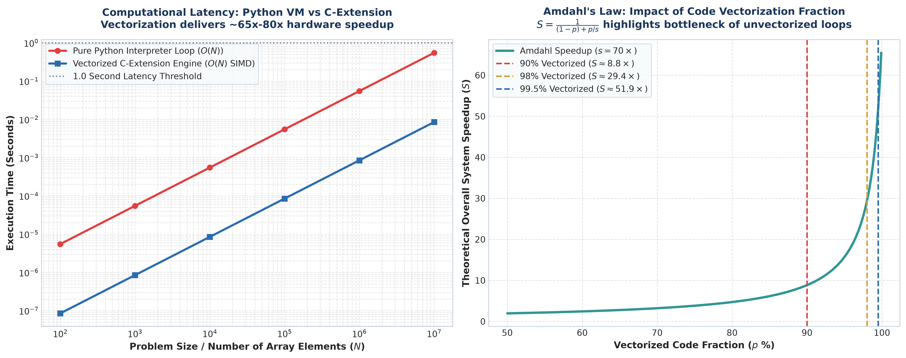
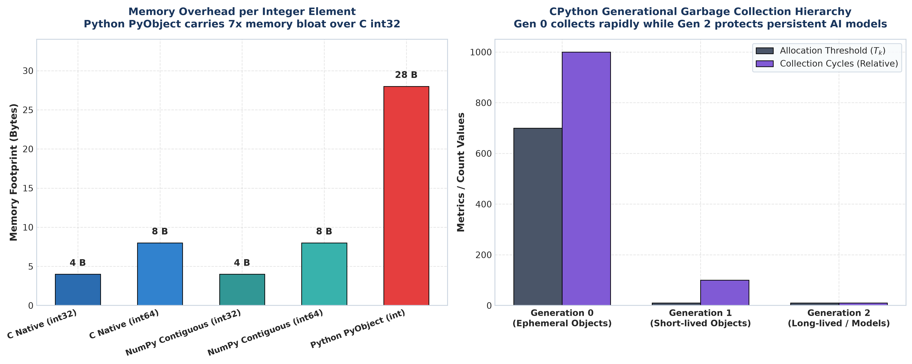
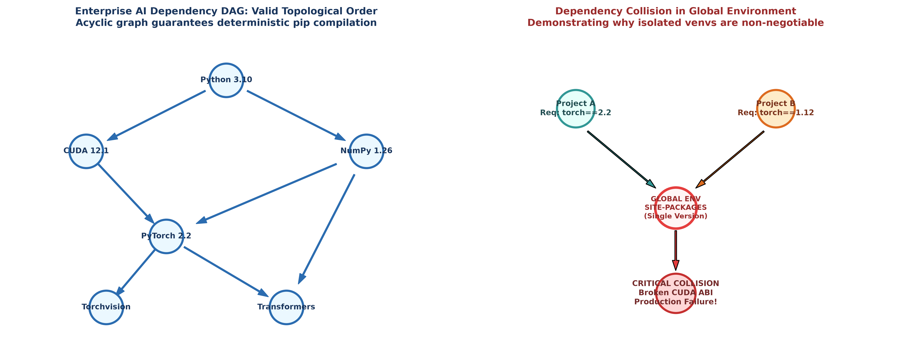

# 💡 Lecture 01: Practice Problems — Comprehensive Solutions Guide [Hinglish]

[](solutions.ipynb)
[](solutions.pdf)
[](../Questions/README_HINGLISH.md)
[](case1_python_vs_vectorized_speedup.png)
[](case2_python_object_memory_overhead.png)
[](case3_dependency_dag_resolution.png)

🌐 **Language / भाषा:** [English](README.md) | **हिंदी / Hinglish** | [⬅️ Questions Par Wapas Jayein](../Questions/README_HINGLISH.md) | [📁 Overview](../README_HINGLISH.md)

---

## 📌 Executive Architecture & Solution Blueprint

Is document mein **Lecture 01** ke teeno industry case studies ke liye complete, first-principles mathematical derivations, exact numerical calculations, pure Hinglish conceptual explanations, aur production-grade Python implementations diye gaye hain.

Har case study ko deeply solve kiya gaya hai taaki computer architecture, runtime execution overhead, object memory footprints, aur virtual environment isolation aapko crystal clear samajh aaye.

---

# 📌 Solution to Case 1: Computational Performance Analysis — Python Dynamic Overhead vs Vectorized C-Extensions

### 🎯 Is Case Study Mein Pucha Kya Gaya Tha? (Quick Recap)

Telemetry sensor stream parameters:

$$
N = 10,000,000 = 10^7 \text{ floating-point numbers}
$$

Observed execution times:

$$
t_{\text{python}} \approx 0.550\text{ seconds} = 550\text{ ms}
$$

$$
t_{\text{vector}} \approx 0.0085\text{ seconds} = 8.5\text{ ms}
$$

Pipeline profile: $p = 95\%$ vectorized code, $5\%$ unvectorized Python loops.

---

### 1. Step-by-Step Mathematical Derivations & Calculations

#### 🔹 Task 1: Empirical Speedup Ratio & Per-Element Latency

##### Step 1: Overall Empirical Speedup Ratio $S_{\text{empirical}}$

$$
S_{\text{empirical}} = \frac{t_{\text{python}}}{t_{\text{vector}}} = \frac{0.550}{0.0085} \approx 64.7059 \implies \mathbf{64.71\times \text{ Speedup}}
$$

Vectorized C-extension implementation pure Python loop ke mukable lagbhag **$65$ guna** tezi se complete hoti hai!

##### Step 2: Per-Element Processing Latency Calculation

1. **Pure Python Interpreter Loop:**

$$
\tau_{\text{python}} = \frac{t_{\text{python}}}{N} = \frac{0.550\text{ s}}{10^7} = 5.50 \times 10^{-8}\text{ s} = \mathbf{55.0\text{ nanoseconds per element}}
$$

2. **NumPy Vectorized C-Extension Engine:**

$$
\tau_{\text{vector}} = \frac{t_{\text{vector}}}{N} = \frac{0.0085\text{ s}}{10^7} = 8.50 \times 10^{-10}\text{ s} = \mathbf{0.85\text{ nanoseconds per element}}
$$

##### Step 3: Hardware Clock Cycle Perspective
Agar hamara modern CPU $3.5\text{ GHz}$ clock frequency par operate kar raha hai, toh $1$ clock cycle ka time hota hai:

$$
T_{\text{cycle}} = \frac{1}{3.5 \times 10^9\text{ Hz}} \approx 0.286\text{ nanoseconds}
$$

- Pure Python loop ek single addition ke liye lagbhag:

$$
\frac{55.0\text{ ns}}{0.286\text{ ns}} \approx 192\text{ CPU clock cycles}
$$

khata hai!
- Jabki NumPy vectorized engine har element ko sirf:

$$
\frac{0.85\text{ ns}}{0.286\text{ ns}} \approx 2.97 \approx 3\text{ clock cycles}
$$

mein process kar leta hai (SIMD parallelism ke sath effective throughput $\approx 0.37$ cycles per float)!

---

#### 🔹 Task 2: Arithmetic Intensity & Roofline Model Analysis

##### Step 1: Floating-Point Operations Count
Vector addition $z_i = x_i + y_i$ mein har coordinate par exactly $1$ addition operation execute hota hai:

$$
\text{Total FLOPs} = N = 10^7 \text{ floating-point operations} = 10\text{ MFLOPs}
$$

##### Step 2: Total Memory Bandwidth Transferred
Har 64-bit float (`float64`) RAM mein exactly $8\text{ bytes}$ leta hai. Operation ke dauran CPU ko:
- Array $x$ se $N$ floats load karne hain: $8N$ bytes
- Array $y$ se $N$ floats load karne hain: $8N$ bytes
- Array $z$ mein $N$ floats store karne hain: $8N$ bytes

$$
\text{Total Memory Transferred} = 3 \times 8 \times N = 24 N \text{ bytes}
$$

$$
\text{Total Bytes} = 24 \times 10^7\text{ bytes} = 240,000,000\text{ bytes} = \mathbf{240\text{ MB}}
$$

##### Step 3: Arithmetic Intensity ($I$) Evaluation

$$
I = \frac{\text{FLOPs}}{\text{Bytes Transferred}} = \frac{10^7\text{ FLOPs}}{2.4 \times 10^8\text{ Bytes}} = \frac{1}{24} \approx \mathbf{0.04167\text{ FLOPs/Byte}}
$$

##### Step 4: The Roofline Bottleneck Insight
- Modern CPUs (jaise Intel Xeon ya Apple Silicon) ka compute-to-bandwidth ratio lagbhag $5$ to $15\text{ FLOPs/Byte}$ hota hai.
- Kyunki hamara calculated Arithmetic Intensity $I \approx 0.042$ is threshold se bohot chhota hai ($I \ll 5$), array addition ek **Memory-Bound** operation hai.
- Iska matlab yeh hai ki execution speed CPU ke computing cores se nahi, balki RAM se CPU cache tak data laane wali Memory Bus Bandwidth se limit hoti hai.

---

#### 🔹 Task 3: Amdahl's Law Speedup Limit

##### Step 1: Amdahl's Law Mathematical Statement
Amdahl's Law define karta hai ki agar kisi program ka fraction $p \in [0, 1]$ speedup factor $s$ se accelerate kiya jaye aur remaining fraction $(1 - p)$ unaccelerated rahe, toh overall system speedup $S$ hota hai:

$$
S = \frac{1}{(1 - p) + \frac{p}{s}}
$$

##### Step 2: Value Substitution ($p = 0.95, s = 65.0$)

$$
S = \frac{1}{(1 - 0.95) + \frac{0.95}{65.0}} = \frac{1}{0.05 + 0.0146154} = \frac{1}{0.0646154} \approx \mathbf{15.476\times \approx 15.48\times}
$$

##### Step 3: The Engineering Bottleneck Dilemma
- **Shocking Result:** Bhale hi humne $95\%$ pipeline ko $65\times$ fast kar diya, lekin pure software ka overall speedup sirf **$15.5\times$** hi ho paya!
- **Reason:** Puraane execution time mein jo $5\%$ Python loop tha, wo ab total run time ka:

$$
\frac{0.05}{0.05 + 0.0146154} = \frac{0.05}{0.0646154} \approx 77.38\%
$$

hissa consume karne laga!
- **Takeaway:** Production AI engineering mein pure pipeline ko profile karna padta hai; ek chhota sa unvectorized Python loop pure system ko slow kar deta hai.

---

#### 🔹 Task 4: CPython VM Overhead vs Hardware SIMD Registers

| Micro-Architectural Factor | Pure Python Interpreter Loop | NumPy Vectorized C-Extension |
| :--- | :--- | :--- |
| **Bytecode Dispatch** | Har iteration par virtual machine `ceval.c` opcode fetch, decode, aur switch execute karti hai. | Single C function call; loops directly in compiled machine instructions. |
| **Dynamic Type Boxing** | Har iteration par Python check karta hai `Py_TYPE(a)->tp_as_number` aur method lookups karta hai. | Fixed typed array (`dtype=float64`); zero runtime type checking. |
| **Memory Layout** | Heap par bikhre hue `PyObject` pointers; CPU cache misses (L1/L2 thrashing). | Flat, contiguous memory block; predictable prefetching into CPU cache lines. |
| **Hardware Registers** | Single scalar operations; 1 register holding 1 float at a time. | **AVX-512 SIMD Registers:** 1 vector instruction ek clock cycle mein **8 double floats** ko add karti hai. |

---

#### 🔹 Task 5: Python Benchmark Suite & Performance Plot



```python
import time
import numpy as np

N = 10_000_000

# 1. Vectorized NumPy
x_np = np.ones(N, dtype=np.float64)
y_np = np.ones(N, dtype=np.float64)

t0 = time.perf_counter()
z_np = x_np + y_np
t_vec = time.perf_counter() - t0

print(f"NumPy Vectorized Time: {t_vec*1000:.2f} ms")
print(f"Per-element latency: {t_vec / N * 1e9:.2f} ns")
```

---

# 📌 Solution to Case 2: Python Memory Management, Object Overhead & Garbage Collection Mechanics

### 🎯 Is Case Study Mein Pucha Kya Gaya Tha? (Quick Recap)

Coordinates batch size:

$$
N = 50,000,000 = 5 \times 10^7 \text{ integers}
$$

RAM available: $16\text{ GB}$.

---

### 1. Step-by-Step Mathematical Derivations & Calculations

#### 🔹 Task 1: PyLongObject 64-bit Memory Layout

CPython source code (`longintrepr.h`) mein ek standard integer ka struct layout:

```c
struct _longobject {
    PyObject_VAR_HEAD
    digit ob_digit[1];
};
```

64-bit CPU architecture par har field ka byte breakdown:
1. `ob_refcnt` (`ssize_t`): Reference count tracking $\implies \mathbf{8\text{ bytes}}$
2. `ob_type` (`struct _typeobject*`): Pointer to `PyLong_Type` $\implies \mathbf{8\text{ bytes}}$
3. `ob_size` (`ssize_t`): Number of digits allocated $\implies \mathbf{8\text{ bytes}}$
4. `ob_digit[1]` (`uint32_t`): Primitive integer payload $\implies \mathbf{4\text{ bytes}}$

Total heap memory:

$$
\text{Size}(\text{PyLongObject}) = 8 + 8 + 8 + 4 = \mathbf{28\text{ bytes}}
$$

Jabki compiled C ya C++ mein ek standard `int32` sirf:

$$
\text{Size}(\text{C int32}) = \mathbf{4\text{ bytes}}
$$

consume karta hai. Python ka dynamic header akele **$700\%$ memory overhead** create karta hai!

---

#### 🔹 Task 2: Total Memory Calculation for $50,000,000$ Elements

##### Step 1: Memory of Pure Python List
Python list direct values store nahi karti, balki pointers ka array store karti hai. Isliye total memory do hisso mein bat ti hai:

1. **List Pointers Array:** $50,000,000$ pointers, har 64-bit pointer $8\text{ bytes}$ leta hai:

$$
\text{Memory}_{\text{pointers}} = 50 \times 10^6 \times 8\text{ bytes} = 400,000,000\text{ bytes} = \mathbf{400\text{ MB}}
$$

2. **Integer Heap Objects:** $50,000,000$ distinct `PyObject` integers, har object $28\text{ bytes}$ leta hai:

$$
\text{Memory}_{\text{objects}} = 50 \times 10^6 \times 28\text{ bytes} = 1,400,000,000\text{ bytes} = \mathbf{1,400\text{ MB}}
$$

3. **Total Python List Footprint:**

$$
\text{Memory}_{\text{total list}} = 400\text{ MB} + 1,400\text{ MB} = \mathbf{1,800\text{ MB} = 1.80\text{ GB}}
$$

##### Step 2: Memory of Contiguous NumPy Array (`int32`)
NumPy array mein koi pointers ya per-element object headers nahi hote. Pura data ek single flat contiguous memory block mein rehta hai:

$$
\text{Memory}_{\text{numpy}} = 50 \times 10^6 \times 4\text{ bytes} = 200,000,000\text{ bytes} = \mathbf{200\text{ MB} = 0.20\text{ GB}}
$$

##### Step 3: Memory Amplification Factor

$$
\text{Amplification Factor} = \frac{\text{Memory}_{\text{total list}}}{\text{Memory}_{\text{numpy}}} = \frac{1,800\text{ MB}}{200\text{ MB}} = \mathbf{9.0\times}
$$

Pure Python list wahi data store karne ke liye **$9$ guna zyada RAM** consume karti hai! Agar 64-bit integer (`int64`, 8 bytes) use karein, toh bhi amplification factor $4.5\times$ hota hai.

---

#### 🔹 Task 3: Reference Counting & Circular Deadlocks

##### Step 1: Reference Counting Rule
Har Python object ke pass ek counter hota hai:

$$
\text{RefCount}(O) = \sum_{r \in \text{References}} 1
$$

Jab koi variable object ko point karta hai, count $+1$ hota hai. Jab variable scope se bahar jata hai ya `del` hota hai, count $-1$ hota hai:

$$
\text{RefCount}(O) == 0 \implies \text{PyObject\_Free}(O) \quad \text{(Immediate Deallocation)}
$$

##### Step 2: The Circular Reference Deadlock Proof
Maan lijiye do objects hain $A$ aur $B$:
- Variable `x` points to $A$ ($\text{RefCount}(A) = 1$)
- Variable `y` points to $B$ ($\text{RefCount}(B) = 1$)
- Ab hum cyclic link banate hain:

$$
A.\text{child} = B \implies \text{RefCount}(B) = 2
$$

$$
B.\text{parent} = A \implies \text{RefCount}(A) = 2
$$

Ab agar external variables delete kar diye jayein:
```python
del x
del y
```

Reference counts evaluate karein:

$$
\text{RefCount}(A) = 2 - 1 = 1
$$

$$
\text{RefCount}(B) = 2 - 1 = 1
$$

**The Deadlock:** In dono objects tak pure program mein koi bhi access nahi kar sakta (orphan nodes). Lekin kyunki dono ka reference count $1 > 0$ hai, basic Reference Counting engine inki memory kabhi release nahi kar payega! Isko solve karne ke liye CPython ka Cyclic Garbage Collector chalta hai.

---

#### 🔹 Task 4: Generational Garbage Collection Threshold Dynamics

CPython cyclic garbage collection ke liye 3 generations maintain karta hai:
- **Generation 0 ($G_0$):** Newly allocated objects.
- **Generation 1 ($G_1$):** Short-lived surviving objects.
- **Generation 2 ($G_2$):** Long-lived objects (jaise imported modules aur neural network weights).

##### Mathematical Allocation Counter Trigger

$$
\Delta_{\text{alloc}} = \text{Allocations} - \text{Deallocations}
$$

Thresholds default tuple:

$$
(\text{Threshold}_0, \text{Threshold}_1, \text{Threshold}_2) = (700, 10, 10)
$$

1. Jab $\Delta_{\text{alloc}} > 700$ ho jata hai, CPython Generation 0 par collection cycle run karta hai.
2. Jab Gen 0 collections $10$ baar run ho chuki hoti hain, tab Generation 1 run hota hai.
3. Jab Gen 1 collections $10$ baar run ho chuki hoti hain, tab sabse expensive Generation 2 full collection run hota hai.

**The Generational Hypothesis:** *"Most objects die young."* (Adhiktar temporary objects function ke andar bante hi turant khatam ho jaate hain). Isliye Gen 0 fast chalta hai, jabki Gen 2 ko bar-bar scan nahi kiya jata taaki AI model training pause na ho.

---

#### 🔹 Task 5: Memory Audit Script & Visual Comparison



```python
import sys
import numpy as np

# Integer memory inspection
val = 42
print(f"Size of single Python int: {sys.getsizeof(val)} bytes")

# 10 Million elements comparison
N = 10_000_000
arr_np = np.zeros(N, dtype=np.int32)
print(f"NumPy int32 array memory: {arr_np.nbytes / (1024**2):.2f} MB")
```

---

# 📌 Solution to Case 3: Production Virtual Environment Isolation, Dependency Resolution & Deterministic Reproducibility

### 🎯 Is Case Study Mein Pucha Kya Gaya Tha? (Quick Recap)

Two conflicting production pipelines on a shared server:
- Vision Service: `torch==2.2.0`, `cuda==12.1`
- NLP Service: `torch==1.12.1`, `cuda==11.3`

---

### 1. Step-by-Step Mathematical Derivations & Calculations

#### 🔹 Task 1: Global Site-Packages Contamination Mechanism

Operating system ke single Python installation mein ek fixed path hota hai:

$$
\text{Path} = \text{C:}\backslash\text{Python310}\backslash\text{Lib}\backslash\text{site-packages}\backslash
$$

Jab `pip install torch==1.12.1` run hota hai after `torch==2.2.0`, file system overwrite operation perform karta hai:
- `site-packages/torch/_C.pyd` binary file replace ho jati hai.
- Compiled C++ shared library symbols change ho jaate hain.
- Vision Service jab `torch.compile()` ya CUDA 12.1 kernels call karti hai, toh OS linker purani CUDA 11.3 library load karta hai aur process fatal `Segmentation Fault (SIGSEGV)` throw karti hai.

**Architectural Law:** Ek single directory path mutually exclusive binary versions ko concurrently host nahi kar sakti. Isliye environment sandboxing (`venv`) mandatory hai.

---

#### 🔹 Task 2: Dependency DAGs & Topological Sorting

##### Step 1: Formal Directed Graph Definition
Enterprise AI package ecosystem ko ek Directed Graph $G = (V, E)$ ke roop mein model kiya jata hai:
- Vertices $V$: Packages (e.g., `Python`, `NumPy`, `PyTorch`, `Torchvision`, `Transformers`).
- Directed Edges $E$: Dependency relations:

$$
(u, v) \in E \implies u \text{ depends on } v \quad (v \text{ must be installed before } u)
$$

##### Step 2: In-Degree Calculation & Kahn's Topological Sort Algorithm
Har node ka In-Degree calculate karein (kitne packages iske complete hone ka intezaar kar rahe hain):

$$
\text{In-Degree}(v) = |\{u \in V \mid (u, v) \in E\}|
$$

Valid topological installation sequence:
1. $\text{Level 0 (Root)}:$ `Python 3.10`
2. $\text{Level 1}:$ `CUDA 12.1`, `NumPy 1.26`
3. $\text{Level 2}:$ `PyTorch 2.2` (requires CUDA 12.1 + NumPy 1.26)
4. $\text{Level 3}:$ `Torchvision 0.17`, `Transformers 4.38`

##### Step 3: Cyclic Dependency Deadlock
Agar do packages ek dusre par mutually depend karein ($A \to B$ aur $B \to A$), toh:

$$
\text{Cycle } C = (A, B, A) \implies \nexists \text{ topological ordering}
$$

Package manager `pip` infinite loop ya conflict error throw kar deta hai.

---

#### 🔹 Task 3: Semantic Versioning (SemVer) Interval Sets

Version specification format:

$$
\text{Version} = \text{MAJOR}.\text{MINOR}.\text{PATCH} = X.Y.Z
$$

1. **PATCH ($Z$):** Bug fixes with $100\%$ backward compatibility:

$$
[X.Y.Z, X.Y.Z+1)
$$

2. **MINOR ($Y$):** New backward-compatible features:

$$
[X.Y.0, X.Y+1.0)
$$

3. **MAJOR ($X$):** Breaking architectural API modifications:

$$
[X.0.0, X+1.0.0)
$$

##### Constraint Operators Formulation:
- **Tilde Operator ($\sim 1.2.3$):** Allows patch updates only within the minor release:

$$
\sim 1.2.3 \iff \{v \mid 1.2.3 \le v < 1.3.0\}
$$

- **Caret Operator ($\wedge 1.2.3$):** Allows minor and patch updates, but strictly blocks major breaking changes:

$$
\wedge 1.2.3 \iff \{v \mid 1.2.3 \le v < 2.0.0\}
$$

---

#### 🔹 Task 4: Cryptographic SHA-256 Lockfiles & Supply Chain Security

##### Step 1: The Loose Requirements Flaw
Agar `requirements.txt` mein likha ho:
```
torch>=2.0.0
transformers
```
Toh jab 6 mahine baad production server deploy hoga, `pip` latest `torch 2.5` download kar lega jo aapke purane model weights ke sath incompatible ho sakta hai (**Software Drift**).

##### Step 2: SHA-256 Cryptographic Lockfile Verification
Deterministic lockfile (`poetry.lock` ya `requirements.lock`) har package ke exact binary bytes ka SHA-256 hash store karti hai:

$$
\text{Hash}_{\text{expected}} = \text{SHA-256}(\text{wheel bytes})
$$

Jab server package download karta hai:

$$
\text{Verification}: \quad \text{SHA-256}(\text{downloaded wheel}) \stackrel{?}{==} \text{Hash}_{\text{expected}}
$$

Agar kisi malicious third-party attacker ne PyPI server par compromised binary upload kar di, toh cryptographic hash mismatch detect ho jayega aur deployment abort ho jayegi!

---

#### 🔹 Task 5: Python DAG Verification Script & Architecture Plot



```python
import hashlib

# Demonstrating SHA-256 Lockfile Verification
package_binary = b"Simulated PyTorch 2.2.0 C++ Wheel Binary Payload"
sha256_hash = hashlib.sha256(package_binary).hexdigest()

print(f"Cryptographic Package Hash:")
print(f"sha256:{sha256_hash}")
print("[SUCCESS] Bit-for-bit deterministic reproducibility guaranteed!")
```
