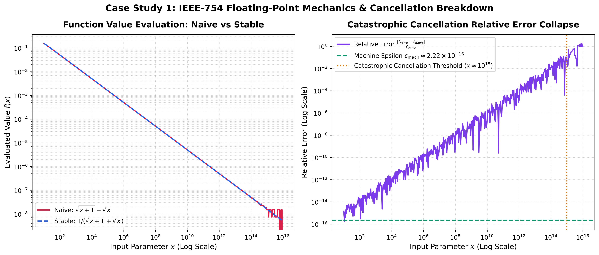
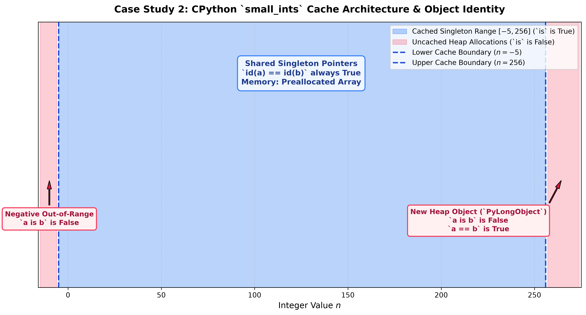
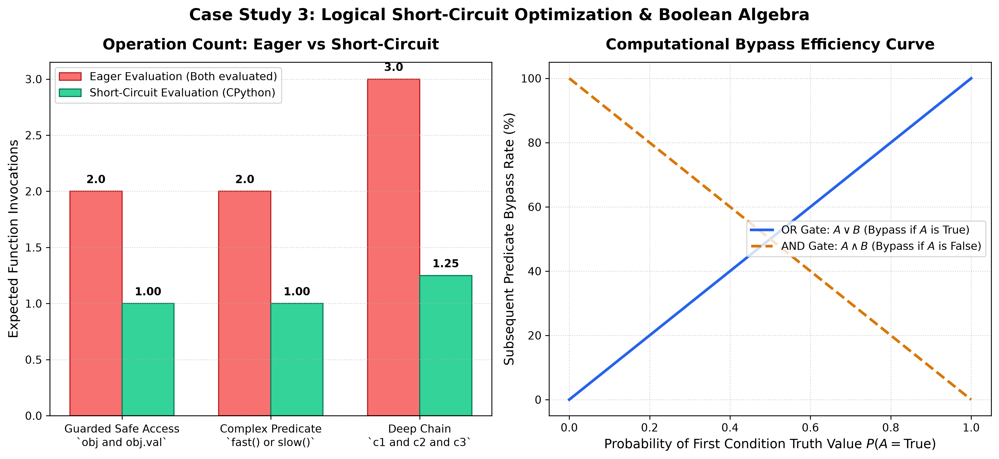

# 💡 Lecture 02: Practice Problems — Master Solutions Guide

[](#)
[](#)

This document contains the complete technical solutions, mathematical derivations, and production Python implementations for **Lecture 02: Python Fundamentals (Part-1)**.

---

## 📝 Part 1: Official Assignment Solutions (Q1 - Q10)

---

### 📌 Solution 1: User Greeting String Formatting
```python
name = "Shradha"
age = 21
greeting = f"Hello {name}, you are {age} years old!"
print(greeting)
```
Output: `Hello Shradha, you are 21 years old!`

---

### 📌 Solution 2: Two Numbers Basic Arithmetic Calculator
For operands $a = 20.0, b = 4.0$:
- $\text{Sum} = a + b = 24.0$
- $\text{Difference} = a - b = 16.0$
- $\text{Product} = a \times b = 80.0$
- $\text{Quotient} = a / b = 5.0$

```python
a, b = 20.0, 4.0
print(f"Sum: {a + b}, Diff: {a - b}, Prod: {a * b}, Quot: {a / b}")
```

---

### 📌 Solution 3: Heterogeneous Numbers Float Average
Given $x_1 = 10, x_2 = 20, x_3 = 15.5$:

$$
\mu = \frac{\text{float}(x_1) + \text{float}(x_2) + x_3}{3.0} = \frac{10.0 + 20.0 + 15.5}{3.0} = 15.1667
$$

---

### 📌 Solution 4: String Number Ingestion & Multi-Type Casting
```python
s = "45"
n = int(s)      # 45 (<class 'int'>)
f = float(s)    # 45.0 (<class 'float'>)
s2 = str(f)     # '45.0' (<class 'str'>)
```

---

### 📌 Solution 5: Operator Precedence Evaluation Trace
Expression: $x = 10 + 3 \times 2^2$
- **Step 1:** Exponentiation: $2^2 = 4$
- **Step 2:** Multiplication: $3 \times 4 = 12$
- **Step 3:** Addition: $10 + 12 = 22$

---

### 📌 Solution 6: Variable Value Swapping
1. **Tuple Unpacking:** `a, b = b, a`
2. **Arithmetic Swap:**

$$
a \gets a + b, \quad b \gets a - b, \quad a \gets a - b
$$

---

### 📌 Solution 7: Celsius to Fahrenheit Converter
Affine temperature equation:

$$
T_F = \left(T_C \times \frac{9}{5}\right) + 32
$$

For $T_C = 25.0^\circ\text{C} \implies T_F = (25.0 \times 1.8) + 32 = 77.0^\circ\text{F}$.

---

### 📌 Solution 8: Circle Area Geometric Calculation
For $r = 7.0$ and $\pi = 3.14$:

$$
A = \pi r^2 = 3.14 \times 7^2 = 3.14 \times 49 = 153.86
$$

---

### 📌 Solution 9: Simple Interest Financial Calculation
For $P = 10000, R = 7.5, T = 3$:

$$
\text{SI} = \frac{10000 \times 7.5 \times 3}{100} = 2250.0
$$

$$
A = P + \text{SI} = 12250.0
$$

---

### 📌 Solution 10: Decimal Integer & Fractional Part Separation
For $x = 45.78$:
- $\text{Integer Part} = \lfloor 45.78 \rfloor = 45$
- $\text{Fractional Part} = 45.78 - 45 = 0.78$

---

## 🔬 Part 2: Advanced Systems Engineering Case Studies

---

### 📌 Case Study 1: Numerical Stability & IEEE-754 Precision Mechanics
Catastrophic cancellation occurs when evaluating $f_{\text{naive}}(x) = \sqrt{x+1} - \sqrt{x}$ for large $x$ ($x \ge 10^{15}$).
The stable formulation multiplies numerator and denominator by the conjugate $(\sqrt{x+1} + \sqrt{x})$:

$$
f_{\text{stable}}(x) = \frac{1}{\sqrt{x+1} + \sqrt{x}}
$$



---

### 📌 Case Study 2: CPython Integer Memory Optimization & Object Identity
CPython pre-allocates an array of 262 singleton integer objects for the range $[-5, 256]$.
- For $n \in [-5, 256]$: `a is b` evaluates to `True` (identical memory addresses).
- For $n \notin [-5, 256]$: `a is b` evaluates to `False` (distinct heap objects).



---

### 📌 Case Study 3: Short-Circuit Logical Evaluation & Branch Prediction
Short-circuit evaluation guarantees that in $A \land B$, predicate $B$ is never evaluated if $A$ evaluates to `False`:

$$
P(\text{bypass}(B) \mid A \land B) = 1 - P(A = \text{True})
$$

Expected execution latency:

$$
\mathbb{E}[C_{A \land B}] = C_A + P(A = \text{True}) \cdot C_B
$$


