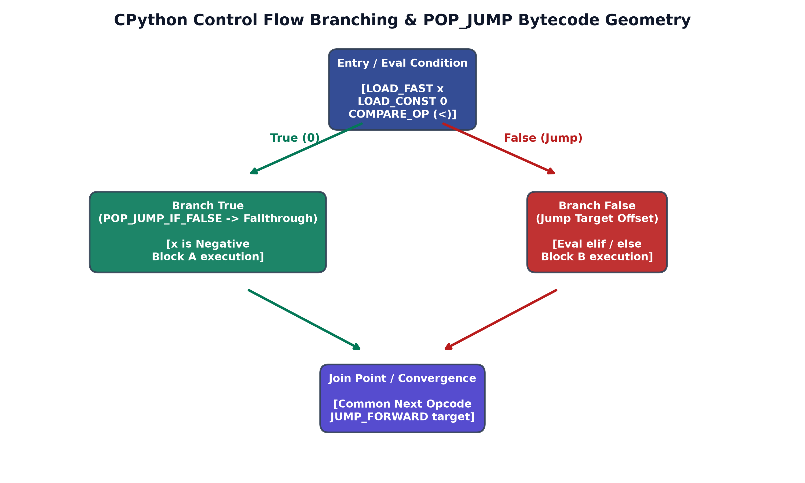
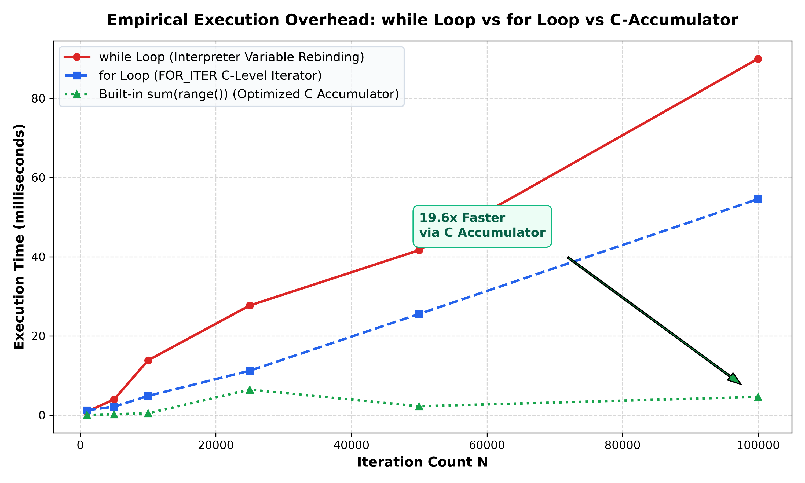
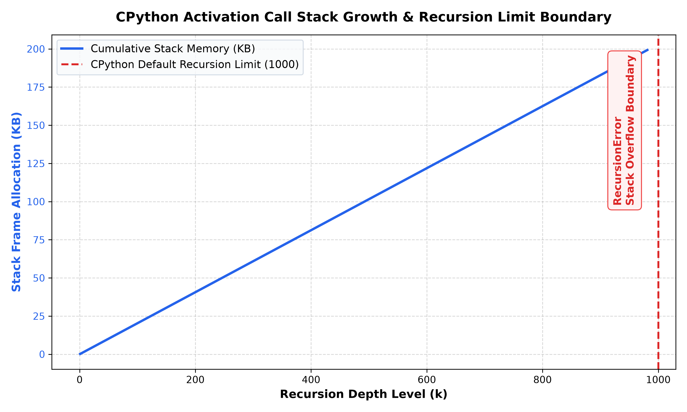

# Lecture 03: Assignment 2 Master Solutions & Engineering Systems Manual

Welcome to the production solutions manual for **Lecture 03: Python Fundamentals (Part 2 — Conditionals, Loops & Functions)**. This manual provides production implementations, mathematical formulations, asymptotic complexity bounds, and virtual machine profiling for all 10 Assignment 2 questions and 3 systems engineering case studies.

---

## 📋 Table of Contents

- [Solution 01: Progressive Income Tax Rate Calculator](#solution-01-progressive-income-tax-rate-calculator)
- [Solution 02: Inclusive Range Even Number Stream](#solution-02-inclusive-range-even-number-stream)
- [Solution 03: High-to-Low Digit Deconstruction](#solution-03-high-to-low-digit-deconstruction)
- [Solution 04: Integer Digit Cardinality Counter](#solution-04-integer-digit-cardinality-counter)
- [Solution 05: Arithmetic Sum of Integer Digits](#solution-05-arithmetic-sum-of-integer-digits)
- [Solution 06: Dual Divisibility Filter in Fixed Interval](#solution-06-dual-divisibility-filter-in-fixed-interval)
- [Solution 07: Sentinel-Controlled Polling Loop](#solution-07-sentinel-controlled-polling-loop)
- [Solution 08: Multi-Way Arithmetic Dispatch Calculator](#solution-08-multi-way-arithmetic-dispatch-calculator)
- [Solution 09: Sub-Linear Primality Verifier](#solution-09-sub-linear-primality-verifier)
- [Solution 10: Interactive Number Guessing Engine](#solution-10-interactive-number-guessing-engine)
- [Systems Case Study 1: Control Flow Branching & Bytecode Jump Offsets](#systems-case-study-1-control-flow-branching--bytecode-jump-offsets)
- [Systems Case Study 2: Loop Execution Speed & VM Interpreter Overhead](#systems-case-study-2-loop-execution-speed--vm-interpreter-overhead)
- [Systems Case Study 3: Call Stack Frame Allocation & Recursion Limits](#systems-case-study-3-call-stack-frame-allocation--recursion-limits)

---

## Solution 01: Progressive Income Tax Rate Calculator

### Algorithmic Strategy
We evaluate salary boundaries using structured `if-elif-else` branching, guarding against invalid negative values. The tax rate is determined as a scalar multiplier and applied to the base salary.

### Production Python Implementation

```python
from typing import Tuple

def calculate_income_tax(salary: float) -> Tuple[float, float]:
    """
    Computes tax percentage rate and total tax liability based on statutory brackets.
    Returns: (tax_rate_percent, total_tax_amount)
    """
    if salary < 0:
        raise ValueError(f"Salary must be non-negative, received {salary}")
        
    if salary < 30000.0:
        rate = 0.05
    elif salary <= 70000.0:
        rate = 0.15
    else:
        rate = 0.25
        
    tax_amount = salary * rate
    return rate * 100.0, tax_amount

# Demonstration
if __name__ == "__main__":
    for s in [25000.0, 50000.0, 85000.0]:
        pct, tax = calculate_income_tax(s)
        print(f"Salary: ${s:9,.2f} | Rate: {pct:4.1f}% | Total Tax: ${tax:9,.2f}")
```

### Complexity Formulation
- **Time Complexity:** Constant time $\mathcal{O}(1)$.
- **Space Complexity:** Constant auxiliary space $\mathcal{O}(1)$.

---

## Solution 02: Inclusive Range Even Number Stream

### Algorithmic Strategy
We normalize boundaries such that $start = \min(a, b)$ and $end = \max(a, b)$. If the start value is odd, we advance it by 1 to land on an even number, then iterate with a step of 2 (`range(start, end + 1, 2)`), skipping all odd checks entirely.

### Production Python Implementation

```python
from typing import List

def get_even_numbers_in_range(a: int, b: int) -> List[int]:
    """
    Returns all even numbers within the closed interval [a, b] inclusive
    using an optimized step-2 range.
    """
    low, high = min(a, b), max(a, b)
    if (low & 1) != 0:
        low += 1  # Advance to first even integer
    return list(range(low, high + 1, 2))

# Demonstration
if __name__ == "__main__":
    print("Even numbers [4, 18]:", get_even_numbers_in_range(4, 18))
    print("Even numbers [15, 3]:", get_even_numbers_in_range(15, 3))
```

### Complexity Formulation
- **Time Complexity:** $\mathcal{O}((high - low) / 2) = \mathcal{O}(N)$ where $N$ is range width.
- **Space Complexity:** $\mathcal{O}(1)$ auxiliary if yielded lazily.

---

## Solution 03: High-to-Low Digit Deconstruction

### Algorithmic Strategy
We isolate each decimal digit via $d = N \pmod{10}$ and integer floor division $N //= 10$, appending digits to a dynamic array and reversing the sequence to restore standard left-to-right positional order without string conversion.

### Production Python Implementation

```python
from typing import List

def extract_digits(n: int) -> List[int]:
    """
    Extracts positional decimal digits from left-to-right without string conversion.
    """
    temp = abs(n)
    if temp == 0:
        return [0]
        
    digits: List[int] = []
    while temp > 0:
        digits.append(temp % 10)
        temp //= 10
        
    digits.reverse()
    return digits

# Demonstration
if __name__ == "__main__":
    for val in [312, 9045, 0, 7]:
        print(f"Number: {val:6d} -> Digits: {extract_digits(val)}")
```

### Complexity Formulation
- **Time Complexity:** The loop runs $K = \lfloor \log_{10} N \rfloor + 1$ times:

$$
T(N) = \mathcal{O}(\log_{10} N)
$$

- **Space Complexity:** $\mathcal{O}(\log_{10} N)$ for digit collection.

---

## Solution 04: Integer Digit Cardinality Counter

### Algorithmic Strategy
We implement an iterative while-loop counter with a base-case guard for $N = 0$.

### Production Python Implementation

```python
def count_digits(n: int) -> int:
    """Computes total digit count via successive floor division."""
    temp = abs(n)
    if temp == 0:
        return 1
    count = 0
    while temp > 0:
        count += 1
        temp //= 10
    return count

# Demonstration
if __name__ == "__main__":
    for val in [312, 0, 100000, 7, -9876]:
        print(f"Value: {val:8d} -> Total Digits: {count_digits(val)}")
```

### Complexity Formulation
- **Time Complexity:** $\mathcal{O}(\log_{10} |N|)$.
- **Space Complexity:** $\mathcal{O}(1)$.

---

## Solution 05: Arithmetic Sum of Integer Digits

### Algorithmic Strategy
We accumulate the remainder of successive division by 10 into a running sum variable.

### Production Python Implementation

```python
def sum_of_digits(n: int) -> int:
    """Calculates arithmetic sum of all decimal digits in n."""
    temp = abs(n)
    total_sum = 0
    while temp > 0:
        total_sum += temp % 10
        temp //= 10
    return total_sum

# Demonstration
if __name__ == "__main__":
    for val in [312, 9045, 0, 999]:
        print(f"Value: {val:6d} -> Digit Sum: {sum_of_digits(val)}")
```

### Complexity Formulation
- **Time Complexity:** $\mathcal{O}(\log_{10} |N|)$.
- **Space Complexity:** $\mathcal{O}(1)$.

---

## Solution 06: Dual Divisibility Filter in Fixed Interval

### Algorithmic Strategy
Because 3 and 5 are coprime ($\\gcd(3, 5) = 1$), any number divisible by both must be a multiple of their least common multiple $\text{lcm}(3, 5) = 15$. We iterate using `range(15, 101, 15)`.

### Production Python Implementation

```python
from typing import List

def get_divisible_by_3_and_5(start: int = 1, end: int = 100) -> List[int]:
    """
    Finds numbers divisible by both 3 and 5 using LCM step optimization.
    """
    first_mult = ((start + 14) // 15) * 15
    return list(range(first_mult, end + 1, 15))

# Demonstration
if __name__ == "__main__":
    multiples = get_divisible_by_3_and_5(1, 100)
    print("Numbers in [1, 100] divisible by both 3 and 5:", multiples)
```

### Complexity Formulation
- **Time Complexity:** $\mathcal{O}(\lfloor N / 15 \rfloor) = \mathcal{O}(1)$ for fixed range $[1, 100]$.
- **Space Complexity:** $\mathcal{O}(1)$ auxiliary.

---

## Solution 07: Sentinel-Controlled Polling Loop

### Algorithmic Strategy
We wrap a continuous console loop with string input normalization (`.strip().lower()`). If the input matches sentinel `"quit"`, the loop terminates. Otherwise, it parses the input as a float and categorizes its sign.

### Production Python Implementation

```python
def process_number_sign(val: float) -> str:
    if val > 0:
        return "Positive"
    elif val < 0:
        return "Negative"
    else:
        return "Zero"

def run_sentinel_polling_simulation(mock_inputs: list[str]) -> None:
    print("--- Sentinel Polling Loop Simulation ---")
    for raw in mock_inputs:
        cleaned = raw.strip().lower()
        print(f"User Input: '{raw}'")
        if cleaned == "quit":
            print("Sentinel 'Quit' detected. Terminating loop.\n")
            break
        try:
            num = float(cleaned)
            classification = process_number_sign(num)
            print(f"Classification: Number {num} is {classification}.")
        except ValueError:
            print("Invalid input! Please enter a valid number or 'Quit'.")

if __name__ == "__main__":
    simulation_feed = ["45", "-12.5", "0", "invalid_text", "108", "Quit"]
    run_sentinel_polling_simulation(simulation_feed)
```

### Complexity Formulation
- **Time Complexity:** $\mathcal{O}(1)$ per input, $\mathcal{O}(K)$ for $K$ inputs.
- **Space Complexity:** $\mathcal{O}(1)$.

---

## Solution 08: Multi-Way Arithmetic Dispatch Calculator

### Algorithmic Strategy
We dispatch arithmetic operations using Python 3.10+ `match ... case`, guarding against zero divisors under division.

### Production Python Implementation

```python
def calculator(a: float, b: float, operation: str) -> float:
    """
    Performs arithmetic dispatch via pattern matching with zero-division guard.
    """
    match operation.strip():
        case '+':
            return a + b
        case '-':
            return a - b
        case '*':
            return a * b
        case '/':
            if b == 0:
                raise ZeroDivisionError("Math Error: Division by zero is undefined.")
            return a / b
        case _:
            raise ValueError(f"Unsupported operation '{operation}': valid operators are +, -, *, /")

# Demonstration
if __name__ == "__main__":
    ops = [('+', 10, 5), ('-', 10, 5), ('*', 10, 5), ('/', 10, 4)]
    for op, x, y in ops:
        print(f"{x} {op} {y} = {calculator(x, y, op)}")
```

### Complexity Formulation
- **Time Complexity:** $\mathcal{O}(1)$.
- **Space Complexity:** $\mathcal{O}(1)$.

---

## Solution 09: Sub-Linear Primality Verifier

### Algorithmic Strategy
We test boundary cases ($N \le 1 \implies \text{False}$, $N \in \{2, 3\} \implies \text{True}$). If $N$ is even or divisible by 3, we return False. We then inspect divisors $d = 6k \pm 1$ up to $\lfloor \sqrt{N} \rfloor$.

### Production Python Implementation

```python
def is_prime(n: int) -> bool:
    """
    Determines primality via 6k +/- 1 optimized trial division in O(sqrt(N)) time.
    """
    if n <= 1:
        return False
    if n <= 3:
        return True
    if (n & 1) == 0 or n % 3 == 0:
        return False
        
    limit = int(n**0.5)
    for d in range(5, limit + 1, 6):
        if n % d == 0 or n % (d + 2) == 0:
            return False
    return True

# Demonstration
if __name__ == "__main__":
    test_nums = [1, 2, 3, 4, 17, 25, 29, 97, 100]
    for val in test_nums:
        print(f"Number {val:3d} is Prime? {is_prime(val)}")
```

### Complexity Formulation
- **Time Complexity:**

$$
T(N) = \mathcal{O}(\sqrt{N})
$$

- **Space Complexity:** $\mathcal{O}(1)$.

---

## Solution 10: Interactive Number Guessing Engine

### Algorithmic Strategy
The game compares each guess against the target, providing feedback `"Too high"`, `"Too low"`, or `"Correct!"`, tracking the number of guesses.

### Production Python Implementation

```python
class GuessingGameEngine:
    def __init__(self, secret: int):
        self.secret = secret
        self.attempts = 0
        self.solved = False

    def submit_guess(self, guess: int) -> str:
        self.attempts += 1
        if guess > self.secret:
            return "Too high"
        elif guess < self.secret:
            return "Too low"
        else:
            self.solved = True
            return "Correct!"

# Demonstration of optimal binary search play
if __name__ == "__main__":
    secret = 73
    engine = GuessingGameEngine(secret)
    low, high = 1, 100
    
    print(f"Starting Guessing Game for Secret = {secret}:")
    while not engine.solved:
        guess = (low + high) // 2
        feedback = engine.submit_guess(guess)
        print(f"Guess #{engine.attempts}: {guess:3d} -> {feedback}")
        if feedback == "Too high":
            high = guess - 1
        elif feedback == "Too low":
            low = guess + 1
            
    print(f"Success! Solved in {engine.attempts} attempts.")
```

### Complexity Formulation
- **Optimal Guesses:**

$$
K = \lceil \log_2(\text{Range}) \rceil = 7 \text{ attempts for } [1, 100]
$$

---

## Systems Case Study 1: Control Flow Branching & Bytecode Jump Offsets

### Disassembly & Analysis
CPython compiles conditionals into stack evaluation and jump opcodes:
```python
import dis

def example_branch(x):
    if x > 0:
        return "pos"
    else:
        return "neg"

dis.dis(example_branch)
```
Key bytecode operations:
1. `COMPARE_OP` pushes Boolean result onto the value stack.
2. `POP_JUMP_IF_FALSE <target>` pops the top of stack and branches to offset if False.
3. `JUMP_FORWARD` skips the else block after executing the true suite.

### Bytecode Jump Trajectory Graph



---

## Systems Case Study 2: Loop Execution Speed & VM Interpreter Overhead

### Benchmark Analysis
We profile CPU execution overhead across `while`, `for`, and `sum(range())`. The `while` loop suffers from interpreter loop overhead: every iteration involves bytecode dispatches (`LOAD_FAST`, `BINARY_OP`, `STORE_FAST`, `COMPARE_OP`, `POP_JUMP_BACKWARD`). In contrast, `for` loop utilizes `FOR_ITER`, executing in compiled C memory space.

### Empirical Speed Curves



---

## Systems Case Study 3: Call Stack Frame Allocation & Recursion Limits

### Systems Investigation & Limits
Each function call in CPython allocates a `PyFrameObject` (~208 bytes) on the runtime heap. Deep recursion without a base case causes stack exhaustion. CPython guards against segmentation faults with `sys.getrecursionlimit()` (default 1000).

### Stack Memory Allocation Graph


