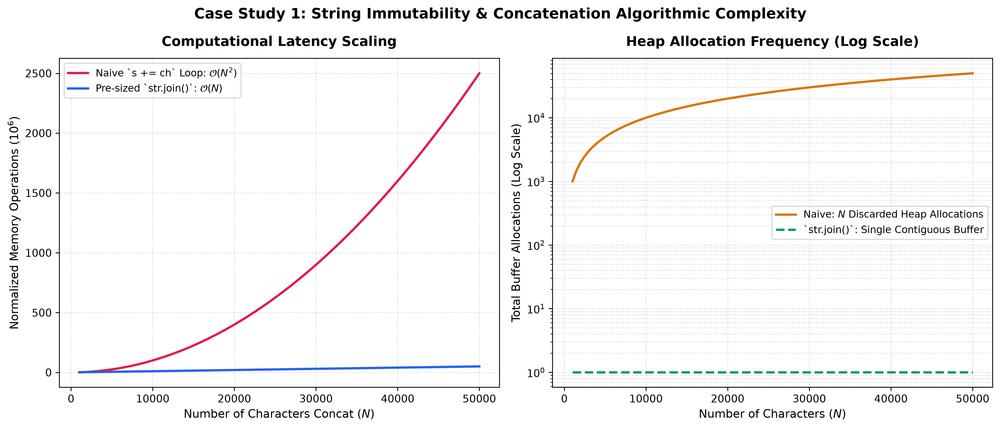
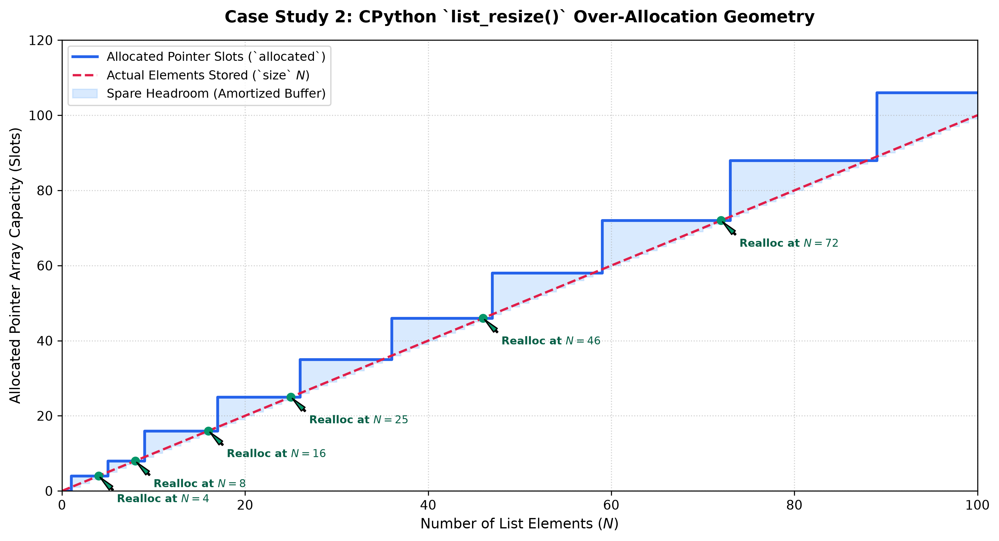
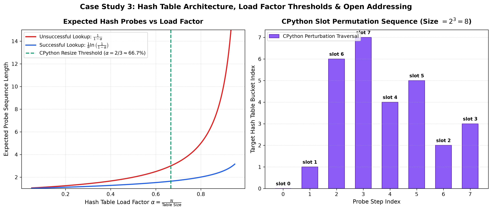

# Lecture 04: Assignment 3 Master Solutions & Engineering Systems Manual

Welcome to the definitive solutions manual for **Lecture 04: Strings, Lists, Tuples, Dictionaries, and Sets**. This document provides production-grade Python implementations, formal complexity analysis, asymptotic bounds, and systems benchmarks for all 10 Assignment 3 questions and 3 systems engineering case studies.

---

## 📋 Table of Contents

- [Solution 01: String Palindrome Invariance](#solution-01-string-palindrome-invariance)
- [Solution 02: Arithmetic Mean of an Integer Sequence](#solution-02-arithmetic-mean-of-an-integer-sequence)
- [Solution 03: Dual List Ingestion & Ascending Sort](#solution-03-dual-list-ingestion--ascending-sort)
- [Solution 04: Tuple Parity Partitioning](#solution-04-tuple-parity-partitioning)
- [Solution 05: Menu-Driven Student Gradebook Hash Table](#solution-05-menu-driven-student-gradebook-hash-table)
- [Solution 06: Lexical Word-Length Mapping](#solution-06-lexical-word-length-mapping)
- [Solution 07: Unicode Whitespace Frequency Analyzer](#solution-07-unicode-whitespace-frequency-analyzer)
- [Solution 08: Disjoint Set Verification](#solution-08-disjoint-set-verification)
- [Solution 09: Sequence Duplicate Detector](#solution-09-sequence-duplicate-detector)
- [Solution 10: Unique Character Extraction & Cardinality](#solution-10-unique-character-extraction--cardinality)
- [Systems Case Study 1: String Immutability & Buffer Concatenation Complexity](#systems-case-study-1-string-immutability--buffer-concatenation-complexity)
- [Systems Case Study 2: Dynamic Array Growth Geometry & Amortized Allocation](#systems-case-study-2-dynamic-array-growth-geometry--amortized-allocation)
- [Systems Case Study 3: CPython Hash Table Architecture & Perturbation Probing](#systems-case-study-3-cpython-hash-table-architecture--perturbation-probing)

---

## Solution 01: String Palindrome Invariance

### Algorithmic Strategy
We provide two production implementations:
1. **Slicing Approach (`s == s[::-1]`):** Highly optimized at the CPython bytecode level (`UNPACK_SEQUENCE` / string buffer inversion), running in $\mathcal{O}(N)$ time with $\mathcal{O}(N)$ auxiliary memory.
2. **Two-Pointer In-Place Verification:** Compares characters symmetrically from boundaries toward the median index $\lfloor N/2 \rfloor$, executing in $\mathcal{O}(N)$ time with strict $\mathcal{O}(1)$ auxiliary space.

### Production Python Implementation

```python
def is_palindrome_slice(s: str) -> bool:
    """Determines whether string s is a palindrome via sequence slicing."""
    return s == s[::-1]

def is_palindrome_twopointer(s: str, case_sensitive: bool = True) -> bool:
    """
    Determines whether string s is a palindrome using two pointers in O(1) space.
    """
    if not case_sensitive:
        s = s.lower()
    
    left = 0
    right = len(s) - 1
    
    while left < right:
        if s[left] != s[right]:
            return False
        left += 1
        right -= 1
        
    return True

# Interactive Verification
if __name__ == "__main__":
    test_cases = ["radar", "Python", "racecar", "Madam", "level"]
    for word in test_cases:
        res = is_palindrome_twopointer(word, case_sensitive=False)
        print(f"Word: '{word:10s}' | Palindrome: {res}")
```

### Complexity Formulation
- **Time Complexity:**

$$
T(N) = \mathcal{O}(N)
$$

- **Auxiliary Space Complexity:**

$$
S_{\text{slice}}(N) = \mathcal{O}(N), \quad S_{\text{pointer}}(N) = \mathcal{O}(1)
$$

---

## Solution 02: Arithmetic Mean of an Integer Sequence

### Algorithmic Strategy
We ingest numbers as a list of integers, validate that cardinality $N > 0$ to prevent floating-point division by zero, compute the aggregate sum via CPython accumulator, and format the quotient $\mu$ to two decimal places.

### Production Python Implementation

```python
from typing import List, Optional

def compute_arithmetic_mean(numbers: List[int]) -> Optional[float]:
    """
    Computes the arithmetic mean of a sequence of integers.
    Returns None if the sequence is empty to guard against ZeroDivisionError.
    """
    if not numbers:
        return None
    
    total_sum: int = sum(numbers)
    cardinality: int = len(numbers)
    
    return total_sum / cardinality

# Interactive Verification
if __name__ == "__main__":
    sample_data = [10, 20, 30, 40, 50]
    mean_val = compute_arithmetic_mean(sample_data)
    if mean_val is not None:
        print(f"Data: {sample_data}")
        print(f"Calculated Mean: {mean_val:.2f}")
```

### Complexity Formulation
- **Time Complexity:**

$$
T(N) = \mathcal{O}(N)
$$

- **Auxiliary Space:**

$$
S(N) = \mathcal{O}(1) \quad \text{(excluding input storage)}
$$

---

## Solution 03: Dual List Ingestion & Ascending Sort

### Algorithmic Strategy
We concatenate two lists via `+` operator or `.extend()`, producing a merged list of size $N + M$. We subsequently invoke Python's adaptive sorting algorithm, **Timsort** (a hybrid of merge sort and insertion sort), which guarantees worst-case stability and near-linear performance on partially ordered sequences.

### Production Python Implementation

```python
from typing import List

def merge_and_sort_sequences(list_a: List[int], list_b: List[int]) -> List[int]:
    """
    Merges two integer lists and returns a new sorted list in ascending order.
    """
    merged: List[int] = list_a + list_b
    merged.sort()  # In-place Timsort
    return merged

# Interactive Verification
if __name__ == "__main__":
    l1 = [4, 1, 7]
    l2 = [9, 2, 5]
    result = merge_and_sort_sequences(l1, l2)
    print(f"List 1: {l1}")
    print(f"List 2: {l2}")
    print(f"Merged and Sorted: {result}")
```

### Complexity Formulation
- **Time Complexity:** Concatenation requires $\mathcal{O}(N + M)$ memory copies, and Timsort runs in:

$$
T(N, M) = \mathcal{O}((N + M) \log(N + M))
$$

- **Auxiliary Space:**

$$
S(N, M) = \mathcal{O}(N + M)
$$

---

## Solution 04: Tuple Parity Partitioning

### Algorithmic Strategy
Because tuples are immutable in Python, we filter the elements based on modulo arithmetic ($x \pmod 2$) and pack the resulting generators into two distinct immutable tuple instances.

### Production Python Implementation

```python
from typing import Tuple

def partition_tuple_by_parity(data: Tuple[int, ...]) -> Tuple[Tuple[int, ...], Tuple[int, ...]]:
    """
    Partitions a tuple of integers into two disjoint tuples: (even_tuple, odd_tuple).
    """
    evens: Tuple[int, ...] = tuple(x for x in data if (x & 1) == 0)
    odds: Tuple[int, ...] = tuple(x for x in data if (x & 1) != 0)
    return evens, odds

# Interactive Verification
if __name__ == "__main__":
    test_tuple = (10, 15, 22, 33, 40, 55, 62)
    even_part, odd_part = partition_tuple_by_parity(test_tuple)
    print(f"Original Tuple: {test_tuple}")
    print(f"Even Numbers:   {even_part}")
    print(f"Odd Numbers:    {odd_part}")
```

### Complexity Formulation
- **Time Complexity:**

$$
T(N) = \mathcal{O}(N)
$$

- **Auxiliary Space:**

$$
S(N) = \mathcal{O}(N)
$$

---

## Solution 05: Menu-Driven Student Gradebook Hash Table

### Algorithmic Strategy
We encapsulate student academic records within a dictionary hash table. The application implements an interactive CLI loop providing CRUD (Create, Read, Update, Delete/Display) operations with input normalization (case-insensitive name lookups).

### Production Python Implementation

```python
from typing import Dict

class StudentGradebook:
    """Production hash table wrapper for managing student gradebook records."""
    def __init__(self):
        self._records: Dict[str, str] = {}

    def add_student(self, name: str, grade: str) -> bool:
        normalized = name.strip().title()
        if normalized in self._records:
            return False
        self._records[normalized] = grade.strip().upper()
        return True

    def update_grade(self, name: str, new_grade: str) -> bool:
        normalized = name.strip().title()
        if normalized not in self._records:
            return False
        self._records[normalized] = new_grade.strip().upper()
        return True

    def search_student(self, name: str) -> str:
        normalized = name.strip().title()
        return self._records.get(normalized, "RECORD_NOT_FOUND")

    def display_all(self) -> None:
        print("\n" + "=" * 35)
        print(f"{'Student Name':<20} | {'Grade':<10}")
        print("-" * 35)
        if not self._records:
            print("No student records available.")
        else:
            for student, grade in sorted(self._records.items()):
                print(f"{student:<20} | {grade:<10}")
        print("=" * 35 + "\n")

# Demonstration
if __name__ == "__main__":
    book = StudentGradebook()
    book.add_student("Alice Smith", "A")
    book.add_student("Bob Johnson", "B+")
    book.add_student("Charlie Brown", "A-")
    book.display_all()
    book.update_grade("Bob Johnson", "A")
    print(f"Search 'Bob Johnson': {book.search_student('Bob Johnson')}")
```

### Complexity Formulation
- **Insertion / Update / Lookup:**

$$
T_{\text{average}} = \mathcal{O}(1), \quad T_{\text{worst}} = \mathcal{O}(N)
$$

- **Space Complexity:**

$$
S(N) = \mathcal{O}(N)
$$

---

## Solution 06: Lexical Word-Length Mapping

### Algorithmic Strategy
We demonstrate both an imperative `for` loop accumulation and an idiomatic Python dictionary comprehension to map each lexical token $w \in W$ to its character length $|w|$.

### Production Python Implementation

```python
from typing import List, Dict

def map_word_lengths_loop(words: List[str]) -> Dict[str, int]:
    """Imperative loop approach."""
    result = {}
    for word in words:
        result[word] = len(word)
    return result

def map_word_lengths_comprehension(words: List[str]) -> Dict[str, int]:
    """Declarative dictionary comprehension approach."""
    return {word: len(word) for word in words}

# Interactive Verification
if __name__ == "__main__":
    sample_words = ["apple", "banana", "kiwi", "cherry"]
    length_map = map_word_lengths_comprehension(sample_words)
    print(f"Source Words: {sample_words}")
    print(f"Generated Length Map: {length_map}")
```

### Complexity Formulation
- **Time Complexity:**

$$
T(N) = \mathcal{O}(N)
$$

- **Space Complexity:**

$$
S(N) = \mathcal{O}(N)
$$

---

## Solution 07: Unicode Whitespace Frequency Analyzer

### Algorithmic Strategy
We employ a memory-efficient generator expression feeding Python's built-in `sum()` function, inspecting each Unicode code-point via `str.isspace()`.

### Production Python Implementation

```python
def count_whitespace_characters(text: str) -> int:
    """
    Counts all whitespace characters (spaces, tabs, newlines, carriage returns)
    using single-pass generator aggregation without intermediate allocations.
    """
    return sum(1 for char in text if char.isspace())

# Interactive Verification
if __name__ == "__main__":
    sample_text = "Python Data Science 2026\tModule\nAdvanced Systems"
    ws_count = count_whitespace_characters(sample_text)
    print(f"Raw String: {repr(sample_text)}")
    print(f"Total Whitespace Characters: {ws_count}")
```

### Complexity Formulation
- **Time Complexity:**

$$
T(N) = \mathcal{O}(N)
$$

- **Auxiliary Space:**

$$
S(N) = \mathcal{O}(1)
$$

---

## Solution 08: Disjoint Set Verification

### Algorithmic Strategy
We construct sets from input sequences and execute Python's built-in `set.isdisjoint()` method. This method iterates over the smaller set and performs hash table lookups in the larger set, minimizing hash evaluations.

### Production Python Implementation

```python
from typing import List, Any

def are_sequences_disjoint(seq_a: List[Any], seq_b: List[Any]) -> bool:
    """
    Determines whether two sequences have zero elements in common.
    """
    set_a = set(seq_a)
    return set_a.isdisjoint(seq_b)

# Interactive Verification
if __name__ == "__main__":
    l1 = [1, 2, 3]
    l2 = [4, 5, 6]
    l3 = [3, 4, 5]
    print(f"L1 & L2 Disjoint? {are_sequences_disjoint(l1, l2)}")  # True
    print(f"L1 & L3 Disjoint? {are_sequences_disjoint(l1, l3)}")  # False
```

### Complexity Formulation
- **Time Complexity:** Set construction takes $\mathcal{O}(N)$, and `.isdisjoint()` takes $\mathcal{O}(\min(N, M))$:

$$
T(N, M) = \mathcal{O}(N + \min(N, M)) = \mathcal{O}(N + M)
$$

- **Auxiliary Space:**

$$
S(N) = \mathcal{O}(N)
$$

---

## Solution 09: Sequence Duplicate Detector

### Algorithmic Strategy
We maintain two distinct hash sets: `seen` (tracking elements encountered at least once) and `duplicates` (collecting elements encountered more than once). This guarantees single-pass detection without $\mathcal{O}(N^2)$ quadratic scanning.

### Production Python Implementation

```python
from typing import List, Set, Any

def extract_duplicates(sequence: List[Any]) -> Set[Any]:
    """
    Identifies all duplicate elements in a sequence using two hash sets in O(N) time.
    """
    seen: Set[Any] = set()
    duplicates: Set[Any] = set()
    
    for item in sequence:
        if item in seen:
            duplicates.add(item)
        else:
            seen.add(item)
            
    return duplicates

# Interactive Verification
if __name__ == "__main__":
    nums = [1, 2, 3, 2, 4, 5, 1, 6, 2]
    dups = extract_duplicates(nums)
    print(f"Sequence: {nums}")
    print(f"Duplicates: {dups}")
```

### Complexity Formulation
- **Time Complexity:**

$$
T(N) = \mathcal{O}(N)
$$

- **Auxiliary Space:**

$$
S(N) = \mathcal{O}(N)
$$

---

## Solution 10: Unique Character Extraction & Cardinality

### Algorithmic Strategy
We cast the user string into a Python `set`, eliminating identical character duplicates via hash hashing, and measure its cardinality using `len()`.

### Production Python Implementation

```python
from typing import Tuple, Set

def extract_unique_characters(text: str) -> Tuple[Set[str], int]:
    """
    Extracts all unique characters from string and returns the set and its cardinality.
    """
    unique_chars: Set[str] = set(text)
    cardinality: int = len(unique_chars)
    return unique_chars, cardinality

# Interactive Verification
if __name__ == "__main__":
    sample_word = "engineering"
    chars, count = extract_unique_characters(sample_word)
    print(f"Input: '{sample_word}'")
    print(f"Unique Characters: {sorted(chars)}")
    print(f"Cardinality: {count}")
```

### Complexity Formulation
- **Time Complexity:**

$$
T(N) = \mathcal{O}(N)
$$

- **Auxiliary Space:**

$$
S(N) = \mathcal{O}(|\Sigma|) \le \mathcal{O}(N)
$$

---

## Systems Case Study 1: String Immutability & Buffer Concatenation Complexity

### Systems Investigation & Implementation
Because strings are immutable, in-place appending creates a brand-new object each iteration. We compare repeated `+` vs `str.join()`.

```python
import time

def benchmark_naive_concat(n: int) -> float:
    start = time.perf_counter()
    s = ""
    for i in range(n):
        s += "a"
    return time.perf_counter() - start

def benchmark_join_concat(n: int) -> float:
    start = time.perf_counter()
    parts = ["a"] * n
    s = "".join(parts)
    return time.perf_counter() - start
```

### Mathematical Formulation
The naive loop allocates buffers of size $1, 2, 3, \dots, N$:

$$
T_{\text{naive}}(N) = \sum_{i=1}^{N} c \cdot i = c \cdot \frac{N(N + 1)}{2} = \Theta(N^2)
$$

In contrast, `str.join()` calculates total required memory in Pass 1 and performs a single contiguous allocation and `memcpy` in Pass 2:

$$
T_{\text{join}}(N) = c_1 N + c_2 N = \Theta(N)
$$

### High-Resolution Benchmark Visualization



---

## Systems Case Study 2: Dynamic Array Growth Geometry & Amortized Allocation

### Systems Investigation & Implementation
We track list memory footprint via `sys.getsizeof()` across sequence appends.

```python
import sys

def inspect_list_growth(max_elements: int = 100):
    lst = []
    prev_bytes = sys.getsizeof(lst)
    print(f"{'Size':<6} | {'Bytes':<8} | {'Allocated Capacity':<20}")
    print("-" * 40)
    for i in range(max_elements):
        lst.append(i)
        curr_bytes = sys.getsizeof(lst)
        if curr_bytes != prev_bytes or i == 0:
            # On 64-bit CPython, base is 56 bytes, each slot is 8 bytes
            capacity = (curr_bytes - 56) // 8
            print(f"{i+1:<6} | {curr_bytes:<8} | {capacity:<20}")
            prev_bytes = curr_bytes
```

### Mathematical Growth Model
CPython `list_resize()` employs the over-allocation equation:

$$
\text{allocated} = \text{new\_size} + (\text{new\_size} \gg 3) + (3 \text{ if new\_size } < 9 \text{ else } 6)
$$

This produces capacity sequence $0, 4, 8, 16, 25, 35, 46, 58, 72, 88, 106, \dots$. The geometric expansion factor ensures:

$$
\text{Amortized Cost per Append} = \frac{\sum_{j=1}^{K} 1 + \sum_{k} 2^k}{N} = \mathcal{O}(1)
$$

### High-Resolution Growth Visualization



---

## Systems Case Study 3: CPython Hash Table Architecture & Perturbation Probing

### Systems Investigation & Implementation
CPython dictionaries use compact 2-table open-addressing hash tables. Probing sequence is governed by:

$$
j_{i+1} = (5 j_i + 1 + \text{perturb}) \pmod{2^k}
$$

Where `perturb` is initialized to the original 64-bit hash code and bit-shifted right by 5 at each step (`perturb >>= 5`).

```python
def simulate_cpython_probing(hash_val: int, table_size: int = 8, max_steps: int = 10):
    perturb = hash_val
    j = hash_val & (table_size - 1)
    trajectory = [j]
    for _ in range(max_steps):
        j = (5 * j + 1 + perturb) & (table_size - 1)
        perturb >>= 5
        trajectory.append(j)
    return trajectory
```

CPython enforces dynamic resizing when load factor exceeds:

$$
\alpha = \frac{\text{used}}{\text{size}} > \frac{2}{3} \approx 0.6667
$$

### High-Resolution Probing Visualization


