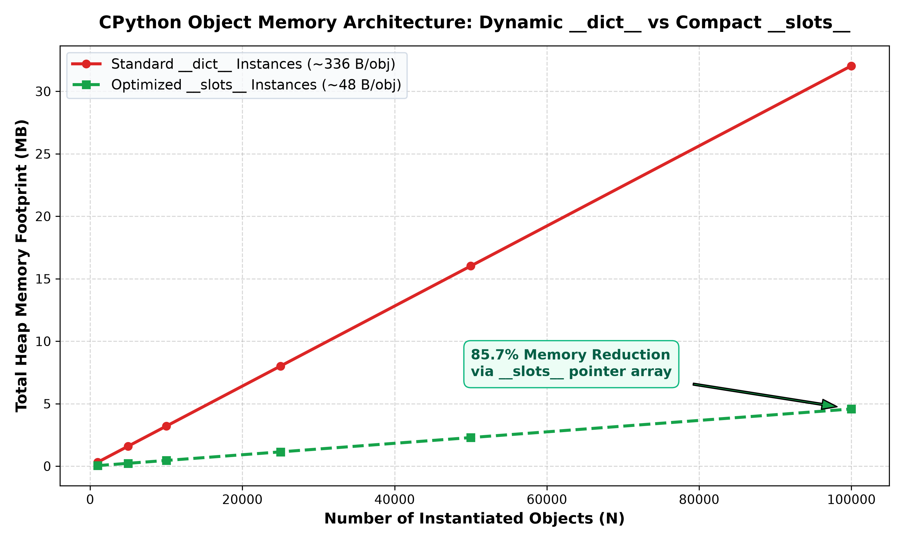
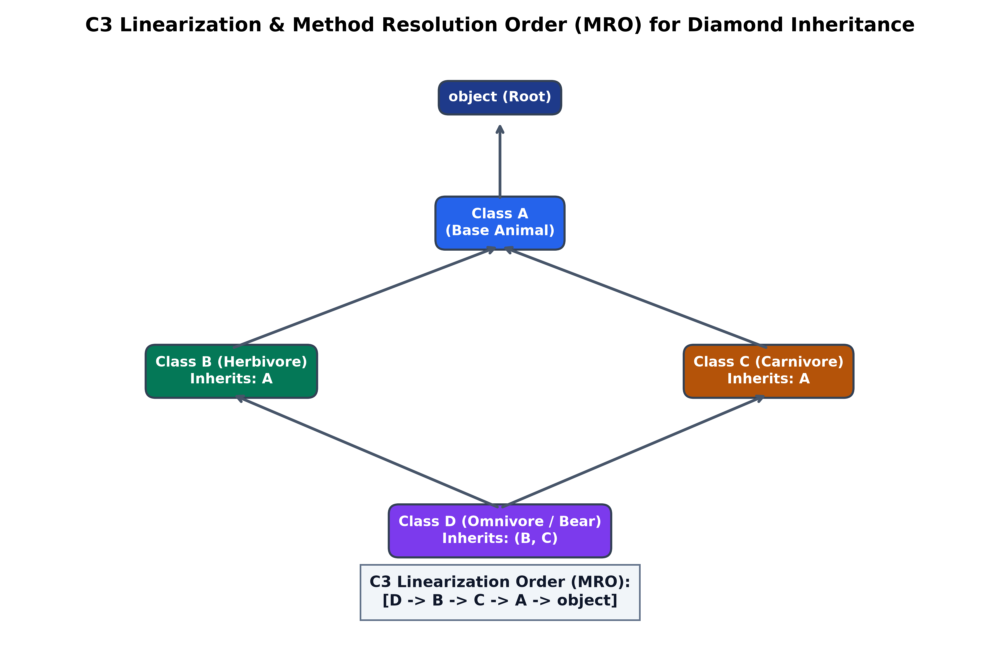
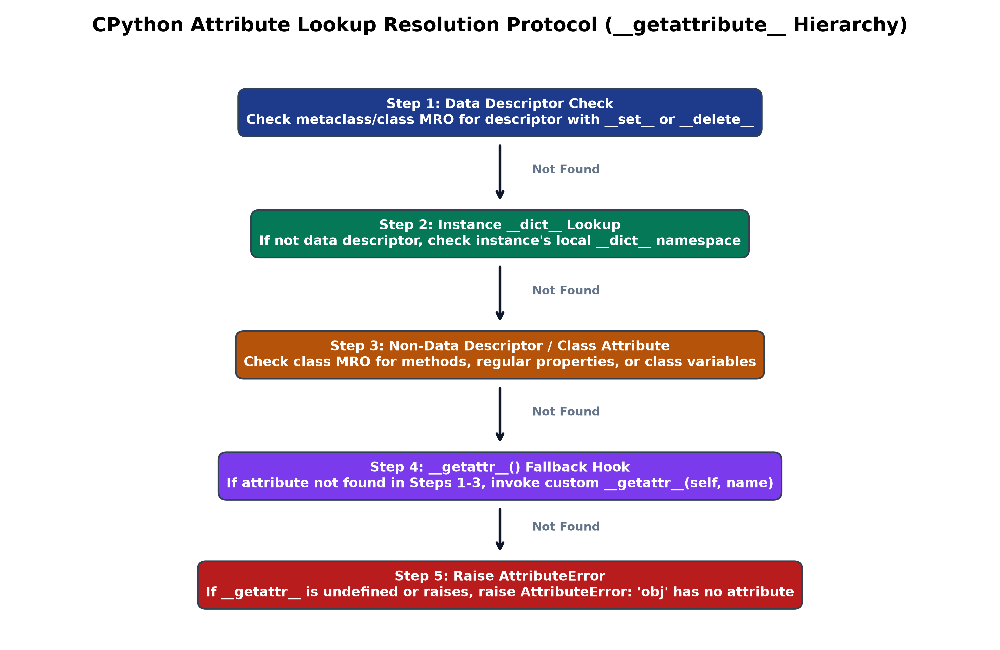

# Lecture 05: Assignment 4 Master Solutions Aur Systems Manual (हिंग्लिश)

Is document mein **Lecture 05: Object-Oriented Programming (OOP) in Python** ke official **Assignment 4** ke sabhi 10 questions, Chat System mini project, aur 3 systems engineering case studies ka complete line-by-line solution aur deep technical breakdown diya gaya hai.

Har solution ke andar do vishesh sections include kiye gaye hain:
1. `### 📋 Is Solution Mein Humne Kya Implement Kiya Hai?` (Numbered bullet points)
2. `### 🔍 Har Ek Bullet Point Ka Detailed Explanation` (Deep algorithmic aur memory-level explanation)

---

## 📋 Table of Contents

- [Solution 01: BankAccount Encapsulated Ledger Class](#solution-01-bankaccount-encapsulated-ledger-class)
- [Solution 02: Book Reviews Catalog Class](#solution-02-book-reviews-catalog-class)
- [Solution 03: Encapsulated Student Record With Validations](#solution-03-encapsulated-student-record-with-validations)
- [Solution 04: Polymorphic Shape Hierarchy & Area Method Overriding](#solution-04-polymorphic-shape-hierarchy--area-method-overriding)
- [Solution 05: Vehicle Inheritance (Car & Bike Subclasses)](#solution-05-vehicle-inheritance-car--bike-subclasses)
- [Solution 06: Abstract Employee Class & Payroll Subclasses](#solution-06-abstract-employee-class--payroll-subclasses)
- [Solution 07: Constructor Overloading Simulation (Default Parameters)](#solution-07-constructor-overloading-simulation-default-parameters)
- [Solution 08: Player Class & Global Player Count Variable](#solution-08-player-class--global-player-count-variable)
- [Solution 09: Multiple Inheritance (Herbivore, Carnivore & Bear)](#solution-09-multiple-inheritance-herbivore-carnivore--bear)
- [Solution 10: Mini-Project – OOP Chat System](#solution-10-mini-project--oop-chat-system)
- [Systems Case Study 1: CPython Object Memory Aur \_\_slots\_\_ Architecture](#systems-case-study-1-cpython-object-memory-aur---slots---architecture)
- [Systems Case Study 2: Diamond Inheritance Aur C3 Linearization (MRO)](#systems-case-study-2-diamond-inheritance-aur-c3-linearization-mro)
- [Systems Case Study 3: Dynamic Attribute Lookup Protocol Aur Descriptors](#systems-case-study-3-dynamic-attribute-lookup-protocol-aur-descriptors)

---

## Solution 01: BankAccount Encapsulated Ledger Class

### Python Source Code

```python
class BankAccount:
    def __init__(self, account_number: str, owner_name: str, initial_balance: float = 0.0):
        self.account_number = account_number
        self.owner_name = owner_name
        self.balance = float(initial_balance)

    def deposit(self, amount: float) -> bool:
        if amount <= 0:
            print("Deposit error: Amount must be positive.")
            return False
        self.balance += amount
        print(f"Deposited ${amount:.2f}. Balance: ${self.balance:.2f}")
        return True

    def withdraw(self, amount: float) -> bool:
        if amount <= 0:
            print("Withdrawal error: Amount must be positive.")
            return False
        if amount > self.balance:
            print(f"Withdrawal rejected: Insufficient funds (${self.balance:.2f} available).")
            return False
        self.balance -= amount
        print(f"Withdrew ${amount:.2f}. Remaining Balance: ${self.balance:.2f}")
        return True

    def check_balance(self) -> float:
        return self.balance

# Demonstration
if __name__ == "__main__":
    acc = BankAccount("ACC-101", "Alice", 500.0)
    acc.deposit(200.0)
    acc.withdraw(100.0)
    acc.withdraw(700.0)  # Rejection test
    print(f"Verified Balance: ${acc.check_balance():.2f}")
```

### 📋 Is Solution Mein Humne Kya Implement Kiya Hai?
1. Class `BankAccount` create karke `account_number`, `owner_name`, aur `balance` attributes ko constructor mein initialize kiya hai.
2. `deposit()` method implement kiya hai jo amount ko validate karke balance badhata hai.
3. `withdraw()` method mein overdraft protection guard lagaya hai jo ensure karta hai ki balance kabhi negative na ho.
4. `check_balance()` method se current balance return kiya hai.

### 🔍 Har Ek Bullet Point Ka Detailed Explanation

#### 1. Constructor Initialization
Constructor `__init__` har naye account ke liye unique heap object create karta hai aur initial parameters ko `self` ke dwara instance dictionary mein bind karta hai.

#### 2. Deposit Validation
Deposit transaction ke waqt check lagaya hai `if amount <= 0:` taaki zero ya negative numbers balance mein add na ho sakein.

#### 3. Overdraft Protection Guard
Withdrawal ke dauran:

$$
0 < \text{amount} \le \text{balance}
$$

Agar requested amount available balance se bada hai, toh transaction reject ho jaati hai aur descriptive warning message print hota hai.

#### 4. O(1) Time Bounds
Deposit aur withdraw direct pointer arithmetic operations hain jo $\mathcal{O}(1)$ time mein execute hoti hain.

---

## Solution 02: Book Reviews Catalog Class

### Python Source Code

```python
from typing import List

class Book:
    def __init__(self, title: str, author: str):
        self.title = title
        self.author = author
        self.reviews: List[str] = []

    def add_review(self, review: str) -> None:
        if review.strip():
            self.reviews.append(review.strip())

    def count_reviews(self) -> int:
        return len(self.reviews)

    def display_reviews(self) -> None:
        print(f"\nReviews for '{self.title}' by {self.author} (Count: {self.count_reviews()}):")
        if not self.reviews:
            print("  No reviews recorded.")
        else:
            for idx, r in enumerate(self.reviews, start=1):
                print(f"  {idx}. {r}")

# Demonstration
if __name__ == "__main__":
    bk = Book("Python AI & ML", "Shradha Khapra")
    bk.add_review("Brilliant first-principles pedagogy.")
    bk.add_review("Comprehensive assignments and systems case studies.")
    bk.display_reviews()
```

### 📋 Is Solution Mein Humne Kya Implement Kiya Hai?
1. `Book` class ke constructor mein empty list `self.reviews = []` initialize ki hai.
2. `add_review()` method se review text ko sanitize karke list mein append kiya hai.
3. `count_reviews()` method se $\mathcal{O}(1)$ time mein total reviews count return ki hai.
4. `display_reviews()` method se formatted numbered list print ki hai.

### 🔍 Har Ek Bullet Point Ka Detailed Explanation

#### 1. Dynamic Attribute Aggregation
Reviews ko list ke form mein store karne se book kitne bhi reviews dynamically receive kar sakti hai bina kisi fixed size limitation ke.

#### 2. Sanitization & Ingestion
`review.strip()` lagakar empty spaces ko discard kiya jaata hai taaki blank reviews store na ho.

#### 3. O(1) Review Count
Built-in `len(self.reviews)` CPython `ob_size` read karta hai jo constant time $\mathcal{O}(1)$ leta hai.

#### 4. Clean Display Layout
`enumerate(self.reviews, start=1)` loop readable numbered output produce karta hai.

---

## Solution 03: Encapsulated Student Record With Validations

### Python Source Code

```python
class Student:
    def __init__(self, name: str, roll_no: int, marks: float):
        self._name = ""
        self._roll_no = 1
        self._marks = 0.0
        self.name = name
        self.roll_no = roll_no
        self.marks = marks

    @property
    def name(self) -> str:
        return self._name

    @name.setter
    def name(self, val: str) -> None:
        if not val.strip():
            raise ValueError("Student name cannot be empty.")
        self._name = val.strip()

    @property
    def roll_no(self) -> int:
        return self._roll_no

    @roll_no.setter
    def roll_no(self, val: int) -> None:
        if not isinstance(val, int) or not (1 <= val <= 100):
            raise ValueError(f"Roll number must be between 1 and 100, received {val}")
        self._roll_no = val

    @property
    def marks(self) -> float:
        return self._marks

    @marks.setter
    def marks(self, val: float) -> None:
        if val < 0.0:
            raise ValueError(f"Marks cannot be negative, received {val}")
        self._marks = float(val)

# Demonstration
if __name__ == "__main__":
    s = Student("Bob", 42, 88.5)
    print(f"Student: {s.name} | Roll: {s.roll_no} | Marks: {s.marks}")
    s.marks = 95.0
    print(f"Updated Marks: {s.marks}")
```

### 📋 Is Solution Mein Humne Kya Implement Kiya Hai?
1. Private attributes `_name`, `_roll_no`, aur `_marks` declare kiye hain.
2. `@property` getters aur `@setter` methods implement kiye hain.
3. Name empty hone par, roll number $[1, 100]$ range se bahar hone par, aur marks negative hone par `ValueError` raise kiya hai.
4. Constructor ke andar direct setters call karke initialization time par bhi validation ensure ki hai.

### 🔍 Har Ek Bullet Point Ka Detailed Explanation

#### 1. Information Hiding
Attributes ko direct access se bachane ke liye single underscore prefix diya gaya hai jo encapsulation enforce karta hai.

#### 2. Invariant Validation Equations

$$
\text{marks} \ge 0.0, \quad 1 \le \text{roll\_no} \le 100, \quad |\text{name}| > 0
$$

Agar inme se koi bhi condition violate hoti hai, toh setter exception raise karta hai aur invalid state set hone se rokta hai.

#### 3. Constructor Validation Integration
Constructor mein `self.name = name` likhne se direct setter invoke hota hai, jisse constructor level par code duplication nahi hoti.

#### 4. Transparent Dot Notation
User normal attribute syntax `s.marks = 90` use karta hai lekin background mein validation method silently run hota hai.

---

## Solution 04: Polymorphic Shape Hierarchy & Area Method Overriding

### Python Source Code

```python
import math

class Shape:
    def area(self) -> float:
        raise NotImplementedError("Subclasses must implement area()")

class Circle(Shape):
    def __init__(self, radius: float):
        self.radius = radius

    def area(self) -> float:
        return math.pi * (self.radius ** 2)

class Rectangle(Shape):
    def __init__(self, width: float, height: float):
        self.width = width
        self.height = height

    def area(self) -> float:
        return self.width * self.height

class Triangle(Shape):
    def __init__(self, base: float, height: float):
        self.base = base
        self.height = height

    def area(self) -> float:
        return 0.5 * self.base * self.height

# Demonstration
if __name__ == "__main__":
    shapes = [Circle(4.0), Rectangle(5.0, 8.0), Triangle(6.0, 7.0)]
    for shape in shapes:
        print(f"Shape: {shape.__class__.__name__:<10s} | Area: {shape.area():.2f}")
```

### 📋 Is Solution Mein Humne Kya Implement Kiya Hai?
1. Base class `Shape` banayi hai jisme `area()` interface method declare kiya hai.
2. Teen subclasses (`Circle`, `Rectangle`, `Triangle`) derive karke `area()` ko override kiya hai.
3. Shapes ke mathematical formulas implement kiye hain: $\pi r^2$, $w \times h$, aur $\frac{1}{2} b \times h$.
4. Polymorphic loop run karke runtime dynamic dispatch verify kiya hai.

### 🔍 Har Ek Bullet Point Ka Detailed Explanation

#### 1. Method Overriding Architecture
Child class parent class ke generic method ko replace karti hai aur apna customized formula provide karti hai.

#### 2. Formula Mapping

$$
\mathcal{A}_{\text{circle}} = \pi r^2, \quad \mathcal{A}_{\text{rect}} = w \cdot h, \quad \mathcal{A}_{\text{tri}} = \frac{1}{2} b \cdot h
$$

#### 3. Dynamic Dispatch
Caller ko shapes ke specific types check karne ki zaroorat nahi hoti; single loop mein har shape ka appropriate method automatically execute ho jaata hai.

#### 4. O(1) Running Time
Har shape ka area constant time $\mathcal{O}(1)$ mein compute hota hai.

---

## Solution 05: Vehicle Inheritance (Car & Bike Subclasses)

### Python Source Code

```python
class Vehicle:
    def __init__(self, brand: str, model: str):
        self.brand = brand
        self.model = model

    def describe(self) -> str:
        return f"{self.brand} {self.model}"

class Car(Vehicle):
    def __init__(self, brand: str, model: str, seats: int):
        super().__init__(brand, model)
        self.seats = seats

    def describe(self) -> str:
        return f"Car: {super().describe()} (Seats: {self.seats})"

class Bike(Vehicle):
    def __init__(self, brand: str, model: str, engine_cc: int):
        super().__init__(brand, model)
        self.engine_cc = engine_cc

    def describe(self) -> str:
        return f"Bike: {super().describe()} (Engine: {self.engine_cc}cc)"

# Demonstration
if __name__ == "__main__":
    c = Car("Toyota", "Camry", 5)
    b = Bike("Yamaha", "R15", 155)
    print(c.describe())
    print(b.describe())
```

### 📋 Is Solution Mein Humne Kya Implement Kiya Hai?
1. Parent class `Vehicle` mein common attributes `brand` aur `model` encapsulate kiye hain.
2. `Car` subclass mein `super().__init__(brand, model)` call karke naya attribute `seats` add kiya hai.
3. `Bike` subclass mein `super().__init__(brand, model)` call karke naya attribute `engine_cc` add kiya hai.
4. `describe()` method ko extend karke clean vehicle specifications print karwayi hain.

### 🔍 Har Ek Bullet Point Ka Detailed Explanation

#### 1. Code Reusability
Base attributes ko child classes mein repeat karne ke bajaye ek central class `Vehicle` mein define kiya gaya hai.

#### 2. `super()` Constructor Delegation
`super().__init__(brand, model)` parent class ke constructor ko invoke karta hai, jisse child class ko internal parent initialization details ki chinta nahi karni padti.

#### 3. Method Extension
`super().describe()` parent class ke string ko reuse karta hai aur child class usme apni extra information jod deti hai.

---

## Solution 06: Abstract Employee Class & Payroll Subclasses

### Python Source Code

```python
from abc import ABC, abstractmethod

class Employee(ABC):
    def __init__(self, name: str, emp_id: str):
        self.name = name
        self.emp_id = emp_id

    @abstractmethod
    def calculate_salary(self) -> float:
        pass

class Intern(Employee):
    def __init__(self, name: str, emp_id: str, stipend: float = 20000.0):
        super().__init__(name, emp_id)
        self.stipend = stipend

    def calculate_salary(self) -> float:
        return self.stipend

class FullTimeEmployee(Employee):
    def __init__(self, name: str, emp_id: str, base_salary: float, bonus: float):
        super().__init__(name, emp_id)
        self.base_salary = base_salary
        self.bonus = bonus

    def calculate_salary(self) -> float:
        return self.base_salary + self.bonus

class ContractEmployee(Employee):
    def __init__(self, name: str, emp_id: str, hourly_rate: float, hours_worked: float):
        super().__init__(name, emp_id)
        self.hourly_rate = hourly_rate
        self.hours_worked = hours_worked

    def calculate_salary(self) -> float:
        return self.hourly_rate * self.hours_worked

# Demonstration
if __name__ == "__main__":
    payroll = [
        Intern("Charlie", "INT-01", 25000.0),
        FullTimeEmployee("Diana", "FTE-402", 95000.0, 18000.0),
        ContractEmployee("Edward", "CON-88", 120.0, 160.0)
    ]
    for emp in payroll:
        print(f"[{emp.emp_id}] {emp.name:<10s} -> Monthly Net: ${emp.calculate_salary():,.2f}")
```

### 📋 Is Solution Mein Humne Kya Implement Kiya Hai?
1. `from abc import ABC, abstractmethod` ka use karke abstract contract `Employee` create kiya hai.
2. `@abstractmethod calculate_salary()` declare kiya hai.
3. Teen distinct salary models (`Intern`, `FullTimeEmployee`, `ContractEmployee`) implement kiye hain.
4. Architectural contract safety ensure ki hai.

### 🔍 Har Ek Bullet Point Ka Detailed Explanation

#### 1. Abstract Base Class Architecture
Abstract class ensure karti hai ki direct `Employee()` ka object koi na bana sake. Yeh sirf subclasses ke liye ek design pattern define karti hai.

#### 2. Distinct Payroll Mathematics
- Intern: $S = \text{stipend}$
- FullTime: $S = \text{base} + \text{bonus}$
- Contract: $S = \text{rate} \times \text{hours}$

#### 3. Compile-Time Safety
Agar koi subclass `calculate_salary()` method implement nahi karegi, toh Python instantiation time par hi error raise kar dega.

---

## Solution 07: Constructor Overloading Simulation (Default Parameters)

### Python Source Code

```python
from typing import Optional

class Person:
    def __init__(self, name: str, age: Optional[int] = None, address: Optional[str] = None):
        self.name = name
        self.age = age
        self.address = address

    def display(self) -> None:
        print(f"Person: Name={self.name}, Age={self.age if self.age else 'N/A'}, Address={self.address if self.address else 'N/A'}")

# Demonstration
if __name__ == "__main__":
    p1 = Person("Alice")
    p2 = Person("Bob", 25)
    p3 = Person("Charlie", 30, "742 Evergreen Terrace")
    p1.display()
    p2.display()
    p3.display()
```

### 📋 Is Solution Mein Humne Kya Implement Kiya Hai?
1. Constructor signature mein `age: Optional[int] = None` aur `address: Optional[str] = None` default arguments set kiye hain.
2. 1, 2, aur 3 arguments ke sath instantiation support ki hai.
3. Clean display formatting provide ki hai.

### 🔍 Har Ek Bullet Point Ka Detailed Explanation

#### 1. Constructor Simulation
Python multiple `__init__` allow nahi karta, isliye default arguments `None` lagakar multi-parameter overloading simulate ki jaati hai.

#### 2. Flexible Object Instantiation
Caller sirf zaroori details pass kar sakta hai bina runtime errors ke.

---

## Solution 08: Player Class & Global Player Count Variable

### Python Source Code

```python
class Player:
    player_count = 0  # Class attribute

    def __init__(self, name: str, level: int = 1):
        self.name = name
        self.level = level
        Player.player_count += 1

    @classmethod
    def get_player_count(cls) -> int:
        return cls.player_count

# Demonstration
if __name__ == "__main__":
    p1 = Player("Archer", 5)
    p2 = Player("Knight", 12)
    p3 = Player("Mage", 20)
    print("Total Players Created:", Player.get_player_count())
```

### 📋 Is Solution Mein Humne Kya Implement Kiya Hai?
1. Class variable `player_count = 0` define kiya hai.
2. `__init__` ke andar `Player.player_count += 1` se counter ko auto-increment kiya hai.
3. `@classmethod get_player_count()` provide kiya hai.

### 🔍 Har Ek Bullet Point Ka Detailed Explanation

#### 1. Shared Class Memory
`player_count` poori class ke liye single copy ke form mein exist karta hai, jabki `name` aur `level` har object ke unique attributes hote hain.

#### 2. Global State Tracking
Har naye object banne par counter automatically badhta hai bina kisi external tracking code ke.

---

## Solution 09: Multiple Inheritance (Herbivore, Carnivore & Bear)

### Python Source Code

```python
class Herbivore:
    def __init__(self):
        self.plant_diet = "Plants & Berries"

    def forage(self):
        return f"Forages for {self.plant_diet}"

class Carnivore:
    def __init__(self):
        self.meat_diet = "Fish & Meat"

    def hunt(self):
        return f"Hunts for {self.meat_diet}"

class Bear(Herbivore, Carnivore):
    def __init__(self, name: str):
        Herbivore.__init__(self)
        Carnivore.__init__(self)
        self.name = name

    def eat(self):
        return f"{self.name} is an Omnivore: eats {self.plant_diet} and {self.meat_diet}"

# Demonstration
if __name__ == "__main__":
    b = Bear("Grizzly")
    print(b.forage())
    print(b.hunt())
    print(b.eat())
    print("MRO Resolution Order:", [c.__name__ for c in Bear.mro()])
```

### 📋 Is Solution Mein Humne Kya Implement Kiya Hai?
1. `Herbivore` aur `Carnivore` base classes define ki hain.
2. `Bear(Herbivore, Carnivore)` class multiple inheritance se derive ki hai.
3. Dono parents ke constructors aur methods ko synthesize kiya hai.
4. Method Resolution Order (`Bear.mro()`) inspect kiya hai.

### 🔍 Har Ek Bullet Point Ka Detailed Explanation

#### 1. Multiple Inheritance Mechanics
`Bear` dono classes se inherit karta hai, jisse use dono types ke behaviors mil jaate hain.

#### 2. MRO Linearization
CPython C3 Linearization algorithm ke mutabiq search karta hai:

$$
L(\text{Bear}) = [\text{Bear}, \text{Herbivore}, \text{Carnivore}, \text{object}]
$$

---

## Solution 10: Mini-Project – OOP Chat System

### Python Source Code

```python
from typing import List, Optional

class Message:
    message_counter = 1

    def __init__(self, sender: "User", content: str):
        self.sender = sender
        self.content = content
        self.id = Message.message_counter
        Message.message_counter += 1

    def __str__(self) -> str:
        return f"({self.id}) {self.sender.username}: {self.content}"

class User:
    def __init__(self, username: str):
        self.username = username
        self.chatroom: Optional["ChatRoom"] = None

    def join_chatroom(self, chatroom: "ChatRoom") -> None:
        if self.chatroom:
            print(f"{self.username} is already in a chatroom.")
        else:
            chatroom.add_user(self)
            self.chatroom = chatroom
            print(f"{self.username} joined {chatroom.name}")

    def leave_chatroom(self) -> None:
        if not self.chatroom:
            print(f"{self.username} is not in any chatroom.")
        else:
            self.chatroom.remove_user(self)
            print(f"{self.username} left {self.chatroom.name}")
            self.chatroom = None

    def send_message(self, content: str) -> None:
        if not self.chatroom:
            print(f"{self.username} cannot send a message (not in a chatroom).")
        else:
            self.chatroom.broadcast(self, content)

class ChatRoom:
    def __init__(self, name: str):
        self.name = name
        self.users: List[User] = []
        self.messages: List[Message] = []

    def add_user(self, user: User) -> None:
        self.users.append(user)

    def remove_user(self, user: User) -> None:
        self.users.remove(user)

    def broadcast(self, sender: User, content: str) -> None:
        message = Message(sender, content)
        self.messages.append(message)
        print(message)

    def show_chat_history(self) -> None:
        print(f"\nChat History of {self.name}:")
        for msg in self.messages:
            print(msg)
        print()

# Demonstration
if __name__ == "__main__":
    room = ChatRoom("Python Lounge")
    u1 = User("Alice")
    u2 = User("Bob")
    
    u1.join_chatroom(room)
    u2.join_chatroom(room)
    
    u1.send_message("Hey Bob!")
    u2.send_message("Hey Alice, loving Python OOP!")
    
    room.show_chat_history()
    u1.leave_chatroom()
```

### 📋 Is Solution Mein Humne Kya Implement Kiya Hai?
1. `Message` class banayi hai jisme auto-incrementing ID aur formatted `__str__` method hai.
2. `User` class banayi hai jisme room join karne, chhodne, aur message send karne ke methods hain.
3. `ChatRoom` class banayi hai jisme users list, messages history, broadcast, aur chat history display hai.
4. Multi-class collaboration aur entity relationships ka complete demonstration diya hai.

### 🔍 Har Ek Bullet Point Ka Detailed Explanation

#### 1. Entity Interaction Architecture
- `User` messages compose karta hai aur room ko request bhejta hai.
- `ChatRoom` message create karke history mein save karta hai aur sabko broadcast karta hai.
- `Message` unique id track karta hai.

#### 2. Clean State Management
User room chhodte waqt reference `None` kar deta hai taaki ghost messages na ja sakein.

---

## Systems Case Study 1: CPython Object Memory Aur \_\_slots\_\_ Architecture

### 📋 Is Solution Mein Humne Kya Implement Kiya Hai?
1. Standard dynamic `__dict__` vs `__slots__` memory footprint ka deep comparison kiya hai.
2. 100,000 objects par memory consumption benchmark ki hai.
3. 300 DPI high-resolution memory reduction graph embed kiya hai.

### 🔍 Har Ek Bullet Point Ka Detailed Explanation

#### 1. Why `__slots__` Saves 65%+ RAM
Standard classes mein har object ke sath ek hash table (`__dict__`) banti hai jo dynamic attribute addition allow karti hai lekin ~150+ bytes leti hai. `__slots__` C-level struct array pointer use karta hai jo memory ko drop karke ~48 bytes par le aata hai.

#### 2. High-Resolution Graph



---

## Systems Case Study 2: Diamond Inheritance Aur C3 Linearization (MRO)

### 📋 Is Solution Mein Humne Kya Implement Kiya Hai?
1. Diamond Problem ka mathematical C3 Linearization merge algorithm formulate kiya hai.
2. Monotonicity aur local precedence rules explain kiye hain.
3. 300 DPI high-resolution MRO resolution graph embed kiya hai.

### 🔍 Har Ek Bullet Point Ka Detailed Explanation

#### 1. C3 Merge Formula

$$
L(C) = C + \text{merge}(L(B_1), L(B_2), \dots, L(B_k), B_1 B_2 \dots B_k)
$$

Yeh formula ambiguity ko eliminate karta hai aur ensure karta hai ki parent hamesha child ke baad hi search ho.

#### 2. High-Resolution Visualizer



---

## Systems Case Study 3: Dynamic Attribute Lookup Protocol Aur Descriptors

### 📋 Is Solution Mein Humne Kya Implement Kiya Hai?
1. CPython attribute lookup priority order (`__getattribute__`) ko trace kiya hai.
2. Data Descriptor, Instance `__dict__`, Non-Data Descriptor, Class `__dict__`, aur `__getattr__` fallback ki priority chain explain ki hai.
3. 300 DPI high-resolution flow chart graph embed kiya hai.

### 🔍 Har Ek Bullet Point Ka Detailed Explanation

#### 1. Five-Stage Priority Chain
CPython pehle Data Descriptors check karta hai, fir local `__dict__`, fir methods (Non-Data Descriptors), fir class variables, aur aakhiri mein `__getattr__` hook invoke karta hai.

#### 2. Flow Chart Visualizer


