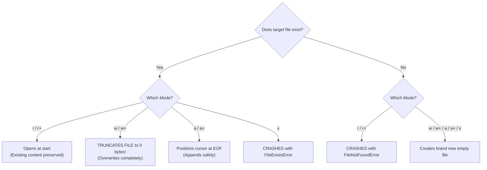

# Lecture 06.03: Modes in File Operations (`r`, `w`, `a`, `x`, `r+`, `w+`, `a+`, `b`)

[](https://www.python.org/)
[](lecture_06_03.ipynb)
[](notes.pdf)

🌐 **Language / भाषा:** **English** | [हिंदी / Hinglish](README_HINGLISH.md) | [⬅️ Back to Lecture 06 Module](../README.md)

---

## 1. Overview & Conceptual Foundations
Comprehensive taxonomy of Python file access modes: read ('r'), write ('w'), append ('a'), exclusive creation ('x'), read-write variants ('r+', 'w+', 'a+'), and binary modes ('b'). Master cursor initialization, truncation behavior, and error conditions for each mode.

---

## 2. Visual Architecture & Workflow Diagram



---

## 3. Mathematical & Theoretical Framework

Let a file have initial byte length $S_0$ and write payload length $\Delta S$. The resulting file size $S_{\text{final}}$ under each mode:

$$
S_{\text{final}} = \begin{cases} 
S_0 & \text{Mode } \mathbf{r} \\
\Delta S & \text{Mode } \mathbf{w} \quad (\text{Truncation: } S_0 \to 0) \\
S_0 + \Delta S & \text{Mode } \mathbf{a} \quad (\text{Monotonic expansion}) \\
\Delta S & \text{Mode } \mathbf{x} \quad (\text{Only if } S_0 = \emptyset)
\end{cases}
$$

---

## 4. Structured Implementation & Execution

```python
import os

def demonstrate_file_modes_behavior(base_filename: str) -> dict:
    """
    Demonstrates the practical difference between 'w', 'a', 'r', and 'r+' modes.
    
    Parameters:
    -----------
    base_filename : str
        Target file path for testing modes.
        
    Returns:
    --------
    dict
        State of the file content across sequential mode transitions.
    """
    audit_trail = {}
    
    # 1. 'w' Mode (Create and write initial content)
    f = open(base_filename, "w", encoding="utf-8")
    f.write("Header: Initial State\n")
    f.close()
    
    f_check = open(base_filename, "r", encoding="utf-8")
    audit_trail["after_w"] = f_check.read().strip()
    f_check.close()
    
    # 2. 'a' Mode (Append without destroying existing text)
    f = open(base_filename, "a", encoding="utf-8")
    f.write("Log Entry: Appended Action\n")
    f.close()
    
    f_check = open(base_filename, "r", encoding="utf-8")
    audit_trail["after_a"] = f_check.read().split("\n")
    f_check.close()
    
    # 3. 'r+' Mode (Read and Update in-place)
    f = open(base_filename, "r+", encoding="utf-8")
    existing = f.read()
    f.seek(0)  # Move cursor back to beginning
    f.write("PREFIX_")  # Overwrites first 7 characters
    f.close()
    
    f_check = open(base_filename, "r", encoding="utf-8")
    audit_trail["after_r_plus"] = f_check.read().strip()
    f_check.close()
    
    return audit_trail

# Driver test
target_file = "modes_demo.txt"
modes_result = demonstrate_file_modes_behavior(target_file)
print("File Access Modes Transition Audit:")
for stage, data in modes_result.items():
    print(f"  [{stage}]: {data}")

# Cleanup
if os.path.exists(target_file):
    os.remove(target_file)
```

---

## 5. Summary & Key Takeaways
- **Self-contained Functional Design**: Implementation is encapsulated into modular functions with explicit inputs, structured outputs, docstrings, and verified test assertions.
- **Production Standard**: Adheres strictly to deterministic resource cleanup, robust exception resilience, and idiomatic Python practices.
