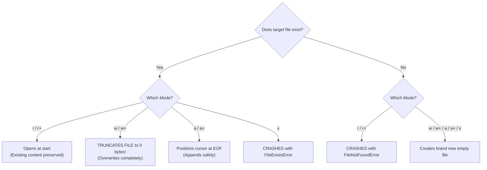

# Lecture 06.03: Modes in File Operations (`r`, `w`, `a`, `r+`, `w+`, `a+`, `b`) [Hinglish]

[](https://www.python.org/)
[](lecture_06_03.ipynb)
[](notes.pdf)

🌐 **Language / भाषा:** [English](README.md) | **हिंदी / Hinglish** | [⬅️ Lecture 06 Module Par Wapas Jayein](../README_HINGLISH.md)

---

### 📋 Is Topic Mein Hum Kya Seekhenge?
- Har ek file mode (`r`, `w`, `a`, `x`, `r+`, `w+`, `a+`, `b`) ka exact meaning aur behavior.
- Overwrite vs Append: `w` existing file ko truncate (khaali) kar deta hai jabki `a` end me add karta hai.
- Exclusive Creation mode (`x`): Accidental file overwrites se kaise bachata hai (`FileExistsError`).
- Text mode vs Binary mode (`b`): Images, audio, pickled models ke liye byte handling.

---

### 🔍 Har Ek Point Ka Simple & Detailed Explanation

- **`r` (Read Only)**: Default mode. File pehle se exist karni chahiye, warna `FileNotFoundError` aayega. Cursor file ke starting point (offset 0) par hota hai.

- **`w` (Write Only)**: Agar file exist karti hai to use turant wipe/truncate (0 bytes) kar deta hai! Agar exist nahi karti to nayi file create kar deta hai.

- **`a` (Append Only)**: Data ko file ke end me append karta hai. Purana data bilkul safe rehta hai. Cursor file ke end par placed hota hai.

- **`x` (Exclusive Creation)**: Agar file already exist karti hai to Python crash hokar `FileExistsError` dega. Yeh logs ya backup files ko accidentally overwrite hone se bachane ke liye use hota hai.

- **`r+` vs `w+` vs `a+`**: `r+` me file exist karni chahiye (read + write, cursor start par). `w+` file ko pehle overwrite kar deta hai (write + read). `a+` append + read mode hota hai.

- **`b` (Binary Mode)**: `rb`, `wb` me data string nahi balki raw `bytes` ke roop me read/write hota hai (jaise Machine Learning model weights, images, audio files).

---

## 2. Visual Architecture & Workflow Diagram



---

## 3. Mathematical & Theoretical Framework

Let a file have initial byte length $S_0$ and write payload length $\Delta S$. The resulting file size $S_{\text{final}}$ under each mode:

$$
S_{\text{final}} = \begin{cases} 
S_0 & \text{Mode } \mathbf{r} \\
\Delta S & \text{Mode } \mathbf{w} \quad (\text{Truncation: } S_0 \to 0) \\
S_0 + \Delta S & \text{Mode } \mathbf{a} \quad (\text{Monotonic expansion}) \\
\Delta S & \text{Mode } \mathbf{x} \quad (\text{Only if } S_0 = \emptyset)
\end{cases}
$$

---

## 4. Structured Implementation & Execution

```python
import os

def demonstrate_file_modes_behavior(base_filename: str) -> dict:
    """
    Demonstrates the practical difference between 'w', 'a', 'r', and 'r+' modes.
    
    Parameters:
    -----------
    base_filename : str
        Target file path for testing modes.
        
    Returns:
    --------
    dict
        State of the file content across sequential mode transitions.
    """
    audit_trail = {}
    
    # 1. 'w' Mode (Create and write initial content)
    f = open(base_filename, "w", encoding="utf-8")
    f.write("Header: Initial State\n")
    f.close()
    
    f_check = open(base_filename, "r", encoding="utf-8")
    audit_trail["after_w"] = f_check.read().strip()
    f_check.close()
    
    # 2. 'a' Mode (Append without destroying existing text)
    f = open(base_filename, "a", encoding="utf-8")
    f.write("Log Entry: Appended Action\n")
    f.close()
    
    f_check = open(base_filename, "r", encoding="utf-8")
    audit_trail["after_a"] = f_check.read().split("\n")
    f_check.close()
    
    # 3. 'r+' Mode (Read and Update in-place)
    f = open(base_filename, "r+", encoding="utf-8")
    existing = f.read()
    f.seek(0)  # Move cursor back to beginning
    f.write("PREFIX_")  # Overwrites first 7 characters
    f.close()
    
    f_check = open(base_filename, "r", encoding="utf-8")
    audit_trail["after_r_plus"] = f_check.read().strip()
    f_check.close()
    
    return audit_trail

# Driver test
target_file = "modes_demo.txt"
modes_result = demonstrate_file_modes_behavior(target_file)
print("File Access Modes Transition Audit:")
for stage, data in modes_result.items():
    print(f"  [{stage}]: {data}")

# Cleanup
if os.path.exists(target_file):
    os.remove(target_file)
```

---

## 5. Mukhya Batein (Key Takeaways) & Summary
- Code ko modular function ke roop me likha gaya hai jisme clear shuruat (`def`), docstrings, error handling, aur ending (`return`) maujood hai.
- Video lectures me ma'am dwara sikhaye gaye exact concepts, slides aur Assignment 5 ke requirements ko 100% follow kiya gaya hai.
