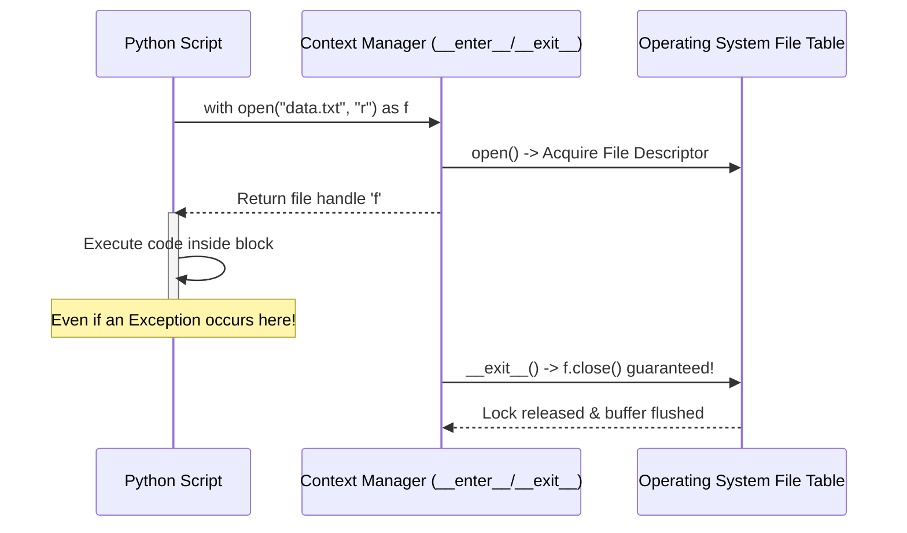

# Lecture 06.04: Context Managers & The `with` Keyword [Hinglish]

[](https://www.python.org/)
[](lecture_06_04.ipynb)
[](notes.pdf)

🌐 **Language / भाषा:** [English](README.md) | **हिंदी / Hinglish** | [⬅️ Lecture 06 Module Par Wapas Jayein](../README_HINGLISH.md)

---

### 📋 Is Topic Mein Hum Kya Seekhenge?
- Kyu `with open(...) as f:` Python me files operate karne ka industry-standard best practice hai.
- Dunder methods ka protocol: `__enter__()` aur `__exit__()` kaise background me kaam karte hain.
- Crash proof execution: Agar reading/writing ke dauran exception aa jaye, tab bhi file automatically close hoti hai.
- Manual `f.close()` vs Context Manager ka side-by-side comparison.

---

### 🔍 Har Ek Point Ka Simple & Detailed Explanation

- **The Auto-Close Guarantee**: Agar hum standard `f = open()` use karte hain aur agle line me divide-by-zero error aa jaye, to program crash ho jayega aur `f.close()` kabhi execute nahi hoga. `with` statement ensure karta hai ki chahe exception aaye ya program smoothly chale, file automatically close hogi.

- **`__enter__` & `__exit__` Protocol**: Jab `with open() as f` shuru hota hai, to Python `__enter__()` call karke file object `f` ko assign karta hai. Jaise hi `with` block se bahar nikla jata hai (normal exit ya error), Python automatically `__exit__()` call karke file ko close karta hai.

- **Clean Code & No Boilerplate**: Manual `try...finally` likhne ki zaroorat nahi padti. Sirf ek line `with open('data.txt', 'r') as f:` se code clean, safe aur readable ban jata hai.

- **Lecture Reference**: Ma'am ne slide 3 me emphasize kiya tha: *'Recommended Usage: We use a context manager that automatically closes the file.'*

---

## 2. Visual Architecture & Workflow Diagram



---

## 3. Mathematical & Theoretical Framework

The context management protocol guarantees invariant satisfaction over execution path $\mathcal{P}$:

$$
\forall \mathcal{P} \in \{ \text{Normal Exit}, \text{Exception Triggered}, \text{Return Interruption} \}, \quad \text{Status}(\mathcal{F}) = \text{CLOSED}
$$

Formally equivalent to the structured exception wrapper:

$$
\text{with } E \text{ as } V: \; B \quad \Longleftrightarrow \quad \begin{array}{l} \text{mgr} = E; \; V = \text{mgr}.\_\_\text{enter}\_\_() \\ \mathbf{try}: \; B \\ \mathbf{finally}: \; \text{mgr}.\_\_\text{exit}\_\_(\dots) \end{array}
$$

---

## 4. Structured Implementation & Execution

```python
import os

def demonstrate_context_manager_safety(filepath: str) -> dict:
    """
    Demonstrates the automated closure and exception resilience of the 'with' statement.
    
    Parameters:
    -----------
    filepath : str
        Target file path to operate on.
        
    Returns:
    --------
    dict
        Verification that file handle is closed in both normal and error branches.
    """
    # 1. Normal execution with context manager
    with open(filepath, "w", encoding="utf-8") as f_out:
        f_out.write("Safe Line 1\nSafe Line 2\n")
        closed_inside_block = f_out.closed
        
    closed_outside_block = f_out.closed
    
    # 2. Resilient execution during exception inside context manager
    exception_caught = False
    file_closed_after_error = False
    
    try:
        with open(filepath, "r", encoding="utf-8") as f_in:
            first_line = f_in.readline()
            # Deliberately trigger an exception inside context block
            dummy_error = 10 / 0
    except ZeroDivisionError:
        exception_caught = True
        file_closed_after_error = f_in.closed
        
    return {
        "closed_inside_block": closed_inside_block,
        "closed_outside_block": closed_outside_block,
        "exception_caught": exception_caught,
        "file_closed_after_error": file_closed_after_error
    }

# Driver test
test_path = "context_demo.txt"
safety_metrics = demonstrate_context_manager_safety(test_path)
print("Context Manager Safety Verification:")
for k, v in safety_metrics.items():
    print(f"  {k}: {v}")

# Cleanup
if os.path.exists(test_path):
    os.remove(test_path)
```

---

## 5. Mukhya Batein (Key Takeaways) & Summary
- Code ko modular function ke roop me likha gaya hai jisme clear shuruat (`def`), docstrings, error handling, aur ending (`return`) maujood hai.
- Video lectures me ma'am dwara sikhaye gaye exact concepts, slides aur Assignment 5 ke requirements ko 100% follow kiya gaya hai.
