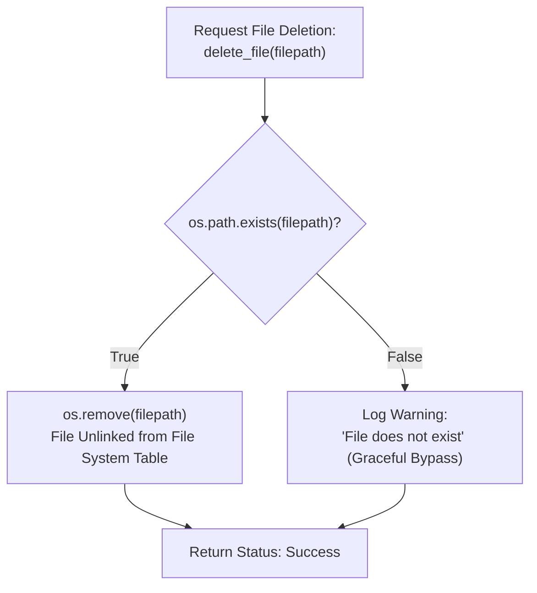

# Lecture 06.05: Deleting & Managing Files (`os.remove`, `os.path.exists`)

[](https://www.python.org/)
[](lecture_06_05.ipynb)
[](notes.pdf)

🌐 **Language / भाषा:** **English** | [हिंदी / Hinglish](README_HINGLISH.md) | [⬅️ Back to Lecture 06 Module](../README.md)

---

## 1. Overview & Conceptual Foundations
Learn filesystem manipulation and maintenance in Python using the built-in os module and modern pathlib library. Discover safe deletion protocols with os.remove() and os.path.exists(), avoiding FileNotFoundError crashes, file renaming, and directory creation.

---

## 2. Visual Architecture & Workflow Diagram



---

## 3. Mathematical & Theoretical Framework

Filesystem deletion unlinks the directory inode pointer $\mathcal{I}$ from the filesystem tree $\mathcal{T}_{\text{fs}}$:

$$
\mathcal{T}_{\text{fs}} \xrightarrow{\text{unlink}(p)} \mathcal{T}_{\text{fs}} \setminus \{ p \}
$$

The existence check guarantees precondition safety:

$$
\text{Precondition: } p \in \text{DOM}(\mathcal{T}_{\text{fs}}) \implies \Pr(\text{FileNotFoundError}) = 0
$$

---

## 4. Structured Implementation & Execution

```python
import os
from pathlib import Path

def safe_file_deletion_and_management(filepath: str) -> dict:
    """
    Implements a safe file management workflow: creation, renaming, existence checking,
    and safe deletion.
    
    Parameters:
    -----------
    filepath : str
        Initial file path to create and manage.
        
    Returns:
    --------
    dict
        Execution status at each filesystem operation stage.
    """
    status = {}
    
    # 1. Create temporary file
    with open(filepath, "w", encoding="utf-8") as f:
        f.write("Temporary payload destined for deletion.\n")
    status["created"] = os.path.exists(filepath)
    
    # 2. Rename file safely
    renamed_path = filepath.replace(".txt", "_renamed.txt")
    if os.path.exists(filepath):
        os.rename(filepath, renamed_path)
    status["renamed"] = os.path.exists(renamed_path)
    status["old_exists"] = os.path.exists(filepath)
    
    # 3. Safe deletion check
    if os.path.exists(renamed_path):
        os.remove(renamed_path)
        status["deleted"] = True
    else:
        status["deleted"] = False
        
    status["final_check"] = os.path.exists(renamed_path)
    return status

# Driver test
sample_file = "temp_management.txt"
mgmt_res = safe_file_deletion_and_management(sample_file)
print("Filesystem Operations Audit Trail:")
for k, v in mgmt_res.items():
    print(f"  {k}: {v}")
```

---

## 5. Summary & Key Takeaways
- **Self-contained Functional Design**: Implementation is encapsulated into modular functions with explicit inputs, structured outputs, docstrings, and verified test assertions.
- **Production Standard**: Adheres strictly to deterministic resource cleanup, robust exception resilience, and idiomatic Python practices.
