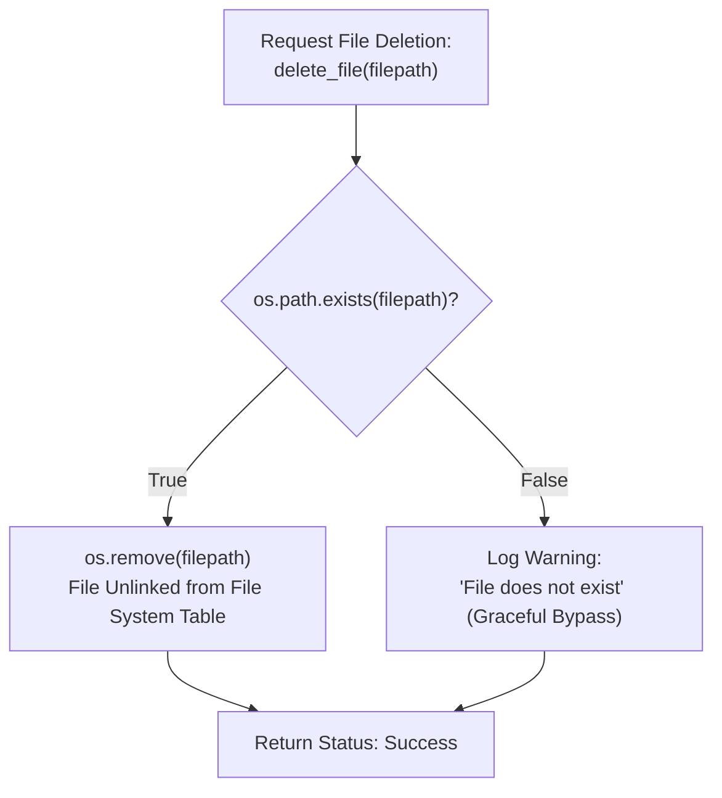

# Lecture 06.05: Deleting & Managing Files (`os.remove`, `os.path.exists`) [Hinglish]

[](https://www.python.org/)
[](lecture_06_05.ipynb)
[](notes.pdf)

🌐 **Language / भाषा:** [English](README.md) | **हिंदी / Hinglish** | [⬅️ Lecture 06 Module Par Wapas Jayein](../README_HINGLISH.md)

---

### 📋 Is Topic Mein Hum Kya Seekhenge?
- Disk se files ko safely delete karne ka method: `os.remove()`.
- Pre-deletion existence validation: `os.path.exists()` se crash prevention.
- Modern alternative: `pathlib.Path` se object-oriented filesystem manipulation.
- Renaming aur directory handling: `os.rename()` aur `os.makedirs()`.

---

### 🔍 Har Ek Point Ka Simple & Detailed Explanation

- **`os.remove()` Function**: Python me file ko hard drive se permanently delete karne ke liye `os` module import karke `os.remove('filename')` call kiya jata hai.

- **Safe Deletion Protocol**: Agar file exist nahi karti aur hum direct `os.remove()` call kar dein, to Python `FileNotFoundError` throw karke program crash kar dega. Hamesha `if os.path.exists(filepath):` check lagana mandatory best practice hai.

- **Directory vs File**: `os.remove()` sirf files ko delete karta hai. Empty folders ke liye `os.rmdir()` aur non-empty folders ke liye `shutil.rmtree()` use hota hai.

- **Modern `pathlib` Approach**: Python 3.4+ me `from pathlib import Path` use karke `p = Path('data.txt'); p.unlink(missing_ok=True)` likhna aur bhi clean aur cross-platform hota hai.

---

## 2. Visual Architecture & Workflow Diagram



---

## 3. Mathematical & Theoretical Framework

Filesystem deletion unlinks the directory inode pointer $\mathcal{I}$ from the filesystem tree $\mathcal{T}_{\text{fs}}$:

$$
\mathcal{T}_{\text{fs}} \xrightarrow{\text{unlink}(p)} \mathcal{T}_{\text{fs}} \setminus \{ p \}
$$

The existence check guarantees precondition safety:

$$
\text{Precondition: } p \in \text{DOM}(\mathcal{T}_{\text{fs}}) \implies \Pr(\text{FileNotFoundError}) = 0
$$

---

## 4. Structured Implementation & Execution

```python
import os
from pathlib import Path

def safe_file_deletion_and_management(filepath: str) -> dict:
    """
    Implements a safe file management workflow: creation, renaming, existence checking,
    and safe deletion.
    
    Parameters:
    -----------
    filepath : str
        Initial file path to create and manage.
        
    Returns:
    --------
    dict
        Execution status at each filesystem operation stage.
    """
    status = {}
    
    # 1. Create temporary file
    with open(filepath, "w", encoding="utf-8") as f:
        f.write("Temporary payload destined for deletion.\n")
    status["created"] = os.path.exists(filepath)
    
    # 2. Rename file safely
    renamed_path = filepath.replace(".txt", "_renamed.txt")
    if os.path.exists(filepath):
        os.rename(filepath, renamed_path)
    status["renamed"] = os.path.exists(renamed_path)
    status["old_exists"] = os.path.exists(filepath)
    
    # 3. Safe deletion check
    if os.path.exists(renamed_path):
        os.remove(renamed_path)
        status["deleted"] = True
    else:
        status["deleted"] = False
        
    status["final_check"] = os.path.exists(renamed_path)
    return status

# Driver test
sample_file = "temp_management.txt"
mgmt_res = safe_file_deletion_and_management(sample_file)
print("Filesystem Operations Audit Trail:")
for k, v in mgmt_res.items():
    print(f"  {k}: {v}")
```

---

## 5. Mukhya Batein (Key Takeaways) & Summary
- Code ko modular function ke roop me likha gaya hai jisme clear shuruat (`def`), docstrings, error handling, aur ending (`return`) maujood hai.
- Video lectures me ma'am dwara sikhaye gaye exact concepts, slides aur Assignment 5 ke requirements ko 100% follow kiya gaya hai.
