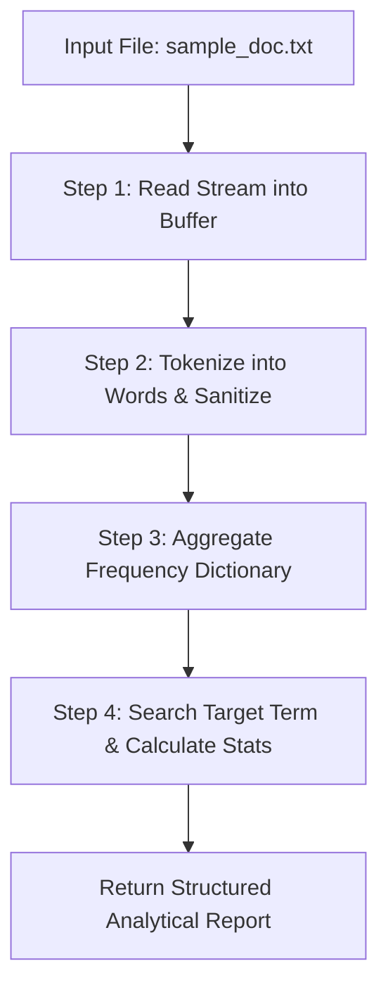

# Lecture 06.06: Practice Problems on File I/O

[](https://www.python.org/)
[](lecture_06_06.ipynb)
[](notes.pdf)

🌐 **Language / भाषा:** **English** | [हिंदी / Hinglish](README_HINGLISH.md) | [⬅️ Back to Lecture 06 Module](../README.md)

---

## 1. Overview & Conceptual Foundations
Real-world algorithmic problem solving using Python File I/O. Build production-grade utilities: text word frequency analysis, case-insensitive keyword searching, in-place find-and-replace, and line/character counting across text logs.

---

## 2. Visual Architecture & Workflow Diagram



---

## 3. Mathematical & Theoretical Framework

Given a text file as a sequence of tokens $\mathcal{W} = (w_1, w_2, \dots, w_M)$, the term frequency $f(t)$ for term $t$ is:

$$
f(t) = \sum_{i=1}^M \mathbb{I}(w_i = t), \quad \mathbb{I}(\text{condition}) \in \{0, 1\}
$$

The Shannon text entropy can quantify vocabulary richness:

$$
H(\mathcal{W}) = -\sum_{t \in \text{Vocab}} p(t) \log_2 p(t), \quad p(t) = \frac{f(t)}{M}
$$

---

## 4. Structured Implementation & Execution

```python
import os
import re
from collections import Counter

def analyze_and_transform_text_file(filepath: str, old_word: str, new_word: str) -> dict:
    """
    Performs comprehensive text file analysis: word counting, frequency aggregation,
    and find-and-replace transformation.
    
    Parameters:
    -----------
    filepath : str
        Target text document path.
    old_word : str
        Target substring to find and replace.
    new_word : str
        Replacement string.
        
    Returns:
    --------
    dict
        Detailed document metrics and transformation confirmation.
    """
    # 1. Read and analyze
    with open(filepath, "r", encoding="utf-8") as f:
        content = f.read()
        
    lines = content.splitlines()
    words = re.findall(r'\b\w+\b', content.lower())
    
    total_chars = len(content)
    total_words = len(words)
    total_lines = len(lines)
    word_counts = Counter(words)
    
    # 2. Perform Find & Replace
    updated_content = content.replace(old_word, new_word)
    with open(filepath, "w", encoding="utf-8") as f:
        f.write(updated_content)
        
    return {
        "line_count": total_lines,
        "word_count": total_words,
        "character_count": total_chars,
        "top_3_words": word_counts.most_common(3),
        "target_word_occurrences": content.count(old_word),
        "transformation_applied": f"Replaced '{old_word}' with '{new_word}'"
    }

# Driver test
test_file = "practice_doc.txt"
sample_data = """Python is an amazing programming language.
Python is used for data science and AI.
File handling in Python is simple, elegant, and efficient."""

with open(test_file, "w", encoding="utf-8") as f:
    f.write(sample_data)

stats = analyze_and_transform_text_file(test_file, "Python", "Modern Python")
print("Text File Analytics & Transformation Results:")
for k, v in stats.items():
    print(f"  {k}: {v}")

# Cleanup
if os.path.exists(test_file):
    os.remove(test_file)
```

---

## 5. Summary & Key Takeaways
- **Self-contained Functional Design**: Implementation is encapsulated into modular functions with explicit inputs, structured outputs, docstrings, and verified test assertions.
- **Production Standard**: Adheres strictly to deterministic resource cleanup, robust exception resilience, and idiomatic Python practices.
