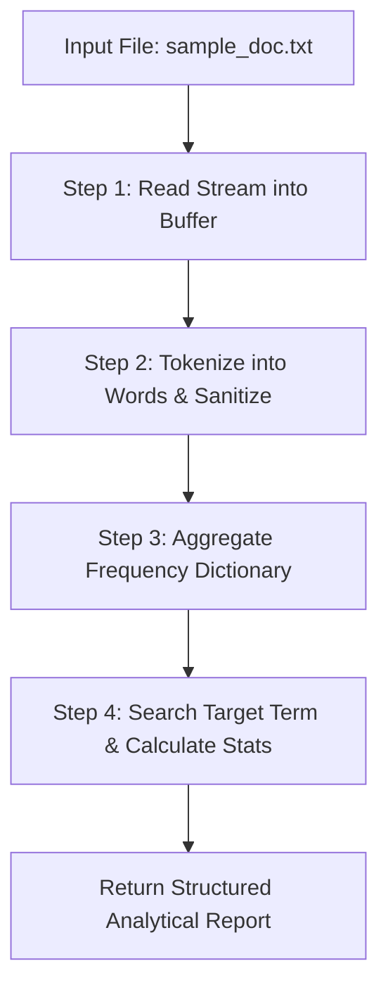

# Lecture 06.06: Practice Problems on File I/O [Hinglish]

[](https://www.python.org/)
[](lecture_06_06.ipynb)
[](notes.pdf)

🌐 **Language / भाषा:** [English](README.md) | **हिंदी / Hinglish** | [⬅️ Lecture 06 Module Par Wapas Jayein](../README_HINGLISH.md)

---

### 📋 Is Topic Mein Hum Kya Seekhenge?
- Real-world file processing algorithms: Word frequency counter aur keyword searcher.
- Text files me specific string find & replace karne ka production logic.
- Line count, word count, aur character count calculate karne ka structured approach.
- File pointers aur data parsing me edge cases (empty files, special symbols) handle karna.

---

### 🔍 Har Ek Point Ka Simple & Detailed Explanation

- **Word Frequency Analysis**: File me har word kitni baar aaya hai count karna. Text ko read karke punctuation clean karna, lowercase me convert karna, aur dictionary me count accumulate karna.

- **Find and Replace Pattern**: File ko read mode me khol kar string replace karna (`content.replace('old', 'new')`), aur phir same file ko write mode me khol kar updated content save karna.

- **Search in Files**: Kisi large log file me specific error code (jaise 'ERROR 404') search karna aur matching line numbers return karna.

- **Lecture Reference**: Ma'am ne video 6 me practice problems solve karke dikhaye the jisme text search aur word count cover kiye gaye the.

---

## 2. Visual Architecture & Workflow Diagram



---

## 3. Mathematical & Theoretical Framework

Given a text file as a sequence of tokens $\mathcal{W} = (w_1, w_2, \dots, w_M)$, the term frequency $f(t)$ for term $t$ is:

$$
f(t) = \sum_{i=1}^M \mathbb{I}(w_i = t), \quad \mathbb{I}(\text{condition}) \in \{0, 1\}
$$

The Shannon text entropy can quantify vocabulary richness:

$$
H(\mathcal{W}) = -\sum_{t \in \text{Vocab}} p(t) \log_2 p(t), \quad p(t) = \frac{f(t)}{M}
$$

---

## 4. Structured Implementation & Execution

```python
import os
import re
from collections import Counter

def analyze_and_transform_text_file(filepath: str, old_word: str, new_word: str) -> dict:
    """
    Performs comprehensive text file analysis: word counting, frequency aggregation,
    and find-and-replace transformation.
    
    Parameters:
    -----------
    filepath : str
        Target text document path.
    old_word : str
        Target substring to find and replace.
    new_word : str
        Replacement string.
        
    Returns:
    --------
    dict
        Detailed document metrics and transformation confirmation.
    """
    # 1. Read and analyze
    with open(filepath, "r", encoding="utf-8") as f:
        content = f.read()
        
    lines = content.splitlines()
    words = re.findall(r'\b\w+\b', content.lower())
    
    total_chars = len(content)
    total_words = len(words)
    total_lines = len(lines)
    word_counts = Counter(words)
    
    # 2. Perform Find & Replace
    updated_content = content.replace(old_word, new_word)
    with open(filepath, "w", encoding="utf-8") as f:
        f.write(updated_content)
        
    return {
        "line_count": total_lines,
        "word_count": total_words,
        "character_count": total_chars,
        "top_3_words": word_counts.most_common(3),
        "target_word_occurrences": content.count(old_word),
        "transformation_applied": f"Replaced '{old_word}' with '{new_word}'"
    }

# Driver test
test_file = "practice_doc.txt"
sample_data = """Python is an amazing programming language.
Python is used for data science and AI.
File handling in Python is simple, elegant, and efficient."""

with open(test_file, "w", encoding="utf-8") as f:
    f.write(sample_data)

stats = analyze_and_transform_text_file(test_file, "Python", "Modern Python")
print("Text File Analytics & Transformation Results:")
for k, v in stats.items():
    print(f"  {k}: {v}")

# Cleanup
if os.path.exists(test_file):
    os.remove(test_file)
```

---

## 5. Mukhya Batein (Key Takeaways) & Summary
- Code ko modular function ke roop me likha gaya hai jisme clear shuruat (`def`), docstrings, error handling, aur ending (`return`) maujood hai.
- Video lectures me ma'am dwara sikhaye gaye exact concepts, slides aur Assignment 5 ke requirements ko 100% follow kiya gaya hai.
