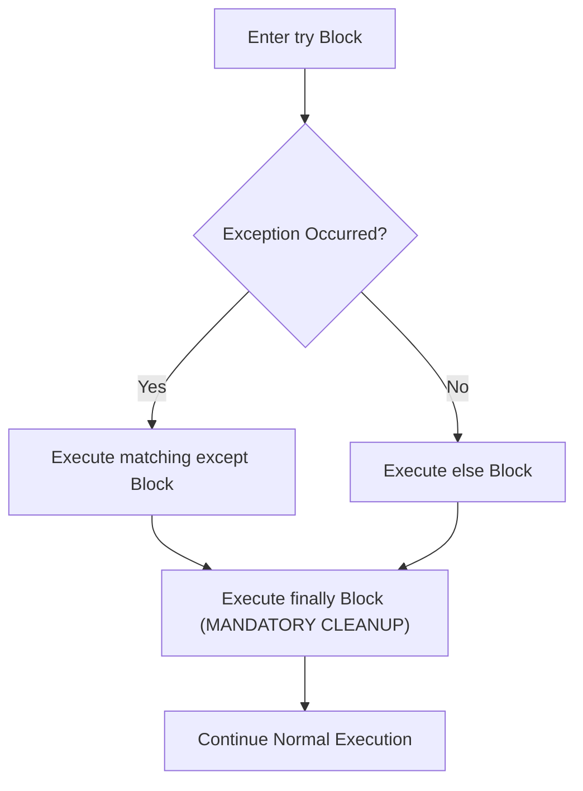

# Lecture 06.08: The Complete Exception Flow (`try`, `except`, `else`, `finally`, `raise`)

[](https://www.python.org/)
[](lecture_06_08.ipynb)
[](notes.pdf)

🌐 **Language / भाषा:** **English** | [हिंदी / Hinglish](README_HINGLISH.md) | [⬅️ Back to Lecture 06 Module](../README.md)

---

## 1. Overview & Conceptual Foundations
Master the complete 4-part exception handling architecture in Python: try, except, else, and finally, along with deliberate exception raising using the raise keyword and creating custom domain-specific Exception classes.

---

## 2. Visual Architecture & Workflow Diagram



---

## 3. Mathematical & Theoretical Framework

The execution state flow is a disjoint partition of execution paths with an invariant terminal closure:

$$
\mathcal{P} = (\text{try} \land \text{except}) \; \dot{\cup} \; (\text{try} \land \text{else})
$$

The terminal cleanup operation $\Omega_{\text{finally}}$ is invariant across all branches:

$$
\forall \pi \in \mathcal{P}, \quad \pi \longrightarrow \Omega_{\text{finally}}
$$

---

## 4. Structured Implementation & Execution

```python
class NegativeBalanceError(Exception):
    """Custom domain exception raised when an account operation leads to negative balance."""
    pass

def process_bank_withdrawal(current_balance: float, withdraw_amount: float) -> dict:
    """
    Demonstrates the complete try-except-else-finally pipeline including custom exception raising.
    
    Parameters:
    -----------
    current_balance : float
        Available balance in user account.
    withdraw_amount : float
        Requested withdrawal amount.
        
    Returns:
    --------
    dict
        Transaction summary and execution audit trail.
    """
    audit = []
    response = {
        "success": False,
        "remaining_balance": current_balance,
        "audit_trail": audit
    }
    
    audit.append("1. Transaction Initiated")
    try:
        audit.append("2. Entering try block - validating amounts")
        if withdraw_amount <= 0:
            raise ValueError("Withdrawal amount must be strictly positive.")
            
        if withdraw_amount > current_balance:
            raise NegativeBalanceError(f"Insufficient funds: Balance (${current_balance}) < Withdrawal (${withdraw_amount})")
            
        new_balance = current_balance - withdraw_amount
        
    except ValueError as ve:
        audit.append(f"3a. Caught ValueError: {ve}")
        response["error"] = str(ve)
        
    except NegativeBalanceError as nbe:
        audit.append(f"3b. Caught NegativeBalanceError: {nbe}")
        response["error"] = str(nbe)
        
    else:
        # Executes ONLY if NO exception occurred
        audit.append("3c. Executing else block: Transaction approved")
        response["success"] = True
        response["remaining_balance"] = new_balance
        
    finally:
        # ALWAYS executes regardless of outcome
        audit.append("4. Executing finally block: Releasing security locks & logging session")
        
    return response

# Driver test cases
print("Complete Exception Pipeline Test:")

# Case 1: Valid transaction
res1 = process_bank_withdrawal(1000.0, 300.0)
print(f"\nCase 1 (Valid): Success={res1['success']}, Balance=${res1['remaining_balance']}")
for step in res1['audit_trail']:
    print(f"   {step}")

# Case 2: Insufficient funds (Custom Exception)
res2 = process_bank_withdrawal(500.0, 800.0)
print(f"\nCase 2 (Insufficient Funds): Success={res2['success']}, Error='{res2.get('error')}'")
for step in res2['audit_trail']:
    print(f"   {step}")
```

---

## 5. Summary & Key Takeaways
- **Self-contained Functional Design**: Implementation is encapsulated into modular functions with explicit inputs, structured outputs, docstrings, and verified test assertions.
- **Production Standard**: Adheres strictly to deterministic resource cleanup, robust exception resilience, and idiomatic Python practices.
