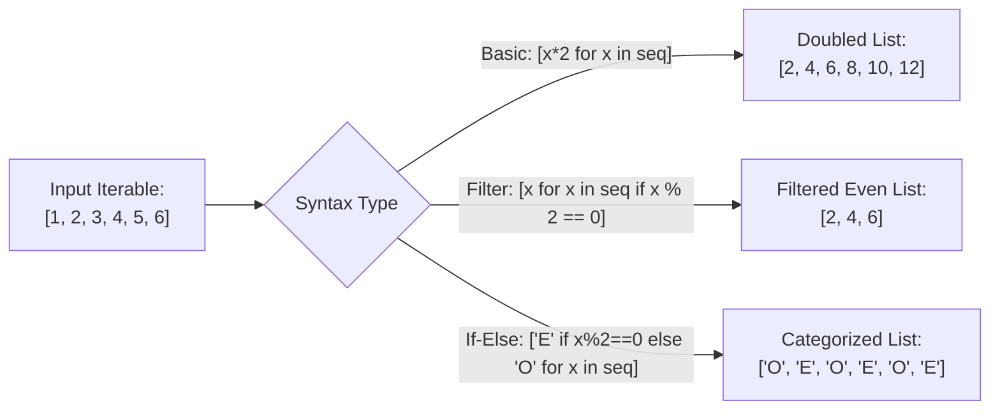

# Lecture 06.09: List Comprehensions in Python

[](https://www.python.org/)
[](lecture_06_09.ipynb)
[](notes.pdf)

🌐 **Language / भाषा:** **English** | [हिंदी / Hinglish](README_HINGLISH.md) | [⬅️ Back to Lecture 06 Module](../README.md)

---

## 1. Overview & Conceptual Foundations
Master Python's expressive and concise list comprehension syntax. Replace multi-line accumulator for-loops with one-line expressions: basic mapping [expr for x in iterable], filtering with if clauses [expr for x in iterable if cond], ternary conditional expressions [a if c else b for x in iterable], and nested matrix transformations.

---

## 2. Visual Architecture & Workflow Diagram



---

## 3. Mathematical & Theoretical Framework

A list comprehension translates set-builder notation from set theory into procedural lists:

$$
\mathcal{L} = \{ f(x) \mid x \in \mathcal{S} \land P(x) \}
$$

In Python list comprehension syntax:

$$
\text{Python: } [f(x) \text{ for } x \text{ in } \mathcal{S} \text{ if } P(x)]
$$

When equipped with a conditional evaluator $g(x) = (x \in \mathcal{A} ? v_1 : v_2)$:

$$
[v_1 \text{ if } P(x) \text{ else } v_2 \text{ for } x \text{ in } \mathcal{S}]
$$

---

## 4. Structured Implementation & Execution

```python
def evaluate_list_comprehension_variants(numbers: list) -> dict:
    """
    Demonstrates basic mapping, conditional filtering, ternary if-else,
    and dictionary comprehensions.
    
    Parameters:
    -----------
    numbers : list of int
        Input list of integers to transform.
        
    Returns:
    --------
    dict
        Transformed collections across each comprehension pattern.
    """
    # 1. Basic Mapping: Squares of numbers
    squares = [x**2 for x in numbers]
    
    # 2. Filtering: Only numbers greater than 15 (Assignment 5 Q3)
    filtered_gt_15 = [x for x in numbers if x > 15]
    
    # 3. Filtering: Only even numbers
    evens = [x for x in numbers if x % 2 == 0]
    
    # 4. Ternary If-Else: Label numbers as 'Even' or 'Odd'
    parity_labels = ["Even" if x % 2 == 0 else "Odd" for x in numbers]
    
    # 5. Dictionary Comprehension: Map number to its cube
    cube_mapping = {x: x**3 for x in numbers[:4]}
    
    return {
        "original": numbers,
        "squares": squares,
        "filtered_greater_than_15": filtered_gt_15,
        "even_numbers": evens,
        "parity_labels": parity_labels,
        "cube_dictionary": cube_mapping
    }

# Driver test (Includes Assignment 5 Q3 dataset [5, 10, 15, 20, 25])
sample_numbers = [5, 10, 15, 20, 25]
comp_results = evaluate_list_comprehension_variants(sample_numbers)
print("List Comprehension Variations Results:")
for k, v in comp_results.items():
    print(f"  {k}: {v}")
```

---

## 5. Summary & Key Takeaways
- **Self-contained Functional Design**: Implementation is encapsulated into modular functions with explicit inputs, structured outputs, docstrings, and verified test assertions.
- **Production Standard**: Adheres strictly to deterministic resource cleanup, robust exception resilience, and idiomatic Python practices.
