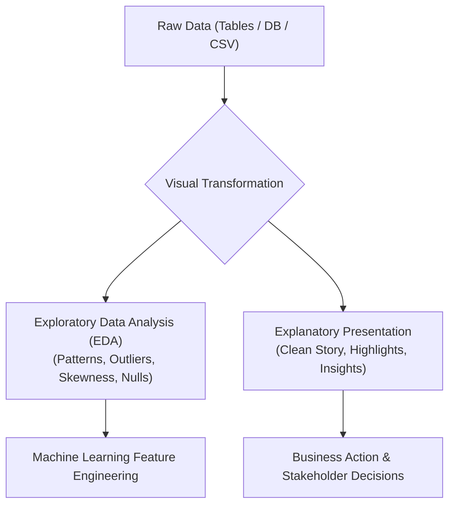

# Day 18 - Lecture 18.1: What is Data Visualization? [Hinglish]

[](https://www.python.org/)
[](lecture_18_01.ipynb)
[](notes.pdf)

🌐 **Language / भाषा:** [English](README.md) | **हिंदी / Hinglish** | [⬅️ Lecture 18 Module Par Wapas Jayein](../README_HINGLISH.md)

---

### 📋 Is Topic Mein Hum Kya Seekhenge?
- Data Visualization kya hota hai aur machine learning / data science me iska primary role kya hai.
- Raw numbers vs Visual representations: Human perception aur visual cognitive processing advantage.
- Anscombe's Quartet ka statistical adhaar: Kyu summary statistics (mean, variance, correlation) misleading ho sakti hain.
- Exploratory Data Analysis (EDA) aur Explanatory Visualization ke beech ka core difference.

---

### 🔍 Har Ek Point Ka Simple & Detailed Explanation

- **Visual Advantage (Cognitive Processing)**: Jab hum table me 1,000 rows dekhte hain, tab trends dhoondhna exhausting hota hai. Lekin wahi data jab line chart ya scatter plot par plot hota hai, tab outliers, seasonal peaks aur troughs seconds me identify ho jate hain.

- **Anscombe's Quartet (1973)**: Francis Anscombe ne 4 alag datasets create kiye jinka mean, variance aur correlation bilkul identical tha ($r \approx 0.816$), lekin jab unhe plot kiya gaya to ek linear tha, ek quadratic parabola, ek straight line with outlier, aur ek vertical cluster with leverage point!

- **Exploratory vs Explanatory Visualization**: EDA model training se pehle data distribution, skewness, missing values aur correlations samajhne ke liye hota hai (analyst-centric). Explanatory visual stakeholder presentation aur business decisions ke liye clean aur polished banaya jata hai.

---

## 2. Visual Architecture & Workflow Diagram



---

## 3. Mathematical & Theoretical Framework

Anscombe's Quartet demonstrates that datasets with identical summary statistics can have drastically different graphical forms:

$$
\bar{x} = 9.0, \quad s_x^2 = 11.0, \quad \bar{y} = 7.50, \quad s_y^2 = 4.125, \quad r_{xy} = 0.816
$$

The OLS regression line across all four datasets evaluates identically to:

$$
\hat{y} = 3.00 + 0.500x \quad (R^2 = 0.67)
$$

---

## 4. Structured Implementation & Execution

```python
import matplotlib.pyplot as plt
import numpy as np

def demonstrate_data_visualization_impact(years: list, revenue_millions: list) -> dict:
    """
    Demonstrates how visualizing tabular data transforms numbers into instant visual insights.
    
    Parameters:
    -----------
    years : list of int
        List of chronological years.
    revenue_millions : list of float
        Revenue values corresponding to each year in Millions USD.
        
    Returns:
    --------
    dict
        Computed summary metrics and visualization metadata.
    """
    fig, ax = plt.subplots(figsize=(8, 4))
    
    # Plotting line with data markers
    ax.plot(years, revenue_millions, marker='o', color='#2b5c8f', linewidth=2.5, markersize=8, label="Annual Revenue ($M)")
    
    # Visual cues for peak and lowest revenue
    max_idx = np.argmax(revenue_millions)
    min_idx = np.argmin(revenue_millions)
    
    ax.annotate(f"Peak: ${revenue_millions[max_idx]}M", 
                xy=(years[max_idx], revenue_millions[max_idx]),
                xytext=(years[max_idx]-0.5, revenue_millions[max_idx]+80),
                arrowprops=dict(facecolor='green', shrink=0.08, width=1.5, headwidth=6))
                
    ax.annotate(f"Trough: ${revenue_millions[min_idx]}M", 
                xy=(years[min_idx], revenue_millions[min_idx]),
                xytext=(years[min_idx]-0.5, revenue_millions[min_idx]+120),
                arrowprops=dict(facecolor='red', shrink=0.08, width=1.5, headwidth=6))

    ax.set_title("Visual Data Discovery: Movie Industry Revenue Trend", fontsize=14, fontweight='bold')
    ax.set_xlabel("Release Year", fontsize=11)
    ax.set_ylabel("Gross Box Office ($M)", fontsize=11)
    ax.grid(True, linestyle='--', alpha=0.6)
    ax.legend(loc="upper right")
    plt.tight_layout()
    plt.show()
    
    summary_stats = {
        "total_revenue": sum(revenue_millions),
        "mean_revenue": float(np.mean(revenue_millions)),
        "max_year": years[max_idx],
        "max_revenue": revenue_millions[max_idx],
        "min_year": years[min_idx],
        "min_revenue": revenue_millions[min_idx]
    }
    return summary_stats

# Driver execution
sample_years = [2008, 2009, 2010, 2011, 2012]
sample_revenue = [1005, 170, 427, 133, 232]

stats = demonstrate_data_visualization_impact(sample_years, sample_revenue)
print("Data Visualization Summary Metrics:")
for k, v in stats.items():
    print(f"  {k}: {v}")
```

---

## 5. Mukhya Batein (Key Takeaways) & Summary
- Code ko modular function ke roop me likha gaya hai jisme clear shuruat (`def`), docstrings, error handling, aur ending (`return`) maujood hai.
- Video lectures me ma'am dwara sikhaye gaye real movie box-office datasets aur syntax parameters ko exact follow kiya gaya hai.
