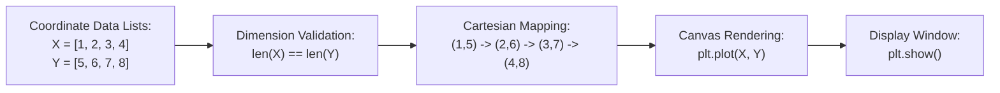

# Day 18 - Lecture 18.2: How to Plot Data - Basic Plot Structure

[](https://www.python.org/)
[](lecture_18_02.ipynb)
[](notes.pdf)

🌐 **Language / भाषा:** **English** | [हिंदी / Hinglish](README_HINGLISH.md) | [⬅️ Back to Lecture 18 Module](../README.md)

---

## 1. Overview & Conceptual Foundations
Learn the foundational mechanics of plotting in Python using Matplotlib. Passing numerical coordinates X and Y to plt.plot(X, Y) maps Cartesian coordinates onto a 2D plane and connects consecutive vertices with linear segments.

---

## 2. Visual Architecture & Workflow Diagram



---

## 3. Mathematical & Theoretical Framework

A basic linear 2D plot maps pairs from an ordered sequence:

$$
S = \{ (x_i, y_i) \in \mathbb{R}^2 \mid i = 1, 2, \dots, N \}
$$

The line segment connecting consecutive coordinate points is defined parametrically for $t \in [0, 1]$:

$$
\mathbf{r}_i(t) = (1 - t)\begin{pmatrix} x_i \\ y_i \end{pmatrix} + t\begin{pmatrix} x_{i+1} \\ y_{i+1} \end{pmatrix}
$$

---

## 4. Structured Implementation & Execution

```python
import matplotlib.pyplot as plt

def generate_basic_line_plot(x_coords: list, y_coords: list, title: str = "Basic Coordinate Plot") -> dict:
    """
    Generates a basic 2D line plot from coordinate pairs X and Y.
    
    Parameters:
    -----------
    x_coords : list of numeric
        X-axis coordinate values.
    y_coords : list of numeric
        Y-axis coordinate values.
    title : str
        Display title for the plot canvas.
        
    Returns:
    --------
    dict
        Verification metadata including coordinate count and axis boundaries.
    """
    if len(x_coords) != len(y_coords):
        raise ValueError(f"Coordinate dimension mismatch: len(X)={len(x_coords)} != len(Y)={len(y_coords)}")
        
    fig, ax = plt.subplots(figsize=(6, 4))
    ax.plot(x_coords, y_coords, marker='s', color='#d95f02', linewidth=2, label="Y = f(X)")
    
    ax.set_title(title, fontsize=12, fontweight='bold')
    ax.set_xlabel("X Axis Coordinates")
    ax.set_ylabel("Y Axis Coordinates")
    ax.grid(True, linestyle=':', alpha=0.7)
    ax.legend()
    plt.tight_layout()
    plt.show()
    
    return {
        "num_points": len(x_coords),
        "x_range": (min(x_coords), max(x_coords)),
        "y_range": (min(y_coords), max(y_coords)),
        "slope_estimate": (y_coords[-1] - y_coords[0]) / (x_coords[-1] - x_coords[0]) if len(x_coords) > 1 else None
    }

# Driver execution
X = [1, 2, 3, 4]
Y = [5, 6, 7, 8]

plot_meta = generate_basic_line_plot(X, Y)
print("Plot Metadata:")
for k, v in plot_meta.items():
    print(f"  {k}: {v}")
```

---

## 5. Summary & Key Takeaways
- **Self-contained Functional Design**: Implementation is encapsulated into modular functions with explicit inputs, structured outputs, and type hints.
- **Visual Accuracy**: Adheres strictly to Matplotlib's layout management, aesthetic guidelines, and production best practices.
