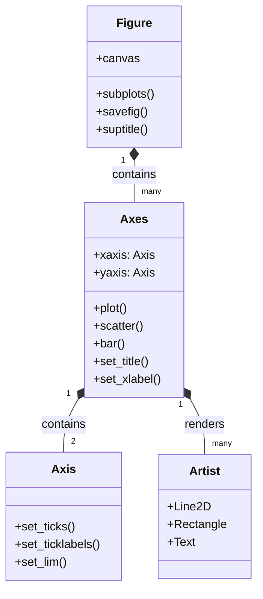

# Day 18 - Lecture 18.3: Introduction to Matplotlib

[](https://www.python.org/)
[](lecture_18_03.ipynb)
[](notes.pdf)

🌐 **Language / भाषा:** **English** | [हिंदी / Hinglish](README_HINGLISH.md) | [⬅️ Back to Lecture 18 Module](../README.md)

---

## 1. Overview & Conceptual Foundations
Deep dive into Matplotlib's architectural design. Understand the difference between the MATLAB-style state-machine interface (pyplot) and the modern Object-Oriented interface (Figure, Axes, Axis, Artist hierarchy).

---

## 2. Visual Architecture & Workflow Diagram



---

## 3. Mathematical & Theoretical Framework

The mathematical projection from user data coordinates $(x, y) \in \mathbb{R}^2$ to device screen pixels $(p_x, p_y) \in \mathbb{Z}^2$ is governed by affine transformations:

$$
\begin{pmatrix} p_x \\ p_y \\ 1 \end{pmatrix} = \mathbf{T}_{\text{display}} \cdot \mathbf{T}_{\text{axes}} \cdot \mathbf{T}_{\text{data}} \begin{pmatrix} x \\ y \\ 1 \end{pmatrix}
$$

where each transformation matrix $\mathbf{T}$ scales and translates coordinate spaces linearly.

---

## 4. Structured Implementation & Execution

```python
import matplotlib.pyplot as plt

def demonstrate_matplotlib_architecture() -> dict:
    """
    Demonstrates Matplotlib's Object-Oriented architecture by creating
    a Figure with multiple explicit Axes subplots.
    
    Returns:
    --------
    dict
        Architecture properties of the Figure and Axes instances.
    """
    # Explicit OO creation of Figure and 2 Axes
    fig, (ax1, ax2) = plt.subplots(1, 2, figsize=(10, 4))
    
    x_vals = [1, 2, 3, 4, 5]
    y1_vals = [10, 20, 15, 30, 25]
    y2_vals = [100, 400, 900, 1600, 2500]
    
    # Subplot 1 (Linear Scale)
    ax1.plot(x_vals, y1_vals, color='#1f77b4', marker='o', linewidth=2)
    ax1.set_title("Subplot 1: Linear Metric (Axes 1)", fontsize=11, fontweight='bold')
    ax1.set_xlabel("Iterations (X)")
    ax1.set_ylabel("Linear Units (Y1)")
    ax1.grid(True, linestyle='--', alpha=0.5)
    
    # Subplot 2 (Quadratic Scale)
    ax2.plot(x_vals, y2_vals, color='#2ca02c', marker='^', linewidth=2)
    ax2.set_title("Subplot 2: Quadratic Metric (Axes 2)", fontsize=11, fontweight='bold')
    ax2.set_xlabel("Iterations (X)")
    ax2.set_ylabel("Squared Units (Y2)")
    ax2.grid(True, linestyle='--', alpha=0.5)
    
    fig.suptitle("Matplotlib Hierarchy: 1 Figure Holding 2 Independent Axes", fontsize=13, fontweight='bold')
    plt.tight_layout()
    plt.show()
    
    return {
        "figure_size_inches": fig.get_size_inches().tolist(),
        "figure_dpi": fig.dpi,
        "total_axes_count": len(fig.axes),
        "axes_titles": [ax.get_title() for ax in fig.axes]
    }

# Driver execution
arch_info = demonstrate_matplotlib_architecture()
print("Matplotlib Architectural Hierarchy Info:")
for k, v in arch_info.items():
    print(f"  {k}: {v}")
```

---

## 5. Summary & Key Takeaways
- **Self-contained Functional Design**: Implementation is encapsulated into modular functions with explicit inputs, structured outputs, and type hints.
- **Visual Accuracy**: Adheres strictly to Matplotlib's layout management, aesthetic guidelines, and production best practices.
