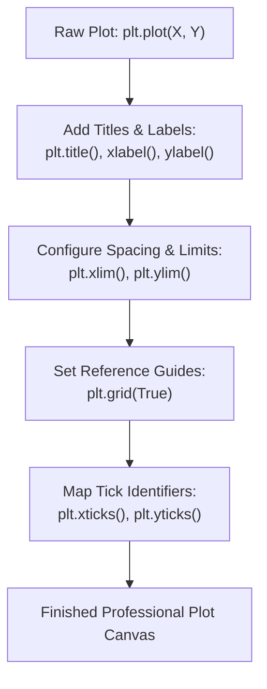

# Day 18 - Lecture 18.4: Important Plot Methods [Hinglish]

[](https://www.python.org/)
[](lecture_18_04.ipynb)
[](notes.pdf)

🌐 **Language / भाषा:** [English](README.md) | **हिंदी / Hinglish** | [⬅️ Lecture 18 Module Par Wapas Jayein](../README_HINGLISH.md)

---

### 📋 Is Topic Mein Hum Kya Seekhenge?
- Data plots me labels aur context ka mahatva: `plt.title()`, `plt.xlabel()`, `plt.ylabel()`.
- Axis scale clipping aur focus adjustment: `plt.xlim()` aur `plt.ylim()` ka use cases.
- Gridlines styling: `plt.grid(True, linestyle, alpha)` readability enhance karne ke liye.
- Custom tick marks configuration: `plt.xticks()` aur `plt.yticks()` se categorical dates/names map karna.

---

### 🔍 Har Ek Point Ka Simple & Detailed Explanation

- **Contextual Labeling**: Bina label ka plot ek unlabelled number sequence jaisa hota hai. `plt.xlabel('Years')` aur `plt.ylabel('Revenue ($M)')` define karne se graph turant self-explanatory ban jata hai.

- **Title Font Hierarchy**: `title` hamesha concise aur high-level takeaway communicate karne ke liye bold font aur higher size me set kiya jata hai.

- **Axis Limit Adjustment (`xlim`, `ylim`)**: Default plotting me data limits exact edge par aate hain jisse points cut jate hain. `plt.ylim(0, max_val + padding)` dene se points comfortably display hote hain.

- **Gridlines & Visual Clarity**: Light dashed grid (`alpha=0.6, linestyle='--'`) human eye ko points ki Y-axis value horizontally compare karne me madad karti hai.

---

## 2. Visual Architecture & Workflow Diagram



---

## 3. Mathematical & Theoretical Framework

Axis limits define the rectangular viewport subset of $\mathbb{R}^2$:

$$
V = [x_{\min}, x_{\max}] \times [y_{\min}, y_{\max}]
$$

Any data coordinate $(x_i, y_i) \notin V$ is clipped by the rasterizer:

$$
\text{visible}(x_i, y_i) = \begin{cases} 1 & \text{if } x_{\min} \le x_i \le x_{\max} \land y_{\min} \le y_i \le y_{\max} \\ 0 & \text{otherwise} \end{cases}
$$

---

## 4. Structured Implementation & Execution

```python
import matplotlib.pyplot as plt

def create_fully_labeled_plot(years: list, revenue: list, movie_title: str) -> dict:
    """
    Builds a fully labeled, scaled, and gridded plot adhering to professional
    data visualization standards.
    
    Parameters:
    -----------
    years : list of int
        Chronological year indices.
    revenue : list of float
        Revenue generated in Millions USD.
    movie_title : str
        Name of the franchise or focus movie category.
        
    Returns:
    --------
    dict
        Applied axis configuration properties.
    """
    fig, ax = plt.subplots(figsize=(7, 4.5))
    
    # Plot line with custom markers
    ax.plot(years, revenue, marker='o', markersize=7, color='#7570b3', linewidth=2, label="Revenue")
    
    # 1. Labels and Titles
    ax.set_title(f"{movie_title}: Annual Financial Performance", fontsize=13, fontweight='bold', pad=12)
    ax.set_xlabel("Release Year", fontsize=11, fontweight='semibold')
    ax.set_ylabel("Box Office Gross ($ Millions)", fontsize=11, fontweight='semibold')
    
    # 2. Axis limits with padding
    y_padding = max(revenue) * 0.15
    ax.set_ylim(0, max(revenue) + y_padding)
    ax.set_xlim(min(years) - 0.5, max(years) + 0.5)
    
    # 3. Ticks and Grids
    ax.set_xticks(years)
    ax.grid(True, which='both', linestyle='--', linewidth=0.7, alpha=0.6)
    ax.legend(loc="upper left")
    
    plt.tight_layout()
    plt.show()
    
    return {
        "x_ticks": years,
        "y_limits": (0, max(revenue) + y_padding),
        "total_revenue": sum(revenue)
    }

# Driver execution
years_data = [2008, 2009, 2010, 2011, 2012]
revenue_data = [1005, 170, 427, 133, 232]

config_res = create_fully_labeled_plot(years_data, revenue_data, "Oscar Winners Franchise")
print("Applied Plot Configuration:")
for k, v in config_res.items():
    print(f"  {k}: {v}")
```

---

## 5. Mukhya Batein (Key Takeaways) & Summary
- Code ko modular function ke roop me likha gaya hai jisme clear shuruat (`def`), docstrings, error handling, aur ending (`return`) maujood hai.
- Video lectures me ma'am dwara sikhaye gaye real movie box-office datasets aur syntax parameters ko exact follow kiya gaya hai.
