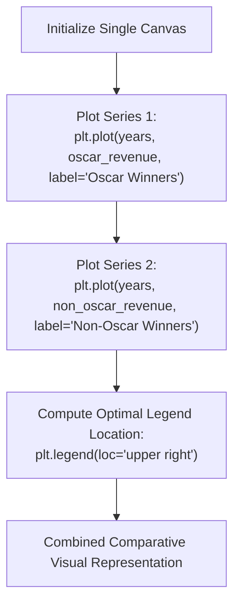

# Day 18 - Lecture 18.5: Multiple Datasets on Line Plot [Hinglish]

[](https://www.python.org/)
[](lecture_18_05.ipynb)
[](notes.pdf)

🌐 **Language / भाषा:** [English](README.md) | **हिंदी / Hinglish** | [⬅️ Lecture 18 Module Par Wapas Jayein](../README_HINGLISH.md)

---

### 📋 Is Topic Mein Hum Kya Seekhenge?
- Ek hi figure canvas par multiple data curves overlay karne ka method.
- Labels aur Legend ka role: `label='...'` aur `plt.legend(loc=...)` positioning.
- Comparative analysis: Oscar Winners vs Non-Oscar Winners trends side-by-side dekhna.
- Legend collision management: Graph ke important data points ko hide hone se bachana.

---

### 🔍 Har Ek Point Ka Simple & Detailed Explanation

- **Multiple Series Calling**: Jab hum lagatar do baar `plt.plot()` call karte hain bina figure close kiye, to Matplotlib dono series ko ek hi coordinate system par draw karta hai.

- **Legend Mapping**: Har plot call me `label` argument pass karna mandatory hota hai, jiske bina `plt.legend()` empty box show karega ya warning throw karega.

- **Legend Placement (`loc`)**: By default Matplotlib `loc='best'` automatically least crowded jagah dhundhta hai. Lekin manual control ke liye `'upper right'`, `'upper left'`, `'lower right'`, `'center'` diya ja sakta hai.

- **Real Lecture Example**: Ma'am ne 2008-2012 ka example dikhaya jahan Oscar Winners (Dark Knight, King's Speech) aur Non-Oscar Winners (Avatar, Inception) ka comparative revenue compare kiya gaya tha.

---

## 2. Visual Architecture & Workflow Diagram



---

## 3. Mathematical & Theoretical Framework

Overlaying $K$ discrete series on a shared domain $X$:

$$
\mathcal{D} = \left\{ \left( X, Y^{(k)}, \ell_k \right) \mid k = 1, 2, \dots, K \right\}
$$

The legend maps visual glyphs (colors $c_k$, line styles $s_k$) directly to semantic label strings $\ell_k$:

$$
\text{Legend}: (c_k, s_k, m_k) \mapsto \ell_k
$$

---

## 4. Structured Implementation & Execution

```python
import matplotlib.pyplot as plt

def plot_multiple_time_series(years: list, series_dict: dict, title: str) -> dict:
    """
    Plots multiple comparative series on a single canvas with distinct visual styling
    and a clean legend.
    
    Parameters:
    -----------
    years : list of int
        Common timeline years.
    series_dict : dict
        Dictionary of format {'Series Name': {'data': list, 'color': str, 'marker': str}}
    title : str
        Plot title.
        
    Returns:
    --------
    dict
        Computed comparative metrics across all series.
    """
    fig, ax = plt.subplots(figsize=(8, 4.5))
    metrics = {}
    
    for s_name, s_props in series_dict.items():
        data = s_props['data']
        color = s_props.get('color', None)
        marker = s_props.get('marker', 'o')
        linestyle = s_props.get('linestyle', '-')
        
        ax.plot(years, data, label=s_name, color=color, marker=marker, 
                linestyle=linestyle, linewidth=2.2, markersize=7)
        
        metrics[s_name] = {
            "total_gross": sum(data),
            "mean_gross": sum(data) / len(data),
            "max_revenue": max(data)
        }
        
    ax.set_title(title, fontsize=13, fontweight='bold', pad=12)
    ax.set_xlabel("Release Year", fontsize=11)
    ax.set_ylabel("Revenue ($ Millions)", fontsize=11)
    ax.grid(True, linestyle='--', alpha=0.5)
    ax.legend(loc="upper right", framealpha=0.9)
    
    plt.tight_layout()
    plt.show()
    return metrics

# Lecture Data: Oscar vs Non-Oscar
years = [2008, 2009, 2010, 2011, 2012]
movie_series = {
    "Oscar Winners": {
        "data": [1005, 170, 427, 133, 232],
        "color": "#1f77b4",
        "marker": "o",
        "linestyle": "-"
    },
    "Non-Oscar Winners": {
        "data": [378, 2788, 829, 185, 275],
        "color": "#d62728",
        "marker": "^",
        "linestyle": "--"
    }
}

comp_results = plot_multiple_time_series(years, movie_series, "Box Office: Oscar vs Non-Oscar Titles (2008-2012)")
print("Comparative Financial Metrics:")
for category, val in comp_results.items():
    print(f"  {category}: Total=${val['total_gross']}M, Mean=${val['mean_gross']:.1f}M")
```

---

## 5. Mukhya Batein (Key Takeaways) & Summary
- Code ko modular function ke roop me likha gaya hai jisme clear shuruat (`def`), docstrings, error handling, aur ending (`return`) maujood hai.
- Video lectures me ma'am dwara sikhaye gaye real movie box-office datasets aur syntax parameters ko exact follow kiya gaya hai.
