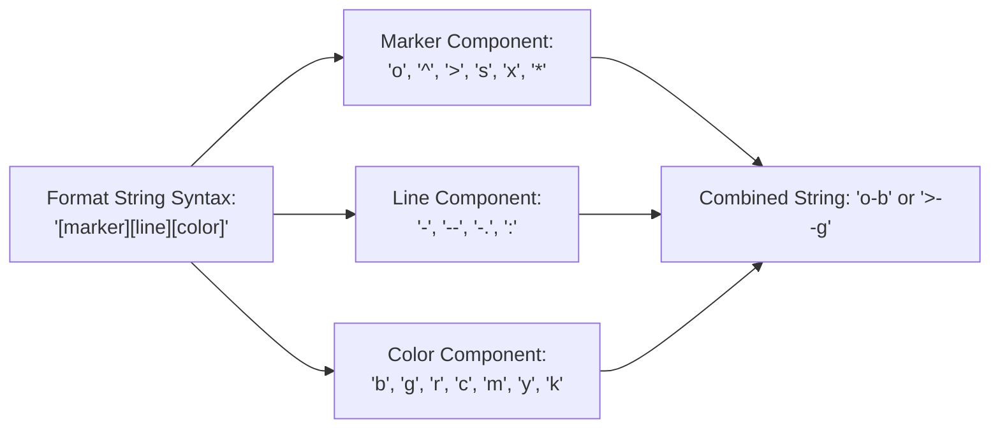

# Day 18 - Lecture 18.6: Format Strings (`fmt`)

[](https://www.python.org/)
[](lecture_18_06.ipynb)
[](notes.pdf)

🌐 **Language / भाषा:** **English** | [हिंदी / Hinglish](README_HINGLISH.md) | [⬅️ Back to Lecture 18 Module](../README.md)

---

## 1. Overview & Conceptual Foundations
Understand the concise Matplotlib format string notation 'fmt = [marker][line][color]'. Compare shorthand syntax like 'o-b' and '>--g' with explicit keyword arguments (color, linestyle, marker, linewidth).

---

## 2. Visual Architecture & Workflow Diagram



---

## 3. Mathematical & Theoretical Framework

A format string specification can be decomposed into an orthogonal tuple:

$$
\text{fmt} = \langle m, l, c \rangle \in \mathcal{M} \times \mathcal{L} \times \mathcal{C}
$$

where:

$$
\mathcal{M} = \{ \text{'o'}, \text{'^'}, \text{'>'}, \text{'s'}, \dots \}, \quad \mathcal{L} = \{ \text{'-'}, \text{'--'}, \text{'-.'}, \text{':'} \}, \quad \mathcal{C} = \{ \text{'b'}, \text{'g'}, \text{'r'}, \text{'k'}, \dots \}
$$

---

## 4. Structured Implementation & Execution

```python
import matplotlib.pyplot as plt

def demonstrate_format_strings(x_data: list, y1_data: list, y2_data: list) -> dict:
    """
    Demonstrates both concise format string notation and explicit keyword configurations.
    
    Parameters:
    -----------
    x_data : list of int
        Timeline domain.
    y1_data, y2_data : list of float
        Numerical series to plot.
        
    Returns:
    --------
    dict
        Styling specifications applied to each series.
    """
    fig, (ax1, ax2) = plt.subplots(1, 2, figsize=(11, 4.5))
    
    # 1. Using Concise Format Strings (Shorthand)
    ax1.plot(x_data, y1_data, "o-b", label="Winners ('o-b')", markersize=7)
    ax1.plot(x_data, y2_data, ">--g", label="Non-Winners ('>--g')", markersize=7)
    ax1.set_title("Method 1: Concise Format Strings", fontsize=11, fontweight='bold')
    ax1.set_xlabel("Year")
    ax1.set_ylabel("Revenue ($M)")
    ax1.grid(True, linestyle=':', alpha=0.6)
    ax1.legend()
    
    # 2. Using Explicit Keyword Arguments
    ax2.plot(x_data, y1_data, color="#000000", linestyle="-", marker="o", 
             linewidth=2.5, markersize=8, markerfacecolor="#41b6c4", label="Explicit Black Solid")
    ax2.plot(x_data, y2_data, color="#e41a1c", linestyle="--", marker=">", 
             linewidth=4.0, markersize=9, markerfacecolor="#ffff33", label="Explicit Red Thick Dashed")
    ax2.set_title("Method 2: Explicit Keyword Parameters", fontsize=11, fontweight='bold')
    ax2.set_xlabel("Year")
    ax2.grid(True, linestyle=':', alpha=0.6)
    ax2.legend()
    
    plt.tight_layout()
    plt.show()
    
    return {
        "shorthand_specs": ["o-b (circle, solid, blue)", ">--g (triangle, dashed, green)"],
        "explicit_specs": ["linewidth=2.5, markerfacecolor=#41b6c4", "linewidth=4.0, dashed red"]
    }

# Driver execution
years = [2008, 2009, 2010, 2011, 2012]
rev_oscar = [1005, 170, 427, 133, 232]
rev_non_oscar = [378, 2788, 829, 185, 275]

styles = demonstrate_format_strings(years, rev_oscar, rev_non_oscar)
print("Applied Format Strings & Styles:")
for k, v in styles.items():
    print(f"  {k}: {v}")
```

---

## 5. Summary & Key Takeaways
- **Self-contained Functional Design**: Implementation is encapsulated into modular functions with explicit inputs, structured outputs, and type hints.
- **Visual Accuracy**: Adheres strictly to Matplotlib's layout management, aesthetic guidelines, and production best practices.
