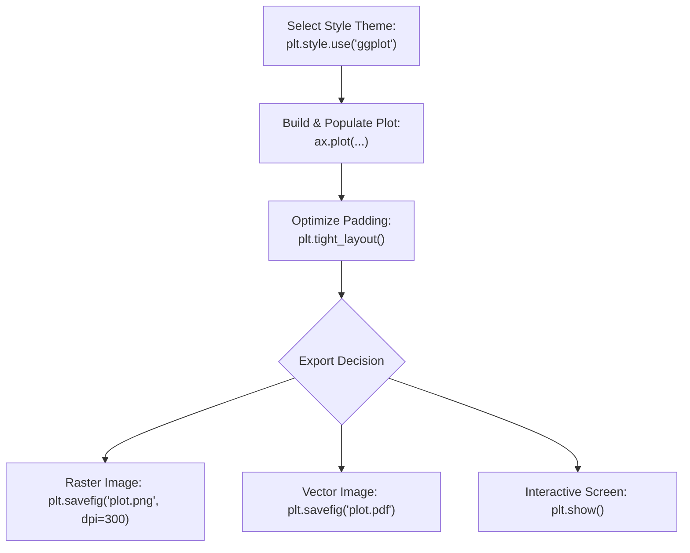

# Day 18 - Lecture 18.7: Styling & Saving Plots

[](https://www.python.org/)
[](lecture_18_07.ipynb)
[](notes.pdf)

🌐 **Language / भाषा:** **English** | [हिंदी / Hinglish](README_HINGLISH.md) | [⬅️ Back to Lecture 18 Module](../README.md)

---

## 1. Overview & Conceptual Foundations
Learn visual themes, layout management, and export mechanics in Matplotlib. Explore plt.style.available ('ggplot', 'dark_background', 'xkcd'), layout tight packing (plt.tight_layout()), and exporting high-resolution vector and raster assets (plt.savefig()).

---

## 2. Visual Architecture & Workflow Diagram



---

## 3. Mathematical & Theoretical Framework

Image export resolution is parameterized by Dots Per Inch ($DPI$) and physical Figure dimensions $(W, H)$ in inches:

$$
\text{Pixel Width } P_w = W \times DPI, \qquad \text{Pixel Height } P_h = H \times DPI
$$

For a standard $8 \times 4.5$ inch canvas at $300$ DPI:

$$
P_w = 8 \times 300 = 2400\text{ px}, \qquad P_h = 4.5 \times 300 = 1350\text{ px}
$$

---

## 4. Structured Implementation & Execution

```python
import matplotlib.pyplot as plt
import os

def render_styled_and_exported_plot(years: list, revenue: list, output_filename: str = "movie_revenue_styled.png") -> dict:
    """
    Applies professional styling, manages layout bounds, and exports a high-resolution image asset.
    
    Parameters:
    -----------
    years : list of int
        Chronological domain.
    revenue : list of float
        Revenue series.
    output_filename : str
        Target output file path.
        
    Returns:
    --------
    dict
        Metadata of exported file including size and style name.
    """
    # Using ggplot aesthetic theme
    plt.style.use('ggplot')
    
    fig, ax = plt.subplots(figsize=(7, 4.2))
    ax.plot(years, revenue, marker='o', color='#33a02c', linewidth=2.5, markersize=8, label="Box Office ($M)")
    
    ax.set_title("Box Office Trend (ggplot Theme)", fontsize=13, fontweight='bold')
    ax.set_xlabel("Year", fontsize=11)
    ax.set_ylabel("Gross ($ Millions)", fontsize=11)
    ax.legend(loc="upper right")
    
    # Adjust layout
    plt.tight_layout()
    
    # Save high-res raster
    plt.savefig(output_filename, dpi=200, bbox_inches='tight')
    plt.show()
    
    # Reset back to default style
    plt.style.use('default')
    
    file_exists = os.path.exists(output_filename)
    file_size = os.path.getsize(output_filename) if file_exists else 0
    
    return {
        "applied_style": "ggplot",
        "output_path": output_filename,
        "saved_successfully": file_exists,
        "file_size_bytes": file_size
    }

# Driver execution
years = [2008, 2009, 2010, 2011, 2012]
rev = [1005, 170, 427, 133, 232]

out_info = render_styled_and_exported_plot(years, rev, "oscar_revenue_export.png")
print("Styled Export Metadata:")
for k, v in out_info.items():
    print(f"  {k}: {v}")
```

---

## 5. Summary & Key Takeaways
- **Self-contained Functional Design**: Implementation is encapsulated into modular functions with explicit inputs, structured outputs, and type hints.
- **Visual Accuracy**: Adheres strictly to Matplotlib's layout management, aesthetic guidelines, and production best practices.
