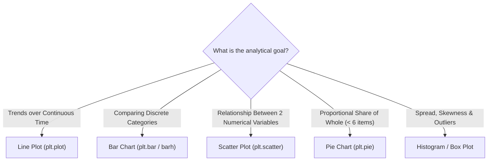

# Day 18 - Lecture 18.8: Common Plots & Charts Taxonomy [Hinglish]

[](https://www.python.org/)
[](lecture_18_08.ipynb)
[](notes.pdf)

🌐 **Language / भाषा:** [English](README.md) | **हिंदी / Hinglish** | [⬅️ Lecture 18 Module Par Wapas Jayein](../README_HINGLISH.md)

---

### 📋 Is Topic Mein Hum Kya Seekhenge?
- Data types ka classification: Continuous numerical vs Discrete categorical data.
- Right chart selection framework: Kis objective ke liye kaunsa plot best suited hai.
- Comparison vs Relationship vs Distribution vs Composition plots.
- Data visualization anti-patterns aur common pitfalls se bachna.

---

### 🔍 Har Ek Point Ka Simple & Detailed Explanation

- **Line Plot**: Continuous time-series ya sequential data ke trends, rate of change aur seasonality dekhne ke liye best hota hai.

- **Bar Chart**: Discrete categories ke beech values compare karne ke liye best hota hai (e.g. Sales by Department, Movie Revenue by Year).

- **Scatter Plot**: Do continuous numerical variables ke beech correlation, clusters aur non-linear patterns dhoondhne ke liye use hota hai.

- **Pie Chart**: Parts-of-a-whole ya percentage composition represent karne ke liye use hota hai (jab categories 5-6 se kam hon).

- **Histogram & Box Plot**: Single numerical variable ka probability distribution, skewness, spread aur outliers detect karne ke liye.

---

## 2. Visual Architecture & Workflow Diagram



---

## 3. Mathematical & Theoretical Framework

Chart selection maps the variable types $\mathcal{V} = \{ \text{Categorical}, \text{Numerical} \}$ and goal $\mathcal{G}$ to chart family $\mathcal{F}$:

$$
\text{Selection}(\mathcal{V}, \mathcal{G}) \mapsto \mathcal{F}
$$

| Variable Types | Analytical Goal | Optimal Chart Family |
| :--- | :--- | :--- |
| $1 \times \text{Time} + 1 \times \text{Continuous}$ | Trend / Progression | Line Plot (`plt.plot`) |
| $1 \times \text{Categorical} + 1 \times \text{Numerical}$ | Discrete Comparison | Bar Chart (`plt.bar`) |
| $2 \times \text{Continuous}$ | Correlation / Clustering | Scatter Plot (`plt.scatter`) |
| $1 \times \text{Categorical}$ (shares sum to $1$) | Composition | Pie Chart (`plt.pie`) |
| $1 \times \text{Continuous}$ | Distribution Shape | Histogram (`plt.hist`) |

---

## 4. Structured Implementation & Execution

```python
import matplotlib.pyplot as plt

def generate_chart_selection_matrix() -> dict:
    """
    Produces a comparative summary of core chart types, their ideal data structures,
    and Python implementation methods.
    
    Returns:
    --------
    dict
        Mapping of chart types to ideal use-cases and syntax.
    """
    chart_taxonomy = {
        "Line Plot": {
            "function": "plt.plot(x, y)",
            "input_types": "Time / Sequential X, Continuous Y",
            "primary_goal": "Trend tracking, continuity, temporal patterns",
            "best_example": "Stock price over time, revenue by year"
        },
        "Bar Chart": {
            "function": "plt.bar(x, height)",
            "input_types": "Discrete Categories X, Numerical Values Y",
            "primary_goal": "Magnitude comparison across distinct groups",
            "best_example": "Product sales by region, department headcount"
        },
        "Scatter Plot": {
            "function": "plt.scatter(x, y)",
            "input_types": "Continuous X, Continuous Y",
            "primary_goal": "Correlation, bivariate relationships, clustering",
            "best_example": "Age vs Blood Pressure, Height vs Weight"
        },
        "Pie Chart": {
            "function": "plt.pie(sizes, labels)",
            "input_types": "Compositional proportions summing to 100%",
            "primary_goal": "Relative part-of-whole shares",
            "best_example": "Company expense breakdown, market share"
        }
    }
    
    # Visual summary demonstration
    fig, axs = plt.subplots(2, 2, figsize=(9, 6))
    
    # 1. Line
    axs[0, 0].plot([1, 2, 3, 4], [10, 25, 20, 35], 'o-b')
    axs[0, 0].set_title("Line: Trends", fontsize=10, fontweight='bold')
    
    # 2. Bar
    axs[0, 1].bar(['A', 'B', 'C', 'D'], [15, 30, 22, 18], color='purple')
    axs[0, 1].set_title("Bar: Discrete Comparison", fontsize=10, fontweight='bold')
    
    # 3. Scatter
    axs[1, 0].scatter([22, 30, 45, 60], [110, 120, 135, 148], color='red', marker='^')
    axs[1, 0].set_title("Scatter: Bivariate Correlation", fontsize=10, fontweight='bold')
    
    # 4. Pie
    axs[1, 1].pie([40, 30, 20, 10], labels=['Salaries', 'Rent', 'Mkt', 'R&D'], autopct='%1.0f%%')
    axs[1, 1].set_title("Pie: Proportional Share", fontsize=10, fontweight='bold')
    
    plt.suptitle("Matplotlib Core Chart Taxonomy Overview", fontsize=12, fontweight='bold')
    plt.tight_layout()
    plt.show()
    
    return chart_taxonomy

# Driver execution
tax_info = generate_chart_selection_matrix()
print("Matplotlib Core Chart Taxonomy:")
for chart_name, details in tax_info.items():
    print(f"\n[{chart_name}]:")
    for k, v in details.items():
        print(f"  {k}: {v}")
```

---

## 5. Mukhya Batein (Key Takeaways) & Summary
- Code ko modular function ke roop me likha gaya hai jisme clear shuruat (`def`), docstrings, error handling, aur ending (`return`) maujood hai.
- Video lectures me ma'am dwara sikhaye gaye real movie box-office datasets aur syntax parameters ko exact follow kiya gaya hai.
