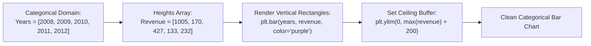

# Day 18 - Lecture 18.9: Vertical Bar Charts (`plt.bar`) [Hinglish]

[](https://www.python.org/)
[](lecture_18_09.ipynb)
[](notes.pdf)

🌐 **Language / भाषा:** [English](README.md) | **हिंदी / Hinglish** | [⬅️ Lecture 18 Module Par Wapas Jayein](../README_HINGLISH.md)

---

### 📋 Is Topic Mein Hum Kya Seekhenge?
- Vertical bar chart ka construction: `plt.bar(x, height, color, width)`.
- Categorical data visualization: Discrete movie years aur annual revenues plot karna.
- Upper headroom padding: `plt.ylim(0, max + margin)` se top cutoff prevent karna.
- Bar chart vs Line chart: Kab line plot ki jagah bar chart choose karein.

---

### 🔍 Har Ek Point Ka Simple & Detailed Explanation

- **`plt.bar()` Mechanics**: Vertical bar chart me x-axis discrete categories ya time periods represent karta hai aur bar ki vertical height us category ke numeric magnitude ko represent karti hai.

- **Color Customization**: `color='purple'` ya hex code pass karke visual presentation enhance ki ja sakti hai.

- **Top Space Padding (`plt.ylim`)**: Default bar chart me sabse uncha bar graph ke top border ko touch karta hai. `plt.ylim(0, max(revenue) + 200)` dene se upar clean breathing space create ho jata hai jisme baad me labels lagaye ja sakte hain.

- **Lecture Code Reference**: Ma'am ne 2008-2012 ke Oscar movies ka revenue `plt.bar(years, revenue, color='purple')` se plot karke dikhaya tha.

---

## 2. Visual Architecture & Workflow Diagram



---

## 3. Mathematical & Theoretical Framework

A vertical bar chart renders disjoint geometric rectangles for each category $i$:

$$
R_i = [x_i - \frac{w}{2}, x_i + \frac{w}{2}] \times [0, h_i]
$$

where $w$ is the bar width (default $w = 0.8$) and $h_i$ is the quantitative metric for category $i$.

---

## 4. Structured Implementation & Execution

```python
import matplotlib.pyplot as plt

def render_vertical_bar_chart(categories: list, values: list, bar_color: str = "#7b3294", top_margin_ratio: float = 0.2) -> dict:
    """
    Renders a standard vertical bar chart with controlled bar widths, custom colors,
    and upper padding headroom.
    
    Parameters:
    -----------
    categories : list
        Category labels or discrete time markers.
    values : list of float
        Numerical values determining vertical bar heights.
    bar_color : str
        Hex color or CSS color name for bars.
    top_margin_ratio : float
        Fraction of max value to add as top padding.
        
    Returns:
    --------
    dict
        Computed bar metrics and applied ceiling limit.
    """
    fig, ax = plt.subplots(figsize=(7, 4.5))
    
    # Plot vertical bars
    bars = ax.bar(categories, values, color=bar_color, width=0.6, edgecolor='black', linewidth=0.8)
    
    ax.set_title("Yearly Revenue of Movies (Vertical Bar Chart)", fontsize=13, fontweight='bold', pad=12)
    ax.set_xlabel("Release Years", fontsize=11)
    ax.set_ylabel("Revenue ($ Millions)", fontsize=11)
    
    # Calculate upper headroom limit
    max_val = max(values)
    upper_limit = max_val + (max_val * top_margin_ratio)
    ax.set_ylim(0, upper_limit)
    
    ax.grid(axis='y', linestyle='--', alpha=0.6)
    plt.tight_layout()
    plt.show()
    
    return {
        "categories_plotted": categories,
        "max_bar_height": max_val,
        "configured_ylim": (0, upper_limit),
        "total_volume": sum(values)
    }

# Lecture Data
years = [2008, 2009, 2010, 2011, 2012]
revenue = [1005, 170, 427, 133, 232]

bar_res = render_vertical_bar_chart(years, revenue)
print("Vertical Bar Chart Execution Results:")
for k, v in bar_res.items():
    print(f"  {k}: {v}")
```

---

## 5. Mukhya Batein (Key Takeaways) & Summary
- Code ko modular function ke roop me likha gaya hai jisme clear shuruat (`def`), docstrings, error handling, aur ending (`return`) maujood hai.
- Video lectures me ma'am dwara sikhaye gaye real movie box-office datasets aur syntax parameters ko exact follow kiya gaya hai.
