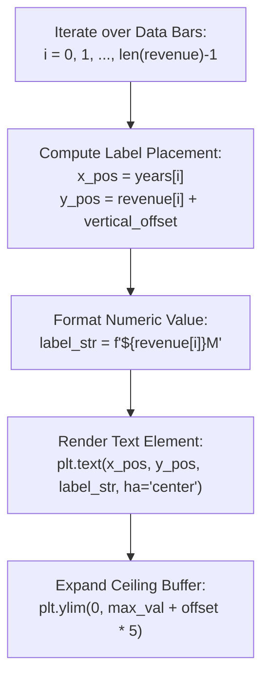

# Day 18 - Lecture 18.10: Adding Labels to Bars (`plt.text`)

[](https://www.python.org/)
[](lecture_18_10.ipynb)
[](notes.pdf)

🌐 **Language / भाषा:** **English** | [हिंदी / Hinglish](README_HINGLISH.md) | [⬅️ Back to Lecture 18 Module](../README.md)

---

## 1. Overview & Conceptual Foundations
Learn precision bar labeling in Matplotlib using plt.text(x, y, s, ha='center'). Discover how iterating over bar coordinates and applying a calculated vertical offset eliminates cognitive guesswork, directly displaying exact numerical values atop each bar.

---

## 2. Visual Architecture & Workflow Diagram



---

## 3. Mathematical & Theoretical Framework

For each bar index $i \in \{1, 2, \dots, N\}$, the label text anchor coordinate is positioned at:

$$
(x_{\text{label}}, y_{\text{label}})_i = \left( x_i, \; h_i + \delta_y \right)
$$

where $\delta_y = \gamma \cdot \max(h)$ is a proportional vertical clearance offset (typically $\gamma \approx 0.02$). The y-axis upper limit must satisfy:

$$
y_{\max} \ge \max(h) + 2\delta_y + \text{fontsize\_offset}
$$

---

## 4. Structured Implementation & Execution

```python
import matplotlib.pyplot as plt

def render_bar_chart_with_direct_labels(years: list, revenue: list, bar_color: str = "#8856a7") -> dict:
    """
    Generates a vertical bar chart with exact numerical labels positioned atop each bar.
    
    Parameters:
    -----------
    years : list of int
        Categorical year timeline.
    revenue : list of float
        Revenue values for each corresponding year.
    bar_color : str
        Hex color for the vertical bars.
        
    Returns:
    --------
    dict
        Metadata of rendered labels including coordinates and text values.
    """
    fig, ax = plt.subplots(figsize=(7.5, 4.5))
    bars = ax.bar(years, revenue, color=bar_color, width=0.55, edgecolor='black', linewidth=0.8)
    
    max_rev = max(revenue)
    vertical_offset = max_rev * 0.025  # Dynamic clearance offset
    
    label_records = []
    # Iterative labeling loop as taught in lecture
    for i in range(len(revenue)):
        x_pos = years[i]
        y_pos = revenue[i] + vertical_offset
        text_val = str(revenue[i])
        
        ax.text(x_pos, y_pos, text_val, ha="center", va="bottom", fontsize=10, fontweight='bold', color="#222222")
        label_records.append({"year": x_pos, "label_y": y_pos, "text": text_val})
        
    ax.set_title("Yearly Revenue of Movies (With Direct Labels)", fontsize=13, fontweight='bold', pad=14)
    ax.set_xlabel("Release Years", fontsize=11)
    ax.set_ylabel("Revenue ($ Millions)", fontsize=11)
    
    # Expand upper limit to give breathing room for labels
    ax.set_ylim(0, max_rev + (max_rev * 0.20))
    ax.grid(axis='y', linestyle='--', alpha=0.5)
    
    plt.tight_layout()
    plt.show()
    
    return {
        "total_bars_labeled": len(label_records),
        "labels_rendered": label_records,
        "upper_bound_ylim": max_rev + (max_rev * 0.20)
    }

# Lecture Data
years = [2008, 2009, 2010, 2011, 2012]
revenue = [1005, 170, 427, 133, 232]

label_info = render_bar_chart_with_direct_labels(years, revenue)
print("Bar Labeling Metadata:")
print(f"  Total Labels: {label_info['total_bars_labeled']}")
print(f"  Ceiling Limit: {label_info['upper_bound_ylim']}")
```

---

## 5. Summary & Key Takeaways
- **Self-contained Functional Design**: Implementation is encapsulated into modular functions with explicit inputs, structured outputs, and type hints.
- **Visual Accuracy**: Adheres strictly to Matplotlib's layout management, aesthetic guidelines, and production best practices.
