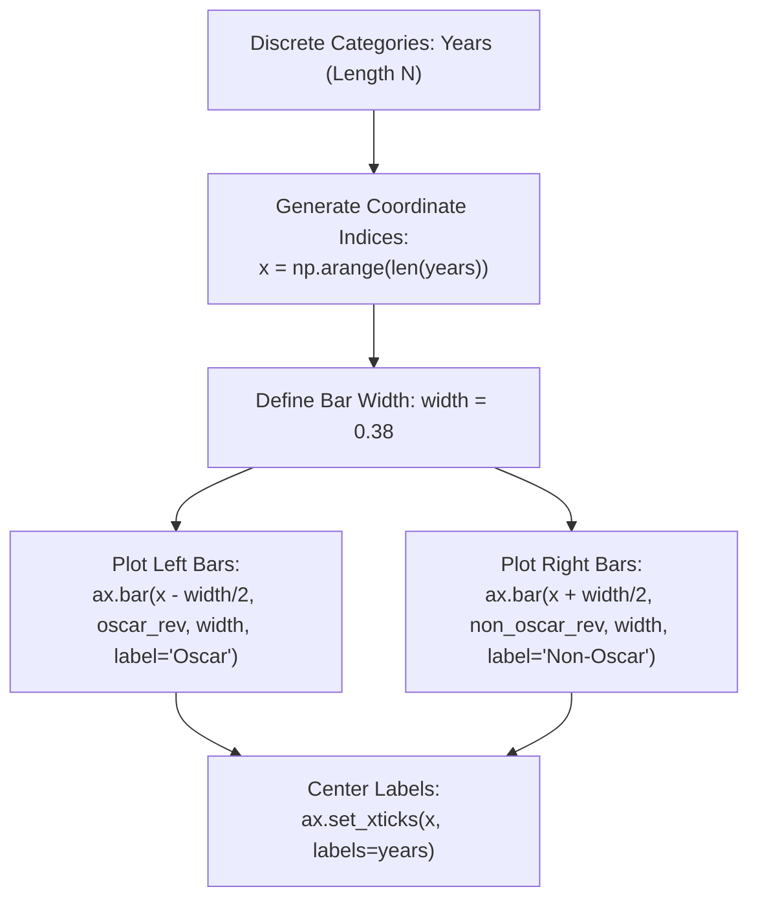

# Day 18 - Lecture 18.11: Grouped / Clustered Bar Charts

[](https://www.python.org/)
[](lecture_18_11.ipynb)
[](notes.pdf)

🌐 **Language / भाषा:** **English** | [हिंदी / Hinglish](README_HINGLISH.md) | [⬅️ Back to Lecture 18 Module](../README.md)

---

## 1. Overview & Conceptual Foundations
Master grouped/clustered bar charts in Matplotlib using NumPy coordinate index manipulation. Shift categorical x-ticks by width/2 offsets (x - width/2 and x + width/2) and align category labels with plt.xticks().

---

## 2. Visual Architecture & Workflow Diagram



---

## 3. Mathematical & Theoretical Framework

For $K=2$ groups with bar width $w$, category $i \in \{0, 1, \dots, N-1\}$ has center coordinates:

$$
x_{i, 1} = i - \frac{w}{2}, \qquad x_{i, 2} = i + \frac{w}{2}
$$

The tick marks for the categorical labels are aligned at the group centroid:

$$
x_{\text{tick}, i} = \frac{x_{i, 1} + x_{i, 2}}{2} = i
$$

To prevent visual collisions between adjacent clusters $i$ and $i+1$, we require:

$$
w < \frac{1}{K} \implies 2w < 1 \implies w < 0.5
$$

---

## 4. Structured Implementation & Execution

```python
import matplotlib.pyplot as plt
import numpy as np

def render_grouped_bar_chart(years: list, group1_data: list, group2_data: list, 
                             label1: str = "Oscar", label2: str = "Non-Oscar", width: float = 0.38) -> dict:
    """
    Builds a grouped/clustered bar chart comparing two datasets across common categories.
    
    Parameters:
    -----------
    years : list of int
        Categorical labels for time periods.
    group1_data, group2_data : list of float
        Numerical values for group 1 and group 2.
    label1, label2 : str
        Legend labels for each cluster.
    width : float
        Individual bar width.
        
    Returns:
    --------
    dict
        Verification summary of the plotted clusters.
    """
    x_indices = np.arange(len(years))
    
    fig, ax = plt.subplots(figsize=(8.5, 4.8))
    
    # Left bar offset: x - width/2
    rects1 = ax.bar(x_indices - width/2, group1_data, width, label=label1, color="#2b83ba", edgecolor='black', linewidth=0.7)
    # Right bar offset: x + width/2
    rects2 = ax.bar(x_indices + width/2, group2_data, width, label=label2, color="#d7191c", edgecolor='black', linewidth=0.7)
    
    ax.set_title("Comparative Box Office: Oscar vs Non-Oscar Movies", fontsize=13, fontweight='bold', pad=12)
    ax.set_xlabel("Release Years", fontsize=11)
    ax.set_ylabel("Revenue ($ Millions)", fontsize=11)
    
    # Align ticks at centroid
    ax.set_xticks(x_indices)
    ax.set_xticklabels(years)
    
    ax.legend(loc="upper left")
    ax.grid(axis='y', linestyle='--', alpha=0.5)
    plt.tight_layout()
    plt.show()
    
    return {
        "num_clusters": len(years),
        "bar_width": width,
        "group1_total": sum(group1_data),
        "group2_total": sum(group2_data),
        "group1_mean": float(np.mean(group1_data)),
        "group2_mean": float(np.mean(group2_data))
    }

# Lecture Data
years = [2008, 2009, 2010, 2011, 2012]
oscar_revenue = [1005, 170, 427, 133, 232]
non_oscar_revenue = [378, 2788, 829, 185, 275]

cluster_res = render_grouped_bar_chart(years, oscar_revenue, non_oscar_revenue)
print("Grouped Bar Chart Metrics:")
for k, v in cluster_res.items():
    print(f"  {k}: {v}")
```

---

## 5. Summary & Key Takeaways
- **Self-contained Functional Design**: Implementation is encapsulated into modular functions with explicit inputs, structured outputs, and type hints.
- **Visual Accuracy**: Adheres strictly to Matplotlib's layout management, aesthetic guidelines, and production best practices.
