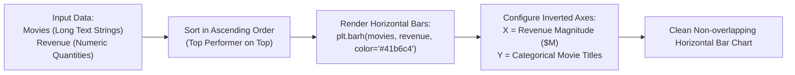

# Day 18 - Lecture 18.12: Horizontal Bar Charts (`plt.barh`)

[](https://www.python.org/)
[](lecture_18_12.ipynb)
[](notes.pdf)

🌐 **Language / भाषा:** **English** | [हिंदी / Hinglish](README_HINGLISH.md) | [⬅️ Back to Lecture 18 Module](../README.md)

---

## 1. Overview & Conceptual Foundations
Explore horizontal bar charts using plt.barh(). Discover why horizontal orientation is superior when category names are long or numerous, preventing label overlapping and facilitating ranked ordinal comparisons.

---

## 2. Visual Architecture & Workflow Diagram



---

## 3. Mathematical & Theoretical Framework

A horizontal bar for item $i$ defines a rectangle aligned along the horizontal x-axis:

$$
R_i^{\text{horiz}} = [0, w_i] \times \left[ y_i - \frac{h}{2}, \; y_i + \frac{h}{2} \right]
$$

where $w_i$ represents the quantitative box office value and $h$ is the bar thickness (default $h = 0.8$).

---

## 4. Structured Implementation & Execution

```python
import matplotlib.pyplot as plt

def render_horizontal_bar_chart(categories: list, values: list, bar_color: str = "#41b6c4") -> dict:
    """
    Builds an uncluttered horizontal bar chart ideal for long string labels and rankings.
    
    Parameters:
    -----------
    categories : list of str
        Category names (e.g. movie titles).
    values : list of float
        Numerical values mapped to bar length.
    bar_color : str
        Hex color code for bars.
        
    Returns:
    --------
    dict
        Ranking metadata from top to bottom performer.
    """
    # Sort data ascending so top performer renders at the top
    sorted_pairs = sorted(zip(categories, values), key=lambda pair: pair[1])
    sorted_categories = [p[0] for p in sorted_pairs]
    sorted_values = [p[1] for p in sorted_pairs]
    
    fig, ax = plt.subplots(figsize=(8, 4.5))
    bars = ax.barh(sorted_categories, sorted_values, color=bar_color, height=0.6, edgecolor='black', linewidth=0.7)
    
    ax.set_title("Movie Revenue Comparison (Horizontal Bar Chart)", fontsize=13, fontweight='bold', pad=12)
    ax.set_xlabel("Box Office Gross ($ Millions)", fontsize=11)
    ax.set_ylabel("Movie Titles", fontsize=11)
    
    # Add value labels at end of each bar
    for bar in bars:
        width = bar.get_width()
        ax.text(width + 15, bar.get_y() + bar.get_height()/2, f"${int(width)}M", 
                va='center', fontsize=9.5, fontweight='bold', color='#333333')
        
    ax.set_xlim(0, max(sorted_values) * 1.15)
    ax.grid(axis='x', linestyle='--', alpha=0.5)
    plt.tight_layout()
    plt.show()
    
    return {
        "top_movie": sorted_categories[-1],
        "top_revenue": sorted_values[-1],
        "lowest_movie": sorted_categories[0],
        "lowest_revenue": sorted_values[0],
        "count": len(categories)
    }

# Lecture Data
oscar_movies = ["The Dark Knight", "The Hurt Locker", "The King's Speech", "The Artist", "Argo"]
oscar_revenue = [1005, 170, 427, 133, 232]

horiz_res = render_horizontal_bar_chart(oscar_movies, oscar_revenue)
print("Horizontal Bar Chart Ranking Summary:")
for k, v in horiz_res.items():
    print(f"  {k}: {v}")
```

---

## 5. Summary & Key Takeaways
- **Self-contained Functional Design**: Implementation is encapsulated into modular functions with explicit inputs, structured outputs, and type hints.
- **Visual Accuracy**: Adheres strictly to Matplotlib's layout management, aesthetic guidelines, and production best practices.
