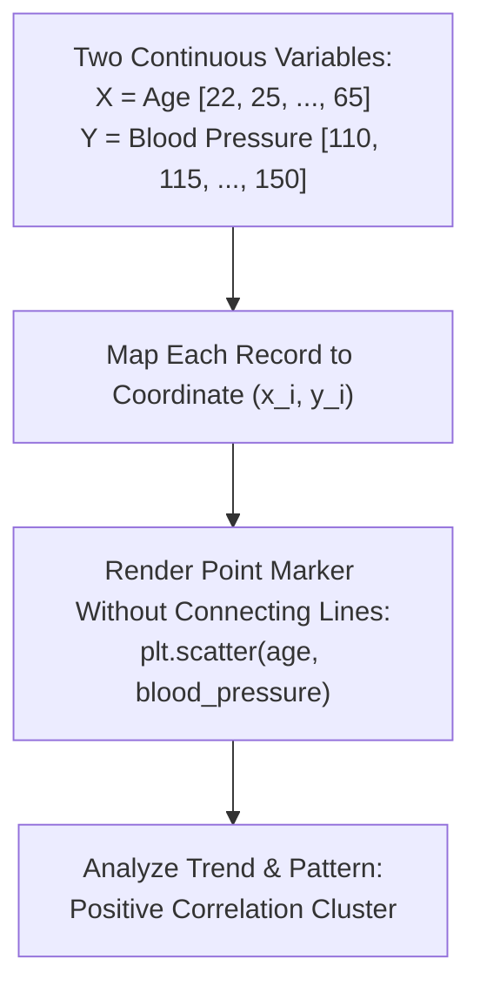

# Day 18 - Lecture 18.13: Scatter Plots (`plt.scatter`)

[](https://www.python.org/)
[](lecture_18_13.ipynb)
[](notes.pdf)

🌐 **Language / भाषा:** **English** | [हिंदी / Hinglish](README_HINGLISH.md) | [⬅️ Back to Lecture 18 Module](../README.md)

---

## 1. Overview & Conceptual Foundations
Learn bivariate numerical analysis using plt.scatter(x, y). Understand how scatter plots visualize correlation, clusters, and individual point variance between two continuous numerical variables (e.g., Age vs Blood Pressure).

---

## 2. Visual Architecture & Workflow Diagram



---

## 3. Mathematical & Theoretical Framework

A scatter plot maps discrete bivariate observations $\mathcal{D} = \{ (x_i, y_i) \}_{i=1}^N$. The linear correlation is quantified by the Pearson correlation coefficient $r_{xy}$:

$$
r_{xy} = \frac{\sum_{i=1}^N (x_i - \bar{x})(y_i - \bar{y})}{\sqrt{\sum_{i=1}^N (x_i - \bar{x})^2} \sqrt{\sum_{i=1}^N (y_i - \bar{y})^2}} \in [-1, 1]
$$

where $r_{xy} > 0$ indicates positive correlation (as in Age vs Blood Pressure).

---

## 4. Structured Implementation & Execution

```python
import matplotlib.pyplot as plt
import numpy as np

def analyze_bivariate_scatter(x_vals: list, y_vals: list, x_label: str = "Age", y_label: str = "Blood Pressure") -> dict:
    """
    Performs bivariate scatter plot rendering and calculates sample correlation.
    
    Parameters:
    -----------
    x_vals : list of float
        Independent numerical variable (e.g. Age).
    y_vals : list of float
        Dependent numerical variable (e.g. Blood Pressure).
    x_label, y_label : str
        Axis labels.
        
    Returns:
    --------
    dict
        Statistical correlation and regression metrics.
    """
    fig, ax = plt.subplots(figsize=(7, 4.5))
    
    # Render scatter points
    ax.scatter(x_vals, y_vals, color="#e41a1c", marker='o', s=60, edgecolors='black', linewidth=0.8, label="Observations")
    
    # Calculate best-fit regression line to visualize trend
    m, c = np.polyfit(x_vals, y_vals, deg=1)
    x_line = np.linspace(min(x_vals), max(x_vals), 100)
    ax.plot(x_line, m*x_line + c, color='#377eb8', linestyle='--', linewidth=1.8, label=f"Trendline (Slope={m:.2f})")
    
    ax.set_title(f"Bivariate Analysis: {x_label} vs {y_label}", fontsize=13, fontweight='bold', pad=12)
    ax.set_xlabel(x_label, fontsize=11)
    ax.set_ylabel(y_label, fontsize=11)
    ax.grid(True, linestyle=':', alpha=0.6)
    ax.legend()
    
    plt.tight_layout()
    plt.show()
    
    # Calculate Pearson correlation
    corr = np.corrcoef(x_vals, y_vals)[0, 1]
    
    return {
        "num_records": len(x_vals),
        "pearson_r": float(corr),
        "trendline_slope": float(m),
        "trendline_intercept": float(c)
    }

# Lecture Data
age = [22, 25, 30, 35, 40, 45, 50, 55, 60, 65]
blood_pressure = [110, 115, 120, 122, 125, 130, 135, 123, 145, 150]

scatter_metrics = analyze_bivariate_scatter(age, blood_pressure)
print("Scatter Plot Correlation Analysis:")
for k, v in scatter_metrics.items():
    print(f"  {k}: {v}")
```

---

## 5. Summary & Key Takeaways
- **Self-contained Functional Design**: Implementation is encapsulated into modular functions with explicit inputs, structured outputs, and type hints.
- **Visual Accuracy**: Adheres strictly to Matplotlib's layout management, aesthetic guidelines, and production best practices.
