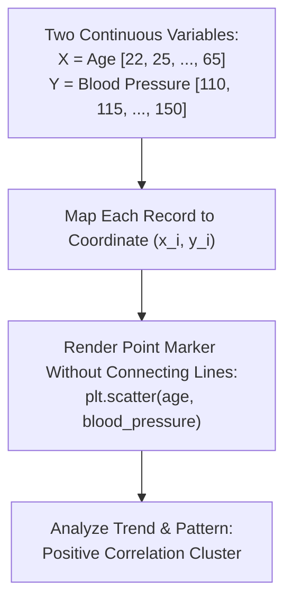

# Day 18 - Lecture 18.13: Scatter Plots (`plt.scatter`) [Hinglish]

[](https://www.python.org/)
[](lecture_18_13.ipynb)
[](notes.pdf)

🌐 **Language / भाषा:** [English](README.md) | **हिंदी / Hinglish** | [⬅️ Lecture 18 Module Par Wapas Jayein](../README_HINGLISH.md)

---

### 📋 Is Topic Mein Hum Kya Seekhenge?
- Bivariate data visualization ka foundation: `plt.scatter(x, y)`.
- Scatter plot vs Line plot: Continuous correlation vs Sequential progression.
- Real medical example: Age vs Blood Pressure (BP) correlation analysis.
- Pearson correlation intuition: Positive trend, negative trend, aur no correlation patterns.

---

### 🔍 Har Ek Point Ka Simple & Detailed Explanation

- **Bivariate Analysis**: Jab hamare paas do continuous continuous features hote hain (jaise Age aur Blood Pressure), tab line chart unhe connect karke confusing bana deta hai. Scatter plot har individual record ko 2D plane par ek independent dot ke roop me dikhata hai.

- **Correlation Detection**: Agar jaise-jaise Age badhti hai waise-waise Blood Pressure upar jata hai, to points bottom-left se top-right ki taraf cluster karte hain (Positive Correlation).

- **Medical Cohort Example**: Ma'am ne 10 logon ka sample liya (Person A se J) jinki age 22 se 65 saal aur BP 110 se 150 mmHg ke beech tha.

- **Syntax & Styling**: `plt.scatter(age, blood_pressure, color='red', marker='o')` se base plot tayar hota hai.

---

## 2. Visual Architecture & Workflow Diagram



---

## 3. Mathematical & Theoretical Framework

A scatter plot maps discrete bivariate observations $\mathcal{D} = \{ (x_i, y_i) \}_{i=1}^N$. The linear correlation is quantified by the Pearson correlation coefficient $r_{xy}$:

$$
r_{xy} = \frac{\sum_{i=1}^N (x_i - \bar{x})(y_i - \bar{y})}{\sqrt{\sum_{i=1}^N (x_i - \bar{x})^2} \sqrt{\sum_{i=1}^N (y_i - \bar{y})^2}} \in [-1, 1]
$$

where $r_{xy} > 0$ indicates positive correlation (as in Age vs Blood Pressure).

---

## 4. Structured Implementation & Execution

```python
import matplotlib.pyplot as plt
import numpy as np

def analyze_bivariate_scatter(x_vals: list, y_vals: list, x_label: str = "Age", y_label: str = "Blood Pressure") -> dict:
    """
    Performs bivariate scatter plot rendering and calculates sample correlation.
    
    Parameters:
    -----------
    x_vals : list of float
        Independent numerical variable (e.g. Age).
    y_vals : list of float
        Dependent numerical variable (e.g. Blood Pressure).
    x_label, y_label : str
        Axis labels.
        
    Returns:
    --------
    dict
        Statistical correlation and regression metrics.
    """
    fig, ax = plt.subplots(figsize=(7, 4.5))
    
    # Render scatter points
    ax.scatter(x_vals, y_vals, color="#e41a1c", marker='o', s=60, edgecolors='black', linewidth=0.8, label="Observations")
    
    # Calculate best-fit regression line to visualize trend
    m, c = np.polyfit(x_vals, y_vals, deg=1)
    x_line = np.linspace(min(x_vals), max(x_vals), 100)
    ax.plot(x_line, m*x_line + c, color='#377eb8', linestyle='--', linewidth=1.8, label=f"Trendline (Slope={m:.2f})")
    
    ax.set_title(f"Bivariate Analysis: {x_label} vs {y_label}", fontsize=13, fontweight='bold', pad=12)
    ax.set_xlabel(x_label, fontsize=11)
    ax.set_ylabel(y_label, fontsize=11)
    ax.grid(True, linestyle=':', alpha=0.6)
    ax.legend()
    
    plt.tight_layout()
    plt.show()
    
    # Calculate Pearson correlation
    corr = np.corrcoef(x_vals, y_vals)[0, 1]
    
    return {
        "num_records": len(x_vals),
        "pearson_r": float(corr),
        "trendline_slope": float(m),
        "trendline_intercept": float(c)
    }

# Lecture Data
age = [22, 25, 30, 35, 40, 45, 50, 55, 60, 65]
blood_pressure = [110, 115, 120, 122, 125, 130, 135, 123, 145, 150]

scatter_metrics = analyze_bivariate_scatter(age, blood_pressure)
print("Scatter Plot Correlation Analysis:")
for k, v in scatter_metrics.items():
    print(f"  {k}: {v}")
```

---

## 5. Mukhya Batein (Key Takeaways) & Summary
- Code ko modular function ke roop me likha gaya hai jisme clear shuruat (`def`), docstrings, error handling, aur ending (`return`) maujood hai.
- Video lectures me ma'am dwara sikhaye gaye real movie box-office datasets aur syntax parameters ko exact follow kiya gaya hai.
