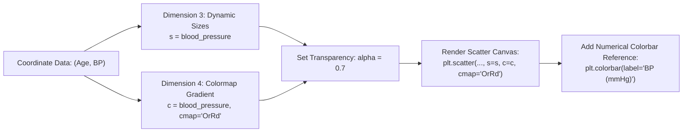

# Day 18 - Lecture 18.14: Advanced Customizations on Scatter Plots

[](https://www.python.org/)
[](lecture_18_14.ipynb)
[](notes.pdf)

🌐 **Language / भाषा:** **English** | [हिंदी / Hinglish](README_HINGLISH.md) | [⬅️ Back to Lecture 18 Module](../README.md)

---

## 1. Overview & Conceptual Foundations
Unlock multi-dimensional visual encoding on scatter plots. Learn conditional point coloring, dynamic bubble sizing (s=sizes), opacity blending (alpha=0.5), colormap gradients (cmap='OrRd'), and colorbars (plt.colorbar()).

---

## 2. Visual Architecture & Workflow Diagram



---

## 3. Mathematical & Theoretical Framework

Each point marker $i$ is parameterized as a 5-tuple:

$$
\mathbf{p}_i = \left( x_i, \; y_i, \; s_i, \; c_i, \; \alpha \right)
$$

where the color map $\mathcal{C}: [y_{\min}, y_{\max}] \to [0, 1]^3$ linearly projects scalar values into RGB color space:

$$
\mathcal{C}(y_i) = \text{Colormap}\left( \frac{y_i - y_{\min}}{y_{\max} - y_{\min}} \right)
$$

---

## 4. Structured Implementation & Execution

```python
import matplotlib.pyplot as plt

def render_advanced_custom_scatter(age: list, bp: list, threshold: float = 135.0) -> dict:
    """
    Builds a multi-dimensional scatter plot featuring conditional coloring, dynamic sizing,
    and a continuous colorbar gradient.
    
    Parameters:
    -----------
    age : list of int
        Age coordinates.
    bp : list of float
        Blood pressure coordinates.
    threshold : float
        Clinical cutoff threshold for conditional flagging.
        
    Returns:
    --------
    dict
        Categorical count of normal vs elevated observations.
    """
    fig, (ax1, ax2) = plt.subplots(1, 2, figsize=(12, 4.8))
    
    # 1. Method 1: Discrete Conditional Thresholding
    discrete_colors = ["#2ca02c" if val < threshold else "#d62728" for val in bp]
    ax1.scatter(age, bp, color=discrete_colors, s=bp, marker='^', alpha=0.7, edgecolors='black')
    ax1.axhline(threshold, color='black', linestyle=':', linewidth=1.5, label=f"Threshold ({threshold} mmHg)")
    ax1.set_title("Method 1: Threshold Flagging (Green < 135, Red >= 135)", fontsize=11, fontweight='bold')
    ax1.set_xlabel("Age")
    ax1.set_ylabel("Blood Pressure (mmHg)")
    ax1.grid(True, linestyle='--', alpha=0.5)
    ax1.legend()
    
    # 2. Method 2: Continuous Colormap & Colorbar
    scatter2 = ax2.scatter(age, bp, c=bp, cmap="OrRd", s=bp, alpha=0.85, edgecolors='black')
    cbar = plt.colorbar(scatter2, ax=ax2)
    cbar.set_label("Blood Pressure (mmHg)", fontsize=10)
    ax2.set_title("Method 2: Continuous Heat Gradient (cmap='OrRd')", fontsize=11, fontweight='bold')
    ax2.set_xlabel("Age")
    ax2.grid(True, linestyle='--', alpha=0.5)
    
    plt.tight_layout()
    plt.show()
    
    normal_count = sum(1 for val in bp if val < threshold)
    elevated_count = len(bp) - normal_count
    
    return {
        "threshold": threshold,
        "normal_bp_count": normal_count,
        "elevated_bp_count": elevated_count,
        "total_subjects": len(bp)
    }

# Lecture Data
age = [22, 25, 30, 35, 40, 45, 50, 55, 60, 65]
blood_pressure = [110, 115, 120, 122, 125, 130, 135, 123, 145, 150]

custom_info = render_advanced_custom_scatter(age, blood_pressure)
print("Custom Scatter Analysis Results:")
for k, v in custom_info.items():
    print(f"  {k}: {v}")
```

---

## 5. Summary & Key Takeaways
- **Self-contained Functional Design**: Implementation is encapsulated into modular functions with explicit inputs, structured outputs, and type hints.
- **Visual Accuracy**: Adheres strictly to Matplotlib's layout management, aesthetic guidelines, and production best practices.
