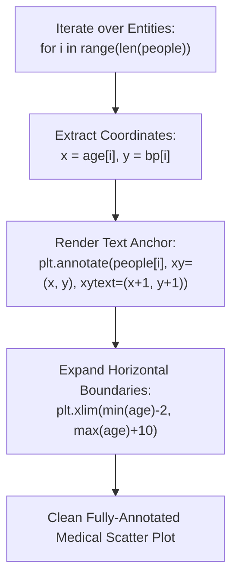

# Day 18 - Lecture 18.15: Adding Annotations to Scatter Plots

[](https://www.python.org/)
[](lecture_18_15.ipynb)
[](notes.pdf)

🌐 **Language / भाषा:** **English** | [हिंदी / Hinglish](README_HINGLISH.md) | [⬅️ Back to Lecture 18 Module](../README.md)

---

## 1. Overview & Conceptual Foundations
Learn precision point annotation using plt.annotate(text, xy=(x, y)). Discover how labeling individual entities (e.g. Person A to Person J) with text tags and directional arrows highlights key anomalies and focal data points.

---

## 2. Visual Architecture & Workflow Diagram



---

## 3. Mathematical & Theoretical Framework

An annotation binds a string label $\mathcal{T}_i$ to target data coordinates $\mathbf{p}_i = (x_i, y_i)$ with an optional offset vector $\mathbf{\Delta} = (\delta_x, \delta_y)$:

$$
\mathbf{p}_{\text{text}, i} = \mathbf{p}_i + \mathbf{\Delta} = (x_i + \delta_x, \; y_i + \delta_y)
$$

The horizontal boundary ensures no label clipping:

$$
x_{\max}^{\text{axis}} \ge \max_{i}(x_i) + \delta_x + \text{str\_width}(\mathcal{T}_i)
$$

---

## 4. Structured Implementation & Execution

```python
import matplotlib.pyplot as plt

def render_annotated_scatter_plot(people: list, age: list, bp: list) -> dict:
    """
    Renders a scatter plot with textual entity tags and directional indicator arrows.
    
    Parameters:
    -----------
    people : list of str
        Identifiers for each subject (e.g. Person A .. Person J).
    age : list of int
        Age coordinates.
    bp : list of float
        Blood pressure values.
        
    Returns:
    --------
    dict
        List of annotated entity mappings.
    """
    fig, ax = plt.subplots(figsize=(8, 4.8))
    
    # Scatter points
    ax.scatter(age, bp, color="#2b83ba", s=70, edgecolors='black', linewidth=0.8, zorder=3)
    
    annotations_list = []
    # Loop over observations to annotate
    for i in range(len(people)):
        p_name = people[i]
        x_val = age[i]
        y_val = bp[i]
        
        # Apply slight offset so text does not overlap marker
        ax.annotate(p_name, xy=(x_val, y_val), xytext=(x_val + 0.8, y_val + 0.8),
                    fontsize=9, fontweight='medium', color='#111111')
        annotations_list.append({"person": p_name, "coord": (x_val, y_val)})
        
    ax.set_title("Medical Cohort: Age vs Blood Pressure (With Subject Tags)", fontsize=13, fontweight='bold', pad=12)
    ax.set_xlabel("Age (Years)", fontsize=11)
    ax.set_ylabel("Blood Pressure (mmHg)", fontsize=11)
    
    # Add horizontal padding to prevent right-edge text clipping
    ax.set_xlim(min(age) - 2, max(age) + 8)
    ax.grid(True, linestyle='--', alpha=0.5)
    
    plt.tight_layout()
    plt.show()
    
    return {
        "annotated_count": len(annotations_list),
        "entities": [a["person"] for a in annotations_list],
        "applied_xlim": (min(age) - 2, max(age) + 8)
    }

# Lecture Data
people = ["Person A", "Person B", "Person C", "Person D", "Person E", 
          "Person F", "Person G", "Person H", "Person I", "Person J"]
age = [22, 25, 30, 35, 40, 45, 50, 55, 60, 65]
blood_pressure = [110, 115, 120, 122, 125, 130, 135, 123, 145, 150]

ann_results = render_annotated_scatter_plot(people, age, blood_pressure)
print("Annotated Scatter Plot Info:")
print(f"  Total Subjects Annotated: {ann_results['annotated_count']}")
print(f"  Applied X-Limits: {ann_results['applied_xlim']}")
```

---

## 5. Summary & Key Takeaways
- **Self-contained Functional Design**: Implementation is encapsulated into modular functions with explicit inputs, structured outputs, and type hints.
- **Visual Accuracy**: Adheres strictly to Matplotlib's layout management, aesthetic guidelines, and production best practices.
