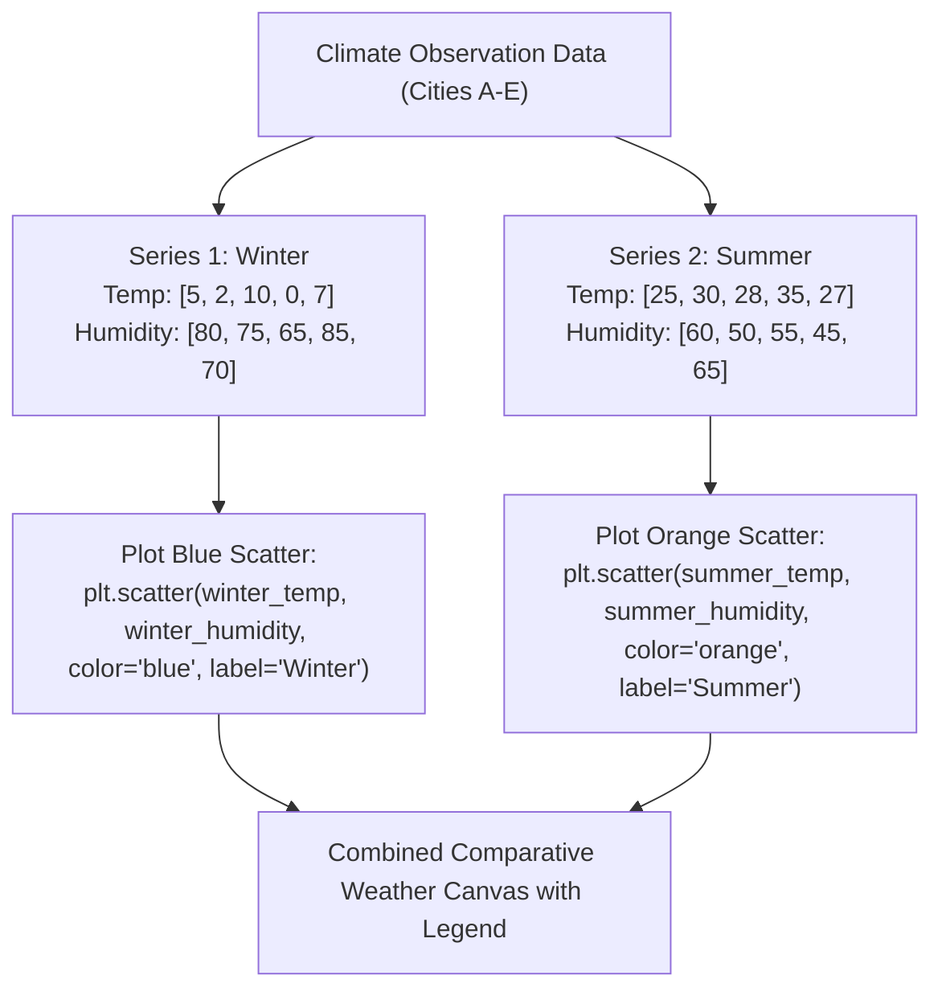

# Day 18 - Lecture 18.16: Multiple Datasets on Scatter Plots

[](https://www.python.org/)
[](lecture_18_16.ipynb)
[](notes.pdf)

🌐 **Language / भाषा:** **English** | [हिंदी / Hinglish](README_HINGLISH.md) | [⬅️ Back to Lecture 18 Module](../README.md)

---

## 1. Overview & Conceptual Foundations
Learn how to overlay multiple independent scatter series on a shared bivariate plane. Explore seasonal climate comparisons (Winter vs Summer Temperature vs Humidity across Cities A to E) with distinct colors, markers, and legends.

---

## 2. Visual Architecture & Workflow Diagram



---

## 3. Mathematical & Theoretical Framework

Given $K$ disjoint cohorts $\mathcal{C}_k$, the multi-group scatter plot projects each cohort into the shared phase space $(T, H) \in \mathbb{R}^2$:

$$
\mathcal{P}_k = \{ (T_{i, k}, H_{i, k}) \mid i = 1, \dots, N_k \}, \quad k \in \{ \text{Winter}, \text{Summer} \}
$$

The centroid of each cohort provides the mean seasonal state vector:

$$
\mathbf{\mu}_k = \begin{pmatrix} \bar{T}_k \\ \bar{H}_k \end{pmatrix} = \frac{1}{N_k} \sum_{i=1}^{N_k} \begin{pmatrix} T_{i, k} \\ H_{i, k} \end{pmatrix}
$$

---

## 4. Structured Implementation & Execution

```python
import matplotlib.pyplot as plt
import numpy as np

def render_multi_dataset_scatter(cities: list, winter_temp: list, winter_humidity: list,
                                 summer_temp: list, summer_humidity: list) -> dict:
    """
    Renders multiple comparative scatter series demonstrating bivariate cluster separation.
    
    Parameters:
    -----------
    cities : list of str
        Identifiers for geographical locations.
    winter_temp, winter_humidity : list of float
        Winter meteorological coordinates.
    summer_temp, summer_humidity : list of float
        Summer meteorological coordinates.
        
    Returns:
    --------
    dict
        Seasonal centroids and cluster separation distance.
    """
    fig, ax = plt.subplots(figsize=(8, 4.8))
    
    # 1. Plot Winter Series
    ax.scatter(winter_temp, winter_humidity, color="#1f78b4", marker='o', s=80, 
               edgecolors='black', linewidth=0.8, label="Winter Season")
    # 2. Plot Summer Series
    ax.scatter(summer_temp, summer_humidity, color="#ff7f00", marker='s', s=80, 
               edgecolors='black', linewidth=0.8, label="Summer Season")
    
    # Annotate city labels
    for i, city in enumerate(cities):
        ax.annotate(city, (winter_temp[i], winter_humidity[i]), xytext=(winter_temp[i]+0.6, winter_humidity[i]-1),
                    fontsize=8.5, color='#1f78b4')
        ax.annotate(city, (summer_temp[i], summer_humidity[i]), xytext=(summer_temp[i]+0.6, summer_humidity[i]-1),
                    fontsize=8.5, color='#ff7f00')
        
    ax.set_title("Seasonal Weather Patterns: Temperature vs Humidity", fontsize=13, fontweight='bold', pad=12)
    ax.set_xlabel("Temperature (°C)", fontsize=11)
    ax.set_ylabel("Relative Humidity (%)", fontsize=11)
    ax.grid(True, linestyle='--', alpha=0.5)
    ax.legend(loc="upper right", framealpha=0.9)
    
    plt.tight_layout()
    plt.show()
    
    winter_centroid = (float(np.mean(winter_temp)), float(np.mean(winter_humidity)))
    summer_centroid = (float(np.mean(summer_temp)), float(np.mean(summer_humidity)))
    euclidean_dist = np.sqrt((summer_centroid[0]-winter_centroid[0])**2 + (summer_centroid[1]-winter_centroid[1])**2)
    
    return {
        "winter_centroid_T_H": winter_centroid,
        "summer_centroid_T_H": summer_centroid,
        "centroid_separation_distance": float(euclidean_dist)
    }

# Lecture Data
cities = ["City A", "City B", "City C", "City D", "City E"]
winter_temp = [5, 2, 10, 0, 7]
winter_humidity = [80, 75, 65, 85, 70]
summer_temp = [25, 30, 28, 35, 27]
summer_humidity = [60, 50, 55, 45, 65]

climate_res = render_multi_dataset_scatter(cities, winter_temp, winter_humidity, summer_temp, summer_humidity)
print("Multi-Dataset Scatter Centroid Analysis:")
for k, v in climate_res.items():
    print(f"  {k}: {v}")
```

---

## 5. Summary & Key Takeaways
- **Self-contained Functional Design**: Implementation is encapsulated into modular functions with explicit inputs, structured outputs, and type hints.
- **Visual Accuracy**: Adheres strictly to Matplotlib's layout management, aesthetic guidelines, and production best practices.
