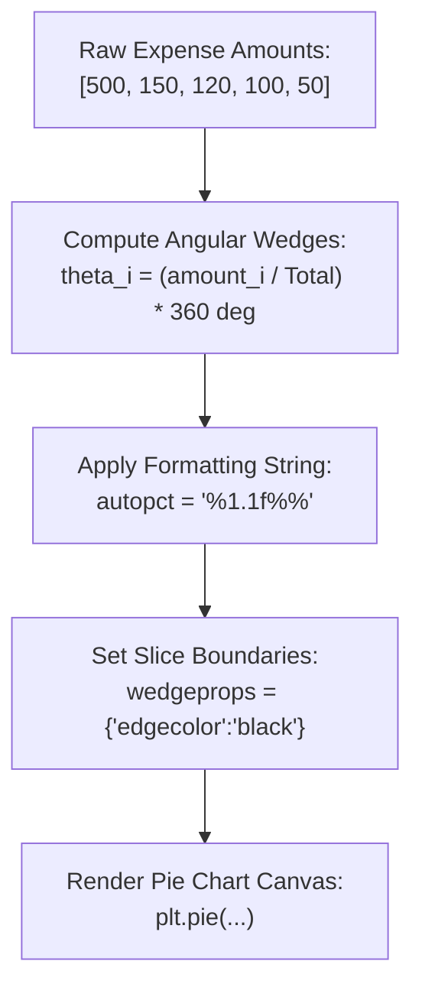

# Day 18 - Lecture 18.17: Pie Charts (`plt.pie`)

[](https://www.python.org/)
[](lecture_18_17.ipynb)
[](notes.pdf)

🌐 **Language / भाषा:** **English** | [हिंदी / Hinglish](README_HINGLISH.md) | [⬅️ Back to Lecture 18 Module](../README.md)

---

## 1. Overview & Conceptual Foundations
Master proportional part-of-whole visualization with plt.pie(). Learn automatic percentage formatting (autopct='%1.1f%%'), custom palette assignment, and clean slice separation using wedgeprops.

---

## 2. Visual Architecture & Workflow Diagram



---

## 3. Mathematical & Theoretical Framework

For a vector of non-negative weights $\mathbf{w} = (w_1, w_2, \dots, w_K)$, the central angle $\theta_i$ and percentage share $p_i$ of slice $i$ are given by:

$$
p_i = \frac{w_i}{\sum_{j=1}^K w_j} \times 100\%, \qquad \theta_i = \frac{w_i}{\sum_{j=1}^K w_j} \times 360^\circ
$$

The sum over all slices forms a complete circle:

$$
\sum_{i=1}^K \theta_i = 360^\circ, \qquad \sum_{i=1}^K p_i = 100\%
$$

---

## 4. Structured Implementation & Execution

```python
import matplotlib.pyplot as plt

def render_budget_pie_chart(categories: list, amounts: list, custom_colors: list = None) -> dict:
    """
    Renders a standard proportional pie chart with percentage formatting and wedge borders.
    
    Parameters:
    -----------
    categories : list of str
        Expense or departmental category names.
    amounts : list of float
        Budget allocations summing to the total.
    custom_colors : list of str, optional
        Palette colors for each slice.
        
    Returns:
    --------
    dict
        Breakdown of percentage shares per category.
    """
    if custom_colors is None:
        custom_colors = ["#7fc97f", "#beaed4", "#fdc086", "#ffff99", "#386cb0"]
        
    fig, ax = plt.subplots(figsize=(6.5, 5))
    
    wedges, texts, autotexts = ax.pie(
        amounts, 
        labels=categories, 
        autopct='%1.1f%%', 
        colors=custom_colors,
        wedgeprops={"edgecolor": "black", "linewidth": 1.2, "antialiased": True},
        textprops={'fontsize': 10, 'fontweight': 'medium'}
    )
    
    # Enhance percentage text readability
    for autotext in autotexts:
        autotext.set_color('#111111')
        autotext.set_fontweight('bold')
        
    ax.set_title("Company Operating Expenses Breakdown", fontsize=13, fontweight='bold', pad=14)
    plt.tight_layout()
    plt.show()
    
    total = sum(amounts)
    shares = {categories[i]: f"{(amounts[i]/total)*100:.1f}%" for i in range(len(categories))}
    
    return {
        "total_budget": total,
        "num_slices": len(categories),
        "percentage_shares": shares
    }

# Lecture Data
expenses = ["Salaries", "Rent", "Marketing", "R&D", "Miscellaneous"]
amounts = [500, 150, 120, 100, 50]

pie_results = render_budget_pie_chart(expenses, amounts)
print("Budget Allocation Pie Chart Shares:")
for cat, share in pie_results['percentage_shares'].items():
    print(f"  {cat}: {share}")
```

---

## 5. Summary & Key Takeaways
- **Self-contained Functional Design**: Implementation is encapsulated into modular functions with explicit inputs, structured outputs, and type hints.
- **Visual Accuracy**: Adheres strictly to Matplotlib's layout management, aesthetic guidelines, and production best practices.
