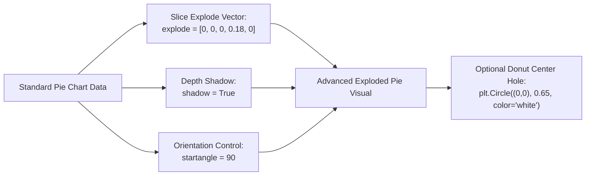

# Day 18 - Lecture 18.18: Advanced Customizations on Pie Charts

[](https://www.python.org/)
[](lecture_18_18.ipynb)
[](notes.pdf)

🌐 **Language / भाषा:** **English** | [हिंदी / Hinglish](README_HINGLISH.md) | [⬅️ Back to Lecture 18 Module](../README.md)

---

## 1. Overview & Conceptual Foundations
Unlock advanced stylistic and rotational controls on pie charts. Learn the explode parameter for slice detachment, drop shadows (shadow=True), rotational orientations (startangle=90/180), and converting a pie chart into a modern Donut Chart.

---

## 2. Visual Architecture & Workflow Diagram



---

## 3. Mathematical & Theoretical Framework

The exploded displacement vector for slice $i$ with radial offset factor $e_i$ along its bisecting angle $\phi_i$ is given by:

$$
\mathbf{d}_i = e_i \cdot R \begin{pmatrix} \cos \phi_i \\ \sin \phi_i \end{pmatrix}
$$

where $\phi_i$ is the mid-angle of the slice relative to the configured start angle $\theta_0$:

$$
\phi_i = \theta_0 + \sum_{j=1}^{i-1} \Delta \theta_j + \frac{1}{2}\Delta \theta_i
$$

---

## 4. Structured Implementation & Execution

```python
import matplotlib.pyplot as plt

def render_advanced_exploded_pie(expenses: list, amounts: list, focus_category: str = "R&D", start_angle: int = 90) -> dict:
    """
    Renders an advanced pie chart featuring slice explosion, drop shadows,
    custom start angle rotation, and donut styling.
    
    Parameters:
    -----------
    expenses : list of str
        Expense categories.
    amounts : list of float
        Numerical expenditures.
    focus_category : str
        Category name to highlight via explode.
    start_angle : int
        Rotational start angle in degrees (90 starts at 12 o'clock).
        
    Returns:
    --------
    dict
        Configuration properties applied to the chart.
    """
    # Build explode vector dynamically
    explode_vector = [0.18 if cat == focus_category else 0.0 for cat in expenses]
    palette = ["#66c2a5", "#fc8d62", "#8da0cb", "#e78ac3", "#a6d854"]
    
    fig, (ax1, ax2) = plt.subplots(1, 2, figsize=(12, 5))
    
    # 1. Advanced Exploded Pie with Shadow
    wedges1, texts1, autotexts1 = ax1.pie(
        amounts,
        labels=expenses,
        autopct='%1.1f%%',
        explode=explode_vector,
        shadow=True,
        startangle=start_angle,
        colors=palette,
        wedgeprops={"edgecolor": "white", "linewidth": 1.5}
    )
    for at in autotexts1:
        at.set_fontweight('bold')
    ax1.set_title(f"1. Exploded Pie ({focus_category} Highlighted, startangle={start_angle}°)", fontsize=11, fontweight='bold')
    
    # 2. Modern Donut Chart Variant
    wedges2, texts2, autotexts2 = ax2.pie(
        amounts,
        labels=expenses,
        autopct='%1.1f%%',
        startangle=start_angle,
        colors=palette,
        wedgeprops={"edgecolor": "white", "linewidth": 1.5}
    )
    # Draw center white circle to create donut hole
    centre_circle = plt.Circle((0, 0), 0.65, fc='white')
    ax2.add_artist(centre_circle)
    total_label = "Total: $" + str(sum(amounts)) + "K"
    ax2.text(0, 0, total_label, ha='center', va='center', fontsize=11, fontweight='bold')
    ax2.set_title("2. Modern Donut Chart Variant", fontsize=11, fontweight='bold')
    
    plt.tight_layout()
    plt.show()
    
    return {
        "focus_category": focus_category,
        "applied_explode_vector": explode_vector,
        "start_angle": start_angle,
        "total_expenditure": sum(amounts)
    }

# Lecture Data
expenses = ["Salaries", "Rent", "Marketing", "R&D", "Miscellaneous"]
amounts = [500, 150, 120, 100, 50]

adv_info = render_advanced_exploded_pie(expenses, amounts, focus_category="R&D", start_angle=90)
print("Advanced Pie Customization Details:")
for k, v in adv_info.items():
    print(f"  {k}: {v}")
```

---

## 5. Summary & Key Takeaways
- **Self-contained Functional Design**: Implementation is encapsulated into modular functions with explicit inputs, structured outputs, and type hints.
- **Visual Accuracy**: Adheres strictly to Matplotlib's layout management, aesthetic guidelines, and production best practices.
