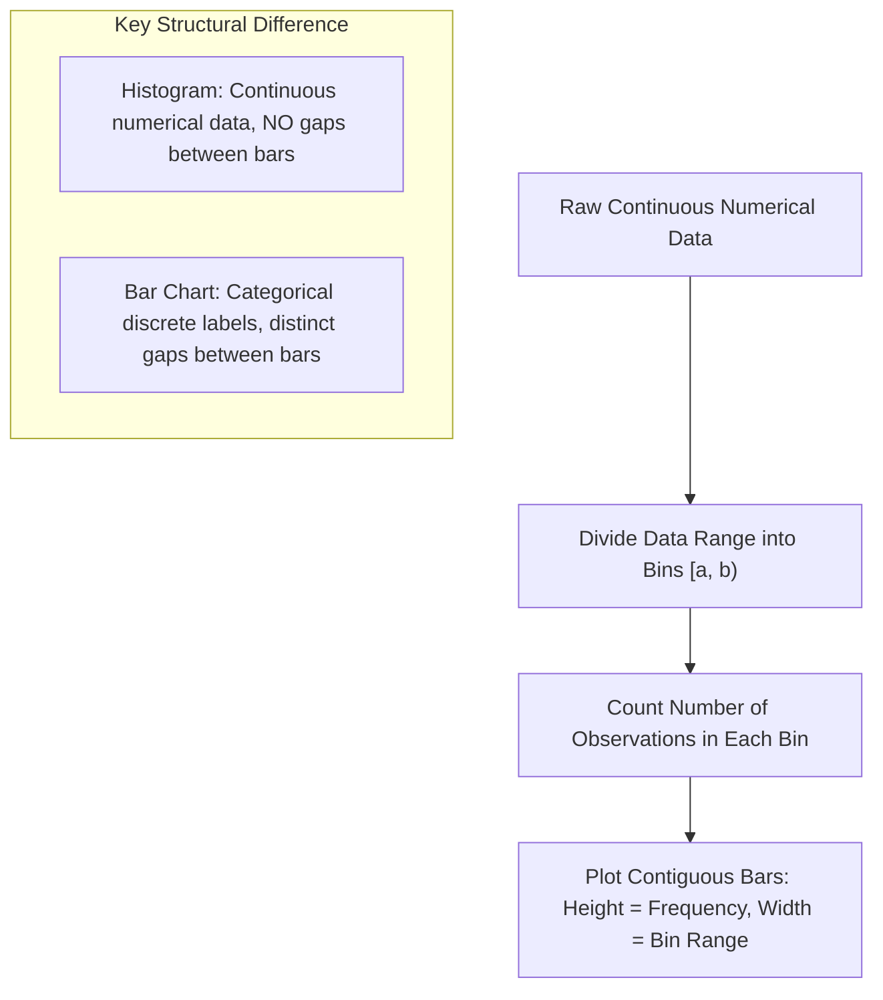

# Lecture 19.01: Histograms in Matplotlib

## 📌 Topic Overview
In this lecture, Shraddha ma'am introduces **Histograms in Matplotlib**, explaining how continuous numerical data is partitioned into discrete intervals (**bins**) to reveal the underlying frequency distribution, spread, and central tendency.

---

## 📊 Histograms vs Bar Charts



---

## 📐 Mathematical Formulation: Binning

Given $n$ numerical data points $X = \{x_1, x_2, \dots, x_n\}$, the continuous range $[\min(X), \max(X)]$ is divided into $k$ contiguous bins of uniform width $\Delta$:

$$
\Delta = \frac{\max(X) - \min(X)}{k}
$$

### Optimal Bin Selection Rules:
1. **Sturges' Rule** (Best for normal, symmetric data):

$$
k = 1 + \lceil \log_2(n) \rceil
$$

2. **Freedman-Diaconis Rule** (Robust against heavy tails and outliers):

$$
h = 2 \cdot \frac{\text{IQR}(X)}{n^{1/3}}, \quad k = \left\lceil \frac{\max(X) - \min(X)}{h} \right\rceil
$$

where $\text{IQR}(X) = Q_3 - Q_1$ is the interquartile range.

---

## 💻 Python Implementation

```python
import matplotlib.pyplot as plt
import numpy as np

def plot_marks_histogram(marks_data=None, custom_bins=None, show_plot=True):
    """
    Plots a histogram for student marks using equal and custom bins.
    Demonstrates continuous data binning, frequency counting, and edge color styling.
    
    Parameters:
        marks_data (list or np.ndarray): 1D continuous scores.
        custom_bins (list): Custom intervals for grading.
        show_plot (bool): Whether to display the plot.
        
    Returns:
        tuple: (counts, bin_edges) computed by plt.hist.
    """
    if marks_data is None:
        marks_data = [
            25, 38, 42, 55, 61, 67, 72, 78, 83, 88,
            91, 95, 47, 53, 59, 64, 69, 74, 79, 85,
            92, 97, 33, 45, 58, 62, 71, 76, 81, 89
        ]
        
    if custom_bins is None:
        custom_bins = [0, 30, 70, 90, 100]
        
    fig, axes = plt.subplots(1, 2, figsize=(14, 5))
    
    # Plot 1: Equal bins (10 intervals)
    counts1, edges1, _ = axes[0].hist(
        marks_data,
        bins=10,
        color="skyblue",
        edgecolor="black",
        linewidth=1.2
    )
    axes[0].set_title("Distribution of Marks (10 Equal Bins)")
    axes[0].set_xlabel("Marks Range")
    axes[0].set_ylabel("Number of Students")
    axes[0].grid(axis="y", linestyle="--", alpha=0.7)
    
    # Plot 2: Custom bins (Grading System)
    counts2, edges2, _ = axes[1].hist(
        marks_data,
        bins=custom_bins,
        color="lightgreen",
        edgecolor="black",
        linewidth=1.2
    )
    axes[1].set_title("Grade Distribution (Custom Bins: 0-30, 30-70, 70-90, 90-100)")
    axes[1].set_xlabel("Score Intervals")
    axes[1].set_ylabel("Number of Students")
    axes[1].set_xticks(custom_bins)
    axes[1].grid(axis="y", linestyle="--", alpha=0.7)
    
    plt.tight_layout()
    if show_plot:
        plt.show()
        
    return counts2, edges2

# --- Execution & Verification ---
counts, edges = plot_marks_histogram(show_plot=False)
print(f"Custom Bin Edges: {edges}")
print(f"Student Counts per Bin: {counts}")

```

---

## 🔑 Key Takeaways
1. Always supply `edgecolor='black'` in `plt.hist()`, otherwise adjacent bars merge into an indistinct visual block.
2. Custom bin edges like `[0, 30, 70, 90, 100]` allow non-uniform partitions ideal for real-world grading boundaries (Fail, Average, Good, Excellent).
3. Histograms visualize data skewness, modalities (unimodal, bimodal), and the concentration of values.
