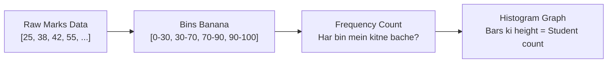

# Notes_19.01: Matplotlib Mein Histograms [Hinglish]

## 📌 Topic Overview
Is lecture mein Shraddha ma'am ne **Histograms** ka concept detail mein samjhaya hai: continuous data ki frequency distribution ko dekhne ke liye bins kaise banaye jaate hain aur bar chart ke mukable histogram kyu alag hota hai.

---

### 📋 Is Topic Mein Hum Kya Seekhenge?
- Histogram kya hota hai aur iski zaroorat kyu padti hai?
- Histogram aur Bar Chart ke beech ka mukhya farq (Continuous vs Categorical).
- Equal bins aur Custom bins (`bins=[0, 30, 70, 90, 100]`) ka use case.
- `edgecolor="black"` kyu zaroori parameter hai.

---

### 🔍 Har Ek Point Ka Simple & Detailed Explanation

#### 1. Histogram Kya Hai?
Jab hamare paas continuous numerical data hota hai (jaise 100 students ke exam marks ya logon ki age), tab hum har number ke liye alag bar nahi bana sakte.
Hum range ko chhote-chhote hisson (**bins**) mein baant dete hain, aur dekhte hain ki har bin ke andar kitni values aayi hain (frequency).

#### 2. Bar Chart vs Histogram
- **Bar Chart:** Categorical data ke liye hota hai (jaise Fruits: Apple, Banana, Mango). Har bar ke beech space/gap hota hai.
- **Histogram:** Continuous numerical data ke liye hota hai (jaise Marks: 0 se 100). Bars aapas mein jude rehte hain kyunki intervals continuous hote hain.

#### 3. Bins Ka Math:
Uniform bin width nikalne ka formula:

$$
\Delta = \frac{\max(X) - \min(X)}{k}
$$

Jahan $k$ number of bins hai.

---

### 📊 Blackboard Diagram: Continuous Data Se Histogram Banna



---

### 💻 Python Code Implementation

```python
import matplotlib.pyplot as plt
import numpy as np

def plot_marks_histogram(marks_data=None, custom_bins=None, show_plot=True):
    """
    Plots a histogram for student marks using equal and custom bins.
    Demonstrates continuous data binning, frequency counting, and edge color styling.
    
    Parameters:
        marks_data (list or np.ndarray): 1D continuous scores.
        custom_bins (list): Custom intervals for grading.
        show_plot (bool): Whether to display the plot.
        
    Returns:
        tuple: (counts, bin_edges) computed by plt.hist.
    """
    if marks_data is None:
        marks_data = [
            25, 38, 42, 55, 61, 67, 72, 78, 83, 88,
            91, 95, 47, 53, 59, 64, 69, 74, 79, 85,
            92, 97, 33, 45, 58, 62, 71, 76, 81, 89
        ]
        
    if custom_bins is None:
        custom_bins = [0, 30, 70, 90, 100]
        
    fig, axes = plt.subplots(1, 2, figsize=(14, 5))
    
    # Plot 1: Equal bins (10 intervals)
    counts1, edges1, _ = axes[0].hist(
        marks_data,
        bins=10,
        color="skyblue",
        edgecolor="black",
        linewidth=1.2
    )
    axes[0].set_title("Distribution of Marks (10 Equal Bins)")
    axes[0].set_xlabel("Marks Range")
    axes[0].set_ylabel("Number of Students")
    axes[0].grid(axis="y", linestyle="--", alpha=0.7)
    
    # Plot 2: Custom bins (Grading System)
    counts2, edges2, _ = axes[1].hist(
        marks_data,
        bins=custom_bins,
        color="lightgreen",
        edgecolor="black",
        linewidth=1.2
    )
    axes[1].set_title("Grade Distribution (Custom Bins: 0-30, 30-70, 70-90, 90-100)")
    axes[1].set_xlabel("Score Intervals")
    axes[1].set_ylabel("Number of Students")
    axes[1].set_xticks(custom_bins)
    axes[1].grid(axis="y", linestyle="--", alpha=0.7)
    
    plt.tight_layout()
    if show_plot:
        plt.show()
        
    return counts2, edges2

# --- Execution & Verification ---
counts, edges = plot_marks_histogram(show_plot=False)
print(f"Custom Bin Edges: {edges}")
print(f"Student Counts per Bin: {counts}")

```

---

### 🎯 Key Takeaways:
1. `edgecolor="black"` lagana kabhi mat bhooliye, warna adjacent bars aapas mein chipak kar ek bada block dikhte hain.
2. Custom bins (`[0, 33, 60, 80, 100]`) real-world grade separation ke liye best hote hain.
