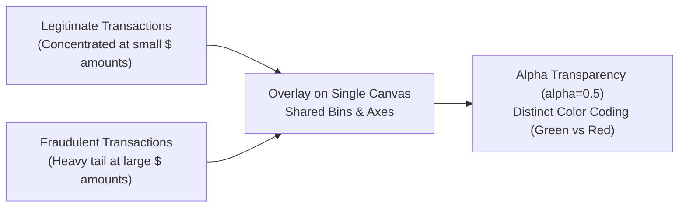

# Lecture 19.02: Multiple Datasets on Histogram

## 📌 Topic Overview
In this lecture, Shraddha ma'am demonstrates how to plot **multiple datasets simultaneously on the same histogram axes** to perform comparative distribution analysis, using the classic fraud detection example (Legitimate vs Fraudulent transactions).

---

## 🔍 Visualizing Distribution Discrepancies



---

## 📐 Mathematical Formulation: Comparative Density

When comparing datasets of unequal size ($N_{\text{legit}} \neq N_{\text{fraud}}$), frequency counts can create an optical illusion. The normalized probability density satisfies:

$$
\int_{-\infty}^{\infty} p_{\text{legit}}(x) \, dx = 1, \qquad \int_{-\infty}^{\infty} p_{\text{fraud}}(x) \, dx = 1
$$

Setting `alpha=0.5` enables visual transparency so neither distribution occludes the other.

---

## 💻 Python Implementation

```python
import matplotlib.pyplot as plt

def plot_legit_vs_fraud_histogram(legit_tx=None, fraud_tx=None, show_plot=True):
    """
    Plots two overlapping distributions on a single histogram to compare
    legitimate vs fraudulent transactions. Demonstrates alpha transparency,
    color distinction, and legend integration.
    
    Parameters:
        legit_tx (list): Transaction amounts for legitimate purchases.
        fraud_tx (list): Transaction amounts for fraudulent activities.
        show_plot (bool): Display control flag.
        
    Returns:
        dict: Summary statistics comparing both datasets.
    """
    if legit_tx is None:
        legit_tx = [
            2.99, 5.49, 8.99, 12.50, 14.99, 19.99, 23.45, 29.99, 34.99, 39.50,
            45.00, 49.99, 55.25, 60.00, 75.99, 89.99, 120.50, 150.00, 199.99,
            249.99, 300.75, 450.00, 600.00, 850.00, 1200.00
        ]
    if fraud_tx is None:
        fraud_tx = [
            50, 100, 150, 200, 300, 500, 500, 750, 1000, 1000,
            1200, 1500, 1500, 2000, 2500, 3000, 3000
        ]
        
    plt.figure(figsize=(9, 5))
    
    # Legit transactions in green with alpha=0.5
    plt.hist(
        legit_tx,
        bins=10,
        color="green",
        alpha=0.5,
        edgecolor="black",
        label="Legitimate Transactions"
    )
    
    # Fraud transactions in red with alpha=0.5
    plt.hist(
        fraud_tx,
        bins=10,
        color="red",
        alpha=0.5,
        edgecolor="black",
        label="Fraudulent Transactions"
    )
    
    plt.xlabel("Transaction Amount ($)")
    plt.ylabel("Frequency")
    plt.title("Transaction Amount Distribution: Legitimate vs Fraudulent")
    plt.legend(loc="upper right")
    plt.grid(True, linestyle=":", alpha=0.6)
    
    plt.tight_layout()
    if show_plot:
        plt.show()
        
    summary = {
        "legit_count": len(legit_tx),
        "legit_max": max(legit_tx),
        "fraud_count": len(fraud_tx),
        "fraud_max": max(fraud_tx)
    }
    return summary

# --- Execution & Verification ---
stats = plot_legit_vs_fraud_histogram(show_plot=False)
print(f"Distribution Summary: {stats}")

```

---

## 🔑 Key Takeaways
1. Setting `alpha=0.5` is mandatory when overlapping histograms; without transparency, the second plot completely hides bars from the first plot.
2. Label each dataset explicitly with `label="..."` and invoke `plt.legend()` so readers can distinguish the categories.
3. This visual comparison immediately highlights feature separation potential for machine learning classifiers.
