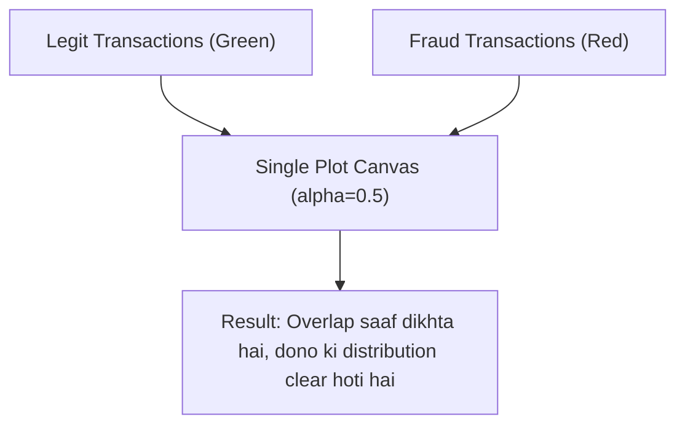

# Notes_19.02: Histogram Par Multiple Datasets [Hinglish]

## 📌 Topic Overview
Is lecture mein Shraddha ma'am ne sikhaya hai ki **ek hi graph par do alag-alag datasets ka histogram** kaise banaya jata hai taaki unka comparison kiya ja sake, jaise Legitimate vs Fraudulent transactions.

---

### 📋 Is Topic Mein Hum Kya Seekhenge?
- Ek hi canvas par do histograms ko ek sath plot karna.
- `alpha` parameter ka use karke transparency set karna.
- `label` aur `plt.legend()` ka use karke visual distinction create karna.
- Real-world fraud detection mein distribution comparison ki importance.

---

### 🔍 Har Ek Point Ka Simple & Detailed Explanation

#### 1. Multiple Histograms Kyu Banate Hain?
Machine Learning mein humein dekhna hota hai ki kya hamare feature classes ko alag kar pa rahe hain.
Agar hum legitimate transactions aur fraud transactions ko ek hi graph par dekhein:
- Legitimate transactions chhote amounts ($10, $20, $50) par bohot zyada hote hain.
- Fraud transactions bade amounts ($1000, $3000) tak jaate hain.

#### 2. `alpha` Parameter Ki Ahmiyat:
Default mein `alpha=1.0` (opaque) hota hai. Agar aap do histograms plot karenge, toh doosra histogram pehle waale ke bars ko poori tarah chhupa dega.
`alpha=0.5` set karne se bars semi-transparent ho jaate hain aur overlap saaf dikhta hai.

---

### 📊 Blackboard Diagram: Transaction Comparison



---

### 💻 Python Code Implementation

```python
import matplotlib.pyplot as plt

def plot_legit_vs_fraud_histogram(legit_tx=None, fraud_tx=None, show_plot=True):
    """
    Plots two overlapping distributions on a single histogram to compare
    legitimate vs fraudulent transactions. Demonstrates alpha transparency,
    color distinction, and legend integration.
    
    Parameters:
        legit_tx (list): Transaction amounts for legitimate purchases.
        fraud_tx (list): Transaction amounts for fraudulent activities.
        show_plot (bool): Display control flag.
        
    Returns:
        dict: Summary statistics comparing both datasets.
    """
    if legit_tx is None:
        legit_tx = [
            2.99, 5.49, 8.99, 12.50, 14.99, 19.99, 23.45, 29.99, 34.99, 39.50,
            45.00, 49.99, 55.25, 60.00, 75.99, 89.99, 120.50, 150.00, 199.99,
            249.99, 300.75, 450.00, 600.00, 850.00, 1200.00
        ]
    if fraud_tx is None:
        fraud_tx = [
            50, 100, 150, 200, 300, 500, 500, 750, 1000, 1000,
            1200, 1500, 1500, 2000, 2500, 3000, 3000
        ]
        
    plt.figure(figsize=(9, 5))
    
    # Legit transactions in green with alpha=0.5
    plt.hist(
        legit_tx,
        bins=10,
        color="green",
        alpha=0.5,
        edgecolor="black",
        label="Legitimate Transactions"
    )
    
    # Fraud transactions in red with alpha=0.5
    plt.hist(
        fraud_tx,
        bins=10,
        color="red",
        alpha=0.5,
        edgecolor="black",
        label="Fraudulent Transactions"
    )
    
    plt.xlabel("Transaction Amount ($)")
    plt.ylabel("Frequency")
    plt.title("Transaction Amount Distribution: Legitimate vs Fraudulent")
    plt.legend(loc="upper right")
    plt.grid(True, linestyle=":", alpha=0.6)
    
    plt.tight_layout()
    if show_plot:
        plt.show()
        
    summary = {
        "legit_count": len(legit_tx),
        "legit_max": max(legit_tx),
        "fraud_count": len(fraud_tx),
        "fraud_max": max(fraud_tx)
    }
    return summary

# --- Execution & Verification ---
stats = plot_legit_vs_fraud_histogram(show_plot=False)
print(f"Distribution Summary: {stats}")

```

---

### 🎯 Key Takeaways:
1. Dono datasets ke liye `edgecolor="black"` aur `alpha=0.5` zaroor use karein.
2. `plt.legend()` se viewer ko pata chalta hai ki green color legit ka hai aur red color fraud ka.
