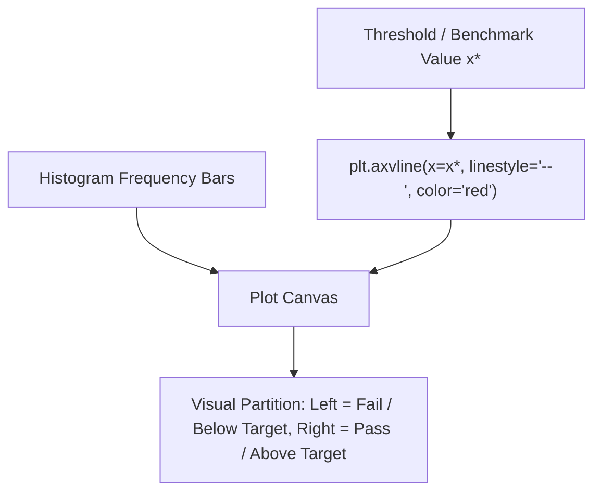

# Lecture 19.03: axvline in Histogram

## 📌 Topic Overview
In this lecture, Shraddha ma'am covers `plt.axvline()` (**Axes Vertical Line**), demonstrating how to draw reference lines across the full height of a plot to highlight critical benchmarks such as passing marks, mean, median, or classification thresholds.

---

## 🏛️ Thresholding & Boundary Lines



---

## 📐 Mathematical Formalism: Decision Threshold

Given an indicator condition $I(x)$:

$$
I(x) = \begin{cases} 1 & \text{if } x \ge x_{\text{threshold}} \\ 0 & \text{if } x < x_{\text{threshold}} \end{cases}
$$

The vertical line $x = x_{\text{threshold}}$ divides the continuous distribution domain into two disjoint subsets $\Omega_{\text{fail}} = (-\infty, x_{\text{threshold}})$ and $\Omega_{\text{pass}} = [x_{\text{threshold}}, \infty)$.

---

## 💻 Python Implementation

```python
import matplotlib.pyplot as plt

def plot_histogram_with_pass_line(marks=None, pass_mark=33, show_plot=True):
    """
    Plots a histogram with an axvline indicator to highlight decision boundaries
    such as pass/fail cutoff marks or anomaly thresholds.
    
    Parameters:
        marks (list): Student test scores.
        pass_mark (float): Threshold line coordinate on the x-axis.
        show_plot (bool): Display control.
        
    Returns:
        dict: Count of students passing and failing.
    """
    if marks is None:
        marks = [
            25, 38, 42, 55, 61, 67, 72, 78, 83, 88,
            91, 95, 47, 53, 59, 64, 69, 74, 79, 85,
            92, 97, 33, 45, 58, 62, 71, 76, 81, 89
        ]
        
    custom_bins = [0, 30, 70, 90, 100]
    
    plt.figure(figsize=(8, 5))
    plt.hist(
        marks,
        bins=custom_bins,
        color="lightblue",
        edgecolor="black",
        linewidth=1.2
    )
    
    # Adding vertical line at pass mark (33)
    plt.axvline(
        x=pass_mark,
        color="red",
        linestyle="--",
        linewidth=2.0,
        label=f"Passing Mark ({pass_mark})"
    )
    
    plt.xlabel("Marks")
    plt.ylabel("Number of Students")
    plt.title("Distribution of Marks of 30 Students with Pass Threshold")
    plt.legend(loc="upper left")
    plt.grid(True, linestyle=":", alpha=0.6)
    
    plt.tight_layout()
    if show_plot:
        plt.show()
        
    passed = sum(1 for m in marks if m >= pass_mark)
    failed = len(marks) - passed
    return {"passed": passed, "failed": failed, "total": len(marks)}

# --- Execution & Verification ---
res = plot_histogram_with_pass_line(show_plot=False)
print(f"Results Analysis: {res}")

```

---

## 🔑 Key Takeaways
1. `plt.axvline(x=val)` spans across the entire y-axis automatically without needing manual y-coordinate bounds.
2. Useful for showing statistical measures (mean $\mu$, median) or operational business thresholds (cutoff marks, SLA limits).
3. Always provide `linestyle='--'` and a `label` to make the purpose of the line obvious.
