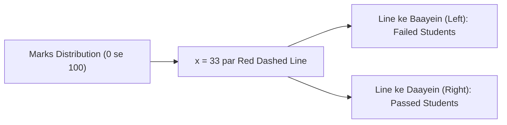

# Notes_19.03: Histogram Mein axvline Ka Upyog [Hinglish]

## 📌 Topic Overview
Is lecture mein Shraddha ma'am ne `plt.axvline()` ka use samjhaya hai: graph par vertical reference line kaise khichte hain taaki cutoff marks (jaise 33 pass marks), mean ya median ko highlight kiya ja sake.

---

### 📋 Is Topic Mein Hum Kya Seekhenge?
- `plt.axvline()` function kya karta hai?
- Graph par passing marks (33) ki line draw karna.
- `linestyle="--"`, `color="red"`, aur `linewidth` styling options.
- Data ko do parts (Pass vs Fail) mein visually partition karna.

---

### 🔍 Har Ek Point Ka Simple & Detailed Explanation

#### 1. `axvline` Kya Hai?
`axvline` ka matlab hai **Axes Vertical Line**.
Agar aapko histogram ke upar kisi khaas point par seedhi vertical line draw karni ho (jaise exam mein 33 passing marks ya average mark), toh `plt.axvline(x=33)` use karte hain. Yeh y-axis ke minimum se maximum tak poori height cover karti hai.

#### 2. Iska Upyog Machine Learning Mein:
- Anomaly detection thresholds mark karne ke liye.
- Classification decision boundary ($p = 0.5$) dikhane ke liye.
- Mean ($\mu$) aur Median ko distribution ke beech dikhane ke liye.

---

### 📊 Blackboard Diagram: Passing Cutoff Line



---

### 💻 Python Code Implementation

```python
import matplotlib.pyplot as plt

def plot_histogram_with_pass_line(marks=None, pass_mark=33, show_plot=True):
    """
    Plots a histogram with an axvline indicator to highlight decision boundaries
    such as pass/fail cutoff marks or anomaly thresholds.
    
    Parameters:
        marks (list): Student test scores.
        pass_mark (float): Threshold line coordinate on the x-axis.
        show_plot (bool): Display control.
        
    Returns:
        dict: Count of students passing and failing.
    """
    if marks is None:
        marks = [
            25, 38, 42, 55, 61, 67, 72, 78, 83, 88,
            91, 95, 47, 53, 59, 64, 69, 74, 79, 85,
            92, 97, 33, 45, 58, 62, 71, 76, 81, 89
        ]
        
    custom_bins = [0, 30, 70, 90, 100]
    
    plt.figure(figsize=(8, 5))
    plt.hist(
        marks,
        bins=custom_bins,
        color="lightblue",
        edgecolor="black",
        linewidth=1.2
    )
    
    # Adding vertical line at pass mark (33)
    plt.axvline(
        x=pass_mark,
        color="red",
        linestyle="--",
        linewidth=2.0,
        label=f"Passing Mark ({pass_mark})"
    )
    
    plt.xlabel("Marks")
    plt.ylabel("Number of Students")
    plt.title("Distribution of Marks of 30 Students with Pass Threshold")
    plt.legend(loc="upper left")
    plt.grid(True, linestyle=":", alpha=0.6)
    
    plt.tight_layout()
    if show_plot:
        plt.show()
        
    passed = sum(1 for m in marks if m >= pass_mark)
    failed = len(marks) - passed
    return {"passed": passed, "failed": failed, "total": len(marks)}

# --- Execution & Verification ---
res = plot_histogram_with_pass_line(show_plot=False)
print(f"Results Analysis: {res}")

```

---

### 🎯 Key Takeaways:
1. `plt.axvline(x=33, color="red", linestyle="--")` se clear boundary ban jaati hai.
2. Is line ke sath `label="Pass Mark (33)"` zaroor dein aur `plt.legend()` call karein.
