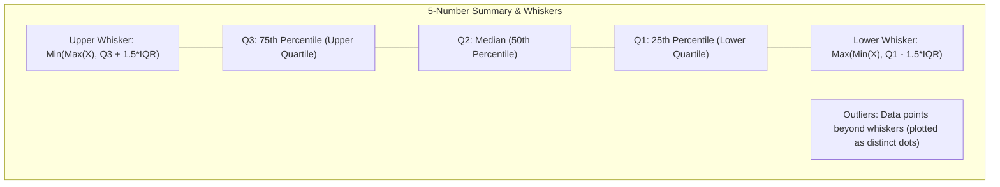

# Lecture 19.04: Box Plots in Matplotlib

## 📌 Topic Overview
In this lecture, Shraddha ma'am introduces **Box Plots (Box & Whisker Plots)**, a fundamental exploratory data analysis tool that summarizes continuous distributions using the **5-Number Summary** and detects statistical outliers using the **$1.5 \times \text{IQR}$ rule**.

---

## 🏛️ Anatomy of a Box Plot



---

## 📐 Mathematical Formulation: Interquartile Range & Fences

Given an ordered dataset $X_{(1)} \le X_{(2)} \le \dots \le X_{(n)}$:

1. **Interquartile Range (IQR):**

$$
\text{IQR} = Q_3 - Q_1
$$

2. **Tukey's Outlier Fences:**

$$
\text{Lower Fence} = Q_1 - 1.5 \cdot \text{IQR}
$$

$$
\text{Upper Fence} = Q_3 + 1.5 \cdot \text{IQR}
$$

Any data point $x < \text{Lower Fence}$ or $x > \text{Upper Fence}$ is flagged as an outlier.

---

## 💻 Python Implementation

```python
import matplotlib.pyplot as plt
import numpy as np

def compute_and_plot_boxplot(data=None, show_plot=True):
    """
    Computes 5-number summary and plots a standard Box & Whisker plot.
    Identifies Q1, Median, Q3, IQR, and Outlier fences.
    
    Parameters:
        data (list or np.ndarray): 1D continuous dataset.
        show_plot (bool): Display control.
        
    Returns:
        dict: 5-number summary statistics and calculated fences.
    """
    if data is None:
        data = [7, 8, 5, 6, 9, 4, 10, 12, 15]
        
    data_arr = np.array(data)
    q1 = np.percentile(data_arr, 25)
    median = np.median(data_arr)
    q3 = np.percentile(data_arr, 75)
    iqr = q3 - q1
    lower_fence = q1 - 1.5 * iqr
    upper_fence = q3 + 1.5 * iqr
    
    plt.figure(figsize=(7, 5))
    plt.boxplot(data_arr, patch_artist=True, boxprops=dict(facecolor="lightblue"))
    plt.title("Box Plot (5-Number Summary & Outlier Detection)")
    plt.ylabel("Data Values")
    plt.grid(True, linestyle=":", alpha=0.6)
    
    plt.tight_layout()
    if show_plot:
        plt.show()
        
    summary = {
        "min": float(np.min(data_arr)),
        "Q1 (25th percentile)": float(q1),
        "Median (50th percentile)": float(median),
        "Q3 (75th percentile)": float(q3),
        "max": float(np.max(data_arr)),
        "IQR": float(iqr),
        "lower_fence": float(lower_fence),
        "upper_fence": float(upper_fence)
    }
    return summary

# --- Execution & Verification ---
summary_stats = compute_and_plot_boxplot(show_plot=False)
for k, v in summary_stats.items():
    print(f"{k}: {v:.2f}")

```

---

## 🔑 Key Takeaways
1. Box plots represent 50% of the middle data inside the interquartile box ($Q_1$ to $Q_3$).
2. The median line shows distribution skewness (if the line is closer to $Q_1$, data is positively skewed; if closer to $Q_3$, negatively skewed).
3. Box plots are robust against extreme outliers unlike the sample mean and variance.
