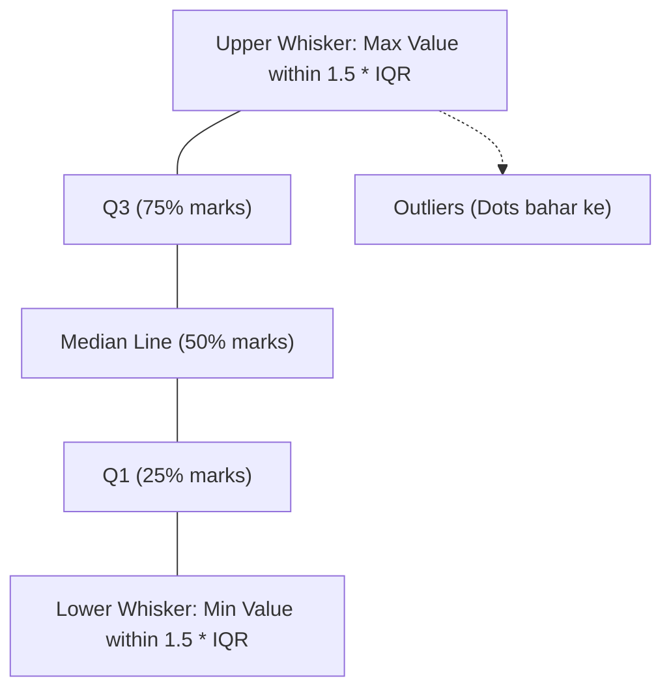

# Notes_19.04: Matplotlib Mein Box Plots [Hinglish]

## 📌 Topic Overview
Is lecture mein Shraddha ma'am ne **Box Plot (Box and Whisker Plot)** ka concept samjhaya hai: kaise 5-number summary se data ka spread samjha jata hai aur outliers ko identify kiya jata hai.

---

### 📋 Is Topic Mein Hum Kya Seekhenge?
- Box Plot kya hota hai aur iski zaroorat kyu hai?
- 5-Number Summary: Minimum, $Q_1$, Median ($Q_2$), $Q_3$, aur Maximum.
- Interquartile Range ($\text{IQR} = Q_3 - Q_1$) aur Outlier Fences ($1.5 \times \text{IQR}$).
- `plt.boxplot()` function ka use karna.

---

### 🔍 Har Ek Point Ka Simple & Detailed Explanation

#### 1. Box Plot Kya Hai?
Jab humein data ke spread aur extreme values (outliers) ko jaldi se dekhna hota hai, toh Box Plot sabse powerful visualization tool hai.
Isme ek rectangular box hota hai jo middle 50% data ko represent karta hai, aur dono taraf lines nikli hoti hain jinhe **Whiskers** kehte hain.

#### 2. 5-Number Summary:
1. **$Q_1$ (25th Percentile):** 25% data isse chhota hota hai.
2. **Median / $Q_2$ (50th Percentile):** Data ka bilkul center point.
3. **$Q_3$ (75th Percentile):** 75% data isse chhota hota hai.
4. **IQR (Interquartile Range):**

$$
\text{IQR} = Q_3 - Q_1
$$

5. **Whiskers & Outliers:**
Agar koi value $Q_3 + 1.5 \cdot \text{IQR}$ se badi ho ya $Q_1 - 1.5 \cdot \text{IQR}$ se chhoti ho, toh use **Outlier** mana jata hai aur alag dot se show kiya jata hai.

---

### 📊 Blackboard Diagram: Box Plot Ki Anatomy



---

### 💻 Python Code Implementation

```python
import matplotlib.pyplot as plt
import numpy as np

def compute_and_plot_boxplot(data=None, show_plot=True):
    """
    Computes 5-number summary and plots a standard Box & Whisker plot.
    Identifies Q1, Median, Q3, IQR, and Outlier fences.
    
    Parameters:
        data (list or np.ndarray): 1D continuous dataset.
        show_plot (bool): Display control.
        
    Returns:
        dict: 5-number summary statistics and calculated fences.
    """
    if data is None:
        data = [7, 8, 5, 6, 9, 4, 10, 12, 15]
        
    data_arr = np.array(data)
    q1 = np.percentile(data_arr, 25)
    median = np.median(data_arr)
    q3 = np.percentile(data_arr, 75)
    iqr = q3 - q1
    lower_fence = q1 - 1.5 * iqr
    upper_fence = q3 + 1.5 * iqr
    
    plt.figure(figsize=(7, 5))
    plt.boxplot(data_arr, patch_artist=True, boxprops=dict(facecolor="lightblue"))
    plt.title("Box Plot (5-Number Summary & Outlier Detection)")
    plt.ylabel("Data Values")
    plt.grid(True, linestyle=":", alpha=0.6)
    
    plt.tight_layout()
    if show_plot:
        plt.show()
        
    summary = {
        "min": float(np.min(data_arr)),
        "Q1 (25th percentile)": float(q1),
        "Median (50th percentile)": float(median),
        "Q3 (75th percentile)": float(q3),
        "max": float(np.max(data_arr)),
        "IQR": float(iqr),
        "lower_fence": float(lower_fence),
        "upper_fence": float(upper_fence)
    }
    return summary

# --- Execution & Verification ---
summary_stats = compute_and_plot_boxplot(show_plot=False)
for k, v in summary_stats.items():
    print(f"{k}: {v:.2f}")

```

---

### 🎯 Key Takeaways:
1. Box ke andar ka area ($Q_1$ se $Q_3$) exactly 50% central data ko hold karta hai.
2. Outliers ko detect karne ke liye $1.5 \times \text{IQR}$ formula universal rule hai.
