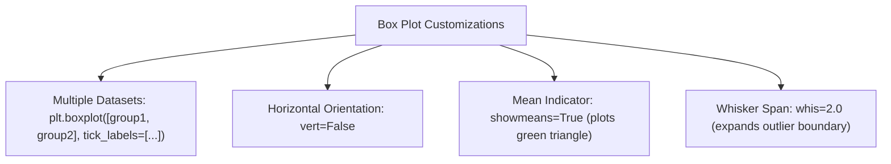

# Lecture 19.05: Operations on Box Plot

## 📌 Topic Overview
In this lecture, Shraddha ma'am covers **Advanced Operations on Box Plots**, showing how to compare multiple distributions side-by-side, orient plots horizontally (`vert=False`), display sample means alongside medians (`showmeans=True`), and configure whisker spans (`whis=2.0`).

---

## 🏛️ Comparative Box Plot Operations



---

## 📐 Mathematical Formulation: Whisker Sensitivity

Standard Tukey whiskers use multiplier $w = 1.5$:

$$
\text{Lower Whisker Limit} = Q_1 - w \cdot \text{IQR}
$$

$$
\text{Upper Whisker Limit} = Q_3 + w \cdot \text{IQR}
$$

Increasing `whis=2.0` broadens the acceptance fence, classifying fewer extreme points as outliers, which is common in highly volatile financial or physical sensor data.

---

## 💻 Python Implementation

```python
import matplotlib.pyplot as plt
import numpy as np

def plot_advanced_boxplots(show_plot=True):
    """
    Demonstrates advanced boxplot operations:
    1. Multiple group comparison on a single canvas.
    2. Horizontal boxplot orientation (vert=False).
    3. Displaying sample mean markers (showmeans=True).
    4. Adjusting whisker reach (whis parameter).
    
    Returns:
        dict: Mean and median values for compared groups.
    """
    np.random.seed(42)
    group1 = np.random.normal(50, 10, 100)
    group2 = np.random.normal(60, 15, 100)
    single_data = [7, 8, 5, 6, 9, 4, 10, 12, 15]
    
    fig, axes = plt.subplots(1, 2, figsize=(14, 5))
    
    # 1. Multiple Groups Comparison
    axes[0].boxplot(
        [group1, group2],
        tick_labels=["Group 1", "Group 2"],
        patch_artist=True,
        boxprops=dict(facecolor="lightyellow")
    )
    axes[0].set_title("Comparing Multiple Datasets (Group 1 vs Group 2)")
    axes[0].set_ylabel("Measured Values")
    axes[0].grid(True, linestyle=":", alpha=0.6)
    
    # 2. Horizontal Boxplot with Means and custom Whisker
    axes[1].boxplot(
        single_data,
        vert=False,
        showmeans=True,
        whis=2.0,
        patch_artist=True,
        boxprops=dict(facecolor="lightgreen")
    )
    axes[1].set_title("Horizontal Boxplot (vert=False, showmeans=True, whis=2.0)")
    axes[1].set_xlabel("Values")
    axes[1].grid(True, linestyle=":", alpha=0.6)
    
    plt.tight_layout()
    if show_plot:
        plt.show()
        
    return {
        "group1_mean": float(np.mean(group1)),
        "group2_mean": float(np.mean(group2)),
        "single_data_mean": float(np.mean(single_data))
    }

# --- Execution & Verification ---
stats = plot_advanced_boxplots(show_plot=False)
print(f"Group Statistics: {stats}")

```

---

## 🔑 Key Takeaways
1. Passing a list of arrays `[group1, group2]` plots them side-by-side with shared axes, enabling direct comparisons of medians and variances.
2. `vert=False` flips the orientation horizontally, which is easier to read when comparing many categories with long text labels.
3. `showmeans=True` renders a green triangle for the mean, instantly showing whether the mean diverges from the median due to skewness.
