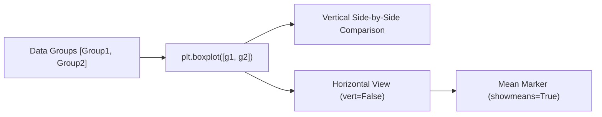

# Notes_19.05: Box Plot Ke Advanced Operations [Hinglish]

## 📌 Topic Overview
Is lecture mein Shraddha ma'am ne **Box Plot ke advanced operations** sikhaye hain: multiple datasets ko ek sath compare karna, horizontal boxplot banana (`vert=False`), mean marker show karna (`showmeans=True`), aur whiskers ko customize karna (`whis=2.0`).

---

### 📋 Is Topic Mein Hum Kya Seekhenge?
- Do ya do se zyada groups ko side-by-side boxplot mein kaise compare karein?
- Horizontal boxplot (`vert=False`) kab use karte hain?
- `showmeans=True` se mean (green triangle) kaise display hota hai?
- `whis` parameter se outlier sensitivity kaise control hoti hai?

---

### 🔍 Har Ek Point Ka Simple & Detailed Explanation

#### 1. Multiple Datasets Compare Karna:
Agar aapke paas do classes ya do groups ka data hai (jaise Group 1 vs Group 2), toh aap unhe list mein daalkar pass kar sakte hain:
`plt.boxplot([group1, group2], tick_labels=["Group 1", "Group 2"])`.
Isse dono groups ka median aur spread ek sath screen par compare ho jata hai.

#### 2. Horizontal Box Plot (`vert=False`):
By default box plot vertical banta hai. `vert=False` pass karne par plot horizontal ban jata hai. Yeh tab bohot helpful hota hai jab category ke names lambe hon.

#### 3. `showmeans=True`:
Default boxplot sirf **Median** dikhata hai. `showmeans=True` pass karne par ek green triangle mean ko bhi show karta hai. Agar mean aur median alag-alag jagah dikhein, iska matlab data skewed hai!

---

### 📊 Blackboard Diagram: Group Comparison & Orientation



---

### 💻 Python Code Implementation

```python
import matplotlib.pyplot as plt
import numpy as np

def plot_advanced_boxplots(show_plot=True):
    """
    Demonstrates advanced boxplot operations:
    1. Multiple group comparison on a single canvas.
    2. Horizontal boxplot orientation (vert=False).
    3. Displaying sample mean markers (showmeans=True).
    4. Adjusting whisker reach (whis parameter).
    
    Returns:
        dict: Mean and median values for compared groups.
    """
    np.random.seed(42)
    group1 = np.random.normal(50, 10, 100)
    group2 = np.random.normal(60, 15, 100)
    single_data = [7, 8, 5, 6, 9, 4, 10, 12, 15]
    
    fig, axes = plt.subplots(1, 2, figsize=(14, 5))
    
    # 1. Multiple Groups Comparison
    axes[0].boxplot(
        [group1, group2],
        tick_labels=["Group 1", "Group 2"],
        patch_artist=True,
        boxprops=dict(facecolor="lightyellow")
    )
    axes[0].set_title("Comparing Multiple Datasets (Group 1 vs Group 2)")
    axes[0].set_ylabel("Measured Values")
    axes[0].grid(True, linestyle=":", alpha=0.6)
    
    # 2. Horizontal Boxplot with Means and custom Whisker
    axes[1].boxplot(
        single_data,
        vert=False,
        showmeans=True,
        whis=2.0,
        patch_artist=True,
        boxprops=dict(facecolor="lightgreen")
    )
    axes[1].set_title("Horizontal Boxplot (vert=False, showmeans=True, whis=2.0)")
    axes[1].set_xlabel("Values")
    axes[1].grid(True, linestyle=":", alpha=0.6)
    
    plt.tight_layout()
    if show_plot:
        plt.show()
        
    return {
        "group1_mean": float(np.mean(group1)),
        "group2_mean": float(np.mean(group2)),
        "single_data_mean": float(np.mean(single_data))
    }

# --- Execution & Verification ---
stats = plot_advanced_boxplots(show_plot=False)
print(f"Group Statistics: {stats}")

```

---

### 🎯 Key Takeaways:
1. `vert=False` aur `showmeans=True` interview aur industry presentation ke do sabse popular options hain.
2. `whis=2.0` karke aap outlier detection ki sensitivity ko adjust kar sakte hain.
