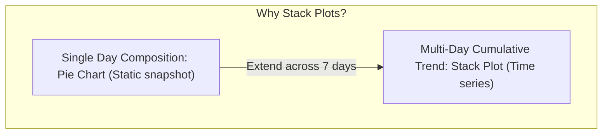

# Lecture 19.06: Stack Plots in Matplotlib

## 📌 Topic Overview
In this lecture, Shraddha ma'am introduces **Stack Plots (Area Charts)**, explaining how to visualize cumulative part-to-whole relationships across time or sequential stages using the website traffic example (Direct, Organic, and Social channels).

---

## 🏛️ Single Day Pie Chart vs Multi-Day Stack Plot



---

## 📐 Mathematical Formulation: Cumulative Accumulation

At each discrete time index $t_i$, the total metric $Y(t_i)$ is the sum of $K$ constituent components:

$$
Y(t_i) = \sum_{k=1}^K y_k(t_i)
$$

The upper boundary of the $m$-th stack layer corresponds to:

$$
S_m(t_i) = \sum_{k=1}^m y_k(t_i), \quad 1 \le m \le K
$$

The vertical height between $S_{m-1}(t_i)$ and $S_m(t_i)$ reflects the magnitude of source $m$.

---

## 💻 Python Implementation

```python
import matplotlib.pyplot as plt

def plot_traffic_stackplot(days=None, direct=None, organic=None, social=None, show_plot=True):
    """
    Plots a multi-series Stack Plot showing website traffic source composition
    over the days of a week.
    
    Parameters:
        days (list): Day names (Mon-Sun).
        direct (list): Daily direct visitors.
        organic (list): Daily organic search visitors.
        social (list): Daily social media visitors.
        show_plot (bool): Display control.
        
    Returns:
        dict: Total traffic per day and percentage composition.
    """
    if days is None:
        days = ["Mon", "Tue", "Wed", "Thu", "Fri", "Sat", "Sun"]
    if direct is None:
        direct = [50, 60, 70, 80, 90, 100, 110]
    if organic is None:
        organic = [30, 40, 50, 55, 60, 70, 80]
    if social is None:
        social = [20, 25, 30, 35, 40, 50, 60]
        
    plt.figure(figsize=(9, 5))
    
    plt.stackplot(
        days,
        direct,
        organic,
        social,
        labels=["Direct", "Organic", "Social"],
        colors=["#4c72b0", "#55a868", "#c44e52"],
        alpha=0.85
    )
    
    plt.title("Website Traffic Breakdown Over a Week (Stack Plot)")
    plt.xlabel("Days of Week")
    plt.ylabel("Number of Visitors")
    plt.legend(loc="upper left")
    plt.grid(True, linestyle=":", alpha=0.5)
    
    plt.tight_layout()
    if show_plot:
        plt.show()
        
    total_traffic = [d + o + s for d, o, s in zip(direct, organic, social)]
    return {"days": days, "total_traffic": total_traffic}

# --- Execution & Verification ---
res = plot_traffic_stackplot(show_plot=False)
for d, tot in zip(res["days"], res["total_traffic"]):
    print(f"{d}: Total Traffic = {tot}")

```

---

## 🔑 Key Takeaways
1. A Pie chart is only suitable for a single snapshot of data; Stack plots generalize this concept across time series.
2. The topmost line represents total aggregate traffic, while each colored slice shows component contribution.
3. Avoid stack plots when series fluctuate erratically, as intermediate layer baselines become warped.
