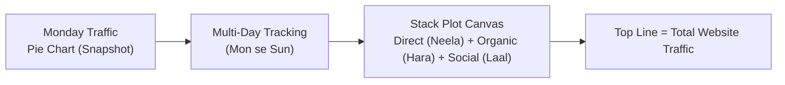

# Notes_19.06: Matplotlib Mein Stack Plots [Hinglish]

## 📌 Topic Overview
Is lecture mein Shraddha ma'am ne **Stack Plot** ka concept samjhaya hai: time ke sath badalte hue cumulative part-to-whole relationships ko kaise plot karte hain, jaise website traffic ke alag-alag sources (Direct, Organic, Social).

---

### 📋 Is Topic Mein Hum Kya Seekhenge?
- Stack Plot kya hota hai aur kab use karna chahiye?
- Single day pie chart vs multi-day stack plot ka comparison.
- `plt.stackplot()` syntax, `labels`, aur color styling.
- Total traffic aur individual channels ka trend ek sath dekhna.

---

### 🔍 Har Ek Point Ka Simple & Detailed Explanation

#### 1. Stack Plot Kya Hai?
Agar aapko sirf ek din ka traffic dekhna ho, toh aap **Pie Chart** bana sakte hain (jaise Monday ko 50% Direct, 30% Organic, 20% Social).
Lekin agar aapko poore hafte (Monday se Sunday) tak dekhna ho ki total traffic kaise badha aur har channel ka hissa kitna tha, toh Pie Chart fail ho jata hai. Wahan hum **Stack Plot** banate hain!

#### 2. Stack Plot Kaise Kaam Karta Hai?
Har source ki values ek ke upar ek stack (chadh) hoti jaati hain:
- Bottom layer: Direct traffic
- Middle layer: Direct + Organic
- Top layer: Direct + Organic + Social = Total Traffic

Formula:

$$
Y(t) = \sum_{k=1}^K y_k(t)
$$

---

### 📊 Blackboard Diagram: Pie Chart Se Stack Plot



---

### 💻 Python Code Implementation

```python
import matplotlib.pyplot as plt

def plot_traffic_stackplot(days=None, direct=None, organic=None, social=None, show_plot=True):
    """
    Plots a multi-series Stack Plot showing website traffic source composition
    over the days of a week.
    
    Parameters:
        days (list): Day names (Mon-Sun).
        direct (list): Daily direct visitors.
        organic (list): Daily organic search visitors.
        social (list): Daily social media visitors.
        show_plot (bool): Display control.
        
    Returns:
        dict: Total traffic per day and percentage composition.
    """
    if days is None:
        days = ["Mon", "Tue", "Wed", "Thu", "Fri", "Sat", "Sun"]
    if direct is None:
        direct = [50, 60, 70, 80, 90, 100, 110]
    if organic is None:
        organic = [30, 40, 50, 55, 60, 70, 80]
    if social is None:
        social = [20, 25, 30, 35, 40, 50, 60]
        
    plt.figure(figsize=(9, 5))
    
    plt.stackplot(
        days,
        direct,
        organic,
        social,
        labels=["Direct", "Organic", "Social"],
        colors=["#4c72b0", "#55a868", "#c44e52"],
        alpha=0.85
    )
    
    plt.title("Website Traffic Breakdown Over a Week (Stack Plot)")
    plt.xlabel("Days of Week")
    plt.ylabel("Number of Visitors")
    plt.legend(loc="upper left")
    plt.grid(True, linestyle=":", alpha=0.5)
    
    plt.tight_layout()
    if show_plot:
        plt.show()
        
    total_traffic = [d + o + s for d, o, s in zip(direct, organic, social)]
    return {"days": days, "total_traffic": total_traffic}

# --- Execution & Verification ---
res = plot_traffic_stackplot(show_plot=False)
for d, tot in zip(res["days"], res["total_traffic"]):
    print(f"{d}: Total Traffic = {tot}")

```

---

### 🎯 Key Takeaways:
1. `plt.stackplot(x, y1, y2, y3, labels=[...])` se time-series composition asaani se visualize hoti hai.
2. Top border poore system ka total volume represent karta hai.
