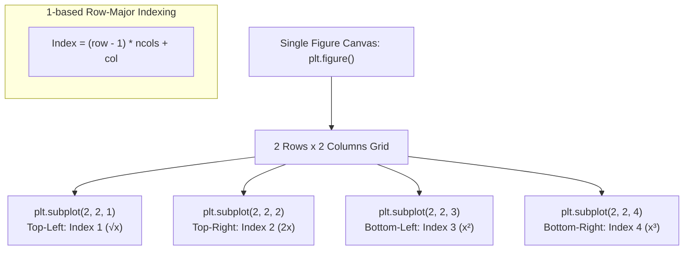

# Lecture 19.07: Subplots in Matplotlib

## 📌 Topic Overview
In this lecture, Shraddha ma'am covers the **state-based subplot interface** (`plt.subplot(nrows, ncols, index)`), demonstrating how to render multiple independent subplots within a single figure layout using mathematical transformations (Square Root, Double, Square, and Cube).

---

## 🏛️ Subplot Grid Indexing Schema



---

## 📐 Mathematical Formulation: Transformation Growth Rates

Comparing asymptotic polynomial growth rates on the same domain $x \in [1, 10]$:

$$
f_1(x) = x^{1/2} \ll f_2(x) = 2x \ll f_3(x) = x^2 \ll f_4(x) = x^3
$$

Because these functions have vastly different scales (from $\sqrt{10} \approx 3.16$ to $10^3 = 1000$), plotting them on a single shared y-axis compresses sub-linear curves into flat lines. Subplots isolate individual y-scales while preserving visual comparability.

---

## 💻 Python Implementation

```python
import matplotlib.pyplot as plt
import numpy as np

def plot_mathematical_subplots(show_plot=True):
    """
    Demonstrates state-based subplot creation using plt.subplot(nrows, ncols, index).
    Plots 4 mathematical transformations (sqrt, double, square, cube) on a 2x2 grid.
    
    Returns:
        dict: Values computed across transformations.
    """
    x = [1, 2, 3, 4, 5, 6, 7, 8, 9, 10]
    y1 = [np.sqrt(i) for i in x]
    y2 = [i * 2 for i in x]
    y3 = [i ** 2 for i in x]
    y4 = [i ** 3 for i in x]
    
    plt.figure(figsize=(10, 8))
    
    # 1st Subplot (Row 1, Col 1 -> Index 1)
    plt.subplot(2, 2, 1)
    plt.plot(x, y1, "b-o", linewidth=1.5)
    plt.title("Plot 1: Square Root (√x)")
    plt.grid(True, linestyle=":", alpha=0.6)
    
    # 2nd Subplot (Row 1, Col 2 -> Index 2)
    plt.subplot(2, 2, 2)
    plt.plot(x, y2, "g-s", linewidth=1.5)
    plt.title("Plot 2: Double (2x)")
    plt.grid(True, linestyle=":", alpha=0.6)
    
    # 3rd Subplot (Row 2, Col 1 -> Index 3)
    plt.subplot(2, 2, 3)
    plt.plot(x, y3, "r-^", linewidth=1.5)
    plt.title("Plot 3: Squares (x²)")
    plt.grid(True, linestyle=":", alpha=0.6)
    
    # 4th Subplot (Row 2, Col 2 -> Index 4)
    plt.subplot(2, 2, 4)
    plt.plot(x, y4, "m-d", linewidth=1.5)
    plt.title("Plot 4: Cubes (x³)")
    plt.grid(True, linestyle=":", alpha=0.6)
    
    plt.tight_layout()
    if show_plot:
        plt.show()
        
    return {"x": x, "y1": y1, "y2": y2, "y3": y3, "y4": y4}

# --- Execution & Verification ---
data_dict = plot_mathematical_subplots(show_plot=False)
print(f"X points: {data_dict['x']}")
print(f"Squares: {data_dict['y3']}")

```

---

## 🔑 Key Takeaways
1. `plt.subplot(nrows, ncols, index)` uses 1-based indexing in row-major order.
2. Always call `plt.tight_layout()` to prevent titles and axis labels from colliding with adjacent plots.
3. Subplots allow multiple distinct metrics to be viewed side-by-side without mutual scale suppression.
