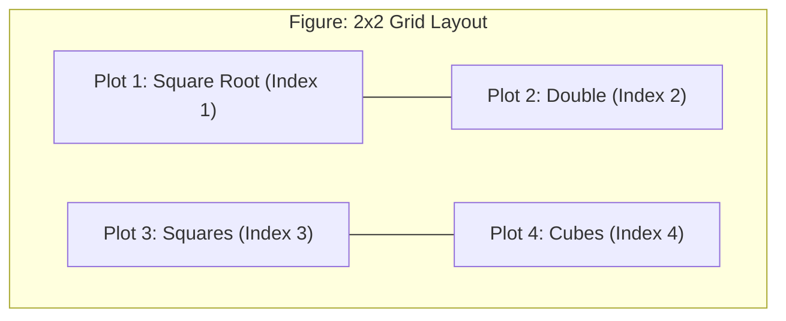

# Notes_19.07: Matplotlib Mein Subplots [Hinglish]

## 📌 Topic Overview
Is lecture mein Shraddha ma'am ne **Subplots** banana sikhaya hai: `plt.subplot(nrows, ncols, index)` function ka use karke ek hi screen par 4 alag-alag graphs (Square root, Double, Square, aur Cube) ka 2x2 grid kaise banaya jata hai.

---

### 📋 Is Topic Mein Hum Kya Seekhenge?
- Subplot kya hota hai aur ek se zyada plots ki zaroorat kyu padti hai?
- `plt.subplot(2, 2, 1)` ka indexing rule (Row-major, 1-based index).
- Alag-alag scale waali functions ko individual y-axis par plot karna.
- `plt.tight_layout()` function kyu mandatory hota hai.

---

### 🔍 Har Ek Point Ka Simple & Detailed Explanation

#### 1. Subplots Ki Zaroorat Kyu Hai?
Maan lijiye aapke paas 4 functions hain:
1. $y_1 = \sqrt{x}$ (Max value $\approx 3.16$)
2. $y_2 = 2x$ (Max value $= 20$)
3. $y_3 = x^2$ (Max value $= 100$)
4. $y_4 = x^3$ (Max value $= 1000$)

Agar aap in charo ko ek hi graph par plot karenge, toh $1000$ ke scale ke samne $\sqrt{x}$ ekdum flat zameen par chipak jayega aur kuch dikhega nahi.
Isliye hum ek canvas ko 4 hisson (2 rows, 2 columns) mein baant dete hain!

#### 2. Indexing Kaise Kaam Karti Hai?
- `plt.subplot(2, 2, 1)`: Row 1, Column 1 (Top-Left)
- `plt.subplot(2, 2, 2)`: Row 1, Column 2 (Top-Right)
- `plt.subplot(2, 2, 3)`: Row 2, Column 1 (Bottom-Left)
- `plt.subplot(2, 2, 4)`: Row 2, Column 2 (Bottom-Right)

---

### 📊 Blackboard Diagram: 2x2 Subplot Grid



---

### 💻 Python Code Implementation

```python
import matplotlib.pyplot as plt
import numpy as np

def plot_mathematical_subplots(show_plot=True):
    """
    Demonstrates state-based subplot creation using plt.subplot(nrows, ncols, index).
    Plots 4 mathematical transformations (sqrt, double, square, cube) on a 2x2 grid.
    
    Returns:
        dict: Values computed across transformations.
    """
    x = [1, 2, 3, 4, 5, 6, 7, 8, 9, 10]
    y1 = [np.sqrt(i) for i in x]
    y2 = [i * 2 for i in x]
    y3 = [i ** 2 for i in x]
    y4 = [i ** 3 for i in x]
    
    plt.figure(figsize=(10, 8))
    
    # 1st Subplot (Row 1, Col 1 -> Index 1)
    plt.subplot(2, 2, 1)
    plt.plot(x, y1, "b-o", linewidth=1.5)
    plt.title("Plot 1: Square Root (√x)")
    plt.grid(True, linestyle=":", alpha=0.6)
    
    # 2nd Subplot (Row 1, Col 2 -> Index 2)
    plt.subplot(2, 2, 2)
    plt.plot(x, y2, "g-s", linewidth=1.5)
    plt.title("Plot 2: Double (2x)")
    plt.grid(True, linestyle=":", alpha=0.6)
    
    # 3rd Subplot (Row 2, Col 1 -> Index 3)
    plt.subplot(2, 2, 3)
    plt.plot(x, y3, "r-^", linewidth=1.5)
    plt.title("Plot 3: Squares (x²)")
    plt.grid(True, linestyle=":", alpha=0.6)
    
    # 4th Subplot (Row 2, Col 2 -> Index 4)
    plt.subplot(2, 2, 4)
    plt.plot(x, y4, "m-d", linewidth=1.5)
    plt.title("Plot 4: Cubes (x³)")
    plt.grid(True, linestyle=":", alpha=0.6)
    
    plt.tight_layout()
    if show_plot:
        plt.show()
        
    return {"x": x, "y1": y1, "y2": y2, "y3": y3, "y4": y4}

# --- Execution & Verification ---
data_dict = plot_mathematical_subplots(show_plot=False)
print(f"X points: {data_dict['x']}")
print(f"Squares: {data_dict['y3']}")

```

---

### 🎯 Key Takeaways:
1. Indexing hamesha 1 se shuru hoti hai (0 se nahi).
2. `plt.tight_layout()` call karna bohot zaroori hai, warna titles ek doosre ke upar chadh jaate hain.
